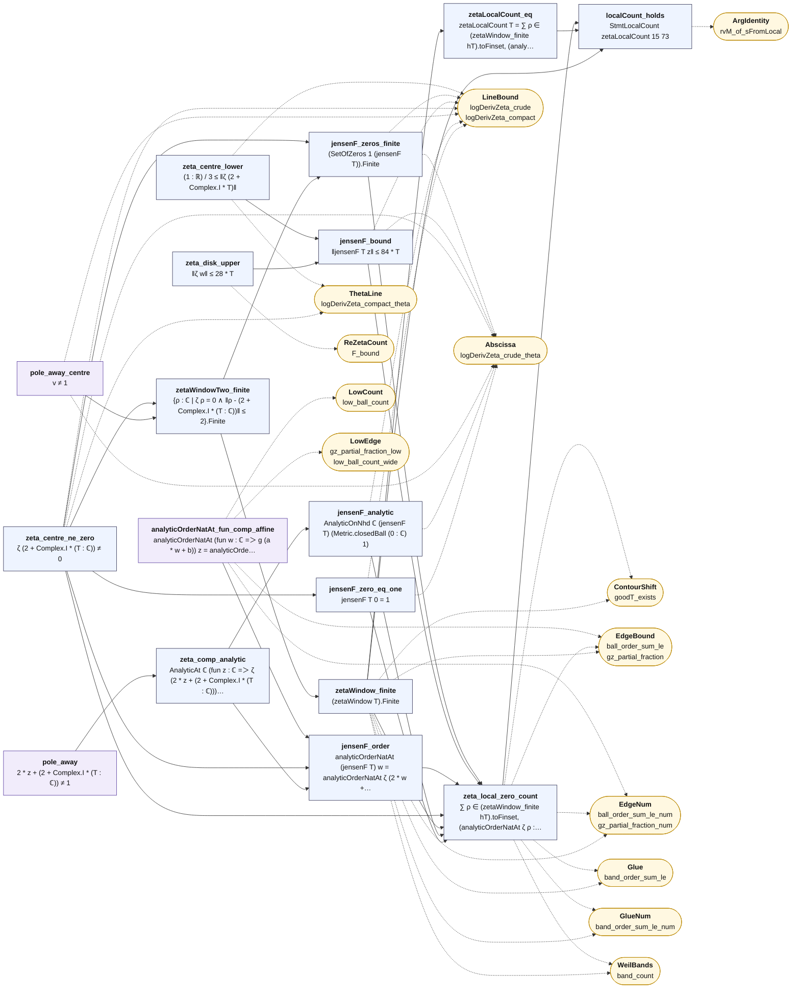

# `lean_stage3/Stage3/JensenCount.lean`

JensenCount — `StmtLocalCount` discharged: the Backlund-style local zero count for `ζ`, with explicit constants.

17 theorems, 3 definitions, 552 lines. Arrows are Lean's own record of what each proof uses.

**Imports:** [`ArgCrude`](../lean_stage3/ArgCrude.md)  
**Imported by:** [`Stage3`](../lean_stage3/Stage3.md), [`ArgIdentity`](../lean_stage3/ArgIdentity.md), [`ContourShift`](../lean_stage3/ContourShift.md), [`LineBound`](../lean_stage3/LineBound.md), [`ReZetaCount`](../lean_stage3/ReZetaCount.md), [`WeilBands`](../lean_stage3/WeilBands.md), [`WeilPowerAssembly`](../lean_stage3/WeilPowerAssembly.md)

## The picture



An arrow A → B reads "A is used in the proof of B". Green: counting, integers only. Violet: shape, analysis with no ζ. Blue: reads ζ. A name ending in ■ is an end: nothing else uses it. Red: contains `sorry`. Yellow: theorems in another file, counted; a dotted arrow crosses files. Definitions are not drawn; they are listed below the diagram.

## Definitions

<a name="Stage3-zetaWindow"></a>
### `Stage3.zetaWindow`

def · line 260

The window. `ζ`'s zeros in the closed disk of radius `7/4` about `2 + iT`. On the critical line this disk covers `|γ - T| ≤ √(13/16)` ≈ `0.901`, an interval of positive length — which is what radius `3/2` fails to do, being tangent to the line and so catching only `γ = T`.

- **Is:** `` zetaWindow (T : ℝ) : Set ℂ := {ρ : ℂ | ζ ρ = 0 ∧ ‖ρ - (2 + Complex.I * (T : ℂ))‖ ≤ 7 / 4} ``
- **Used by 13:** [`ContourShift.goodT_exists`](../lean_stage3/ContourShift.md#ContourShift-goodT_exists), [`ContourShift.mem_zetaWindow`](../lean_stage3/ContourShift.md#ContourShift-mem_zetaWindow), [`EdgeBound.ball_order_sum_le`](../lean_stage3/EdgeBound.md#EdgeBound-ball_order_sum_le), [`EdgeBound.ball_order_sum_le_num`](../lean_stage3/EdgeNum.md#EdgeBound-ball_order_sum_le_num), [`Glue.band_order_sum_le`](../lean_stage3/Glue.md#Glue-band_order_sum_le), [`Glue.band_order_sum_le_num`](../lean_stage3/GlueNum.md#Glue-band_order_sum_le_num), [`Stage3.localCount_holds`](#Stage3-localCount_holds), [`Stage3.zetaLocalCount`](#Stage3-zetaLocalCount), [`Stage3.zetaLocalCount_eq`](#Stage3-zetaLocalCount_eq), [`Stage3.zetaWindow_finite`](#Stage3-zetaWindow_finite), [`Stage3.zeta_local_zero_count`](#Stage3-zeta_local_zero_count), [`WeilBands.band_count`](../lean_stage3/WeilBands.md#WeilBands-band_count), [`WeilBands.mem_zetaWindow_of_online`](../lean_stage3/WeilBands.md#WeilBands-mem_zetaWindow_of_online)

<a name="Stage3-jensenF"></a>
### `Stage3.jensenF`

def · line 271

The normalised local model. `f z = ζ (2z + 2 + iT) / ζ (2 + iT)`; the closed unit ball maps onto `|s - (2+iT)| ≤ 2`.

- **Is:** `` jensenF (T : ℝ) : ℂ → ℂ := fun z => ζ (2 * z + (2 + Complex.I * (T : ℂ))) / ζ (2 + Complex.I * (T : ℂ)) ``
- **Used by 8:** [`Stage3.logDerivZeta_crude_theta`](../lean_stage3/Abscissa.md#Stage3-logDerivZeta_crude_theta), [`Stage3.jensenF_analytic`](#Stage3-jensenF_analytic), [`Stage3.jensenF_bound`](#Stage3-jensenF_bound), [`Stage3.jensenF_order`](#Stage3-jensenF_order), [`Stage3.jensenF_zero_eq_one`](#Stage3-jensenF_zero_eq_one), [`Stage3.jensenF_zeros_finite`](#Stage3-jensenF_zeros_finite), [`Stage3.zeta_local_zero_count`](#Stage3-zeta_local_zero_count), [`Slice3.logDerivZeta_crude`](../lean_stage3/LineBound.md#Slice3-logDerivZeta_crude)

<a name="Stage3-zetaLocalCount"></a>
### `Stage3.zetaLocalCount`

def · line 453

The count function. Total zero order of `ζ` in `|s - (2+iT)| ≤ 7/4`.

- **Is:** `` zetaLocalCount (T : ℝ) : ℝ := if h : (zetaWindow T).Finite then ∑ ρ ∈ h.toFinset, (analyticOrderNatAt ζ ρ : ℝ) else 0 ``
- **Built from:** [`Stage3.zetaWindow`](#Stage3-zetaWindow)
- **Used by 4:** [`Stage3.backlundArg_of_sFromLocal`](../lean_stage3/ArgIdentity.md#Stage3-backlundArg_of_sFromLocal), [`Stage3.rvM_of_sFromLocal`](../lean_stage3/ArgIdentity.md#Stage3-rvM_of_sFromLocal), [`Stage3.localCount_holds`](#Stage3-localCount_holds), [`Stage3.zetaLocalCount_eq`](#Stage3-zetaLocalCount_eq)

## Theorems

<a name="Stage3-zeta_centre_lower"></a>
### `Stage3.zeta_centre_lower`

line 76

**Reads ζ.** It, or something it rests on, uses the zeta function, its zeros or the Riemann hypothesis.

**Why.** For every real `T`, the norm of `ζ` at the centre `2 + iT` is at least `1/3`.

**Proves**

```lean
(1 : ℝ) / 3 ≤ ‖ζ (2 + Complex.I * T)‖
```

**Needs** (its hypotheses)

  - `` T : ℝ ``

**Fed by:** no theorem of this repo; it stands on Mathlib.

**Feeds** (3 that use it)

  - [`Stage3.jensenF_bound`](#Stage3-jensenF_bound) — `` ‖jensenF T z‖ ≤ 84 * T ``
  - [`Slice4.logDerivZeta_compact`](../lean_stage3/LineBound.md#Slice4-logDerivZeta_compact) (LineBound) — `` ‖deriv ζ ((σ₁ : ℂ) + I * (t : ℂ)) / ζ ((σ₁ : ℂ) + I * (t : ℂ))‖ ≤ 14535 + 212 / (σ₁ - 1/2) ``
  - [`Stage3.logDerivZeta_compact_theta`](../lean_stage3/ThetaLine.md#Stage3-logDerivZeta_compact_theta) (ThetaLine) — `` ‖deriv ζ ((σ₁ : ℂ) + I * (t : ℂ)) / ζ ((σ₁ : ℂ) + I * (t : ℂ))‖ ≤ 14530 + 2 / (1 - θ) + 212 / (σ₁ - θ) ``

<a name="Stage3-zeta_disk_upper"></a>
### `Stage3.zeta_disk_upper`

line 124

**Reads ζ.** It, or something it rests on, uses the zeta function, its zeros or the Riemann hypothesis.

**Why.** The majorant on the wide disk. `‖ζ w‖ ≤ 28 T` for `T ≥ 2` and `‖w - (2 + iT)‖ ≤ 15/8`; this is the `R = 15/16` radius of the Jensen step pulled back through `s = 2z + (2 + iT)`. On that disk `Re w ≥ 1/8 > 0` and `Im w ≥ T - 15/8 ≥ 1/8`, so the pole at `s = 1` is avoided with room.

**Proves**

```lean
‖ζ w‖ ≤ 28 * T
```

**Needs** (its hypotheses)

  - `` hT : 2 ≤ T ``
  - `` hw : ‖w - (2 + Complex.I * (T : ℂ))‖ ≤ 15 / 8 ``

**Fed by:** no theorem of this repo; it stands on Mathlib.

**Feeds** (2 that use it)

  - [`Stage3.jensenF_bound`](#Stage3-jensenF_bound) — `` ‖jensenF T z‖ ≤ 84 * T ``
  - [`ReZetaCount.F_bound`](../lean_stage3/ReZetaCount.md#ReZetaCount-F_bound) (ReZetaCount) — `` ‖F T z‖ ≤ 80 * T ``

<a name="Stage3-zeta_centre_ne_zero"></a>
### `Stage3.zeta_centre_ne_zero`

line 198

**Reads ζ.** It, or something it rests on, uses the zeta function, its zeros or the Riemann hypothesis.

**Why.** The centre `2 + iT` has real part `2`, hence `ζ` does not vanish there.

**Proves**

```lean
ζ (2 + Complex.I * (T : ℂ)) ≠ 0
```

**Needs** (its hypotheses)

  - `` T : ℝ ``

**Fed by:** no theorem of this repo; it stands on Mathlib.

**Feeds** (9 that use it)

  - [`Stage3.logDerivZeta_crude_theta`](../lean_stage3/Abscissa.md#Stage3-logDerivZeta_crude_theta) (Abscissa) — `` ‖deriv ζ ((σ₁ : ℂ) + I * (t : ℂ)) / ζ ((σ₁ : ℂ) + I * (t : ℂ))‖ ≤ 1996 * Real.log (84 * t) + (29 * Real.log t + 129) / (σ₁ - θ) ``
  - [`Stage3.jensenF_order`](#Stage3-jensenF_order) — `` analyticOrderNatAt (jensenF T) w = analyticOrderNatAt ζ (2 * w + (2 + Complex.I * (T : ℂ))) ``
  - [`Stage3.jensenF_zero_eq_one`](#Stage3-jensenF_zero_eq_one) — `` jensenF T 0 = 1 ``
  - [`Stage3.jensenF_zeros_finite`](#Stage3-jensenF_zeros_finite) — `` (SetOfZeros 1 (jensenF T)).Finite ``
  - [`Stage3.zetaWindowTwo_finite`](#Stage3-zetaWindowTwo_finite) — `` {ρ : ℂ | ζ ρ = 0 ∧ ‖ρ - (2 + Complex.I * (T : ℂ))‖ ≤ 2}.Finite ``
  - [`Stage3.zeta_local_zero_count`](#Stage3-zeta_local_zero_count) — `` ∑ ρ ∈ (zetaWindow_finite hT).toFinset, (analyticOrderNatAt ζ ρ : ℝ) ≤ 15 * Real.log T + 73 ``
  - [`Slice3.logDerivZeta_crude`](../lean_stage3/LineBound.md#Slice3-logDerivZeta_crude) (LineBound) — `` ‖deriv ζ ((σ₁ : ℂ) + I * (t : ℂ)) / ζ ((σ₁ : ℂ) + I * (t : ℂ))‖ ≤ 1996 * Real.log (84 * t) + (29 * Real.log t + 129) / (σ₁ - 1/2) ``
  - [`Slice4.logDerivZeta_compact`](../lean_stage3/LineBound.md#Slice4-logDerivZeta_compact) (LineBound) — `` ‖deriv ζ ((σ₁ : ℂ) + I * (t : ℂ)) / ζ ((σ₁ : ℂ) + I * (t : ℂ))‖ ≤ 14535 + 212 / (σ₁ - 1/2) ``
  - [`Stage3.logDerivZeta_compact_theta`](../lean_stage3/ThetaLine.md#Stage3-logDerivZeta_compact_theta) (ThetaLine) — `` ‖deriv ζ ((σ₁ : ℂ) + I * (t : ℂ)) / ζ ((σ₁ : ℂ) + I * (t : ℂ))‖ ≤ 14530 + 2 / (1 - θ) + 212 / (σ₁ - θ) ``

<a name="Stage3-pole_away"></a>
### `Stage3.pole_away`

line 206

**Shape.** Uses real or complex analysis; nothing in it or beneath it reads ζ.

**Why.** The pole stays outside the mapped ball. For `T ≥ 2` and `‖z‖ ≤ 11/10`, the point `2z + (2 + iT)` is never the pole `s = 1`.

**Proves**

```lean
2 * z + (2 + Complex.I * (T : ℂ)) ≠ 1
```

**Needs** (its hypotheses)

  - `` hT : 2 ≤ T ``
  - `` hz : ‖z‖ ≤ 11 / 10 ``

**Fed by:** no theorem of this repo; it stands on Mathlib.

**Feeds** (1 that use it)

  - [`Stage3.zeta_comp_analytic`](#Stage3-zeta_comp_analytic) — `` AnalyticAt ℂ (fun z : ℂ => ζ (2 * z + (2 + Complex.I * (T : ℂ)))) w ``

<a name="Stage3-pole_away_centre"></a>
### `Stage3.pole_away_centre`

line 219

**Shape.** Uses real or complex analysis; nothing in it or beneath it reads ζ.

**Why.** The pole stays outside the window. For `T ≥ 2`, every point within `11/5` of `2 + iT` differs from `1`.

**Proves**

```lean
v ≠ 1
```

**Needs** (its hypotheses)

  - `` hT : 2 ≤ T ``
  - `` hv : ‖v - (2 + Complex.I * (T : ℂ))‖ < 11 / 5 ``

**Fed by:** no theorem of this repo; it stands on Mathlib.

**Feeds** (3 that use it)

  - [`Stage3.logDerivZeta_crude_theta`](../lean_stage3/Abscissa.md#Stage3-logDerivZeta_crude_theta) (Abscissa) — `` ‖deriv ζ ((σ₁ : ℂ) + I * (t : ℂ)) / ζ ((σ₁ : ℂ) + I * (t : ℂ))‖ ≤ 1996 * Real.log (84 * t) + (29 * Real.log t + 129) / (σ₁ - θ) ``
  - [`Stage3.zetaWindowTwo_finite`](#Stage3-zetaWindowTwo_finite) — `` {ρ : ℂ | ζ ρ = 0 ∧ ‖ρ - (2 + Complex.I * (T : ℂ))‖ ≤ 2}.Finite ``
  - [`Slice3.logDerivZeta_crude`](../lean_stage3/LineBound.md#Slice3-logDerivZeta_crude) (LineBound) — `` ‖deriv ζ ((σ₁ : ℂ) + I * (t : ℂ)) / ζ ((σ₁ : ℂ) + I * (t : ℂ))‖ ≤ 1996 * Real.log (84 * t) + (29 * Real.log t + 129) / (σ₁ - 1/2) ``

<a name="Stage3-zetaWindowTwo_finite"></a>
### `Stage3.zetaWindowTwo_finite`

line 233

**Reads ζ.** It, or something it rests on, uses the zeta function, its zeros or the Riemann hypothesis.

**Why.** `ζ` has finitely many zeros within `2` of the centre.

**Proves**

```lean
{ρ : ℂ | ζ ρ = 0 ∧ ‖ρ - (2 + Complex.I * (T : ℂ))‖ ≤ 2}.Finite
```

**Needs** (its hypotheses)

  - `` hT : 2 ≤ T ``

**Fed by** (2 theorems its proof uses)

  - [`Stage3.pole_away_centre`](#Stage3-pole_away_centre) — `` v ≠ 1 ``
  - [`Stage3.zeta_centre_ne_zero`](#Stage3-zeta_centre_ne_zero) — `` ζ (2 + Complex.I * (T : ℂ)) ≠ 0 ``

**Feeds** (2 that use it)

  - [`Stage3.jensenF_zeros_finite`](#Stage3-jensenF_zeros_finite) — `` (SetOfZeros 1 (jensenF T)).Finite ``
  - [`Stage3.zetaWindow_finite`](#Stage3-zetaWindow_finite) — `` (zetaWindow T).Finite ``

<a name="Stage3-zetaWindow_finite"></a>
### `Stage3.zetaWindow_finite`

line 264

**Reads ζ.** It, or something it rests on, uses the zeta function, its zeros or the Riemann hypothesis.

**Why.** For `T ≥ 2`, the window of zeros of `ζ` within `7/4` of `2 + iT` is finite.

**Proves**

```lean
(zetaWindow T).Finite
```

**Needs** (its hypotheses)

  - `` hT : 2 ≤ T ``

**Stated with:** [`Stage3.zetaWindow`](#Stage3-zetaWindow)

**Fed by** (1 theorem its proof uses)

  - [`Stage3.zetaWindowTwo_finite`](#Stage3-zetaWindowTwo_finite) — `` {ρ : ℂ | ζ ρ = 0 ∧ ‖ρ - (2 + Complex.I * (T : ℂ))‖ ≤ 2}.Finite ``

**Feeds** (9 that use it)

  - [`ContourShift.goodT_exists`](../lean_stage3/ContourShift.md#ContourShift-goodT_exists) (ContourShift) — `` ∃ T' ∈ Set.Icc T (T+1), ∀ ρ : ℂ, riemannZeta ρ = 0 → 0 < ρ.re → zeroGap T ≤ |ρ.im - T'| ``
  - [`EdgeBound.ball_order_sum_le`](../lean_stage3/EdgeBound.md#EdgeBound-ball_order_sum_le) (EdgeBound) — `` ∃ C : ℝ, 0 < C ∧ ∀ T' : ℝ, 2 ≤ T' → (∑ w ∈ (gz_zeros_ball_finite T' (by norm_num : (0:ℝ) ≤ 46/25)).toFinset, (analyticOrderNatAt gz w : ℝ)) ≤ C * Real… ``
  - [`EdgeBound.ball_order_sum_le_num`](../lean_stage3/EdgeNum.md#EdgeBound-ball_order_sum_le_num) (EdgeNum) — `` ∀ T' : ℝ, 2 ≤ T' → (∑ w ∈ (gz_zeros_ball_finite T' (by norm_num : (0:ℝ) ≤ 46/25)).toFinset, (analyticOrderNatAt gz w : ℝ)) ≤ C2n * Real.log T' ``
  - [`Glue.band_order_sum_le`](../lean_stage3/Glue.md#Glue-band_order_sum_le) (Glue) — `` ∃ C : ℝ, 0 < C ∧ ∀ T : ℝ, 2 ≤ T → ∀ F : Finset ℂ, (∀ ρ ∈ F, riemannZeta ρ = 0 ∧ (0 < ρ.re ∧ ρ.re < 1) ∧ T ≤ |ρ.im| ∧ |ρ.im| ≤ T + 1) → (∑ ρ ∈ F, (anal… ``
  - [`Glue.band_order_sum_le_num`](../lean_stage3/GlueNum.md#Glue-band_order_sum_le_num) (GlueNum) — `` ∀ T : ℝ, 2 ≤ T → ∀ F : Finset ℂ, (∀ ρ ∈ F, riemannZeta ρ = 0 ∧ (0 < ρ.re ∧ ρ.re < 1) ∧ T ≤ |ρ.im| ∧ |ρ.im| ≤ T + 1) → (∑ ρ ∈ F, (analyticOrderNatAt ri… ``
  - [`Stage3.localCount_holds`](#Stage3-localCount_holds) — `` StmtLocalCount zetaLocalCount 15 73 ``
  - [`Stage3.zetaLocalCount_eq`](#Stage3-zetaLocalCount_eq) — `` zetaLocalCount T = ∑ ρ ∈ (zetaWindow_finite hT).toFinset, (analyticOrderNatAt ζ ρ : ℝ) ``
  - [`Stage3.zeta_local_zero_count`](#Stage3-zeta_local_zero_count) — `` ∑ ρ ∈ (zetaWindow_finite hT).toFinset, (analyticOrderNatAt ζ ρ : ℝ) ≤ 15 * Real.log T + 73 ``
  - [`WeilBands.band_count`](../lean_stage3/WeilBands.md#WeilBands-band_count) (WeilBands) — `` ∑ ρ ∈ S, (analyticOrderNatAt riemannZeta ρ : ℝ) ≤ 15 * Real.log T + 73 ``

<a name="Stage3-zeta_comp_analytic"></a>
### `Stage3.zeta_comp_analytic`

line 275

**Reads ζ.** It, or something it rests on, uses the zeta function, its zeros or the Riemann hypothesis.

**Why.** For `T ≥ 2` and `‖w‖ ≤ 11/10`, the map `z ↦ ζ (2z + (2 + iT))` is analytic at `w`.

**Proves**

```lean
AnalyticAt ℂ (fun z : ℂ => ζ (2 * z + (2 + Complex.I * (T : ℂ)))) w
```

**Needs** (its hypotheses)

  - `` hT : 2 ≤ T ``
  - `` hw : ‖w‖ ≤ 11 / 10 ``

**Fed by** (1 theorem its proof uses)

  - [`Stage3.pole_away`](#Stage3-pole_away) — `` 2 * z + (2 + Complex.I * (T : ℂ)) ≠ 1 ``

**Feeds** (2 that use it)

  - [`Stage3.jensenF_analytic`](#Stage3-jensenF_analytic) — `` AnalyticOnNhd ℂ (jensenF T) (Metric.closedBall (0 : ℂ) 1) ``
  - [`Stage3.jensenF_order`](#Stage3-jensenF_order) — `` analyticOrderNatAt (jensenF T) w = analyticOrderNatAt ζ (2 * w + (2 + Complex.I * (T : ℂ))) ``

<a name="Stage3-jensenF_analytic"></a>
### `Stage3.jensenF_analytic`

line 282

**Reads ζ.** It, or something it rests on, uses the zeta function, its zeros or the Riemann hypothesis.

**Why.** For `T ≥ 2`, the normalised local model `jensenF T` is analytic on a neighbourhood of the closed unit ball.

**Proves**

```lean
AnalyticOnNhd ℂ (jensenF T) (Metric.closedBall (0 : ℂ) 1)
```

**Needs** (its hypotheses)

  - `` hT : 2 ≤ T ``

**Stated with:** [`Stage3.jensenF`](#Stage3-jensenF)

**Fed by** (1 theorem its proof uses)

  - [`Stage3.zeta_comp_analytic`](#Stage3-zeta_comp_analytic) — `` AnalyticAt ℂ (fun z : ℂ => ζ (2 * z + (2 + Complex.I * (T : ℂ)))) w ``

**Feeds** (3 that use it)

  - [`Stage3.logDerivZeta_crude_theta`](../lean_stage3/Abscissa.md#Stage3-logDerivZeta_crude_theta) (Abscissa) — `` ‖deriv ζ ((σ₁ : ℂ) + I * (t : ℂ)) / ζ ((σ₁ : ℂ) + I * (t : ℂ))‖ ≤ 1996 * Real.log (84 * t) + (29 * Real.log t + 129) / (σ₁ - θ) ``
  - [`Stage3.zeta_local_zero_count`](#Stage3-zeta_local_zero_count) — `` ∑ ρ ∈ (zetaWindow_finite hT).toFinset, (analyticOrderNatAt ζ ρ : ℝ) ≤ 15 * Real.log T + 73 ``
  - [`Slice3.logDerivZeta_crude`](../lean_stage3/LineBound.md#Slice3-logDerivZeta_crude) (LineBound) — `` ‖deriv ζ ((σ₁ : ℂ) + I * (t : ℂ)) / ζ ((σ₁ : ℂ) + I * (t : ℂ))‖ ≤ 1996 * Real.log (84 * t) + (29 * Real.log t + 129) / (σ₁ - 1/2) ``

<a name="Stage3-jensenF_zero_eq_one"></a>
### `Stage3.jensenF_zero_eq_one`

line 290

**Reads ζ.** It, or something it rests on, uses the zeta function, its zeros or the Riemann hypothesis.

**Why.** The normalised local model takes the value `1` at the origin: `jensenF T 0 = 1`.

**Proves**

```lean
jensenF T 0 = 1
```

**Needs** (its hypotheses)

  - `` T : ℝ ``

**Stated with:** [`Stage3.jensenF`](#Stage3-jensenF)

**Fed by** (1 theorem its proof uses)

  - [`Stage3.zeta_centre_ne_zero`](#Stage3-zeta_centre_ne_zero) — `` ζ (2 + Complex.I * (T : ℂ)) ≠ 0 ``

**Feeds** (3 that use it)

  - [`Stage3.logDerivZeta_crude_theta`](../lean_stage3/Abscissa.md#Stage3-logDerivZeta_crude_theta) (Abscissa) — `` ‖deriv ζ ((σ₁ : ℂ) + I * (t : ℂ)) / ζ ((σ₁ : ℂ) + I * (t : ℂ))‖ ≤ 1996 * Real.log (84 * t) + (29 * Real.log t + 129) / (σ₁ - θ) ``
  - [`Stage3.zeta_local_zero_count`](#Stage3-zeta_local_zero_count) — `` ∑ ρ ∈ (zetaWindow_finite hT).toFinset, (analyticOrderNatAt ζ ρ : ℝ) ≤ 15 * Real.log T + 73 ``
  - [`Slice3.logDerivZeta_crude`](../lean_stage3/LineBound.md#Slice3-logDerivZeta_crude) (LineBound) — `` ‖deriv ζ ((σ₁ : ℂ) + I * (t : ℂ)) / ζ ((σ₁ : ℂ) + I * (t : ℂ))‖ ≤ 1996 * Real.log (84 * t) + (29 * Real.log t + 129) / (σ₁ - 1/2) ``

<a name="Stage3-jensenF_zeros_finite"></a>
### `Stage3.jensenF_zeros_finite`

line 296

**Reads ζ.** It, or something it rests on, uses the zeta function, its zeros or the Riemann hypothesis.

**Why.** For `T ≥ 2`, the zero set `SetOfZeros 1 (jensenF T)` of the normalised local model at radius `1` is finite.

**Proves**

```lean
(SetOfZeros 1 (jensenF T)).Finite
```

**Needs** (its hypotheses)

  - `` hT : 2 ≤ T ``

**Stated with:** [`Stage3.jensenF`](#Stage3-jensenF)

**Fed by** (2 theorems its proof uses)

  - [`Stage3.zetaWindowTwo_finite`](#Stage3-zetaWindowTwo_finite) — `` {ρ : ℂ | ζ ρ = 0 ∧ ‖ρ - (2 + Complex.I * (T : ℂ))‖ ≤ 2}.Finite ``
  - [`Stage3.zeta_centre_ne_zero`](#Stage3-zeta_centre_ne_zero) — `` ζ (2 + Complex.I * (T : ℂ)) ≠ 0 ``

**Feeds** (3 that use it)

  - [`Stage3.logDerivZeta_crude_theta`](../lean_stage3/Abscissa.md#Stage3-logDerivZeta_crude_theta) (Abscissa) — `` ‖deriv ζ ((σ₁ : ℂ) + I * (t : ℂ)) / ζ ((σ₁ : ℂ) + I * (t : ℂ))‖ ≤ 1996 * Real.log (84 * t) + (29 * Real.log t + 129) / (σ₁ - θ) ``
  - [`Stage3.zeta_local_zero_count`](#Stage3-zeta_local_zero_count) — `` ∑ ρ ∈ (zetaWindow_finite hT).toFinset, (analyticOrderNatAt ζ ρ : ℝ) ≤ 15 * Real.log T + 73 ``
  - [`Slice3.logDerivZeta_crude`](../lean_stage3/LineBound.md#Slice3-logDerivZeta_crude) (LineBound) — `` ‖deriv ζ ((σ₁ : ℂ) + I * (t : ℂ)) / ζ ((σ₁ : ℂ) + I * (t : ℂ))‖ ≤ 1996 * Real.log (84 * t) + (29 * Real.log t + 129) / (σ₁ - 1/2) ``

<a name="Stage3-jensenF_bound"></a>
### `Stage3.jensenF_bound`

line 316

**Reads ζ.** It, or something it rests on, uses the zeta function, its zeros or the Riemann hypothesis.

**Why.** For `T ≥ 2` and `‖z‖ ≤ 15/16`, the normalised local model satisfies `‖jensenF T z‖ ≤ 84 T`.

**Proves**

```lean
‖jensenF T z‖ ≤ 84 * T
```

**Needs** (its hypotheses)

  - `` hT : 2 ≤ T ``
  - `` hz : ‖z‖ ≤ 15 / 16 ``

**Stated with:** [`Stage3.jensenF`](#Stage3-jensenF)

**Fed by** (2 theorems its proof uses)

  - [`Stage3.zeta_centre_lower`](#Stage3-zeta_centre_lower) — `` (1 : ℝ) / 3 ≤ ‖ζ (2 + Complex.I * T)‖ ``
  - [`Stage3.zeta_disk_upper`](#Stage3-zeta_disk_upper) — `` ‖ζ w‖ ≤ 28 * T ``

**Feeds** (3 that use it)

  - [`Stage3.logDerivZeta_crude_theta`](../lean_stage3/Abscissa.md#Stage3-logDerivZeta_crude_theta) (Abscissa) — `` ‖deriv ζ ((σ₁ : ℂ) + I * (t : ℂ)) / ζ ((σ₁ : ℂ) + I * (t : ℂ))‖ ≤ 1996 * Real.log (84 * t) + (29 * Real.log t + 129) / (σ₁ - θ) ``
  - [`Stage3.zeta_local_zero_count`](#Stage3-zeta_local_zero_count) — `` ∑ ρ ∈ (zetaWindow_finite hT).toFinset, (analyticOrderNatAt ζ ρ : ℝ) ≤ 15 * Real.log T + 73 ``
  - [`Slice3.logDerivZeta_crude`](../lean_stage3/LineBound.md#Slice3-logDerivZeta_crude) (LineBound) — `` ‖deriv ζ ((σ₁ : ℂ) + I * (t : ℂ)) / ζ ((σ₁ : ℂ) + I * (t : ℂ))‖ ≤ 1996 * Real.log (84 * t) + (29 * Real.log t + 129) / (σ₁ - 1/2) ``

<a name="Stage3-analyticOrderNatAt_fun_comp_affine"></a>
### `Stage3.analyticOrderNatAt_fun_comp_affine`

line 334

**Shape.** Uses real or complex analysis; nothing in it or beneath it reads ζ.

**Why.** The analytic order is unchanged by an invertible affine change of variable.

**Proves**

```lean
analyticOrderNatAt (fun w : ℂ => g (a * w + b)) z = analyticOrderNatAt g (a * z + b)
```

**Needs** (its hypotheses)

  - `` g : ℂ → ℂ ``
  - `` b z : ℂ ``
  - `` ha : a ≠ 0 ``

**Fed by:** no theorem of this repo; it stands on Mathlib.

**Feeds** (6 that use it)

  - [`EdgeBound.gz_partial_fraction`](../lean_stage3/EdgeBound.md#EdgeBound-gz_partial_fraction) (EdgeBound) — `` ∃ C : ℝ, 0 < C ∧ ∀ T' : ℝ, 2 ≤ T' → ∀ u : ℂ, u.im = T' → -1/4 ≤ u.re → u.re ≤ 2 → gz u ≠ 0 → ‖deriv gz u / gz u - ∑ w ∈ (gz_zeros_ball_finite T' (by n… ``
  - [`EdgeBound.gz_partial_fraction_num`](../lean_stage3/EdgeNum.md#EdgeBound-gz_partial_fraction_num) (EdgeNum) — `` ∀ T' : ℝ, 2 ≤ T' → ∀ u : ℂ, u.im = T' → -1/4 ≤ u.re → u.re ≤ 2 → gz u ≠ 0 → ‖deriv gz u / gz u - ∑ w ∈ (gz_zeros_ball_finite T' (by norm_num : (0:ℝ) ≤… ``
  - [`Stage3.jensenF_order`](#Stage3-jensenF_order) — `` analyticOrderNatAt (jensenF T) w = analyticOrderNatAt ζ (2 * w + (2 + Complex.I * (T : ℂ))) ``
  - [`EdgeBound.low_ball_count`](../lean_stage3/LowCount.md#EdgeBound-low_ball_count) (LowCount) — `` (∑ w ∈ (gz_zeros_ball_finite T' (by norm_num : (0 : ℝ) ≤ 8 / 5)).toFinset, (analyticOrderNatAt gz w : ℝ)) ≤ 119 ``
  - [`EdgeBound.gz_partial_fraction_low`](../lean_stage3/LowEdge.md#EdgeBound-gz_partial_fraction_low) (LowEdge) — `` ‖deriv gz u / gz u - ∑ w ∈ (gz_zeros_ball_finite T' (by norm_num : (0:ℝ) ≤ 46/25)).toFinset, (analyticOrderNatAt gz w : ℂ) / (u - w)‖ ≤ 1617537 ``
  - [`EdgeBound.low_ball_count_wide`](../lean_stage3/LowEdge.md#EdgeBound-low_ball_count_wide) (LowEdge) — `` (∑ w ∈ (gz_zeros_ball_finite T' (by norm_num : (0 : ℝ) ≤ 46 / 25)).toFinset, (analyticOrderNatAt gz w : ℝ)) ≤ 250 ``

<a name="Stage3-jensenF_order"></a>
### `Stage3.jensenF_order`

line 348

**Reads ζ.** It, or something it rests on, uses the zeta function, its zeros or the Riemann hypothesis.

**Why.** For `T ≥ 2` and `‖w‖ ≤ 11/10`, the analytic order of `jensenF T` at `w` equals the analytic order of `ζ` at `2w + (2 + iT)`.

**Proves**

```lean
analyticOrderNatAt (jensenF T) w = analyticOrderNatAt ζ (2 * w + (2 + Complex.I * (T : ℂ)))
```

**Needs** (its hypotheses)

  - `` hT : 2 ≤ T ``
  - `` hw : ‖w‖ ≤ 11 / 10 ``

**Stated with:** [`Stage3.jensenF`](#Stage3-jensenF)

**Fed by** (3 theorems its proof uses)

  - [`Stage3.analyticOrderNatAt_fun_comp_affine`](#Stage3-analyticOrderNatAt_fun_comp_affine) — `` analyticOrderNatAt (fun w : ℂ => g (a * w + b)) z = analyticOrderNatAt g (a * z + b) ``
  - [`Stage3.zeta_centre_ne_zero`](#Stage3-zeta_centre_ne_zero) — `` ζ (2 + Complex.I * (T : ℂ)) ≠ 0 ``
  - [`Stage3.zeta_comp_analytic`](#Stage3-zeta_comp_analytic) — `` AnalyticAt ℂ (fun z : ℂ => ζ (2 * z + (2 + Complex.I * (T : ℂ)))) w ``

**Feeds** (1 that use it)

  - [`Stage3.zeta_local_zero_count`](#Stage3-zeta_local_zero_count) — `` ∑ ρ ∈ (zetaWindow_finite hT).toFinset, (analyticOrderNatAt ζ ρ : ℝ) ≤ 15 * Real.log T + 73 ``

<a name="Stage3-zeta_local_zero_count"></a>
### `Stage3.zeta_local_zero_count`

line 366

**Reads ζ.** It, or something it rests on, uses the zeta function, its zeros or the Riemann hypothesis.

**Why.** THE LOCAL ZERO COUNT. For every `T ≥ 2`, the total order of the zeros of `ζ` in the closed disk `|s - (2 + iT)| ≤ 7/4` — a disk which meets the critical line in the segment `|γ - T| ≤ √(13/16)` — is at most `15 log T + 73`.

**Proves**

```lean
∑ ρ ∈ (zetaWindow_finite hT).toFinset, (analyticOrderNatAt ζ ρ : ℝ) ≤ 15 * Real.log T + 73
```

**Needs** (its hypotheses)

  - `` hT : 2 ≤ T ``

**Stated with:** [`Stage3.zetaWindow`](#Stage3-zetaWindow), [`Stage3.zetaWindow_finite`](#Stage3-zetaWindow_finite)

**Fed by** (6 theorems its proof uses)

  - [`Stage3.jensenF_analytic`](#Stage3-jensenF_analytic) — `` AnalyticOnNhd ℂ (jensenF T) (Metric.closedBall (0 : ℂ) 1) ``
  - [`Stage3.jensenF_bound`](#Stage3-jensenF_bound) — `` ‖jensenF T z‖ ≤ 84 * T ``
  - [`Stage3.jensenF_order`](#Stage3-jensenF_order) — `` analyticOrderNatAt (jensenF T) w = analyticOrderNatAt ζ (2 * w + (2 + Complex.I * (T : ℂ))) ``
  - [`Stage3.jensenF_zero_eq_one`](#Stage3-jensenF_zero_eq_one) — `` jensenF T 0 = 1 ``
  - [`Stage3.jensenF_zeros_finite`](#Stage3-jensenF_zeros_finite) — `` (SetOfZeros 1 (jensenF T)).Finite ``
  - [`Stage3.zeta_centre_ne_zero`](#Stage3-zeta_centre_ne_zero) — `` ζ (2 + Complex.I * (T : ℂ)) ≠ 0 ``

**Definitions its proof touches:** [`Stage3.jensenF`](#Stage3-jensenF)

**Feeds** (7 that use it)

  - [`ContourShift.goodT_exists`](../lean_stage3/ContourShift.md#ContourShift-goodT_exists) (ContourShift) — `` ∃ T' ∈ Set.Icc T (T+1), ∀ ρ : ℂ, riemannZeta ρ = 0 → 0 < ρ.re → zeroGap T ≤ |ρ.im - T'| ``
  - [`EdgeBound.ball_order_sum_le`](../lean_stage3/EdgeBound.md#EdgeBound-ball_order_sum_le) (EdgeBound) — `` ∃ C : ℝ, 0 < C ∧ ∀ T' : ℝ, 2 ≤ T' → (∑ w ∈ (gz_zeros_ball_finite T' (by norm_num : (0:ℝ) ≤ 46/25)).toFinset, (analyticOrderNatAt gz w : ℝ)) ≤ C * Real… ``
  - [`EdgeBound.ball_order_sum_le_num`](../lean_stage3/EdgeNum.md#EdgeBound-ball_order_sum_le_num) (EdgeNum) — `` ∀ T' : ℝ, 2 ≤ T' → (∑ w ∈ (gz_zeros_ball_finite T' (by norm_num : (0:ℝ) ≤ 46/25)).toFinset, (analyticOrderNatAt gz w : ℝ)) ≤ C2n * Real.log T' ``
  - [`Glue.band_order_sum_le`](../lean_stage3/Glue.md#Glue-band_order_sum_le) (Glue) — `` ∃ C : ℝ, 0 < C ∧ ∀ T : ℝ, 2 ≤ T → ∀ F : Finset ℂ, (∀ ρ ∈ F, riemannZeta ρ = 0 ∧ (0 < ρ.re ∧ ρ.re < 1) ∧ T ≤ |ρ.im| ∧ |ρ.im| ≤ T + 1) → (∑ ρ ∈ F, (anal… ``
  - [`Glue.band_order_sum_le_num`](../lean_stage3/GlueNum.md#Glue-band_order_sum_le_num) (GlueNum) — `` ∀ T : ℝ, 2 ≤ T → ∀ F : Finset ℂ, (∀ ρ ∈ F, riemannZeta ρ = 0 ∧ (0 < ρ.re ∧ ρ.re < 1) ∧ T ≤ |ρ.im| ∧ |ρ.im| ≤ T + 1) → (∑ ρ ∈ F, (analyticOrderNatAt ri… ``
  - [`Stage3.localCount_holds`](#Stage3-localCount_holds) — `` StmtLocalCount zetaLocalCount 15 73 ``
  - [`WeilBands.band_count`](../lean_stage3/WeilBands.md#WeilBands-band_count) (WeilBands) — `` ∑ ρ ∈ S, (analyticOrderNatAt riemannZeta ρ : ℝ) ≤ 15 * Real.log T + 73 ``

<a name="Stage3-zetaLocalCount_eq"></a>
### `Stage3.zetaLocalCount_eq`

line 458

**Reads ζ.** It, or something it rests on, uses the zeta function, its zeros or the Riemann hypothesis.

**Why.** For `T ≥ 2`, the count function `zetaLocalCount T` equals the sum of the analytic orders of `ζ` over the finite window of zeros within `7/4` of `2 + iT`.

**Proves**

```lean
zetaLocalCount T = ∑ ρ ∈ (zetaWindow_finite hT).toFinset, (analyticOrderNatAt ζ ρ : ℝ)
```

**Needs** (its hypotheses)

  - `` hT : 2 ≤ T ``

**Stated with:** [`Stage3.zetaLocalCount`](#Stage3-zetaLocalCount), [`Stage3.zetaWindow`](#Stage3-zetaWindow), [`Stage3.zetaWindow_finite`](#Stage3-zetaWindow_finite)

**Fed by:** no theorem of this repo; it stands on Mathlib and the definitions below.

**Feeds** (1 that use it)

  - [`Stage3.localCount_holds`](#Stage3-localCount_holds) — `` StmtLocalCount zetaLocalCount 15 73 ``

<a name="Stage3-localCount_holds"></a>
### `Stage3.localCount_holds`

line 469

**Reads ζ.** It, or something it rests on, uses the zeta function, its zeros or the Riemann hypothesis.

**Why.** THE LEAF, DISCHARGED. `StmtLocalCount` holds for the concrete zeta zero count with the explicit constants `A₁ = 15`, `A₃ = 73`. Entry 130's budget accepts `A₁ ≤ 100`, `A₃ ≤ 1000`, so these clear it with room; the widening from radius `3/2` to `7/4` cost roughly a factor of two in `A₁` and is paid out of that budget.

**Proves**

```lean
StmtLocalCount zetaLocalCount 15 73
```

**Stated with:** [`Stage3.StmtLocalCount`](../lean_stage3/ArgCrude.md#Stage3-StmtLocalCount), [`Stage3.zetaLocalCount`](#Stage3-zetaLocalCount)

**Fed by** (3 theorems its proof uses)

  - [`Stage3.zetaLocalCount_eq`](#Stage3-zetaLocalCount_eq) — `` zetaLocalCount T = ∑ ρ ∈ (zetaWindow_finite hT).toFinset, (analyticOrderNatAt ζ ρ : ℝ) ``
  - [`Stage3.zetaWindow_finite`](#Stage3-zetaWindow_finite) — `` (zetaWindow T).Finite ``
  - [`Stage3.zeta_local_zero_count`](#Stage3-zeta_local_zero_count) — `` ∑ ρ ∈ (zetaWindow_finite hT).toFinset, (analyticOrderNatAt ζ ρ : ℝ) ≤ 15 * Real.log T + 73 ``

**Definitions its proof touches:** [`Stage3.zetaWindow`](#Stage3-zetaWindow)

**Feeds** (1 that use it)

  - [`Stage3.rvM_of_sFromLocal`](../lean_stage3/ArgIdentity.md#Stage3-rvM_of_sFromLocal) (ArgIdentity) — `` riemannZeta.Riemann_vonMangoldt_bound (97 + a * 15) 0 (98 + (a * 73 + b)) ``

