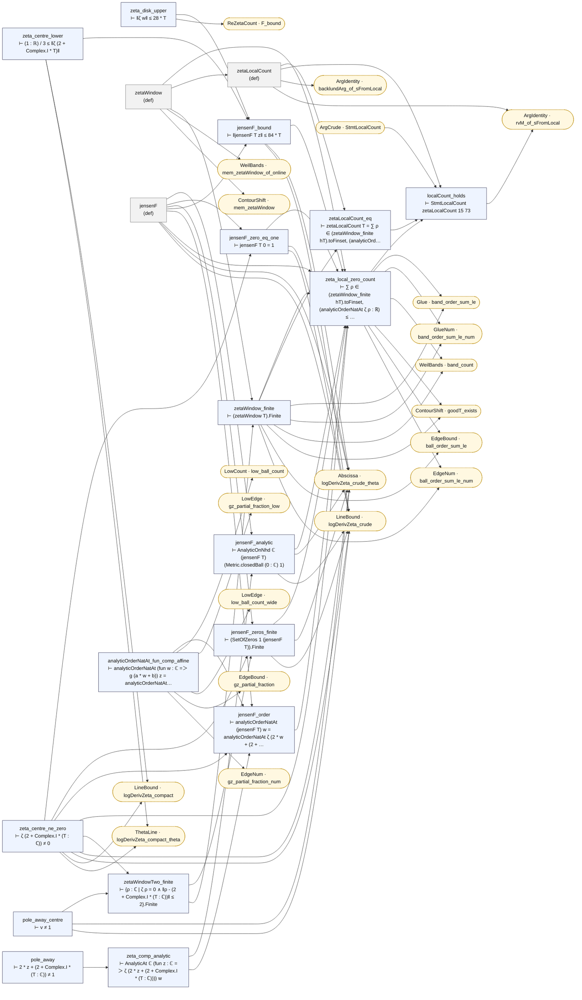

# `lean_stage3/Stage3/JensenCount.lean`

**What it does** (its own header): JensenCount — `StmtLocalCount` discharged: the Backlund-style local zero count for `ζ`, with explicit constants.

**Imports:** [`ArgCrude`](../lean_stage3/ArgCrude.md).
**Imported by:** [`Stage3`](../lean_stage3/Stage3.md), [`ArgIdentity`](../lean_stage3/ArgIdentity.md), [`ContourShift`](../lean_stage3/ContourShift.md), [`LineBound`](../lean_stage3/LineBound.md), [`ReZetaCount`](../lean_stage3/ReZetaCount.md), [`WeilBands`](../lean_stage3/WeilBands.md), [`WeilPowerAssembly`](../lean_stage3/WeilPowerAssembly.md).

Blue: theorem. Green: a theorem nothing else uses (an end). Dashed white: connects to nothing. Grey: definition. Red: contains `sorry`. Yellow: in another file. An arrow A → B reads "A is used by B".

## Every declaration

| declaration | proves (output) | needs (input) | why (its own docstring) | uses | used by |
|---|---|---|---|---|---|
| `Stage3.zeta_centre_lower` theorem, line 75 | (1 : ℝ) / 3 ≤ ‖ζ (2 + Complex.I * T)‖ | T : ℝ | — | — | `Stage3.jensenF_bound`, `Slice4.logDerivZeta_compact`, `Stage3.logDerivZeta_compact_theta` |
| `Stage3.zeta_disk_upper` theorem, line 123 | ‖ζ w‖ ≤ 28 * T | hT : 2 ≤ T; hw : ‖w - (2 + Complex.I * (T : ℂ))‖ ≤ 15 / 8 | The majorant on the wide disk. `‖ζ w‖ ≤ 28 T` for `T ≥ 2` and `‖w - (2 + iT)‖ ≤ 15/8`; this is the `R = 15/16` radius of the Jensen step pulled back through `s = 2z + (2 + iT)`. On that disk `Re w ≥ 1/8 &gt; 0` and `Im w ≥ T - 15/8 ≥ 1/8`, so the pole at `s = 1` is avoided with room. | — | `Stage3.jensenF_bound`, `ReZetaCount.F_bound` |
| `Stage3.zeta_centre_ne_zero` theorem, line 197 | ζ (2 + Complex.I * (T : ℂ)) ≠ 0 | T : ℝ | The centre `2 + iT` has real part `2`, hence `ζ` does not vanish there. | — | `Stage3.logDerivZeta_crude_theta`, `Stage3.jensenF_order`, `Stage3.jensenF_zero_eq_one`, `Stage3.jensenF_zeros_finite`, `Stage3.zetaWindowTwo_finite`, `Stage3.zeta_local_zero_count`, `Slice3.logDerivZeta_crude`, `Slice4.logDerivZeta_compact`, `Stage3.logDerivZeta_compact_theta` |
| `Stage3.pole_away` theorem, line 205 | 2 * z + (2 + Complex.I * (T : ℂ)) ≠ 1 | hT : 2 ≤ T; hz : ‖z‖ ≤ 11 / 10 | The pole stays outside the mapped ball. For `T ≥ 2` and `‖z‖ ≤ 11/10`, the point `2z + (2 + iT)` is never the pole `s = 1`. | — | `Stage3.zeta_comp_analytic` |
| `Stage3.pole_away_centre` theorem, line 218 | v ≠ 1 | hT : 2 ≤ T; hv : ‖v - (2 + Complex.I * (T : ℂ))‖ &lt; 11 / 5 | The pole stays outside the window. For `T ≥ 2`, every point within `11/5` of `2 + iT` differs from `1`. | — | `Stage3.logDerivZeta_crude_theta`, `Stage3.zetaWindowTwo_finite`, `Slice3.logDerivZeta_crude` |
| `Stage3.zetaWindowTwo_finite` theorem, line 232 | {ρ : ℂ \| ζ ρ = 0 ∧ ‖ρ - (2 + Complex.I * (T : ℂ))‖ ≤ 2}.Finite | hT : 2 ≤ T | `ζ` has finitely many zeros within `2` of the centre. | `Stage3.pole_away_centre`, `Stage3.zeta_centre_ne_zero` | `Stage3.jensenF_zeros_finite`, `Stage3.zetaWindow_finite` |
| `Stage3.zetaWindow` def, line 259 | Set ℂ | T : ℝ | The window. `ζ`'s zeros in the closed disk of radius `7/4` about `2 + iT`. On the critical line this disk covers `\|γ - T\| ≤ √(13/16)` ≈ `0.901`, an interval of positive length — which is what radius `3/2` fails to do, being tangent to the line and so catching only `γ = T`. | — | `ContourShift.mem_zetaWindow`, `Stage3.zetaLocalCount`, `Stage3.zetaWindow_finite`, `Stage3.zeta_local_zero_count`, `WeilBands.mem_zetaWindow_of_online` |
| `Stage3.zetaWindow_finite` theorem, line 262 | (zetaWindow T).Finite | hT : 2 ≤ T | — | `Stage3.zetaWindow`, `Stage3.zetaWindowTwo_finite` | `ContourShift.goodT_exists`, `EdgeBound.ball_order_sum_le`, `EdgeBound.ball_order_sum_le_num`, `Glue.band_order_sum_le`, `Glue.band_order_sum_le_num`, `Stage3.zetaLocalCount_eq`, `Stage3.zeta_local_zero_count`, `WeilBands.band_count` |
| `Stage3.jensenF` def, line 269 | ℂ → ℂ | T : ℝ | The normalised local model. `f z = ζ (2z + 2 + iT) / ζ (2 + iT)`; the closed unit ball maps onto `\|s - (2+iT)\| ≤ 2`. | — | `Stage3.logDerivZeta_crude_theta`, `Stage3.jensenF_analytic`, `Stage3.jensenF_bound`, `Stage3.jensenF_order`, `Stage3.jensenF_zero_eq_one`, `Stage3.jensenF_zeros_finite`, `Stage3.zeta_local_zero_count`, `Slice3.logDerivZeta_crude` |
| `Stage3.zeta_comp_analytic` theorem, line 272 | AnalyticAt ℂ (fun z : ℂ =&gt; ζ (2 * z + (2 + Complex.I * (T : ℂ)))) w | hT : 2 ≤ T; hw : ‖w‖ ≤ 11 / 10 | — | `Stage3.pole_away` | `Stage3.jensenF_analytic`, `Stage3.jensenF_order` |
| `Stage3.jensenF_analytic` theorem, line 277 | AnalyticOnNhd ℂ (jensenF T) (Metric.closedBall (0 : ℂ) 1) | hT : 2 ≤ T | — | `Stage3.jensenF`, `Stage3.zeta_comp_analytic` | `Stage3.logDerivZeta_crude_theta`, `Stage3.zeta_local_zero_count`, `Slice3.logDerivZeta_crude` |
| `Stage3.jensenF_zero_eq_one` theorem, line 284 | jensenF T 0 = 1 | T : ℝ | — | `Stage3.jensenF`, `Stage3.zeta_centre_ne_zero` | `Stage3.logDerivZeta_crude_theta`, `Stage3.zeta_local_zero_count`, `Slice3.logDerivZeta_crude` |
| `Stage3.jensenF_zeros_finite` theorem, line 288 | (SetOfZeros 1 (jensenF T)).Finite | hT : 2 ≤ T | — | `Stage3.jensenF`, `Stage3.zetaWindowTwo_finite`, `Stage3.zeta_centre_ne_zero` | `Stage3.logDerivZeta_crude_theta`, `Stage3.zeta_local_zero_count`, `Slice3.logDerivZeta_crude` |
| `Stage3.jensenF_bound` theorem, line 306 | ‖jensenF T z‖ ≤ 84 * T | hT : 2 ≤ T; hz : ‖z‖ ≤ 15 / 16 | — | `Stage3.jensenF`, `Stage3.zeta_centre_lower`, `Stage3.zeta_disk_upper` | `Stage3.logDerivZeta_crude_theta`, `Stage3.zeta_local_zero_count`, `Slice3.logDerivZeta_crude` |
| `Stage3.analyticOrderNatAt_fun_comp_affine` theorem, line 324 | analyticOrderNatAt (fun w : ℂ =&gt; g (a * w + b)) z = analyticOrderNatAt g (a * z + b) | g : ℂ → ℂ; b z : ℂ; ha : a ≠ 0 | The analytic order is unchanged by an invertible affine change of variable. | — | `EdgeBound.gz_partial_fraction`, `EdgeBound.gz_partial_fraction_num`, `Stage3.jensenF_order`, `EdgeBound.low_ball_count`, `EdgeBound.gz_partial_fraction_low`, `EdgeBound.low_ball_count_wide` |
| `Stage3.jensenF_order` theorem, line 336 | analyticOrderNatAt (jensenF T) w = analyticOrderNatAt ζ (2 * w + (2 + Complex.I * (T : ℂ))) | hT : 2 ≤ T; hw : ‖w‖ ≤ 11 / 10 | — | `Stage3.analyticOrderNatAt_fun_comp_affine`, `Stage3.jensenF`, `Stage3.zeta_centre_ne_zero`, `Stage3.zeta_comp_analytic` | `Stage3.zeta_local_zero_count` |
| `Stage3.zeta_local_zero_count` theorem, line 354 | ∑ ρ ∈ (zetaWindow_finite hT).toFinset, (analyticOrderNatAt ζ ρ : ℝ) ≤ 15 * Real.log T + 73 | hT : 2 ≤ T | THE LOCAL ZERO COUNT. For every `T ≥ 2`, the total order of the zeros of `ζ` in the closed disk `\|s - (2 + iT)\| ≤ 7/4` — a disk which meets the critical line in the segment `\|γ - T\| ≤ √(13/16)` — is at most `15 log T + 73`. | `Stage3.jensenF`, `Stage3.jensenF_analytic`, `Stage3.jensenF_bound`, `Stage3.jensenF_order`, `Stage3.jensenF_zero_eq_one`, `Stage3.jensenF_zeros_finite`, `Stage3.zetaWindow`, `Stage3.zetaWindow_finite`, `Stage3.zeta_centre_ne_zero` | `ContourShift.goodT_exists`, `EdgeBound.ball_order_sum_le`, `EdgeBound.ball_order_sum_le_num`, `Glue.band_order_sum_le`, `Glue.band_order_sum_le_num`, `Stage3.localCount_holds`, `WeilBands.band_count` |
| `Stage3.zetaLocalCount` def, line 441 | ℝ | T : ℝ | The count function. Total zero order of `ζ` in `\|s - (2+iT)\| ≤ 7/4`. | `Stage3.zetaWindow` | `Stage3.backlundArg_of_sFromLocal`, `Stage3.rvM_of_sFromLocal`, `Stage3.localCount_holds`, `Stage3.zetaLocalCount_eq` |
| `Stage3.zetaLocalCount_eq` theorem, line 444 | zetaLocalCount T = ∑ ρ ∈ (zetaWindow_finite hT).toFinset, (analyticOrderNatAt ζ ρ : ℝ) | hT : 2 ≤ T | — | `Stage3.zetaLocalCount`, `Stage3.zetaWindow_finite` | `Stage3.localCount_holds` |
| `Stage3.localCount_holds` theorem, line 455 | StmtLocalCount zetaLocalCount 15 73 | — | THE LEAF, DISCHARGED. `StmtLocalCount` holds for the concrete zeta zero count with the explicit constants `A₁ = 15`, `A₃ = 73`. Entry 130's budget accepts `A₁ ≤ 100`, `A₃ ≤ 1000`, so these clear it with room; the widening from radius `3/2` to `7/4` cost roughly a factor of two in `A₁` and is paid out of that budget. | `Stage3.StmtLocalCount`, `Stage3.zetaLocalCount`, `Stage3.zetaLocalCount_eq`, `Stage3.zeta_local_zero_count` | `Stage3.rvM_of_sFromLocal` |
