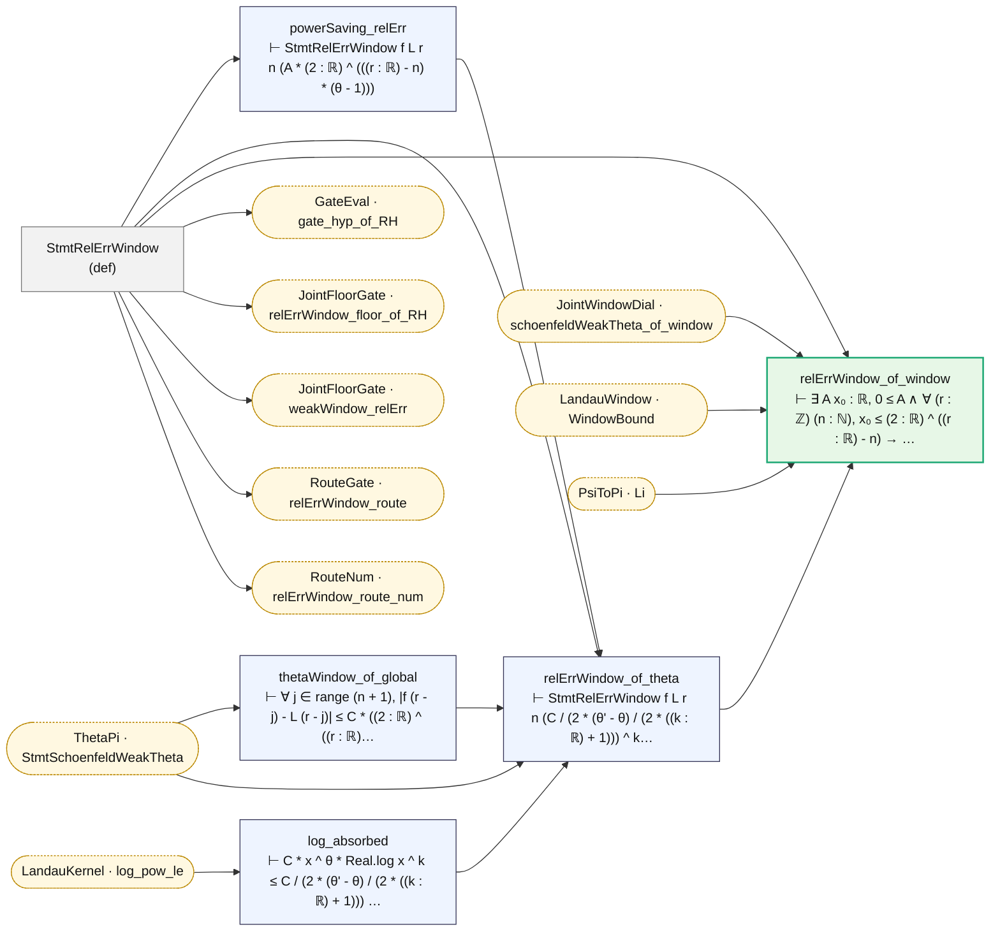

# `lean_stage3/Stage3/JointDialGate.lean`

**What it does** (its own header): JointDialGate — joints 3, 4, 5 of `SECTIONS.md`: the dial onto the table's gate. Block 3 of `lean_stage3/design/joints.md`. 2026-11-22.

**Imports:** [`JointWindowDial`](../lean_stage3/JointWindowDial.md), [`LandauKernel`](../lean_stage3/LandauKernel.md).
**Imported by:** [`Stage3`](../lean_stage3/Stage3.md), [`JointFloorGate`](../lean_stage3/JointFloorGate.md).

Blue: theorem. Green: a theorem nothing else uses (an end). Dashed white: connects to nothing. Grey: definition. Red: contains `sorry`. Yellow: in another file. An arrow A → B reads "A is used by B".

## Every declaration

| declaration | proves (output) | needs (input) | why (its own docstring) | uses | used by |
|---|---|---|---|---|---|
| `JointDialGate.StmtRelErrWindow` def, line 39 | Prop | f L : ℤ → ℝ; r : ℤ; n : ℕ; ρ : ℝ | Character-level copy of `RelativeGate.StmtRelErrWindow` from the bench tree (lean/RelativeGate.lean). The weld: utilities/check_weld.py verifies the two definition bodies are textually identical. | — | `GateEval.gate_hyp_of_RH`, `JointDialGate.powerSaving_relErr`, `JointDialGate.relErrWindow_of_theta`, `JointDialGate.relErrWindow_of_window`, `JointFloorGate.relErrWindow_floor_of_RH`, `JointFloorGate.weakWindow_relErr`, `RouteGate.relErrWindow_route`, `RouteNum.relErrWindow_route_num` |
| `JointDialGate.thetaWindow_of_global` theorem, line 43 | ∀ j ∈ range (n + 1), \|f (r - j) - L (r - j)\| ≤ C * ((2 : ℝ) ^ ((r : ℝ) - j)) ^ θ * Real.log ((2 : ℝ) ^ ((r : ℝ) - j)) ^ k | hpi : Stage3.StmtSchoenfeldWeakTheta θ C k x₀ pi li; hf : ∀ m : ℤ, f m = pi ((2 : ℝ) ^ (m : ℝ)); hL : ∀ m : ℤ, L m = li ((2 : ℝ) ^ (m : ℝ)); hbot : x₀ ≤ (2 : ℝ) ^ ((r : ℝ) - n) | — | `Stage3.StmtSchoenfeldWeakTheta` | `JointDialGate.relErrWindow_of_theta` |
| `JointDialGate.log_absorbed` theorem, line 62 | C * x ^ θ * Real.log x ^ k ≤ C / (2 * (θ' - θ) / (2 * ((k : ℝ) + 1))) ^ k * x ^ θ' | hC : 0 ≤ C; hθ : θ &lt; θ'; hx : 1 ≤ x | — | `LandauKernel.log_pow_le` | `JointDialGate.relErrWindow_of_theta` |
| `JointDialGate.powerSaving_relErr` theorem, line 83 | StmtRelErrWindow f L r n (A * (2 : ℝ) ^ (((r : ℝ) - n) * (θ - 1))) | hA : 0 ≤ A; hθ : θ ≤ 1; hP : ∀ k ∈ range (n + 1), \|f (r - k) - L (r - k)\| ≤ A * ((2 : ℝ) ^ ((r : ℝ) - k)) ^ θ | Statement identical to `RelativeGate.powerSaving_relErr` of the bench tree; reproved on this toolchain. | `JointDialGate.StmtRelErrWindow` | `JointDialGate.relErrWindow_of_theta` |
| `JointDialGate.relErrWindow_of_theta` theorem, line 103 | StmtRelErrWindow f L r n (C / (2 * (θ' - θ) / (2 * ((k : ℝ) + 1))) ^ k * (2 : ℝ) ^ (((r : ℝ) - n) * (θ' - 1))) | hpi : Stage3.StmtSchoenfeldWeakTheta θ C k x₀ pi li; hC : 0 ≤ C; hθ : θ &lt; θ'; hθ' : θ' ≤ 1; hf : ∀ m : ℤ, f m = pi ((2 : ℝ) ^ (m : ℝ)); hL : ∀ m : ℤ, L m = li ((2 : ℝ) ^ (m : ℝ)); hbot : x₀ ≤ (2 : ℝ) ^ ((r : ℝ) - n); hpos : 0 ≤ (r : ℝ) - n | — | `JointDialGate.StmtRelErrWindow`, `JointDialGate.log_absorbed`, `JointDialGate.powerSaving_relErr`, `JointDialGate.thetaWindow_of_global`, `Stage3.StmtSchoenfeldWeakTheta` | `JointDialGate.relErrWindow_of_window` |
| `JointDialGate.relErrWindow_of_window` theorem, line 122 | ∃ A x₀ : ℝ, 0 ≤ A ∧ ∀ (r : ℤ) (n : ℕ), x₀ ≤ (2 : ℝ) ^ ((r : ℝ) - n) → 0 ≤ (r : ℝ) - n → StmtRelErrWindow (fun m : ℤ =&gt; (Nat.primeCounting ⌊(2 : ℝ) ^ (m : ℝ)⌋₊ : ℝ)) (fun m : ℤ =&gt; Stage3.Li ((2 : ℝ) ^ (m : ℝ))) r n (A * (2 : ℝ) ^ (((r : ℝ) - n) * (θ' - 1))) | hθlo : 1 / 2 ≤ θ; hθ1 : θ &lt; 1; hδ : 0 &lt; δ; hW : LandauWindow.WindowBound θ δ C₀; hθ : θ &lt; θ'; hθ' : θ' ≤ 1 | — | `JointDialGate.StmtRelErrWindow`, `JointDialGate.relErrWindow_of_theta`, `JointWindowDial.schoenfeldWeakTheta_of_window`, `LandauWindow.WindowBound`, `Stage3.Li` | — |
