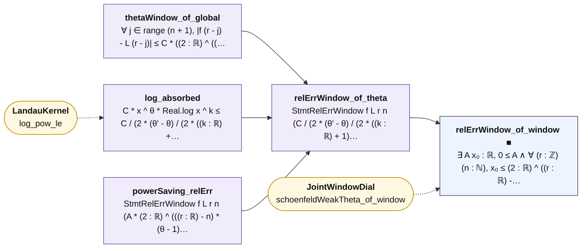

# `lean_stage3/Stage3/JointDialGate.lean`

JointDialGate — joints 3, 4, 5 of `SECTIONS.md`: the dial onto the table's gate. Block 3 of `lean_stage3/design/joints.md`. 2026-11-22.

5 theorems, 1 definition, 165 lines. Arrows are Lean's own record of what each proof uses.

**Imports:** [`JointWindowDial`](../lean_stage3/JointWindowDial.md), [`LandauKernel`](../lean_stage3/LandauKernel.md)  
**Imported by:** [`Stage3`](../lean_stage3/Stage3.md), [`JointFloorGate`](../lean_stage3/JointFloorGate.md)

## The picture



An arrow A → B reads "A is used in the proof of B". Green: counting, integers only. Violet: shape, analysis with no ζ. Blue: reads ζ. A name ending in ■ is an end: nothing else uses it. Red: contains `sorry`. Yellow: theorems in another file, counted; a dotted arrow crosses files. Definitions are not drawn; they are listed below the diagram.

## Definitions

<a name="JointDialGate-StmtRelErrWindow"></a>
### `JointDialGate.StmtRelErrWindow`

def · line 39

Character-level copy of `RelativeGate.StmtRelErrWindow` from the bench tree (lean/RelativeGate.lean). The weld: utilities/check_weld.py verifies the two definition bodies are textually identical.

- **Is:** `` StmtRelErrWindow (f L : ℤ → ℝ) (r : ℤ) (n : ℕ) (ρ : ℝ) : Prop := ∀ k ∈ range (n + 1), |f (r - k) - L (r - k)| ≤ ρ * (2 : ℝ) ^ ((r : ℝ) - k) ``
- **Used by 10:** [`GateEval.gate_hyp_of_RH`](../lean_stage3/GateEval.md#GateEval-gate_hyp_of_RH), [`JointDialGate.powerSaving_relErr`](#JointDialGate-powerSaving_relErr), [`JointDialGate.relErrWindow_of_theta`](#JointDialGate-relErrWindow_of_theta), [`JointDialGate.relErrWindow_of_window`](#JointDialGate-relErrWindow_of_window), [`JointFloorGate.relErrWindow_floor_of_RH`](../lean_stage3/JointFloorGate.md#JointFloorGate-relErrWindow_floor_of_RH), [`JointFloorGate.weakWindow_relErr`](../lean_stage3/JointFloorGate.md#JointFloorGate-weakWindow_relErr), [`RouteGate.relErrWindow_route`](../lean_stage3/RouteGate.md#RouteGate-relErrWindow_route), [`RouteNum.relErrWindow_route_num`](../lean_stage3/RouteNum.md#RouteNum-relErrWindow_route_num), [`TableDepths.cell_ne_zero_gen`](../lean_stage3/TableDepths.md#TableDepths-cell_ne_zero_gen), [`TableRoute.cell_ne_zero_of_RH`](../lean_stage3/TableRoute.md#TableRoute-cell_ne_zero_of_RH)

## Theorems

<a name="JointDialGate-thetaWindow_of_global"></a>
### `JointDialGate.thetaWindow_of_global`

line 46

**Shape.** Uses real or complex analysis; nothing in it or beneath it reads ζ.

**Why.** Joint 3: the dial's bound read at the rows. If `StmtSchoenfeldWeakTheta θ C k x₀ pi li` holds, `f` and `L` are `pi` and `li` at `2^m`, and `x₀ ≤ 2^(r−n)`, then for every `j ≤ n`, `|f(r−j) − L(r−j)| ≤ C·x^θ·(log x)^k` at `x = 2^(r−j)`.

**Proves**

```lean
∀ j ∈ range (n + 1), |f (r - j) - L (r - j)| ≤ C * ((2 : ℝ) ^ ((r : ℝ) - j)) ^ θ * Real.log ((2 : ℝ) ^ ((r : ℝ) - j)) ^ k
```

**Needs** (its hypotheses)

  - `` hpi : Stage3.StmtSchoenfeldWeakTheta θ C k x₀ pi li ``
  - `` hf : ∀ m : ℤ, f m = pi ((2 : ℝ) ^ (m : ℝ)) ``
  - `` hL : ∀ m : ℤ, L m = li ((2 : ℝ) ^ (m : ℝ)) ``
  - `` hbot : x₀ ≤ (2 : ℝ) ^ ((r : ℝ) - n) ``

**Stated with:** [`Stage3.StmtSchoenfeldWeakTheta`](../lean_stage3/ThetaPi.md#Stage3-StmtSchoenfeldWeakTheta)

**Fed by:** no theorem of this repo; it stands on Mathlib and the definitions below.

**Feeds** (1 that use it)

  - [`JointDialGate.relErrWindow_of_theta`](#JointDialGate-relErrWindow_of_theta) — `` StmtRelErrWindow f L r n (C / (2 * (θ' - θ) / (2 * ((k : ℝ) + 1))) ^ k * (2 : ℝ) ^ (((r : ℝ) - n) * (θ' - 1))) ``

<a name="JointDialGate-log_absorbed"></a>
### `JointDialGate.log_absorbed`

line 67

**Shape.** Uses real or complex analysis; nothing in it or beneath it reads ζ.

**Why.** Joint 4: the log power is absorbed into a larger exponent. If `0 ≤ C`, `θ < θ'` and `1 ≤ x`, then `C·x^θ·(log x)^k ≤ A·x^θ'` with `A = C / (2(θ'−θ)/(2(k+1)))^k`.

**Proves**

```lean
C * x ^ θ * Real.log x ^ k ≤ C / (2 * (θ' - θ) / (2 * ((k : ℝ) + 1))) ^ k * x ^ θ'
```

**Needs** (its hypotheses)

  - `` hC : 0 ≤ C ``
  - `` hθ : θ < θ' ``
  - `` hx : 1 ≤ x ``

**Fed by** (1 theorem its proof uses)

  - [`LandauKernel.log_pow_le`](../lean_stage3/LandauKernel.md#LandauKernel-log_pow_le) (LandauKernel) — `` Real.log y ^ n ≤ y ^ (a / 2) / (a / (2 * (n + 1))) ^ n ``

**Feeds** (1 that use it)

  - [`JointDialGate.relErrWindow_of_theta`](#JointDialGate-relErrWindow_of_theta) — `` StmtRelErrWindow f L r n (C / (2 * (θ' - θ) / (2 * ((k : ℝ) + 1))) ^ k * (2 : ℝ) ^ (((r : ℝ) - n) * (θ' - 1))) ``

<a name="JointDialGate-powerSaving_relErr"></a>
### `JointDialGate.powerSaving_relErr`

line 88

**Shape.** Uses real or complex analysis; nothing in it or beneath it reads ζ.

**Why.** Statement identical to `RelativeGate.powerSaving_relErr` of the bench tree; reproved on this toolchain.

**Proves**

```lean
StmtRelErrWindow f L r n (A * (2 : ℝ) ^ (((r : ℝ) - n) * (θ - 1)))
```

**Needs** (its hypotheses)

  - `` hA : 0 ≤ A ``
  - `` hθ : θ ≤ 1 ``
  - `` hP : ∀ k ∈ range (n + 1), |f (r - k) - L (r - k)| ≤ A * ((2 : ℝ) ^ ((r : ℝ) - k)) ^ θ ``

**Stated with:** [`JointDialGate.StmtRelErrWindow`](#JointDialGate-StmtRelErrWindow)

**Fed by:** no theorem of this repo; it stands on Mathlib and the definitions below.

**Feeds** (1 that use it)

  - [`JointDialGate.relErrWindow_of_theta`](#JointDialGate-relErrWindow_of_theta) — `` StmtRelErrWindow f L r n (C / (2 * (θ' - θ) / (2 * ((k : ℝ) + 1))) ^ k * (2 : ℝ) ^ (((r : ℝ) - n) * (θ' - 1))) ``

<a name="JointDialGate-relErrWindow_of_theta"></a>
### `JointDialGate.relErrWindow_of_theta`

line 112

**Shape.** Uses real or complex analysis; nothing in it or beneath it reads ζ.

**Why.** Joints 3, 4, 5 composed. If `StmtSchoenfeldWeakTheta θ C k x₀ pi li` holds with `0 ≤ C`, `θ < θ' ≤ 1`, `f` and `L` are `pi` and `li` at `2^m`, `x₀ ≤ 2^(r−n)` and `0 ≤ r − n`, then the gate's statement `StmtRelErrWindow f L r n ρ` holds with `ρ = C / (2(θ'−θ)/(2(k+1)))^k · 2^((r−n)(θ'−1))`.

**Proves**

```lean
StmtRelErrWindow f L r n (C / (2 * (θ' - θ) / (2 * ((k : ℝ) + 1))) ^ k * (2 : ℝ) ^ (((r : ℝ) - n) * (θ' - 1)))
```

**Needs** (its hypotheses)

  - `` hpi : Stage3.StmtSchoenfeldWeakTheta θ C k x₀ pi li ``
  - `` hC : 0 ≤ C ``
  - `` hθ : θ < θ' ``
  - `` hθ' : θ' ≤ 1 ``
  - `` hf : ∀ m : ℤ, f m = pi ((2 : ℝ) ^ (m : ℝ)) ``
  - `` hL : ∀ m : ℤ, L m = li ((2 : ℝ) ^ (m : ℝ)) ``
  - `` hbot : x₀ ≤ (2 : ℝ) ^ ((r : ℝ) - n) ``
  - `` hpos : 0 ≤ (r : ℝ) - n ``

**Stated with:** [`JointDialGate.StmtRelErrWindow`](#JointDialGate-StmtRelErrWindow), [`Stage3.StmtSchoenfeldWeakTheta`](../lean_stage3/ThetaPi.md#Stage3-StmtSchoenfeldWeakTheta)

**Fed by** (3 theorems its proof uses)

  - [`JointDialGate.log_absorbed`](#JointDialGate-log_absorbed) — `` C * x ^ θ * Real.log x ^ k ≤ C / (2 * (θ' - θ) / (2 * ((k : ℝ) + 1))) ^ k * x ^ θ' ``
  - [`JointDialGate.powerSaving_relErr`](#JointDialGate-powerSaving_relErr) — `` StmtRelErrWindow f L r n (A * (2 : ℝ) ^ (((r : ℝ) - n) * (θ - 1))) ``
  - [`JointDialGate.thetaWindow_of_global`](#JointDialGate-thetaWindow_of_global) — `` ∀ j ∈ range (n + 1), |f (r - j) - L (r - j)| ≤ C * ((2 : ℝ) ^ ((r : ℝ) - j)) ^ θ * Real.log ((2 : ℝ) ^ ((r : ℝ) - j)) ^ k ``

**Feeds** (1 that use it)

  - [`JointDialGate.relErrWindow_of_window`](#JointDialGate-relErrWindow_of_window) — `` ∃ A x₀ : ℝ, 0 ≤ A ∧ ∀ (r : ℤ) (n : ℕ), x₀ ≤ (2 : ℝ) ^ ((r : ℝ) - n) → 0 ≤ (r : ℝ) - n → StmtRelErrWindow (fun m : ℤ => (Nat.primeCounting ⌊(2 : ℝ) ^ (… ``

<a name="JointDialGate-relErrWindow_of_window"></a>
### `JointDialGate.relErrWindow_of_window`

line 134

**Reads ζ.** It, or something it rests on, uses the zeta function, its zeros or the Riemann hypothesis.

**Why.** From a window bound on `G` at `θ`, with `1/2 ≤ θ < 1`, `0 < δ` and `θ < θ' ≤ 1`: there are `A ≥ 0` and `x₀` such that for all `r`, `n` with `x₀ ≤ 2^(r−n)` and `0 ≤ r − n`, the gate's statement holds on the rows of `π` and `Li` with relative error `A·2^((r−n)(θ'−1))`.

**Proves**

```lean
∃ A x₀ : ℝ, 0 ≤ A ∧ ∀ (r : ℤ) (n : ℕ), x₀ ≤ (2 : ℝ) ^ ((r : ℝ) - n) → 0 ≤ (r : ℝ) - n → StmtRelErrWindow (fun m : ℤ => (Nat.primeCounting ⌊(2 : ℝ) ^ (m : ℝ)⌋₊ : ℝ)) (fun m : ℤ => Stage3.Li ((2 : ℝ) ^ (m : ℝ))) r n (A * (2 : ℝ) ^ (((r : ℝ) - n) * (θ' - 1)))
```

**Needs** (its hypotheses)

  - `` hθlo : 1 / 2 ≤ θ ``
  - `` hθ1 : θ < 1 ``
  - `` hδ : 0 < δ ``
  - `` hW : LandauWindow.WindowBound θ δ C₀ ``
  - `` hθ : θ < θ' ``
  - `` hθ' : θ' ≤ 1 ``

**Stated with:** [`JointDialGate.StmtRelErrWindow`](#JointDialGate-StmtRelErrWindow), [`LandauWindow.WindowBound`](../lean_stage3/LandauWindow.md#LandauWindow-WindowBound), [`Stage3.Li`](../lean_stage3/PsiToPi.md#Stage3-Li)

**Fed by** (2 theorems its proof uses)

  - [`JointDialGate.relErrWindow_of_theta`](#JointDialGate-relErrWindow_of_theta) — `` StmtRelErrWindow f L r n (C / (2 * (θ' - θ) / (2 * ((k : ℝ) + 1))) ^ k * (2 : ℝ) ^ (((r : ℝ) - n) * (θ' - 1))) ``
  - [`JointWindowDial.schoenfeldWeakTheta_of_window`](../lean_stage3/JointWindowDial.md#JointWindowDial-schoenfeldWeakTheta_of_window) (JointWindowDial) — `` ∃ C' > 0, ∃ x₀ : ℝ, Stage3.StmtSchoenfeldWeakTheta θ C' 2 x₀ (fun x => (Nat.primeCounting ⌊x⌋₊ : ℝ)) Stage3.Li ``

**Definitions its proof touches:** [`Stage3.StmtSchoenfeldWeakTheta`](../lean_stage3/ThetaPi.md#Stage3-StmtSchoenfeldWeakTheta)

**Feeds:** nothing. It is an end.

