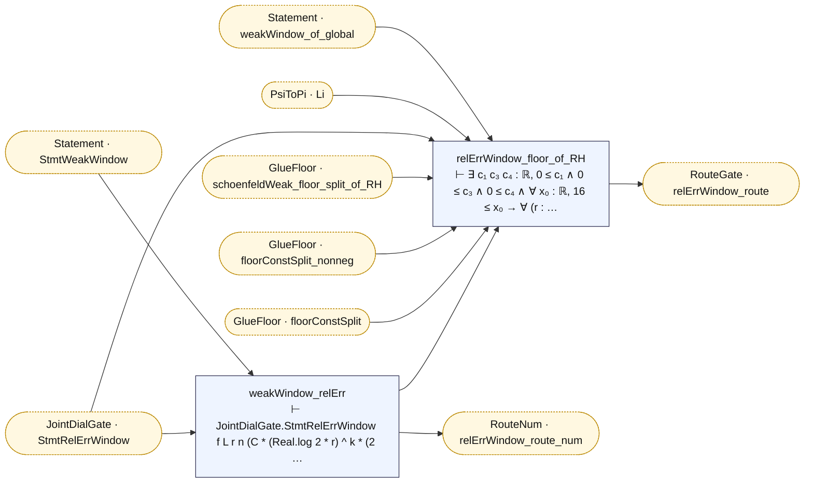

# `lean_stage3/Stage3/JointFloorGate.lean`

**What it does** (its own header): JointFloorGate — block E3 of `lean_stage3/design/joints.md`. 2026-11-22. The explicit-formula route (unit 0409, `schoenfeldWeak_floor_split_of_RH`) carried to the statement the table's gate takes, `StmtRelErrWindow` (`JointDialGate`, a character copy of `lean/RelativeGate.lean`, welded).

**Imports:** [`GlueFloor`](../lean_stage3/GlueFloor.md), [`JointDialGate`](../lean_stage3/JointDialGate.md).
**Imported by:** [`Stage3`](../lean_stage3/Stage3.md), [`RouteGate`](../lean_stage3/RouteGate.md).

Blue: theorem. Green: a theorem nothing else uses (an end). Dashed white: connects to nothing. Grey: definition. Red: contains `sorry`. Yellow: in another file. An arrow A → B reads "A is used by B".

## Every declaration

| declaration | proves (output) | needs (input) | why (its own docstring) | uses | used by |
|---|---|---|---|---|---|
| `JointFloorGate.weakWindow_relErr` theorem, line 30 | JointDialGate.StmtRelErrWindow f L r n (C * (Real.log 2 * r) ^ k * (2 : ℝ) ^ (-(((r : ℝ) - n) / 2))) | hC : 0 ≤ C; hpos : 0 ≤ (r : ℝ) - n; h : Stage3.StmtWeakWindow C k f L r n | A weak window is the gate's relative-error window. | `JointDialGate.StmtRelErrWindow`, `Stage3.StmtWeakWindow` | `JointFloorGate.relErrWindow_floor_of_RH`, `RouteNum.relErrWindow_route_num` |
| `JointFloorGate.relErrWindow_floor_of_RH` theorem, line 62 | ∃ c₁ c₃ c₄ : ℝ, 0 ≤ c₁ ∧ 0 ≤ c₃ ∧ 0 ≤ c₄ ∧ ∀ x₀ : ℝ, 16 ≤ x₀ → ∀ (r : ℤ) (n : ℕ), x₀ ^ 2 ≤ (2 : ℝ) ^ ((r : ℝ) - n) → 0 ≤ (r : ℝ) - n → JointDialGate.StmtRelErrWindow (fun m : ℤ =&gt; (Nat.primeCounting ⌊(2 : ℝ) ^ (m : ℝ)⌋₊ : ℝ)) (fun m : ℤ =&gt; Stage3.Li ((2 : ℝ) ^ (m : ℝ))) r n ((3 * Stage3.floorConstSplit c₁ c₃ c₄ 112 0 698 Kadiri.weightedZeroHeightBucket x₀ + 13) * (Real.log 2 * r) ^ 1 * (2 : ℝ) ^ (-(((r : ℝ) - n) / 2))) | hRH : RiemannHypothesis | The explicit-formula route at the gate. Under RH, on any window of rows above the floor squared, the relative error of `π` against `Li` is at most `(3·floorConstSplit + 13)·(log 2·r)·2^(−(r−n)/2)`. | `Stage3.floorConstSplit`, `Stage3.floorConstSplit_nonneg`, `Stage3.schoenfeldWeak_floor_split_of_RH`, `JointDialGate.StmtRelErrWindow`, `JointFloorGate.weakWindow_relErr`, `Stage3.Li`, `Stage3.weakWindow_of_global` | `RouteGate.relErrWindow_route` |
