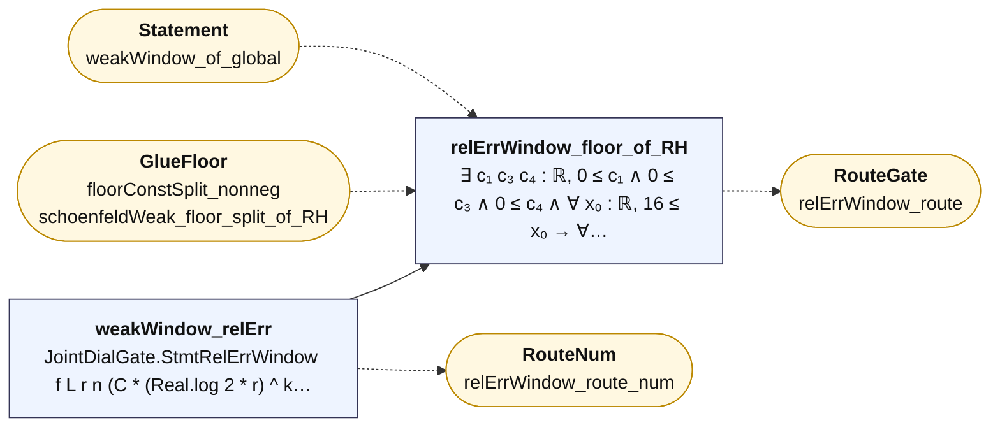

# `lean_stage3/Stage3/JointFloorGate.lean`

JointFloorGate — block E3 of `lean_stage3/design/joints.md`. 2026-11-22. The explicit-formula route (unit 0409, `schoenfeldWeak_floor_split_of_RH`) carried to the statement the table's gate takes, `StmtRelErrWindow` (`JointDialGate`, a character copy of `lean/RelativeGate.lean`, welded).

2 theorems, 0 definitions, 93 lines. Arrows are Lean's own record of what each proof uses.

**Imports:** [`GlueFloor`](../lean_stage3/GlueFloor.md), [`JointDialGate`](../lean_stage3/JointDialGate.md)  
**Imported by:** [`Stage3`](../lean_stage3/Stage3.md), [`RouteGate`](../lean_stage3/RouteGate.md)

## The picture



An arrow A → B reads "A is used in the proof of B". Blue: theorem. Green: a theorem nothing else uses (an end). Dashed: connects to nothing. Red: contains `sorry`. Yellow: theorems in another file, counted; a dotted arrow crosses files. Definitions are not drawn; they are listed below the diagram.

## Theorems

<a name="JointFloorGate-weakWindow_relErr"></a>
### `JointFloorGate.weakWindow_relErr`

line 30

**Why.** A weak window is the gate's relative-error window.

**Proves**

```lean
JointDialGate.StmtRelErrWindow f L r n (C * (Real.log 2 * r) ^ k * (2 : ℝ) ^ (-(((r : ℝ) - n) / 2)))
```

**Needs** (its hypotheses)

  - `` hC : 0 ≤ C ``
  - `` hpos : 0 ≤ (r : ℝ) - n ``
  - `` h : Stage3.StmtWeakWindow C k f L r n ``

**Stated with:** [`JointDialGate.StmtRelErrWindow`](../lean_stage3/JointDialGate.md#JointDialGate-StmtRelErrWindow), [`Stage3.StmtWeakWindow`](../lean_stage3/Statement.md#Stage3-StmtWeakWindow)

**Fed by:** no theorem of this repo; it stands on Mathlib and the definitions below.

**Feeds** (2 that use it)

  - [`JointFloorGate.relErrWindow_floor_of_RH`](#JointFloorGate-relErrWindow_floor_of_RH) — `` ∃ c₁ c₃ c₄ : ℝ, 0 ≤ c₁ ∧ 0 ≤ c₃ ∧ 0 ≤ c₄ ∧ ∀ x₀ : ℝ, 16 ≤ x₀ → ∀ (r : ℤ) (n : ℕ), x₀ ^ 2 ≤ (2 : ℝ) ^ ((r : ℝ) - n) → 0 ≤ (r : ℝ) - n → JointDialGate.S… ``
  - [`RouteNum.relErrWindow_route_num`](../lean_stage3/RouteNum.md#RouteNum-relErrWindow_route_num) (RouteNum) — `` JointDialGate.StmtRelErrWindow (fun m : ℤ => (Nat.primeCounting ⌊(2 : ℝ) ^ (m : ℝ)⌋₊ : ℝ)) (fun m : ℤ => 2 / Real.log 2 + ∫ t in (1 : ℝ)..(m : ℝ), Rea… ``

<a name="JointFloorGate-relErrWindow_floor_of_RH"></a>
### `JointFloorGate.relErrWindow_floor_of_RH`

line 62

**Why.** The explicit-formula route at the gate. Under RH, on any window of rows above the floor squared, the relative error of `π` against `Li` is at most `(3·floorConstSplit + 13)·(log 2·r)·2^(−(r−n)/2)`.

**Proves**

```lean
∃ c₁ c₃ c₄ : ℝ, 0 ≤ c₁ ∧ 0 ≤ c₃ ∧ 0 ≤ c₄ ∧ ∀ x₀ : ℝ, 16 ≤ x₀ → ∀ (r : ℤ) (n : ℕ), x₀ ^ 2 ≤ (2 : ℝ) ^ ((r : ℝ) - n) → 0 ≤ (r : ℝ) - n → JointDialGate.StmtRelErrWindow (fun m : ℤ => (Nat.primeCounting ⌊(2 : ℝ) ^ (m : ℝ)⌋₊ : ℝ)) (fun m : ℤ => Stage3.Li ((2 : ℝ) ^ (m : ℝ))) r n ((3 * Stage3.floorConstSplit c₁ c₃ c₄ 112 0 698 Kadiri.weightedZeroHeightBucket x₀ + 13) * (Real.log 2 * r) ^ 1 * (2 : ℝ) ^ (-(((r : ℝ) - n) / 2)))
```

**Needs** (its hypotheses)

  - `` hRH : RiemannHypothesis ``

**Stated with:** [`Stage3.floorConstSplit`](../lean_stage3/GlueFloor.md#Stage3-floorConstSplit), [`JointDialGate.StmtRelErrWindow`](../lean_stage3/JointDialGate.md#JointDialGate-StmtRelErrWindow), [`Stage3.Li`](../lean_stage3/PsiToPi.md#Stage3-Li)

**Fed by** (4 theorems its proof uses)

  - [`Stage3.floorConstSplit_nonneg`](../lean_stage3/GlueFloor.md#Stage3-floorConstSplit_nonneg) (GlueFloor) — `` 0 ≤ floorConstSplit c₁ c₃ c₄ b₁ b₂ b₃ W x₀ ``
  - [`Stage3.schoenfeldWeak_floor_split_of_RH`](../lean_stage3/GlueFloor.md#Stage3-schoenfeldWeak_floor_split_of_RH) (GlueFloor) — `` ∃ c₁ c₃ c₄ : ℝ, 0 ≤ c₁ ∧ 0 ≤ c₃ ∧ 0 ≤ c₄ ∧ ∀ x₀ : ℝ, 16 ≤ x₀ → StmtSchoenfeldWeak (3 * floorConstSplit c₁ c₃ c₄ 112 0 698 weightedZeroHeightBucket x₀ … ``
  - [`JointFloorGate.weakWindow_relErr`](#JointFloorGate-weakWindow_relErr) — `` JointDialGate.StmtRelErrWindow f L r n (C * (Real.log 2 * r) ^ k * (2 : ℝ) ^ (-(((r : ℝ) - n) / 2))) ``
  - [`Stage3.weakWindow_of_global`](../lean_stage3/Statement.md#Stage3-weakWindow_of_global) (Statement) — `` StmtWeakWindow C k f L r n ``

**Definitions its proof touches:** [`Stage3.StmtSchoenfeldWeak`](../lean_stage3/Statement.md#Stage3-StmtSchoenfeldWeak)

**Feeds** (1 that use it)

  - [`RouteGate.relErrWindow_route`](../lean_stage3/RouteGate.md#RouteGate-relErrWindow_route) (RouteGate) — `` ∃ c₁ c₃ c₄ : ℝ, 0 ≤ c₁ ∧ 0 ≤ c₃ ∧ 0 ≤ c₄ ∧ ∀ x₀ : ℝ, 16 ≤ x₀ → ∀ (r : ℤ) (n : ℕ), x₀ ^ 2 ≤ (2 : ℝ) ^ ((r : ℝ) - n) → JointDialGate.StmtRelErrWindow (f… ``

