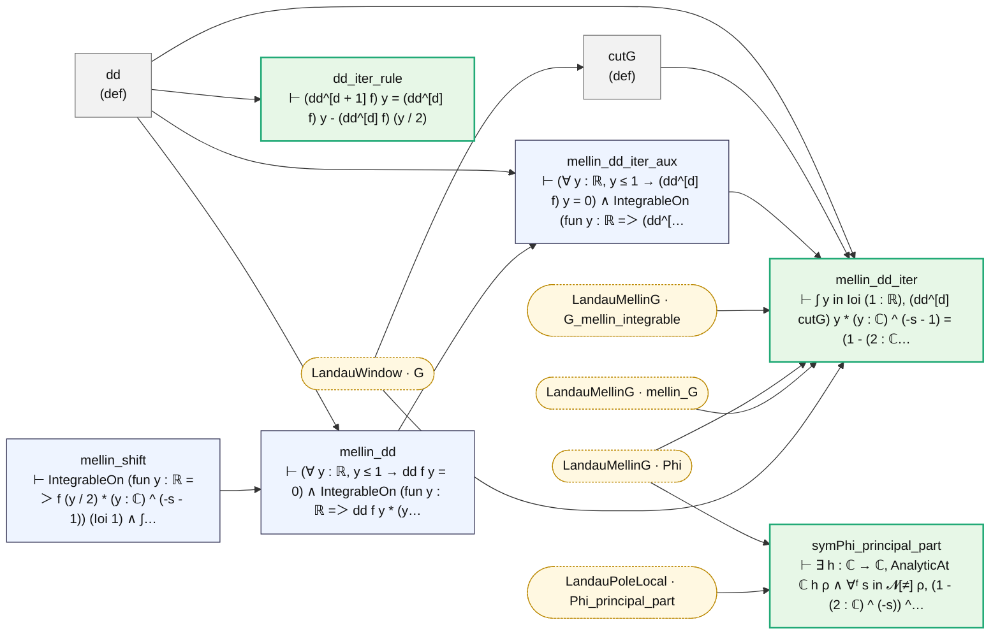

# `lean_stage3/Stage3/JointSymbol.lean`

**What it does** (its own header): JointSymbol — joint 9a of `SECTIONS.md`: the table of `G` along the doublings and the symbol, on the transform side. Block 9a of `lean_stage3/design/joints.md`. 2026-11-22.

**Imports:** [`LandauPoleLocal`](../lean_stage3/LandauPoleLocal.md).
**Imported by:** [`Stage3`](../lean_stage3/Stage3.md).

Blue: theorem. Green: a theorem nothing else uses (an end). Dashed white: connects to nothing. Grey: definition. Red: contains `sorry`. Yellow: in another file. An arrow A → B reads "A is used by B".

## Every declaration

| declaration | proves (output) | needs (input) | why (its own docstring) | uses | used by |
|---|---|---|---|---|---|
| `JointSymbol.dd` def, line 42 | ℝ → ℂ | f : ℝ → ℂ | One difference along the doublings. | — | `JointSymbol.dd_iter_rule`, `JointSymbol.mellin_dd`, `JointSymbol.mellin_dd_iter`, `JointSymbol.mellin_dd_iter_aux` |
| `JointSymbol.cutG` def, line 45 | ℂ | y : ℝ | `G` on `y &gt; 1`, zero below: the row starts at the first regime. | `LandauWindow.G` | `JointSymbol.mellin_dd_iter` |
| `JointSymbol.mellin_shift` theorem, line 47 | IntegrableOn (fun y : ℝ =&gt; f (y / 2) * (y : ℂ) ^ (-s - 1)) (Ioi 1) ∧ ∫ y in Ioi (1 : ℝ), f (y / 2) * (y : ℂ) ^ (-s - 1) = (2 : ℂ) ^ (-s) * ∫ y in Ioi (1 : ℝ), f y * (y : ℂ) ^ (-s - 1) | hf0 : ∀ y : ℝ, y ≤ 1 → f y = 0; hint : IntegrableOn (fun y : ℝ =&gt; f y * (y : ℂ) ^ (-s - 1)) (Ioi 1) | — | — | `JointSymbol.mellin_dd` |
| `JointSymbol.mellin_dd` theorem, line 105 | (∀ y : ℝ, y ≤ 1 → dd f y = 0) ∧ IntegrableOn (fun y : ℝ =&gt; dd f y * (y : ℂ) ^ (-s - 1)) (Ioi 1) ∧ ∫ y in Ioi (1 : ℝ), dd f y * (y : ℂ) ^ (-s - 1) = (1 - (2 : ℂ) ^ (-s)) * ∫ y in Ioi (1 : ℝ), f y * (y : ℂ) ^ (-s - 1) | hf0 : ∀ y : ℝ, y ≤ 1 → f y = 0; hint : IntegrableOn (fun y : ℝ =&gt; f y * (y : ℂ) ^ (-s - 1)) (Ioi 1) | `dd` keeps the two hypotheses and multiplies the transform by the symbol. | `JointSymbol.dd`, `JointSymbol.mellin_shift` | `JointSymbol.mellin_dd_iter_aux` |
| `JointSymbol.mellin_dd_iter_aux` theorem, line 120 | (∀ y : ℝ, y ≤ 1 → (dd^[d] f) y = 0) ∧ IntegrableOn (fun y : ℝ =&gt; (dd^[d] f) y * (y : ℂ) ^ (-s - 1)) (Ioi 1) ∧ ∫ y in Ioi (1 : ℝ), (dd^[d] f) y * (y : ℂ) ^ (-s - 1) = (1 - (2 : ℂ) ^ (-s)) ^ d * ∫ y in Ioi (1 : ℝ), f y * (y : ℂ) ^ (-s - 1) | hf0 : ∀ y : ℝ, y ≤ 1 → f y = 0; hint : IntegrableOn (fun y : ℝ =&gt; f y * (y : ℂ) ^ (-s - 1)) (Ioi 1); d : ℕ | — | `JointSymbol.dd`, `JointSymbol.mellin_dd` | `JointSymbol.mellin_dd_iter` |
| `JointSymbol.mellin_dd_iter` theorem, line 136 | ∫ y in Ioi (1 : ℝ), (dd^[d] cutG) y * (y : ℂ) ^ (-s - 1) = (1 - (2 : ℂ) ^ (-s)) ^ d * LandauMellinG.Phi s | hs : 1 &lt; s.re; d : ℕ | — | `JointSymbol.cutG`, `JointSymbol.dd`, `JointSymbol.mellin_dd_iter_aux`, `LandauMellinG.G_mellin_integrable`, `LandauMellinG.Phi`, `LandauMellinG.mellin_G`, `LandauWindow.G` | — |
| `JointSymbol.dd_iter_rule` theorem, line 153 | (dd^[d + 1] f) y = (dd^[d] f) y - (dd^[d] f) (y / 2) | f : ℝ → ℂ; d : ℕ; y : ℝ | — | `JointSymbol.dd` | — |
| `JointSymbol.symPhi_principal_part` theorem, line 158 | ∃ h : ℂ → ℂ, AnalyticAt ℂ h ρ ∧ ∀ᶠ s in 𝓝[≠] ρ, (1 - (2 : ℂ) ^ (-s)) ^ d * LandauMellinG.Phi s = h s + (1 - (2 : ℂ) ^ (-ρ)) ^ d * ((analyticOrderNatAt riemannZeta ρ : ℂ) / (ρ * (1 - ρ))) / (s - ρ) | h0 : ρ ≠ 0; h1 : ρ ≠ 1; hz : riemannZeta ρ = 0; d : ℕ | — | `LandauMellinG.Phi`, `LandauPoleLocal.Phi_principal_part` | — |
