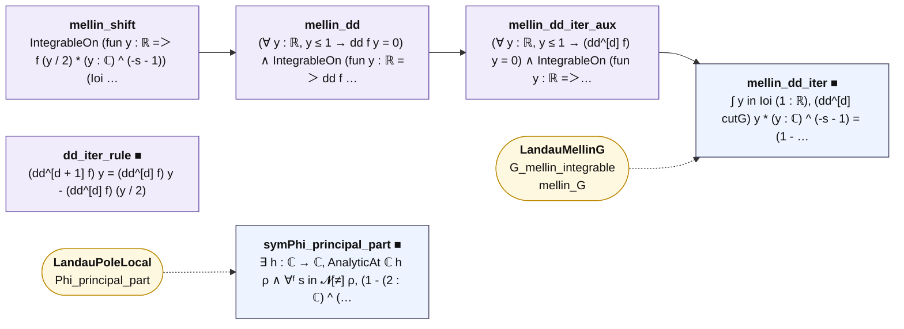

# `lean_stage3/Stage3/JointSymbol.lean`

JointSymbol — joint 9a of `SECTIONS.md`: the table of `G` along the doublings and the symbol, on the transform side. Block 9a of `lean_stage3/design/joints.md`. 2026-11-22.

6 theorems, 2 definitions, 216 lines. Arrows are Lean's own record of what each proof uses.

**Imports:** [`LandauPoleLocal`](../lean_stage3/LandauPoleLocal.md)  
**Imported by:** [`Stage3`](../lean_stage3/Stage3.md)

## The picture



An arrow A → B reads "A is used in the proof of B". Green: counting, integers only. Violet: shape, analysis with no ζ. Blue: reads ζ. A name ending in ■ is an end: nothing else uses it. Red: contains `sorry`. Yellow: theorems in another file, counted; a dotted arrow crosses files. Definitions are not drawn; they are listed below the diagram.

## Definitions

<a name="JointSymbol-dd"></a>
### `JointSymbol.dd`

def · line 42

One difference along the doublings.

- **Is:** `` dd (f : ℝ → ℂ) : ℝ → ℂ := fun y => f y - f (y / 2) ``
- **Used by 4:** [`JointSymbol.dd_iter_rule`](#JointSymbol-dd_iter_rule), [`JointSymbol.mellin_dd`](#JointSymbol-mellin_dd), [`JointSymbol.mellin_dd_iter`](#JointSymbol-mellin_dd_iter), [`JointSymbol.mellin_dd_iter_aux`](#JointSymbol-mellin_dd_iter_aux)

<a name="JointSymbol-cutG"></a>
### `JointSymbol.cutG`

def · line 45

`G` on `y > 1`, zero below: the row starts at the first regime.

- **Is:** `` cutG (y : ℝ) : ℂ := if 1 < y then (LandauWindow.G y : ℂ) else 0 ``
- **Built from:** [`LandauWindow.G`](../lean_stage3/LandauWindow.md#LandauWindow-G)
- **Used by 1:** [`JointSymbol.mellin_dd_iter`](#JointSymbol-mellin_dd_iter)

## Theorems

<a name="JointSymbol-mellin_shift"></a>
### `JointSymbol.mellin_shift`

line 50

**Shape.** Uses real or complex analysis; nothing in it or beneath it reads ζ.

**Why.** If `f` vanishes on `y ≤ 1` and `f(y)·y^(−s−1)` is integrable on `(1, ∞)`, then `f(y/2)·y^(−s−1)` is integrable there and its integral is `2^(−s)` times that of `f(y)·y^(−s−1)`.

**Proves**

```lean
IntegrableOn (fun y : ℝ => f (y / 2) * (y : ℂ) ^ (-s - 1)) (Ioi 1) ∧ ∫ y in Ioi (1 : ℝ), f (y / 2) * (y : ℂ) ^ (-s - 1) = (2 : ℂ) ^ (-s) * ∫ y in Ioi (1 : ℝ), f y * (y : ℂ) ^ (-s - 1)
```

**Needs** (its hypotheses)

  - `` hf0 : ∀ y : ℝ, y ≤ 1 → f y = 0 ``
  - `` hint : IntegrableOn (fun y : ℝ => f y * (y : ℂ) ^ (-s - 1)) (Ioi 1) ``

**Fed by:** no theorem of this repo; it stands on Mathlib.

**Feeds** (1 that use it)

  - [`JointSymbol.mellin_dd`](#JointSymbol-mellin_dd) — `` (∀ y : ℝ, y ≤ 1 → dd f y = 0) ∧ IntegrableOn (fun y : ℝ => dd f y * (y : ℂ) ^ (-s - 1)) (Ioi 1) ∧ ∫ y in Ioi (1 : ℝ), dd f y * (y : ℂ) ^ (-s - 1) = (1… ``

<a name="JointSymbol-mellin_dd"></a>
### `JointSymbol.mellin_dd`

line 108

**Shape.** Uses real or complex analysis; nothing in it or beneath it reads ζ.

**Why.** `dd` keeps the two hypotheses and multiplies the transform by the symbol.

**Proves**

```lean
(∀ y : ℝ, y ≤ 1 → dd f y = 0) ∧ IntegrableOn (fun y : ℝ => dd f y * (y : ℂ) ^ (-s - 1)) (Ioi 1) ∧ ∫ y in Ioi (1 : ℝ), dd f y * (y : ℂ) ^ (-s - 1) = (1 - (2 : ℂ) ^ (-s)) * ∫ y in Ioi (1 : ℝ), f y * (y : ℂ) ^ (-s - 1)
```

**Needs** (its hypotheses)

  - `` hf0 : ∀ y : ℝ, y ≤ 1 → f y = 0 ``
  - `` hint : IntegrableOn (fun y : ℝ => f y * (y : ℂ) ^ (-s - 1)) (Ioi 1) ``

**Stated with:** [`JointSymbol.dd`](#JointSymbol-dd)

**Fed by** (1 theorem its proof uses)

  - [`JointSymbol.mellin_shift`](#JointSymbol-mellin_shift) — `` IntegrableOn (fun y : ℝ => f (y / 2) * (y : ℂ) ^ (-s - 1)) (Ioi 1) ∧ ∫ y in Ioi (1 : ℝ), f (y / 2) * (y : ℂ) ^ (-s - 1) = (2 : ℂ) ^ (-s) * ∫ y in Ioi … ``

**Feeds** (1 that use it)

  - [`JointSymbol.mellin_dd_iter_aux`](#JointSymbol-mellin_dd_iter_aux) — `` (∀ y : ℝ, y ≤ 1 → (dd^[d] f) y = 0) ∧ IntegrableOn (fun y : ℝ => (dd^[d] f) y * (y : ℂ) ^ (-s - 1)) (Ioi 1) ∧ ∫ y in Ioi (1 : ℝ), (dd^[d] f) y * (y : … ``

<a name="JointSymbol-mellin_dd_iter_aux"></a>
### `JointSymbol.mellin_dd_iter_aux`

line 126

**Shape.** Uses real or complex analysis; nothing in it or beneath it reads ζ.

**Why.** If `f` vanishes on `y ≤ 1` and `f(y)·y^(−s−1)` is integrable on `(1, ∞)`, then the depth-`d` difference `dd^[d] f` has both properties and its transform over `(1, ∞)` is `(1 − 2^(−s))^d` times the transform of `f`.

**Proves**

```lean
(∀ y : ℝ, y ≤ 1 → (dd^[d] f) y = 0) ∧ IntegrableOn (fun y : ℝ => (dd^[d] f) y * (y : ℂ) ^ (-s - 1)) (Ioi 1) ∧ ∫ y in Ioi (1 : ℝ), (dd^[d] f) y * (y : ℂ) ^ (-s - 1) = (1 - (2 : ℂ) ^ (-s)) ^ d * ∫ y in Ioi (1 : ℝ), f y * (y : ℂ) ^ (-s - 1)
```

**Needs** (its hypotheses)

  - `` hf0 : ∀ y : ℝ, y ≤ 1 → f y = 0 ``
  - `` hint : IntegrableOn (fun y : ℝ => f y * (y : ℂ) ^ (-s - 1)) (Ioi 1) ``
  - `` d : ℕ ``

**Stated with:** [`JointSymbol.dd`](#JointSymbol-dd)

**Fed by** (1 theorem its proof uses)

  - [`JointSymbol.mellin_dd`](#JointSymbol-mellin_dd) — `` (∀ y : ℝ, y ≤ 1 → dd f y = 0) ∧ IntegrableOn (fun y : ℝ => dd f y * (y : ℂ) ^ (-s - 1)) (Ioi 1) ∧ ∫ y in Ioi (1 : ℝ), dd f y * (y : ℂ) ^ (-s - 1) = (1… ``

**Feeds** (1 that use it)

  - [`JointSymbol.mellin_dd_iter`](#JointSymbol-mellin_dd_iter) — `` ∫ y in Ioi (1 : ℝ), (dd^[d] cutG) y * (y : ℂ) ^ (-s - 1) = (1 - (2 : ℂ) ^ (-s)) ^ d * LandauMellinG.Phi s ``

<a name="JointSymbol-mellin_dd_iter"></a>
### `JointSymbol.mellin_dd_iter`

line 144

**Reads ζ.** It, or something it rests on, uses the zeta function, its zeros or the Riemann hypothesis.

**Why.** For `Re s > 1` and depth `d`, the transform of the depth-`d` difference of the cut row: `∫₁^∞ (dd^[d] cutG)(y)·y^(−s−1) dy = (1 − 2^(−s))^d · Phi s`.

**Proves**

```lean
∫ y in Ioi (1 : ℝ), (dd^[d] cutG) y * (y : ℂ) ^ (-s - 1) = (1 - (2 : ℂ) ^ (-s)) ^ d * LandauMellinG.Phi s
```

**Needs** (its hypotheses)

  - `` hs : 1 < s.re ``
  - `` d : ℕ ``

**Stated with:** [`JointSymbol.cutG`](#JointSymbol-cutG), [`JointSymbol.dd`](#JointSymbol-dd), [`LandauMellinG.Phi`](../lean_stage3/LandauMellinG.md#LandauMellinG-Phi)

**Fed by** (3 theorems its proof uses)

  - [`JointSymbol.mellin_dd_iter_aux`](#JointSymbol-mellin_dd_iter_aux) — `` (∀ y : ℝ, y ≤ 1 → (dd^[d] f) y = 0) ∧ IntegrableOn (fun y : ℝ => (dd^[d] f) y * (y : ℂ) ^ (-s - 1)) (Ioi 1) ∧ ∫ y in Ioi (1 : ℝ), (dd^[d] f) y * (y : … ``
  - [`LandauMellinG.G_mellin_integrable`](../lean_stage3/LandauMellinG.md#LandauMellinG-G_mellin_integrable) (LandauMellinG) — `` IntegrableOn (fun y : ℝ => (LandauWindow.G y : ℂ) * (y : ℂ) ^ (-s - 1)) (Ioi 1) ``
  - [`LandauMellinG.mellin_G`](../lean_stage3/LandauMellinG.md#LandauMellinG-mellin_G) (LandauMellinG) — `` ∫ y in Ioi (1 : ℝ), (LandauWindow.G y : ℂ) * (y : ℂ) ^ (-s - 1) = Phi s ``

**Definitions its proof touches:** [`LandauWindow.G`](../lean_stage3/LandauWindow.md#LandauWindow-G)

**Feeds:** nothing. It is an end.

<a name="JointSymbol-dd_iter_rule"></a>
### `JointSymbol.dd_iter_rule`

line 163

**Shape.** Uses real or complex analysis; nothing in it or beneath it reads ζ.

**Why.** The table's rule: the depth-`d+1` difference at `y` is the depth-`d` difference at `y` minus the depth-`d` difference at `y/2`.

**Proves**

```lean
(dd^[d + 1] f) y = (dd^[d] f) y - (dd^[d] f) (y / 2)
```

**Needs** (its hypotheses)

  - `` f : ℝ → ℂ ``
  - `` d : ℕ ``
  - `` y : ℝ ``

**Stated with:** [`JointSymbol.dd`](#JointSymbol-dd)

**Fed by:** no theorem of this repo; it stands on Mathlib and the definitions below.

**Feeds:** nothing. It is an end.

<a name="JointSymbol-symPhi_principal_part"></a>
### `JointSymbol.symPhi_principal_part`

line 171

**Reads ζ.** It, or something it rests on, uses the zeta function, its zeros or the Riemann hypothesis.

**Why.** For a zero `ρ` of `riemannZeta` with `ρ ≠ 0` and `ρ ≠ 1`, and any depth `d`: near `ρ` and off it, `(1 − 2^(−s))^d · Phi s` is a function analytic at `ρ` plus `(1 − 2^(−ρ))^d · A/(s − ρ)`, where `A = m/(ρ(1−ρ))` and `m` is the order of the zero.

**Proves**

```lean
∃ h : ℂ → ℂ, AnalyticAt ℂ h ρ ∧ ∀ᶠ s in 𝓝[≠] ρ, (1 - (2 : ℂ) ^ (-s)) ^ d * LandauMellinG.Phi s = h s + (1 - (2 : ℂ) ^ (-ρ)) ^ d * ((analyticOrderNatAt riemannZeta ρ : ℂ) / (ρ * (1 - ρ))) / (s - ρ)
```

**Needs** (its hypotheses)

  - `` h0 : ρ ≠ 0 ``
  - `` h1 : ρ ≠ 1 ``
  - `` hz : riemannZeta ρ = 0 ``
  - `` d : ℕ ``

**Stated with:** [`LandauMellinG.Phi`](../lean_stage3/LandauMellinG.md#LandauMellinG-Phi)

**Fed by** (1 theorem its proof uses)

  - [`LandauPoleLocal.Phi_principal_part`](../lean_stage3/LandauPoleLocal.md#LandauPoleLocal-Phi_principal_part) (LandauPoleLocal) — `` ∃ h : ℂ → ℂ, AnalyticAt ℂ h ρ ∧ ∀ᶠ s in 𝓝[≠] ρ, LandauMellinG.Phi s = h s + (analyticOrderNatAt riemannZeta ρ : ℂ) / (ρ * (1 - ρ)) / (s - ρ) ``

**Feeds:** nothing. It is an end.

