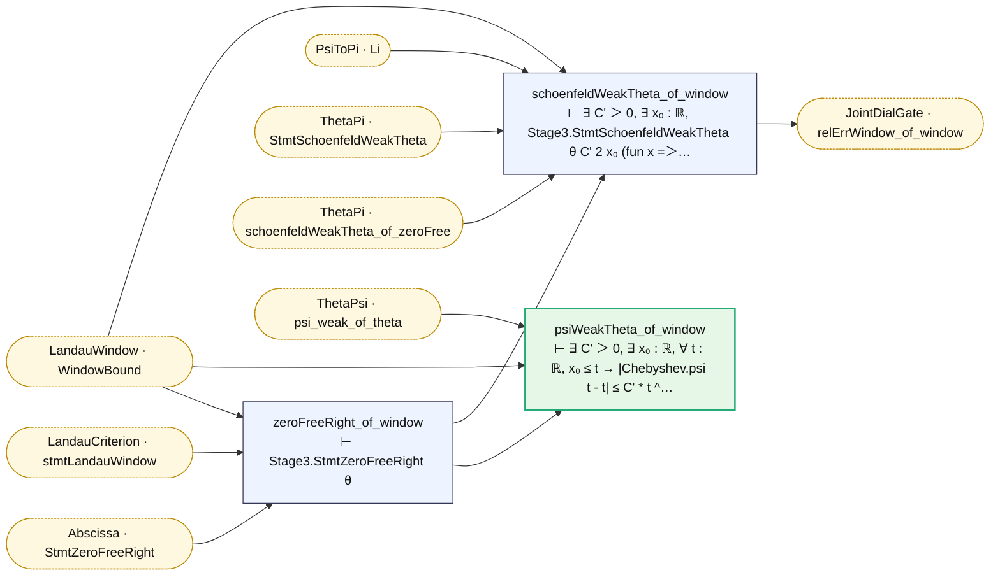

# `lean_stage3/Stage3/JointWindowDial.lean`

**What it does** (its own header): JointWindowDial — joint 1 of `SECTIONS.md`: the Landau window onto the dial. Block 1 of `lean_stage3/design/joints.md`. 2026-11-22.

**Imports:** [`LandauCriterion`](../lean_stage3/LandauCriterion.md), [`ThetaPi`](../lean_stage3/ThetaPi.md).
**Imported by:** [`Stage3`](../lean_stage3/Stage3.md), [`JointDialGate`](../lean_stage3/JointDialGate.md).

Blue: theorem. Green: a theorem nothing else uses (an end). Dashed white: connects to nothing. Grey: definition. Red: contains `sorry`. Yellow: in another file. An arrow A → B reads "A is used by B".

## Every declaration

| declaration | proves (output) | needs (input) | why (its own docstring) | uses | used by |
|---|---|---|---|---|---|
| `JointWindowDial.zeroFreeRight_of_window` theorem, line 33 | Stage3.StmtZeroFreeRight θ | hθ0 : 0 &lt; θ; hθ1 : θ &lt; 1; hδ : 0 &lt; δ; hW : LandauWindow.WindowBound θ δ C | — | `Stage3.StmtZeroFreeRight`, `LandauCriterion.stmtLandauWindow`, `LandauWindow.WindowBound` | `JointWindowDial.psiWeakTheta_of_window`, `JointWindowDial.schoenfeldWeakTheta_of_window` |
| `JointWindowDial.psiWeakTheta_of_window` theorem, line 38 | ∃ C' &gt; 0, ∃ x₀ : ℝ, ∀ t : ℝ, x₀ ≤ t → \|Chebyshev.psi t - t\| ≤ C' * t ^ θ * Real.log t ^ 3 | hθlo : 1 / 2 ≤ θ; hθ1 : θ &lt; 1; hδ : 0 &lt; δ; hW : LandauWindow.WindowBound θ δ C | — | `JointWindowDial.zeroFreeRight_of_window`, `LandauWindow.WindowBound`, `Stage3.psi_weak_of_theta` | — |
| `JointWindowDial.schoenfeldWeakTheta_of_window` theorem, line 44 | ∃ C' &gt; 0, ∃ x₀ : ℝ, Stage3.StmtSchoenfeldWeakTheta θ C' 2 x₀ (fun x =&gt; (Nat.primeCounting ⌊x⌋₊ : ℝ)) Stage3.Li | hθlo : 1 / 2 ≤ θ; hθ1 : θ &lt; 1; hδ : 0 &lt; δ; hW : LandauWindow.WindowBound θ δ C | — | `JointWindowDial.zeroFreeRight_of_window`, `LandauWindow.WindowBound`, `Stage3.Li`, `Stage3.StmtSchoenfeldWeakTheta`, `Stage3.schoenfeldWeakTheta_of_zeroFree` | `JointDialGate.relErrWindow_of_window` |
