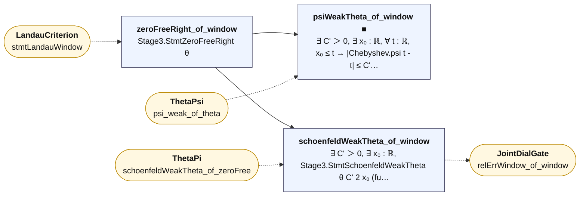

# `lean_stage3/Stage3/JointWindowDial.lean`

JointWindowDial — joint 1 of `SECTIONS.md`: the Landau window onto the dial. Block 1 of `lean_stage3/design/joints.md`. 2026-11-22.

3 theorems, 0 definitions, 72 lines. Arrows are Lean's own record of what each proof uses.

**Imports:** [`LandauCriterion`](../lean_stage3/LandauCriterion.md), [`ThetaPi`](../lean_stage3/ThetaPi.md)  
**Imported by:** [`Stage3`](../lean_stage3/Stage3.md), [`JointDialGate`](../lean_stage3/JointDialGate.md)

## The picture



An arrow A → B reads "A is used in the proof of B". Green: counting, integers only. Violet: shape, analysis with no ζ. Blue: reads ζ. A name ending in ■ is an end: nothing else uses it. Red: contains `sorry`. Yellow: theorems in another file, counted; a dotted arrow crosses files. Definitions are not drawn; they are listed below the diagram.

## Theorems

<a name="JointWindowDial-zeroFreeRight_of_window"></a>
### `JointWindowDial.zeroFreeRight_of_window`

line 35

**Reads ζ.** It, or something it rests on, uses the zeta function, its zeros or the Riemann hypothesis.

**Why.** For `0 < θ < 1` and `0 < δ`, a window bound on `G` at `θ` gives the zero-free half-plane `StmtZeroFreeRight θ`: ζ has no zero with real part above `θ`.

**Proves**

```lean
Stage3.StmtZeroFreeRight θ
```

**Needs** (its hypotheses)

  - `` hθ0 : 0 < θ ``
  - `` hθ1 : θ < 1 ``
  - `` hδ : 0 < δ ``
  - `` hW : LandauWindow.WindowBound θ δ C ``

**Stated with:** [`Stage3.StmtZeroFreeRight`](../lean_stage3/Abscissa.md#Stage3-StmtZeroFreeRight), [`LandauWindow.WindowBound`](../lean_stage3/LandauWindow.md#LandauWindow-WindowBound)

**Fed by** (1 theorem its proof uses)

  - [`LandauCriterion.stmtLandauWindow`](../lean_stage3/LandauCriterion.md#LandauCriterion-stmtLandauWindow) (LandauCriterion) — `` LandauWindow.StmtLandauWindow ``

**Feeds** (2 that use it)

  - [`JointWindowDial.psiWeakTheta_of_window`](#JointWindowDial-psiWeakTheta_of_window) — `` ∃ C' > 0, ∃ x₀ : ℝ, ∀ t : ℝ, x₀ ≤ t → |Chebyshev.psi t - t| ≤ C' * t ^ θ * Real.log t ^ 3 ``
  - [`JointWindowDial.schoenfeldWeakTheta_of_window`](#JointWindowDial-schoenfeldWeakTheta_of_window) — `` ∃ C' > 0, ∃ x₀ : ℝ, Stage3.StmtSchoenfeldWeakTheta θ C' 2 x₀ (fun x => (Nat.primeCounting ⌊x⌋₊ : ℝ)) Stage3.Li ``

<a name="JointWindowDial-psiWeakTheta_of_window"></a>
### `JointWindowDial.psiWeakTheta_of_window`

line 42

**Reads ζ.** It, or something it rests on, uses the zeta function, its zeros or the Riemann hypothesis.

**Why.** For `1/2 ≤ θ < 1` and `0 < δ`, a window bound on `G` at `θ` gives `C' > 0` and `x₀` with `|ψ(t) − t| ≤ C'·t^θ·log³ t` for all `t ≥ x₀`.

**Proves**

```lean
∃ C' > 0, ∃ x₀ : ℝ, ∀ t : ℝ, x₀ ≤ t → |Chebyshev.psi t - t| ≤ C' * t ^ θ * Real.log t ^ 3
```

**Needs** (its hypotheses)

  - `` hθlo : 1 / 2 ≤ θ ``
  - `` hθ1 : θ < 1 ``
  - `` hδ : 0 < δ ``
  - `` hW : LandauWindow.WindowBound θ δ C ``

**Stated with:** [`LandauWindow.WindowBound`](../lean_stage3/LandauWindow.md#LandauWindow-WindowBound)

**Fed by** (2 theorems its proof uses)

  - [`JointWindowDial.zeroFreeRight_of_window`](#JointWindowDial-zeroFreeRight_of_window) — `` Stage3.StmtZeroFreeRight θ ``
  - [`Stage3.psi_weak_of_theta`](../lean_stage3/ThetaPsi.md#Stage3-psi_weak_of_theta) (ThetaPsi) — `` ∃ C > 0, ∃ x₀ : ℝ, ∀ t : ℝ, x₀ ≤ t → |ψ t - t| ≤ C * t ^ θ * (Real.log t) ^ 3 ``

**Feeds:** nothing. It is an end.

<a name="JointWindowDial-schoenfeldWeakTheta_of_window"></a>
### `JointWindowDial.schoenfeldWeakTheta_of_window`

line 50

**Reads ζ.** It, or something it rests on, uses the zeta function, its zeros or the Riemann hypothesis.

**Why.** For `1/2 ≤ θ < 1` and `0 < δ`, a window bound on `G` at `θ` gives `C' > 0` and `x₀` with `|π(x) − Li(x)| ≤ C'·x^θ·log² x` for all `x ≥ x₀`.

**Proves**

```lean
∃ C' > 0, ∃ x₀ : ℝ, Stage3.StmtSchoenfeldWeakTheta θ C' 2 x₀ (fun x => (Nat.primeCounting ⌊x⌋₊ : ℝ)) Stage3.Li
```

**Needs** (its hypotheses)

  - `` hθlo : 1 / 2 ≤ θ ``
  - `` hθ1 : θ < 1 ``
  - `` hδ : 0 < δ ``
  - `` hW : LandauWindow.WindowBound θ δ C ``

**Stated with:** [`LandauWindow.WindowBound`](../lean_stage3/LandauWindow.md#LandauWindow-WindowBound), [`Stage3.Li`](../lean_stage3/PsiToPi.md#Stage3-Li), [`Stage3.StmtSchoenfeldWeakTheta`](../lean_stage3/ThetaPi.md#Stage3-StmtSchoenfeldWeakTheta)

**Fed by** (2 theorems its proof uses)

  - [`JointWindowDial.zeroFreeRight_of_window`](#JointWindowDial-zeroFreeRight_of_window) — `` Stage3.StmtZeroFreeRight θ ``
  - [`Stage3.schoenfeldWeakTheta_of_zeroFree`](../lean_stage3/ThetaPi.md#Stage3-schoenfeldWeakTheta_of_zeroFree) (ThetaPi) — `` ∃ C > 0, ∃ x₀ : ℝ, StmtSchoenfeldWeakTheta θ C 2 x₀ (fun x => (Nat.primeCounting ⌊x⌋₊ : ℝ)) Li ``

**Feeds** (1 that use it)

  - [`JointDialGate.relErrWindow_of_window`](../lean_stage3/JointDialGate.md#JointDialGate-relErrWindow_of_window) (JointDialGate) — `` ∃ A x₀ : ℝ, 0 ≤ A ∧ ∀ (r : ℤ) (n : ℕ), x₀ ≤ (2 : ℝ) ^ ((r : ℝ) - n) → 0 ≤ (r : ℝ) - n → StmtRelErrWindow (fun m : ℤ => (Nat.primeCounting ⌊(2 : ℝ) ^ (… ``

