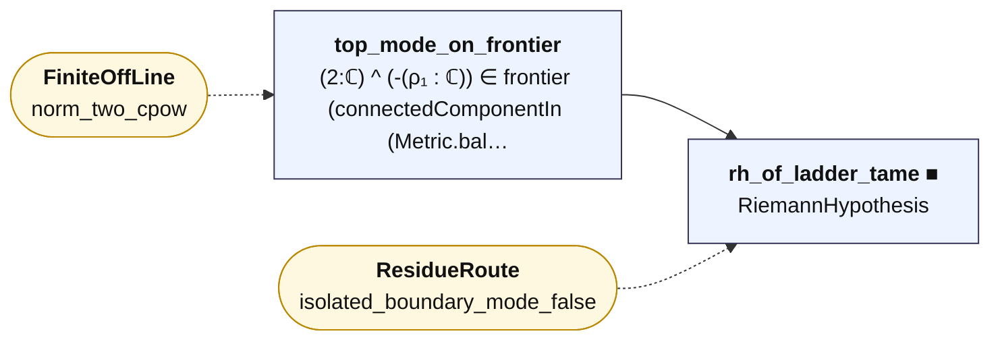

# `lean_stage3/Stage3/LadderAssembly.lean`

> **Read from the source text.** This file changed after the last `python3 utilities/lean_map.py --dump`, so the arrows on this page are names occurring in each proof and have not been confirmed by Lean.

LadderAssembly — block S5 of `lean_stage3/design/stencil.md`. 2026-11-24. Julian, 2026-11-24: assemble the ladder route; step (D) and the assembled theorem. Block S4 (`ResidueRoute.isolated_boundary_mode_false`) needs a mode `u₁ = 2^(−ρ₁)` isolated in `K σ = closure {2^(−ρ) : Re ρ ≥ σ}` and on the frontier of the component of `0` in `{|u| < 2^(−σ)} ∖ K σ`.

2 theorems, 0 definitions, 133 lines. 

**Imports:** [`ClosedLoopJoin`](../lean_stage3/ClosedLoopJoin.md), [`ResidueRoute`](../lean_stage3/ResidueRoute.md)  
**Imported by:** [`Stage3`](../lean_stage3/Stage3.md)

## The picture



An arrow A → B reads "A is used in the proof of B". Green: counting, integers only. Violet: shape, analysis with no ζ. Blue: reads ζ. A name ending in ■ is an end: nothing else uses it. Red: contains `sorry`. Yellow: theorems in another file, counted; a dotted arrow crosses files. Definitions are not drawn; they are listed below the diagram.

## Theorems

<a name="LadderAssembly-top_mode_on_frontier"></a>
### `LadderAssembly.top_mode_on_frontier`

line 35 · arrows read from text

**Reads ζ.** It, or something it rests on, uses the zeta function, its zeros or the Riemann hypothesis.

**Why.** (D) The top mode is on the frontier. If every zero has real part at most `Re ρ₁` and `σ ≤ Re ρ₁`, the mode `2^(−ρ₁)` lies on the frontier of the connected component of `{|u| < 2^(−σ)} ∖ K σ` that holds `0`.

**Proves**

```lean
(2:ℂ) ^ (-(ρ₁ : ℂ)) ∈ frontier (connectedComponentIn (Metric.ball (0:ℂ) ((2:ℝ) ^ (-σ)) \ ResidueRoute.K σ) 0)
```

**Needs** (its hypotheses)

  - `` ρ₁ : Kadiri.NontrivialZeros ``
  - `` htop : ∀ ρ : Kadiri.NontrivialZeros, (ρ : ℂ).re ≤ (ρ₁ : ℂ).re ``
  - `` hσ : σ ≤ (ρ₁ : ℂ).re ``

**Fed by** (1 theorem its proof uses)

  - [`FiniteOffLine.norm_two_cpow`](../lean_stage3/FiniteOffLine.md#FiniteOffLine-norm_two_cpow) (FiniteOffLine) — `` ‖(2:ℂ) ^ ρ‖ = (2:ℝ) ^ ρ.re ``

**Definitions its proof touches:** [`ResidueRoute.K`](../lean_stage3/ResidueRoute.md#ResidueRoute-K)

**Feeds** (1 that use it)

  - [`LadderAssembly.rh_of_ladder_tame`](#LadderAssembly-rh_of_ladder_tame) — `` RiemannHypothesis ``

<a name="LadderAssembly-rh_of_ladder_tame"></a>
### `LadderAssembly.rh_of_ladder_tame`

line 84 · arrows read from text

**Reads ζ.** It, or something it rests on, uses the zeta function, its zeros or the Riemann hypothesis.

**Why.** The ladder route, assembled. Under the ladder bound `|ψ(2^k) − 2^k| ≤ C·k²·√2^k` for `k ≥ 1`, if every failure of the Riemann hypothesis has a tame top — a zero `ρ₁` with `1/2 < Re ρ₁`, every real part at most `Re ρ₁`, and `σ₀ ∈ (1/2, Re ρ₁)`, `ε > 0` with every mode of real part `≥ σ₀` other than `2^(−ρ₁)` at distance at least `ε` from it — then the Riemann hypothesis holds.

**Proves**

```lean
RiemannHypothesis
```

**Needs** (its hypotheses)

  - `` hH : ∀ k : ℕ, 1 ≤ k → ‖(Chebyshev.psi ((2:ℝ)^k) : ℂ) - (((2:ℝ)^k : ℝ) : ℂ)‖ ≤ C * (k:ℝ)^2 * Real.sqrt 2 ^ k ``
  - `` htame : ¬ RiemannHypothesis → ∃ ρ₁ : Kadiri.NontrivialZeros, 1/2 < (ρ₁:ℂ).re ∧ (∀ ρ : Kadiri.NontrivialZeros, (ρ:ℂ).re ≤ (ρ₁:ℂ).re) ∧ ∃ σ₀ ε : ℝ, 1/2 < σ₀ ∧ σ₀ < (ρ₁:ℂ).re ∧ 0 < ε ∧ ∀ ρ : Kadiri.NontrivialZeros, σ₀ ≤ (ρ:ℂ).re → (2:ℂ)^(-(ρ:ℂ)) ≠ (2:ℂ)^(-(ρ₁:ℂ)) → ε ≤ ‖(2:ℂ)^(-(ρ:ℂ)) - (2:ℂ)^(-(ρ₁:ℂ))… ``

**Fed by** (2 theorems its proof uses)

  - [`LadderAssembly.top_mode_on_frontier`](#LadderAssembly-top_mode_on_frontier) — `` (2:ℂ) ^ (-(ρ₁ : ℂ)) ∈ frontier (connectedComponentIn (Metric.ball (0:ℂ) ((2:ℝ) ^ (-σ)) \ ResidueRoute.K σ) 0) ``
  - [`ResidueRoute.isolated_boundary_mode_false`](../lean_stage3/ResidueRoute.md#ResidueRoute-isolated_boundary_mode_false) (ResidueRoute) — `` ∃ E : ℝ, σ₀ ≤ E ∧ E < Θ ∧ ∀ σ : ℝ, E ≤ σ → ∀ ρ₁ : Kadiri.NontrivialZeros, σ < (ρ₁ : ℂ).re → (∃ ε : ℝ, 0 < ε ∧ ∀ u ∈ K σ, ‖u - (2:ℂ) ^ (-(ρ₁ : ℂ))‖ < ε… ``

**Feeds:** nothing. It is an end.

