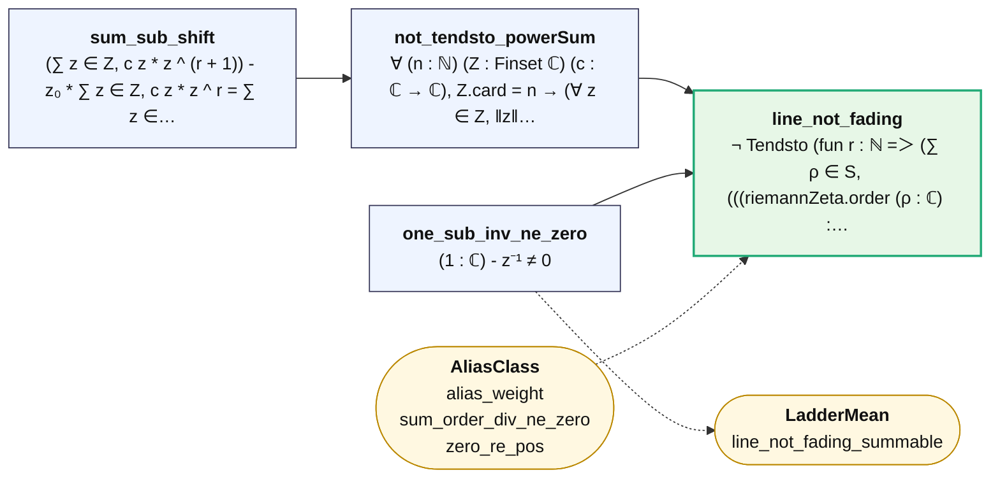

# `lean_stage3/Stage3/LadderFading.lean`

LadderFading — block J10b of `lean_stage3/design/joints.md`. 2026-11-22. Joint 10 on the table's own ladder, second piece. `AliasClass` showed that the zeros the ladder folds together contribute one mode with a weight that is not zero. This module shows that finitely many such modes of one size cannot fade: their sum along the rows is not small against that size. The proof is the table's own operation: one difference with the symbol of a mode removes that mode and keeps every other weight nonzero.

4 theorems, 0 definitions, 162 lines. Arrows are Lean's own record of what each proof uses.

**Imports:** [`AliasClass`](../lean_stage3/AliasClass.md)  
**Imported by:** [`Stage3`](../lean_stage3/Stage3.md), [`LadderMean`](../lean_stage3/LadderMean.md)

## The picture



An arrow A → B reads "A is used in the proof of B". Blue: theorem. Green: a theorem nothing else uses (an end). Dashed: connects to nothing. Red: contains `sorry`. Yellow: theorems in another file, counted; a dotted arrow crosses files. Definitions are not drawn; they are listed below the diagram.

## Theorems

<a name="LadderFading-sum_sub_shift"></a>
### `LadderFading.sum_sub_shift`

line 35

**Why.** One difference removes one mode. Differencing a sum of modes with the symbol of `z₀` deletes the mode `z₀` and multiplies each other weight by `z − z₀`.

**Proves**

```lean
(∑ z ∈ Z, c z * z ^ (r + 1)) - z₀ * ∑ z ∈ Z, c z * z ^ r = ∑ z ∈ Z.erase z₀, (c z * (z - z₀)) * z ^ r
```

**Needs** (its hypotheses)

  - `` Z : Finset ℂ ``
  - `` c : ℂ → ℂ ``
  - `` hz₀ : z₀ ∈ Z ``
  - `` r : ℕ ``

**Fed by:** no theorem of this repo; it stands on Mathlib.

**Feeds** (1 that use it)

  - [`LadderFading.not_tendsto_powerSum`](#LadderFading-not_tendsto_powerSum) — `` ∀ (n : ℕ) (Z : Finset ℂ) (c : ℂ → ℂ), Z.card = n → (∀ z ∈ Z, ‖z‖ = R) → (∃ z ∈ Z, c z ≠ 0) → ¬ Tendsto (fun r : ℕ => (∑ z ∈ Z, c z * z ^ r) / ((R : ℂ)… ``

<a name="LadderFading-not_tendsto_powerSum"></a>
### `LadderFading.not_tendsto_powerSum`

line 46

**Why.** Finitely many modes of one size do not fade. If the modes `z ∈ Z` all have modulus `R` and at least one has a weight that is not zero, their sum along the rows, measured against `R^r`, does not tend to zero.

**Proves**

```lean
∀ (n : ℕ) (Z : Finset ℂ) (c : ℂ → ℂ), Z.card = n → (∀ z ∈ Z, ‖z‖ = R) → (∃ z ∈ Z, c z ≠ 0) → ¬ Tendsto (fun r : ℕ => (∑ z ∈ Z, c z * z ^ r) / ((R : ℂ)) ^ r) atTop (𝓝 0)
```

**Needs** (its hypotheses)

  - `` hR : 0 < R ``

**Fed by** (1 theorem its proof uses)

  - [`LadderFading.sum_sub_shift`](#LadderFading-sum_sub_shift) — `` (∑ z ∈ Z, c z * z ^ (r + 1)) - z₀ * ∑ z ∈ Z, c z * z ^ r = ∑ z ∈ Z.erase z₀, (c z * (z - z₀)) * z ^ r ``

**Feeds** (1 that use it)

  - [`LadderFading.line_not_fading`](#LadderFading-line_not_fading) — `` ¬ Tendsto (fun r : ℕ => (∑ ρ ∈ S, (((riemannZeta.order (ρ : ℂ) : ℤ) : ℂ)) / (ρ : ℂ) * Chain.Sym 2 (ρ : ℂ) ^ d * Chain.mode 2 (ρ : ℂ) (((r : ℤ)) : ℂ)) … ``

<a name="LadderFading-one_sub_inv_ne_zero"></a>
### `LadderFading.one_sub_inv_ne_zero`

line 92

**Why.** Outside the unit circle the symbol `1 − z⁻¹` is not zero.

**Proves**

```lean
(1 : ℂ) - z⁻¹ ≠ 0
```

**Needs** (its hypotheses)

  - `` hz : 1 < ‖z‖ ``

**Fed by:** no theorem of this repo; it stands on Mathlib.

**Feeds** (2 that use it)

  - [`LadderFading.line_not_fading`](#LadderFading-line_not_fading) — `` ¬ Tendsto (fun r : ℕ => (∑ ρ ∈ S, (((riemannZeta.order (ρ : ℂ) : ℤ) : ℂ)) / (ρ : ℂ) * Chain.Sym 2 (ρ : ℂ) ^ d * Chain.mode 2 (ρ : ℂ) (((r : ℤ)) : ℂ)) … ``
  - [`LadderMean.line_not_fading_summable`](../lean_stage3/LadderMean.md#LadderMean-line_not_fading_summable) (LadderMean) — `` ¬ Tendsto (fun r : ℕ => (∑' ρ : S, coef ρ * Chain.Sym 2 ((ρ : Kadiri.NontrivialZeros) : ℂ) ^ d * Chain.mode 2 ((ρ : Kadiri.NontrivialZeros) : ℂ) (((r … ``

<a name="LadderFading-line_not_fading"></a>
### `LadderFading.line_not_fading`

line 103

**Why.** A finite line of zeros does not fade from the cells. Take any nonempty finite set of zeros of ζ with one real part `β`. Their contribution to the cell `(r, d)` of the table's own ladder, measured against `2^(rβ)`, does not tend to zero as the rows go on.

**Proves**

```lean
¬ Tendsto (fun r : ℕ => (∑ ρ ∈ S, (((riemannZeta.order (ρ : ℂ) : ℤ) : ℂ)) / (ρ : ℂ) * Chain.Sym 2 (ρ : ℂ) ^ d * Chain.mode 2 (ρ : ℂ) (((r : ℤ)) : ℂ)) / ((((2 : ℝ) ^ β : ℝ)) : ℂ) ^ r) atTop (𝓝 0)
```

**Needs** (its hypotheses)

  - `` S : Finset Kadiri.NontrivialZeros ``
  - `` hS : S.Nonempty ``
  - `` hβ : ∀ ρ ∈ S, (ρ : ℂ).re = β ``
  - `` d : ℕ ``

**Stated with:** [`Chain.Sym`](../lean/Chain.md#Chain-Sym), [`Chain.mode`](../lean/Chain.md#Chain-mode)

**Fed by** (5 theorems its proof uses)

  - [`AliasClass.alias_weight`](../lean_stage3/AliasClass.md#AliasClass-alias_weight) (AliasClass) — `` ∑ ρ ∈ S, (((riemannZeta.order (ρ : ℂ) : ℤ) : ℂ)) / (ρ : ℂ) * Chain.Sym 2 (ρ : ℂ) ^ d * Chain.mode 2 (ρ : ℂ) (r : ℂ) = (∑ ρ ∈ S, (((riemannZeta.order (… ``
  - [`AliasClass.sum_order_div_ne_zero`](../lean_stage3/AliasClass.md#AliasClass-sum_order_div_ne_zero) (AliasClass) — `` ∑ ρ ∈ S, (((riemannZeta.order (ρ : ℂ) : ℤ) : ℂ)) / (ρ : ℂ) ≠ 0 ``
  - [`AliasClass.zero_re_pos`](../lean_stage3/AliasClass.md#AliasClass-zero_re_pos) (AliasClass) — `` 0 < (ρ : ℂ).re ``
  - [`LadderFading.not_tendsto_powerSum`](#LadderFading-not_tendsto_powerSum) — `` ∀ (n : ℕ) (Z : Finset ℂ) (c : ℂ → ℂ), Z.card = n → (∀ z ∈ Z, ‖z‖ = R) → (∃ z ∈ Z, c z ≠ 0) → ¬ Tendsto (fun r : ℕ => (∑ z ∈ Z, c z * z ^ r) / ((R : ℂ)… ``
  - [`LadderFading.one_sub_inv_ne_zero`](#LadderFading-one_sub_inv_ne_zero) — `` (1 : ℂ) - z⁻¹ ≠ 0 ``

**Feeds:** nothing. It is an end.

