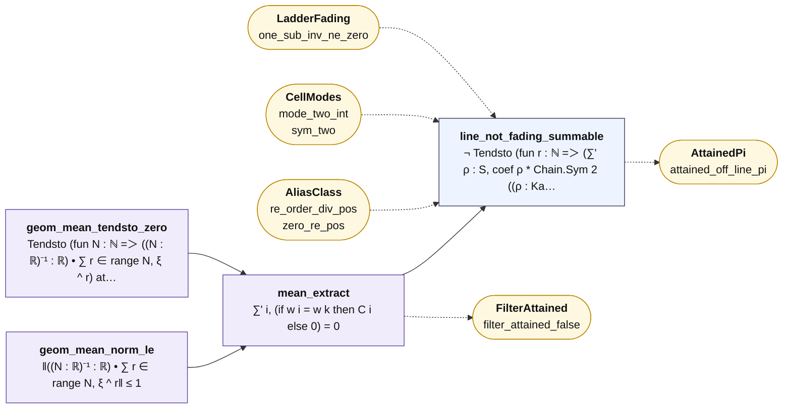

# `lean_stage3/Stage3/LadderMean.lean`

LadderMean — block J10c of `lean_stage3/design/joints.md`. 2026-11-22. Joint 10 on the table's own ladder, third piece. `LadderFading` showed that finitely many modes of one size cannot fade. Here the modes may be infinitely many, with weights that are absolutely summable: averaging along the rows picks out the weight of one folded class, so a sum that fades has every folded class of weight zero. For the zeros of ζ on one vertical line the folded classes have weight with positive real part, so they cannot fade.

4 theorems, 2 definitions, 230 lines. Arrows are Lean's own record of what each proof uses.

**Imports:** [`LadderFading`](../lean_stage3/LadderFading.md)  
**Imported by:** [`Stage3`](../lean_stage3/Stage3.md), [`AttainedPi`](../lean_stage3/AttainedPi.md), [`FilterAttained`](../lean_stage3/FilterAttained.md), [`FiniteOffLine`](../lean_stage3/FiniteOffLine.md)

## The picture



An arrow A → B reads "A is used in the proof of B". Green: counting, integers only. Violet: shape, analysis with no ζ. Blue: reads ζ. A name ending in ■ is an end: nothing else uses it. Red: contains `sorry`. Yellow: theorems in another file, counted; a dotted arrow crosses files. Definitions are not drawn; they are listed below the diagram.

## Definitions

<a name="LadderMean-coef"></a>
### `LadderMean.coef`

def · line 122

The coefficient a zero carries in the cell: its multiplicity over the zero.

- **Is:** `` coef (ρ : Kadiri.NontrivialZeros) : ℂ := (((riemannZeta.order (ρ : ℂ) : ℤ) : ℂ)) / (ρ : ℂ) ``
- **Used by 27:** [`AttainedPi.attained_off_line_pi`](../lean_stage3/AttainedPi.md#AttainedPi-attained_off_line_pi), [`AttainedPi.fin_bound`](../lean_stage3/AttainedPi.md#AttainedPi-fin_bound), [`AttainedPi.fin_eventually`](../lean_stage3/AttainedPi.md#AttainedPi-fin_eventually), [`AttainedPi.norm_tailTerm_le`](../lean_stage3/AttainedPi.md#AttainedPi-norm_tailTerm_le), [`AttainedPi.norm_term`](../lean_stage3/AttainedPi.md#AttainedPi-norm_term), [`AttainedPi.summable_line`](../lean_stage3/AttainedPi.md#AttainedPi-summable_line), [`AttainedPi.tendsto_tail`](../lean_stage3/AttainedPi.md#AttainedPi-tendsto_tail), [`AttainedPi.term`](../lean_stage3/AttainedPi.md#AttainedPi-term), [`AttainedPi.tsum_split`](../lean_stage3/AttainedPi.md#AttainedPi-tsum_split), [`FilterAttained.filter_attained_false`](../lean_stage3/FilterAttained.md#FilterAttained-filter_attained_false), [`FilterAttained.finite_part_le`](../lean_stage3/FilterAttained.md#FilterAttained-finite_part_le), [`FilterAttained.norm_tailT_le`](../lean_stage3/FilterAttained.md#FilterAttained-norm_tailT_le), [`FilterAttained.summable_S`](../lean_stage3/FilterAttained.md#FilterAttained-summable_S), [`FilterAttained.tailT`](../lean_stage3/FilterAttained.md#FilterAttained-tailT), [`FilterAttained.tendsto_full`](../lean_stage3/FilterAttained.md#FilterAttained-tendsto_full), [`FilterAttained.tsum_split`](../lean_stage3/FilterAttained.md#FilterAttained-tsum_split), [`LadderMean.line_not_fading_summable`](#LadderMean-line_not_fading_summable), [`ReachRoute.reached_mode_false`](../lean_stage3/ReachRoute.md#ReachRoute-reached_mode_false), [`ResidueRoute.F`](../lean_stage3/ResidueRoute.md#ResidueRoute-F), [`ResidueRoute.G_eq_F`](../lean_stage3/ResidueRoute.md#ResidueRoute-G_eq_F), [`ResidueRoute.P`](../lean_stage3/ResidueRoute.md#ResidueRoute-P), [`ResidueRoute.P_bound`](../lean_stage3/ResidueRoute.md#ResidueRoute-P_bound), [`ResidueRoute.differentiableAt_F`](../lean_stage3/ResidueRoute.md#ResidueRoute-differentiableAt_F), [`ResidueRoute.isolated_boundary_mode_false`](../lean_stage3/ResidueRoute.md#ResidueRoute-isolated_boundary_mode_false), [`ResidueRoute.summable_coef`](../lean_stage3/ResidueRoute.md#ResidueRoute-summable_coef), [`ZeroSummable.norm_coef`](../lean_stage3/ZeroSummable.md#ZeroSummable-norm_coef), [`ZeroSummable.summable_norm_coef`](../lean_stage3/ZeroSummable.md#ZeroSummable-summable_norm_coef)

<a name="LadderMean-zOf"></a>
### `LadderMean.zOf`

def · line 126

The mode of a zero on the ladder: two to the zero.

- **Is:** `` zOf (ρ : Kadiri.NontrivialZeros) : ℂ := (2 : ℂ) ^ (ρ : ℂ) ``
- **Used by 1:** [`LadderMean.line_not_fading_summable`](#LadderMean-line_not_fading_summable)

## Theorems

<a name="LadderMean-geom_mean_norm_le"></a>
### `LadderMean.geom_mean_norm_le`

line 35

**Shape.** Uses real or complex analysis; nothing in it or beneath it reads ζ.

**Why.** The mean of the powers of a point on the unit circle is at most one in size.

**Proves**

```lean
‖((N : ℝ)⁻¹ : ℝ) • ∑ r ∈ range N, ξ ^ r‖ ≤ 1
```

**Needs** (its hypotheses)

  - `` hξ : ‖ξ‖ = 1 ``
  - `` N : ℕ ``

**Fed by:** no theorem of this repo; it stands on Mathlib.

**Feeds** (1 that use it)

  - [`LadderMean.mean_extract`](#LadderMean-mean_extract) — `` ∑' i, (if w i = w k then C i else 0) = 0 ``

<a name="LadderMean-geom_mean_tendsto_zero"></a>
### `LadderMean.geom_mean_tendsto_zero`

line 50

**Shape.** Uses real or complex analysis; nothing in it or beneath it reads ζ.

**Why.** The mean of the powers of a point on the unit circle other than one tends to zero: a rotation that is not the identity averages out.

**Proves**

```lean
Tendsto (fun N : ℕ => ((N : ℝ)⁻¹ : ℝ) • ∑ r ∈ range N, ξ ^ r) atTop (𝓝 0)
```

**Needs** (its hypotheses)

  - `` hξ : ‖ξ‖ = 1 ``
  - `` hne : ξ ≠ 1 ``

**Fed by:** no theorem of this repo; it stands on Mathlib.

**Feeds** (1 that use it)

  - [`LadderMean.mean_extract`](#LadderMean-mean_extract) — `` ∑' i, (if w i = w k then C i else 0) = 0 ``

<a name="LadderMean-mean_extract"></a>
### `LadderMean.mean_extract`

line 68

**Shape.** Uses real or complex analysis; nothing in it or beneath it reads ζ.

**Why.** Averaging along the rows picks out one folded class. If an absolutely summable sum of rotations tends to zero along the rows, then for every mode the weights of all the modes equal to it add to zero.

**Proves**

```lean
∑' i, (if w i = w k then C i else 0) = 0
```

**Needs** (its hypotheses)

  - `` w C : ι → ℂ ``
  - `` hw : ∀ i, ‖w i‖ = 1 ``
  - `` hC : Summable fun i => ‖C i‖ ``
  - `` k : ι ``
  - `` h : Tendsto (fun r : ℕ => ∑' i, C i * w i ^ r) atTop (𝓝 0) ``

**Fed by** (2 theorems its proof uses)

  - [`LadderMean.geom_mean_norm_le`](#LadderMean-geom_mean_norm_le) — `` ‖((N : ℝ)⁻¹ : ℝ) • ∑ r ∈ range N, ξ ^ r‖ ≤ 1 ``
  - [`LadderMean.geom_mean_tendsto_zero`](#LadderMean-geom_mean_tendsto_zero) — `` Tendsto (fun N : ℕ => ((N : ℝ)⁻¹ : ℝ) • ∑ r ∈ range N, ξ ^ r) atTop (𝓝 0) ``

**Feeds** (2 that use it)

  - [`FilterAttained.filter_attained_false`](../lean_stage3/FilterAttained.md#FilterAttained-filter_attained_false) (FilterAttained) — `` False ``
  - [`LadderMean.line_not_fading_summable`](#LadderMean-line_not_fading_summable) — `` ¬ Tendsto (fun r : ℕ => (∑' ρ : S, coef ρ * Chain.Sym 2 ((ρ : Kadiri.NontrivialZeros) : ℂ) ^ d * Chain.mode 2 ((ρ : Kadiri.NontrivialZeros) : ℂ) (((r … ``

<a name="LadderMean-line_not_fading_summable"></a>
### `LadderMean.line_not_fading_summable`

line 132

**Reads ζ.** It, or something it rests on, uses the zeta function, its zeros or the Riemann hypothesis.

**Why.** Infinitely many zeros on one line do not fade from the cells. Take any set of zeros of ζ with one real part `β`, with `Σ m(ρ)/|ρ|` finite over it, and one zero in it. Their contribution to the cell `(r, d)` of the table's own ladder, measured against `2^(rβ)`, does not tend to zero as the rows go on.

**Proves**

```lean
¬ Tendsto (fun r : ℕ => (∑' ρ : S, coef ρ * Chain.Sym 2 ((ρ : Kadiri.NontrivialZeros) : ℂ) ^ d * Chain.mode 2 ((ρ : Kadiri.NontrivialZeros) : ℂ) (((r : ℤ)) : ℂ)) / ((((2 : ℝ) ^ β : ℝ)) : ℂ) ^ r) atTop (𝓝 0)
```

**Needs** (its hypotheses)

  - `` S : Set Kadiri.NontrivialZeros ``
  - `` hβ : ∀ ρ ∈ S, (ρ : ℂ).re = β ``
  - `` ρ₀ : Kadiri.NontrivialZeros ``
  - `` hρ₀ : ρ₀ ∈ S ``
  - `` hsum : Summable fun ρ : S => ‖coef ρ‖ ``
  - `` d : ℕ ``

**Stated with:** [`Chain.Sym`](../lean/Chain.md#Chain-Sym), [`Chain.mode`](../lean/Chain.md#Chain-mode), [`LadderMean.coef`](#LadderMean-coef)

**Fed by** (6 theorems its proof uses)

  - [`AliasClass.re_order_div_pos`](../lean_stage3/AliasClass.md#AliasClass-re_order_div_pos) (AliasClass) — `` 0 < ((((riemannZeta.order (ρ : ℂ) : ℤ) : ℂ)) / (ρ : ℂ)).re ``
  - [`AliasClass.zero_re_pos`](../lean_stage3/AliasClass.md#AliasClass-zero_re_pos) (AliasClass) — `` 0 < (ρ : ℂ).re ``
  - [`CellModes.mode_two_int`](../lean_stage3/CellModes.md#CellModes-mode_two_int) (CellModes) — `` Chain.mode 2 ρ (r : ℂ) = ((2:ℂ) ^ ρ) ^ r ``
  - [`CellModes.sym_two`](../lean_stage3/CellModes.md#CellModes-sym_two) (CellModes) — `` Chain.Sym 2 ρ = 1 - ((2:ℂ) ^ ρ)⁻¹ ``
  - [`LadderFading.one_sub_inv_ne_zero`](../lean_stage3/LadderFading.md#LadderFading-one_sub_inv_ne_zero) (LadderFading) — `` (1 : ℂ) - z⁻¹ ≠ 0 ``
  - [`LadderMean.mean_extract`](#LadderMean-mean_extract) — `` ∑' i, (if w i = w k then C i else 0) = 0 ``

**Definitions its proof touches:** [`LadderMean.zOf`](#LadderMean-zOf)

**Feeds** (1 that use it)

  - [`AttainedPi.attained_off_line_pi`](../lean_stage3/AttainedPi.md#AttainedPi-attained_off_line_pi) (AttainedPi) — `` RiemannHypothesis ``

