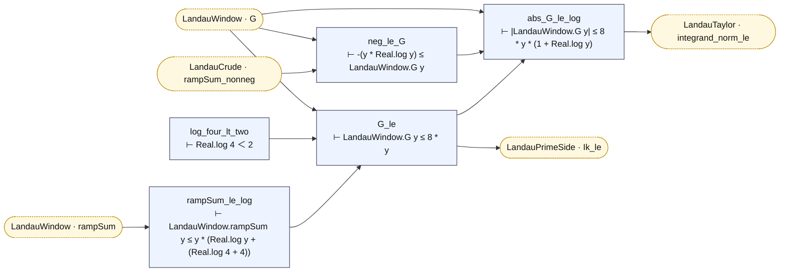

# `lean_stage3/Stage3/LandauChebyshev.lean`

**What it does** (its own header): LandauChebyshev — the bound on `G` of Chebyshev's order: `G y ≤ 8y` and `|G(y)| ≤ 8y(1 + log y)` for `y ≥ 1`. Block 5b of `lean_stage3/design/landau.md`. 2026-11-22.

**Imports:** [`LandauCrude`](../lean_stage3/LandauCrude.md).
**Imported by:** [`Stage3`](../lean_stage3/Stage3.md), [`LandauTaylor`](../lean_stage3/LandauTaylor.md).

Blue: theorem. Green: a theorem nothing else uses (an end). Dashed white: connects to nothing. Grey: definition. Red: contains `sorry`. Yellow: in another file. An arrow A → B reads "A is used by B".

## Every declaration

| declaration | proves (output) | needs (input) | why (its own docstring) | uses | used by |
|---|---|---|---|---|---|
| `LandauChebyshev.rampSum_le_log` theorem, line 33 | LandauWindow.rampSum y ≤ y * (Real.log y + (Real.log 4 + 4)) | hy : 1 ≤ y | — | `LandauWindow.rampSum` | `LandauChebyshev.G_le` |
| `LandauChebyshev.log_four_lt_two` theorem, line 70 | Real.log 4 &lt; 2 | — | — | — | `LandauChebyshev.G_le` |
| `LandauChebyshev.G_le` theorem, line 76 | LandauWindow.G y ≤ 8 * y | hy : 1 ≤ y | — | `LandauChebyshev.log_four_lt_two`, `LandauChebyshev.rampSum_le_log`, `LandauWindow.G` | `LandauChebyshev.abs_G_le_log`, `LandauPrimeSide.Ik_le` |
| `LandauChebyshev.neg_le_G` theorem, line 84 | -(y * Real.log y) ≤ LandauWindow.G y | hy : 1 ≤ y | — | `LandauCrude.rampSum_nonneg`, `LandauWindow.G` | `LandauChebyshev.abs_G_le_log` |
| `LandauChebyshev.abs_G_le_log` theorem, line 93 | \|LandauWindow.G y\| ≤ 8 * y * (1 + Real.log y) | hy : 1 ≤ y | — | `LandauChebyshev.G_le`, `LandauChebyshev.neg_le_G`, `LandauWindow.G` | `LandauTaylor.integrand_norm_le` |
