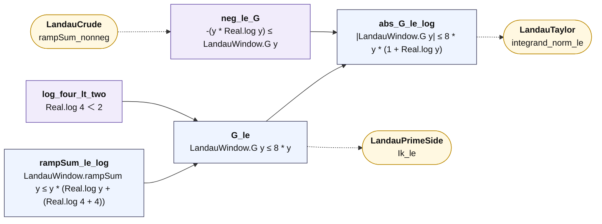

# `lean_stage3/Stage3/LandauChebyshev.lean`

LandauChebyshev — the bound on `G` of Chebyshev's order: `G y ≤ 8y` and `|G(y)| ≤ 8y(1 + log y)` for `y ≥ 1`. Block 5b of `lean_stage3/design/landau.md`. 2026-11-22.

5 theorems, 0 definitions, 118 lines. Arrows are Lean's own record of what each proof uses.

**Imports:** [`LandauCrude`](../lean_stage3/LandauCrude.md)  
**Imported by:** [`Stage3`](../lean_stage3/Stage3.md), [`LandauTaylor`](../lean_stage3/LandauTaylor.md)

## The picture



An arrow A → B reads "A is used in the proof of B". Green: counting, integers only. Violet: shape, analysis with no ζ. Blue: reads ζ. A name ending in ■ is an end: nothing else uses it. Red: contains `sorry`. Yellow: theorems in another file, counted; a dotted arrow crosses files. Definitions are not drawn; they are listed below the diagram.

## Theorems

<a name="LandauChebyshev-rampSum_le_log"></a>
### `LandauChebyshev.rampSum_le_log`

line 33

**Reads ζ.** It, or something it rests on, uses the zeta function, its zeros or the Riemann hypothesis.

**Proves**

```lean
LandauWindow.rampSum y ≤ y * (Real.log y + (Real.log 4 + 4))
```

**Needs** (its hypotheses)

  - `` hy : 1 ≤ y ``

**Stated with:** [`LandauWindow.rampSum`](../lean_stage3/LandauWindow.md#LandauWindow-rampSum)

**Fed by:** no theorem of this repo; it stands on Mathlib and the definitions below.

**Feeds** (1 that use it)

  - [`LandauChebyshev.G_le`](#LandauChebyshev-G_le) — `` LandauWindow.G y ≤ 8 * y ``

<a name="LandauChebyshev-log_four_lt_two"></a>
### `LandauChebyshev.log_four_lt_two`

line 70

**Shape.** Uses real or complex analysis; nothing in it or beneath it reads ζ.

**Proves**

```lean
Real.log 4 < 2
```

**Fed by:** no theorem of this repo; it stands on Mathlib.

**Feeds** (1 that use it)

  - [`LandauChebyshev.G_le`](#LandauChebyshev-G_le) — `` LandauWindow.G y ≤ 8 * y ``

<a name="LandauChebyshev-G_le"></a>
### `LandauChebyshev.G_le`

line 76

**Reads ζ.** It, or something it rests on, uses the zeta function, its zeros or the Riemann hypothesis.

**Proves**

```lean
LandauWindow.G y ≤ 8 * y
```

**Needs** (its hypotheses)

  - `` hy : 1 ≤ y ``

**Stated with:** [`LandauWindow.G`](../lean_stage3/LandauWindow.md#LandauWindow-G)

**Fed by** (2 theorems its proof uses)

  - [`LandauChebyshev.log_four_lt_two`](#LandauChebyshev-log_four_lt_two) — `` Real.log 4 < 2 ``
  - [`LandauChebyshev.rampSum_le_log`](#LandauChebyshev-rampSum_le_log) — `` LandauWindow.rampSum y ≤ y * (Real.log y + (Real.log 4 + 4)) ``

**Definitions its proof touches:** [`LandauWindow.rampSum`](../lean_stage3/LandauWindow.md#LandauWindow-rampSum)

**Feeds** (2 that use it)

  - [`LandauChebyshev.abs_G_le_log`](#LandauChebyshev-abs_G_le_log) — `` |LandauWindow.G y| ≤ 8 * y * (1 + Real.log y) ``
  - [`LandauPrimeSide.Ik_le`](../lean_stage3/LandauPrimeSide.md#LandauPrimeSide-Ik_le) (LandauPrimeSide) — `` Ik σ k ≤ C * (k.factorial / (σ - θ) ^ (k + 1)) + 8 * (Y ^ b * (k.factorial / (σ - 1 + b) ^ (k + 1))) + 8 * ((Y ^ (1 + δ)) ^ (-b') * (k.factorial / (σ … ``

<a name="LandauChebyshev-neg_le_G"></a>
### `LandauChebyshev.neg_le_G`

line 84

**Shape.** Uses real or complex analysis; nothing in it or beneath it reads ζ.

**Proves**

```lean
-(y * Real.log y) ≤ LandauWindow.G y
```

**Needs** (its hypotheses)

  - `` hy : 1 ≤ y ``

**Stated with:** [`LandauWindow.G`](../lean_stage3/LandauWindow.md#LandauWindow-G)

**Fed by** (1 theorem its proof uses)

  - [`LandauCrude.rampSum_nonneg`](../lean_stage3/LandauCrude.md#LandauCrude-rampSum_nonneg) (LandauCrude) — `` 0 ≤ LandauWindow.rampSum y ``

**Definitions its proof touches:** [`LandauWindow.rampSum`](../lean_stage3/LandauWindow.md#LandauWindow-rampSum)

**Feeds** (1 that use it)

  - [`LandauChebyshev.abs_G_le_log`](#LandauChebyshev-abs_G_le_log) — `` |LandauWindow.G y| ≤ 8 * y * (1 + Real.log y) ``

<a name="LandauChebyshev-abs_G_le_log"></a>
### `LandauChebyshev.abs_G_le_log`

line 93

**Reads ζ.** It, or something it rests on, uses the zeta function, its zeros or the Riemann hypothesis.

**Proves**

```lean
|LandauWindow.G y| ≤ 8 * y * (1 + Real.log y)
```

**Needs** (its hypotheses)

  - `` hy : 1 ≤ y ``

**Stated with:** [`LandauWindow.G`](../lean_stage3/LandauWindow.md#LandauWindow-G)

**Fed by** (2 theorems its proof uses)

  - [`LandauChebyshev.G_le`](#LandauChebyshev-G_le) — `` LandauWindow.G y ≤ 8 * y ``
  - [`LandauChebyshev.neg_le_G`](#LandauChebyshev-neg_le_G) — `` -(y * Real.log y) ≤ LandauWindow.G y ``

**Feeds** (1 that use it)

  - [`LandauTaylor.integrand_norm_le`](../lean_stage3/LandauTaylor.md#LandauTaylor-integrand_norm_le) (LandauTaylor) — `` ‖(LandauWindow.G y : ℂ) * (-(Real.log y : ℂ)) ^ k * (y : ℂ) ^ (-s - 1)‖ ≤ 8 * (Real.log y ^ k * y ^ (-a - 1) + Real.log y ^ (k + 1) * y ^ (-a - 1)) ``

