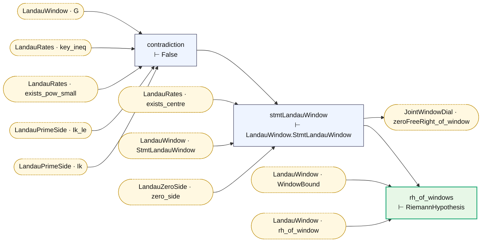

# `lean_stage3/Stage3/LandauCriterion.lean`

**What it does** (its own header): LandauCriterion — the Landau window criterion, proved. Block 7d of `lean_stage3/design/landau.md`. 2026-11-22.

**Imports:** [`LandauRates`](../lean_stage3/LandauRates.md), [`LandauZeroSide`](../lean_stage3/LandauZeroSide.md).
**Imported by:** [`Stage3`](../lean_stage3/Stage3.md), [`JointWindowDial`](../lean_stage3/JointWindowDial.md).

Blue: theorem. Green: a theorem nothing else uses (an end). Dashed white: connects to nothing. Grey: definition. Red: contains `sorry`. Yellow: in another file. An arrow A → B reads "A is used by B".

## Every declaration

| declaration | proves (output) | needs (input) | why (its own docstring) | uses | used by |
|---|---|---|---|---|---|
| `LandauCriterion.contradiction` theorem, line 37 | False | hσ : 1 &lt; σ₀; hδ0 : 0 &lt; δ; hδ1 : δ ≤ 1; hC : 0 ≤ C; hra : σ₀ - 1 &lt; r; hr3 : r ≤ (σ₀ - 1) * (1 + δ ^ 2 / 240); hrθ : r &lt; σ₀ - θ; hrR : r &lt; R; hτ : 0 &lt; τ; hzero : ∀ a N : ℕ, N₀ ≤ N → ∃ k ∈ Finset.Ico a (a + N), τ / r ^ (k + 1) - C₁ / R ^ k ≤ LandauPrimeSide.Ik σ₀ k / k.factorial; hwin : ∀ U₀ : ℝ, ∃ Y : ℝ, 1 ≤ Y ∧ U₀ ≤ Real.log Y ∧ ∀ y ∈ Icc Y (Y ^ (1 + δ)), LandauWindow.G y ≤ C * y ^ θ | — | `LandauPrimeSide.Ik`, `LandauPrimeSide.Ik_le`, `LandauRates.exists_pow_small`, `LandauRates.key_ineq`, `LandauWindow.G` | `LandauCriterion.stmtLandauWindow` |
| `LandauCriterion.stmtLandauWindow` theorem, line 194 | LandauWindow.StmtLandauWindow | — | — | `LandauCriterion.contradiction`, `LandauRates.exists_centre`, `LandauWindow.StmtLandauWindow`, `LandauZeroSide.zero_side` | `JointWindowDial.zeroFreeRight_of_window`, `LandauCriterion.rh_of_windows` |
| `LandauCriterion.rh_of_windows` theorem, line 219 | RiemannHypothesis | hW : ∀ θ : ℝ, 1 / 2 &lt; θ → θ &lt; 1 → ∃ δ C : ℝ, 0 &lt; δ ∧ LandauWindow.WindowBound θ δ C | — | `LandauCriterion.stmtLandauWindow`, `LandauWindow.WindowBound`, `LandauWindow.rh_of_window` | — |
