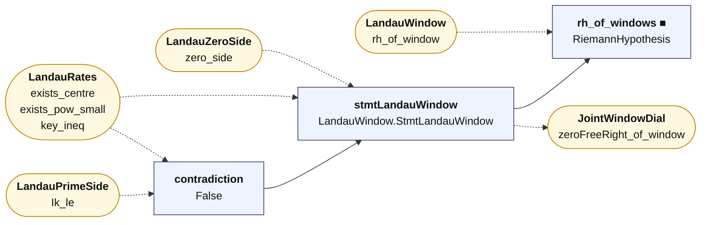

# `lean_stage3/Stage3/LandauCriterion.lean`

LandauCriterion — the Landau window criterion, proved. Block 7d of `lean_stage3/design/landau.md`. 2026-11-22.

3 theorems, 0 definitions, 250 lines. Arrows are Lean's own record of what each proof uses.

**Imports:** [`LandauRates`](../lean_stage3/LandauRates.md), [`LandauZeroSide`](../lean_stage3/LandauZeroSide.md)  
**Imported by:** [`Stage3`](../lean_stage3/Stage3.md), [`JointWindowDial`](../lean_stage3/JointWindowDial.md), [`WindowsOfRH`](../lean_stage3/WindowsOfRH.md)

## The picture



An arrow A → B reads "A is used in the proof of B". Green: counting, integers only. Violet: shape, analysis with no ζ. Blue: reads ζ. A name ending in ■ is an end: nothing else uses it. Red: contains `sorry`. Yellow: theorems in another file, counted; a dotted arrow crosses files. Definitions are not drawn; they are listed below the diagram.

## Theorems

<a name="LandauCriterion-contradiction"></a>
### `LandauCriterion.contradiction`

line 42

**Reads ζ.** It, or something it rests on, uses the zeta function, its zeros or the Riemann hypothesis.

**Why.** The two bounds on the primes' integral `Ik σ₀ k / k!` cannot both hold. Given `σ₀ > 1`, `0 < δ ≤ 1`, `C ≥ 0`, `σ₀ − 1 < r ≤ (σ₀ − 1)(1 + δ²/240)`, `r < σ₀ − θ`, `r < R`, `τ > 0`, the lower bound `τ/r^(k+1) − C₁/R^k ≤ Ik σ₀ k / k!` for some `k` in every run of at least `N₀` consecutive naturals, and windows `[Y, Y^(1+δ)]` at arbitrarily large `Y` on which `G y ≤ C·y^θ`, the conclusion is `False`.

**Proves**

```lean
False
```

**Needs** (its hypotheses)

  - `` hσ : 1 < σ₀ ``
  - `` hδ0 : 0 < δ ``
  - `` hδ1 : δ ≤ 1 ``
  - `` hC : 0 ≤ C ``
  - `` hra : σ₀ - 1 < r ``
  - `` hr3 : r ≤ (σ₀ - 1) * (1 + δ ^ 2 / 240) ``
  - `` hrθ : r < σ₀ - θ ``
  - `` hrR : r < R ``
  - `` hτ : 0 < τ ``
  - `` hzero : ∀ a N : ℕ, N₀ ≤ N → ∃ k ∈ Finset.Ico a (a + N), τ / r ^ (k + 1) - C₁ / R ^ k ≤ LandauPrimeSide.Ik σ₀ k / k.factorial ``
  - `` hwin : ∀ U₀ : ℝ, ∃ Y : ℝ, 1 ≤ Y ∧ U₀ ≤ Real.log Y ∧ ∀ y ∈ Icc Y (Y ^ (1 + δ)), LandauWindow.G y ≤ C * y ^ θ ``

**Stated with:** [`LandauPrimeSide.Ik`](../lean_stage3/LandauPrimeSide.md#LandauPrimeSide-Ik), [`LandauWindow.G`](../lean_stage3/LandauWindow.md#LandauWindow-G)

**Fed by** (3 theorems its proof uses)

  - [`LandauPrimeSide.Ik_le`](../lean_stage3/LandauPrimeSide.md#LandauPrimeSide-Ik_le) (LandauPrimeSide) — `` Ik σ k ≤ C * (k.factorial / (σ - θ) ^ (k + 1)) + 8 * (Y ^ b * (k.factorial / (σ - 1 + b) ^ (k + 1))) + 8 * ((Y ^ (1 + δ)) ^ (-b') * (k.factorial / (σ … ``
  - [`LandauRates.exists_pow_small`](../lean_stage3/LandauRates.md#LandauRates-exists_pow_small) (LandauRates) — `` ∃ K : ℕ, ∀ k : ℕ, K ≤ k → c * q ^ k < ε ``
  - [`LandauRates.key_ineq`](../lean_stage3/LandauRates.md#LandauRates-key_ineq) (LandauRates) — `` 4 * (lam - Real.log (1 - δ / 12)) < (1 + δ) * (Real.log (1 + δ / 3) - lam) ∧ 0 < Real.log (1 + δ / 3) - lam ∧ 0 < lam - Real.log (1 - δ / 12) ``

**Feeds** (1 that use it)

  - [`LandauCriterion.stmtLandauWindow`](#LandauCriterion-stmtLandauWindow) — `` LandauWindow.StmtLandauWindow ``

<a name="LandauCriterion-stmtLandauWindow"></a>
### `LandauCriterion.stmtLandauWindow`

line 202

**Reads ζ.** It, or something it rests on, uses the zeta function, its zeros or the Riemann hypothesis.

**Why.** The Landau window criterion holds: for `0 < θ < 1`, `δ > 0` and any `C`, if `G y ≤ C·y^θ` on a window `[Y, Y^(1+δ)]` for arbitrarily large `Y`, then `riemannZeta` has no zero with real part above `θ`.

**Proves**

```lean
LandauWindow.StmtLandauWindow
```

**Stated with:** [`LandauWindow.StmtLandauWindow`](../lean_stage3/LandauWindow.md#LandauWindow-StmtLandauWindow)

**Fed by** (3 theorems its proof uses)

  - [`LandauCriterion.contradiction`](#LandauCriterion-contradiction) — `` False ``
  - [`LandauRates.exists_centre`](../lean_stage3/LandauRates.md#LandauRates-exists_centre) (LandauRates) — `` ∃ σ₀ : ℝ, 1 < σ₀ ∧ ‖(σ₀ : ℂ) - ρ₀‖ < σ₀ - θ ∧ ‖(σ₀ : ℂ) - ρ₀‖ ≤ (σ₀ - 1) * (1 + δ ^ 2 / 240) ``
  - [`LandauZeroSide.zero_side`](../lean_stage3/LandauZeroSide.md#LandauZeroSide-zero_side) (LandauZeroSide) — `` ∃ r R τ C₁ : ℝ, ∃ N₀ : ℕ, σ₀ - 1 < r ∧ r ≤ ‖(σ₀ : ℂ) - ρ₀‖ ∧ r < R ∧ 0 < τ ∧ 0 ≤ C₁ ∧ ∀ a N : ℕ, N₀ ≤ N → ∃ k ∈ Finset.Ico a (a + N), τ / r ^ (k + 1) … ``

**Definitions its proof touches:** [`LandauPrimeSide.Ik`](../lean_stage3/LandauPrimeSide.md#LandauPrimeSide-Ik), [`LandauWindow.G`](../lean_stage3/LandauWindow.md#LandauWindow-G), [`LandauWindow.WindowBound`](../lean_stage3/LandauWindow.md#LandauWindow-WindowBound)

**Feeds** (2 that use it)

  - [`JointWindowDial.zeroFreeRight_of_window`](../lean_stage3/JointWindowDial.md#JointWindowDial-zeroFreeRight_of_window) (JointWindowDial) — `` Stage3.StmtZeroFreeRight θ ``
  - [`LandauCriterion.rh_of_windows`](#LandauCriterion-rh_of_windows) — `` RiemannHypothesis ``

<a name="LandauCriterion-rh_of_windows"></a>
### `LandauCriterion.rh_of_windows`

line 230

**Reads ζ.** It, or something it rests on, uses the zeta function, its zeros or the Riemann hypothesis.

**Why.** Conditional: if for every `θ` in `(1/2, 1)` there are `δ > 0` and `C` with the window bound `WindowBound θ δ C`, then `RiemannHypothesis` holds. The window bound is a hypothesis of this statement.

**Proves**

```lean
RiemannHypothesis
```

**Needs** (its hypotheses)

  - `` hW : ∀ θ : ℝ, 1 / 2 < θ → θ < 1 → ∃ δ C : ℝ, 0 < δ ∧ LandauWindow.WindowBound θ δ C ``

**Stated with:** [`LandauWindow.WindowBound`](../lean_stage3/LandauWindow.md#LandauWindow-WindowBound)

**Fed by** (2 theorems its proof uses)

  - [`LandauCriterion.stmtLandauWindow`](#LandauCriterion-stmtLandauWindow) — `` LandauWindow.StmtLandauWindow ``
  - [`LandauWindow.rh_of_window`](../lean_stage3/LandauWindow.md#LandauWindow-rh_of_window) (LandauWindow) — `` RiemannHypothesis ``

**Feeds:** nothing. It is an end.

