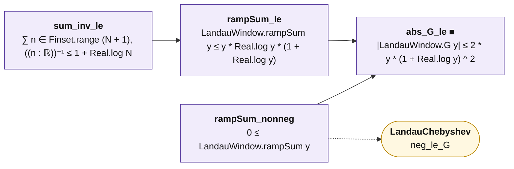

# `lean_stage3/Stage3/LandauCrude.lean`

LandauCrude — a crude bound on `G`: `|G(y)| ≤ 2y(1 + log y)²` for `y ≥ 1`. Block 5 of `lean_stage3/design/landau.md`. 2026-11-22.

4 theorems, 0 definitions, 114 lines. Arrows are Lean's own record of what each proof uses.

**Imports:** [`LandauWindow`](../lean_stage3/LandauWindow.md)  
**Imported by:** [`Stage3`](../lean_stage3/Stage3.md), [`LandauChebyshev`](../lean_stage3/LandauChebyshev.md)

## The picture



An arrow A → B reads "A is used in the proof of B". Green: counting, integers only. Violet: shape, analysis with no ζ. Blue: reads ζ. A name ending in ■ is an end: nothing else uses it. Red: contains `sorry`. Yellow: theorems in another file, counted; a dotted arrow crosses files. Definitions are not drawn; they are listed below the diagram.

## Theorems

<a name="LandauCrude-rampSum_nonneg"></a>
### `LandauCrude.rampSum_nonneg`

line 31

**Shape.** Uses real or complex analysis; nothing in it or beneath it reads ζ.

**Proves**

```lean
0 ≤ LandauWindow.rampSum y
```

**Needs** (its hypotheses)

  - `` y : ℝ ``

**Stated with:** [`LandauWindow.rampSum`](../lean_stage3/LandauWindow.md#LandauWindow-rampSum)

**Fed by:** no theorem of this repo; it stands on Mathlib and the definitions below.

**Feeds** (2 that use it)

  - [`LandauChebyshev.neg_le_G`](../lean_stage3/LandauChebyshev.md#LandauChebyshev-neg_le_G) (LandauChebyshev) — `` -(y * Real.log y) ≤ LandauWindow.G y ``
  - [`LandauCrude.abs_G_le`](#LandauCrude-abs_G_le) — `` |LandauWindow.G y| ≤ 2 * y * (1 + Real.log y) ^ 2 ``

<a name="LandauCrude-sum_inv_le"></a>
### `LandauCrude.sum_inv_le`

line 37

**Shape.** Uses real or complex analysis; nothing in it or beneath it reads ζ.

**Why.** The reciprocals up to `N`, with the term at `0` (which is `0`).

**Proves**

```lean
∑ n ∈ Finset.range (N + 1), ((n : ℝ))⁻¹ ≤ 1 + Real.log N
```

**Needs** (its hypotheses)

  - `` N : ℕ ``

**Fed by:** no theorem of this repo; it stands on Mathlib.

**Feeds** (1 that use it)

  - [`LandauCrude.rampSum_le`](#LandauCrude-rampSum_le) — `` LandauWindow.rampSum y ≤ y * Real.log y * (1 + Real.log y) ``

<a name="LandauCrude-rampSum_le"></a>
### `LandauCrude.rampSum_le`

line 47

**Shape.** Uses real or complex analysis; nothing in it or beneath it reads ζ.

**Proves**

```lean
LandauWindow.rampSum y ≤ y * Real.log y * (1 + Real.log y)
```

**Needs** (its hypotheses)

  - `` hy : 1 ≤ y ``

**Stated with:** [`LandauWindow.rampSum`](../lean_stage3/LandauWindow.md#LandauWindow-rampSum)

**Fed by** (1 theorem its proof uses)

  - [`LandauCrude.sum_inv_le`](#LandauCrude-sum_inv_le) — `` ∑ n ∈ Finset.range (N + 1), ((n : ℝ))⁻¹ ≤ 1 + Real.log N ``

**Feeds** (1 that use it)

  - [`LandauCrude.abs_G_le`](#LandauCrude-abs_G_le) — `` |LandauWindow.G y| ≤ 2 * y * (1 + Real.log y) ^ 2 ``

<a name="LandauCrude-abs_G_le"></a>
### `LandauCrude.abs_G_le`

line 83

**Shape.** Uses real or complex analysis; nothing in it or beneath it reads ζ.

**Proves**

```lean
|LandauWindow.G y| ≤ 2 * y * (1 + Real.log y) ^ 2
```

**Needs** (its hypotheses)

  - `` hy : 1 ≤ y ``

**Stated with:** [`LandauWindow.G`](../lean_stage3/LandauWindow.md#LandauWindow-G)

**Fed by** (2 theorems its proof uses)

  - [`LandauCrude.rampSum_le`](#LandauCrude-rampSum_le) — `` LandauWindow.rampSum y ≤ y * Real.log y * (1 + Real.log y) ``
  - [`LandauCrude.rampSum_nonneg`](#LandauCrude-rampSum_nonneg) — `` 0 ≤ LandauWindow.rampSum y ``

**Definitions its proof touches:** [`LandauWindow.rampSum`](../lean_stage3/LandauWindow.md#LandauWindow-rampSum)

**Feeds:** nothing. It is an end.

