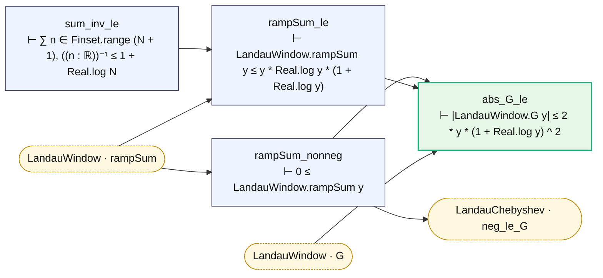

# `lean_stage3/Stage3/LandauCrude.lean`

**What it does** (its own header): LandauCrude — a crude bound on `G`: `|G(y)| ≤ 2y(1 + log y)²` for `y ≥ 1`. Block 5 of `lean_stage3/design/landau.md`. 2026-11-22.

**Imports:** [`LandauWindow`](../lean_stage3/LandauWindow.md).
**Imported by:** [`Stage3`](../lean_stage3/Stage3.md), [`LandauChebyshev`](../lean_stage3/LandauChebyshev.md).

Blue: theorem. Green: a theorem nothing else uses (an end). Dashed white: connects to nothing. Grey: definition. Red: contains `sorry`. Yellow: in another file. An arrow A → B reads "A is used by B".

## Every declaration

| declaration | proves (output) | needs (input) | why (its own docstring) | uses | used by |
|---|---|---|---|---|---|
| `LandauCrude.rampSum_nonneg` theorem, line 31 | 0 ≤ LandauWindow.rampSum y | y : ℝ | — | `LandauWindow.rampSum` | `LandauChebyshev.neg_le_G`, `LandauCrude.abs_G_le` |
| `LandauCrude.sum_inv_le` theorem, line 37 | ∑ n ∈ Finset.range (N + 1), ((n : ℝ))⁻¹ ≤ 1 + Real.log N | N : ℕ | The reciprocals up to `N`, with the term at `0` (which is `0`). | — | `LandauCrude.rampSum_le` |
| `LandauCrude.rampSum_le` theorem, line 47 | LandauWindow.rampSum y ≤ y * Real.log y * (1 + Real.log y) | hy : 1 ≤ y | — | `LandauCrude.sum_inv_le`, `LandauWindow.rampSum` | `LandauCrude.abs_G_le` |
| `LandauCrude.abs_G_le` theorem, line 83 | \|LandauWindow.G y\| ≤ 2 * y * (1 + Real.log y) ^ 2 | hy : 1 ≤ y | — | `LandauCrude.rampSum_le`, `LandauCrude.rampSum_nonneg`, `LandauWindow.G` | — |
