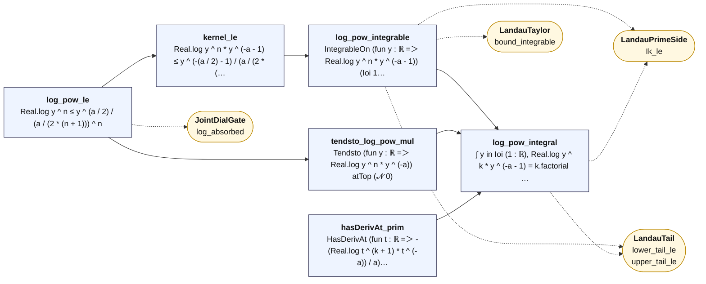

# `lean_stage3/Stage3/LandauKernel.lean`

LandauKernel — the kernel's integral: for `a > 0`, `∫₁^∞ (log y)^k · y^(−a−1) dy = k!/a^(k+1)`. Block 4a of `lean_stage3/design/landau.md`. 2026-11-22.

6 theorems, 0 definitions, 166 lines. Arrows are Lean's own record of what each proof uses.

**Imports:** nothing in this tree  
**Imported by:** [`Stage3`](../lean_stage3/Stage3.md), [`JointDialGate`](../lean_stage3/JointDialGate.md), [`LandauTail`](../lean_stage3/LandauTail.md), [`LandauTaylor`](../lean_stage3/LandauTaylor.md)

## The picture



An arrow A → B reads "A is used in the proof of B". Blue: theorem. Green: a theorem nothing else uses (an end). Dashed: connects to nothing. Red: contains `sorry`. Yellow: theorems in another file, counted; a dotted arrow crosses files. Definitions are not drawn; they are listed below the diagram.

## Theorems

<a name="LandauKernel-log_pow_le"></a>
### `LandauKernel.log_pow_le`

line 33

**Proves**

```lean
Real.log y ^ n ≤ y ^ (a / 2) / (a / (2 * (n + 1))) ^ n
```

**Needs** (its hypotheses)

  - `` ha : 0 < a ``
  - `` n : ℕ ``
  - `` hy : 1 ≤ y ``

**Fed by:** no theorem of this repo; it stands on Mathlib.

**Feeds** (3 that use it)

  - [`JointDialGate.log_absorbed`](../lean_stage3/JointDialGate.md#JointDialGate-log_absorbed) (JointDialGate) — `` C * x ^ θ * Real.log x ^ k ≤ C / (2 * (θ' - θ) / (2 * ((k : ℝ) + 1))) ^ k * x ^ θ' ``
  - [`LandauKernel.kernel_le`](#LandauKernel-kernel_le) — `` Real.log y ^ n * y ^ (-a - 1) ≤ y ^ (-(a / 2) - 1) / (a / (2 * (n + 1))) ^ n ``
  - [`LandauKernel.tendsto_log_pow_mul`](#LandauKernel-tendsto_log_pow_mul) — `` Tendsto (fun y : ℝ => Real.log y ^ n * y ^ (-a)) atTop (𝓝 0) ``

<a name="LandauKernel-kernel_le"></a>
### `LandauKernel.kernel_le`

line 56

**Why.** The kernel is at most a power of `y` with exponent below `−1`.

**Proves**

```lean
Real.log y ^ n * y ^ (-a - 1) ≤ y ^ (-(a / 2) - 1) / (a / (2 * (n + 1))) ^ n
```

**Needs** (its hypotheses)

  - `` ha : 0 < a ``
  - `` n : ℕ ``
  - `` hy : 1 ≤ y ``

**Fed by** (1 theorem its proof uses)

  - [`LandauKernel.log_pow_le`](#LandauKernel-log_pow_le) — `` Real.log y ^ n ≤ y ^ (a / 2) / (a / (2 * (n + 1))) ^ n ``

**Feeds** (1 that use it)

  - [`LandauKernel.log_pow_integrable`](#LandauKernel-log_pow_integrable) — `` IntegrableOn (fun y : ℝ => Real.log y ^ n * y ^ (-a - 1)) (Ioi 1) ``

<a name="LandauKernel-log_pow_integrable"></a>
### `LandauKernel.log_pow_integrable`

line 66

**Proves**

```lean
IntegrableOn (fun y : ℝ => Real.log y ^ n * y ^ (-a - 1)) (Ioi 1)
```

**Needs** (its hypotheses)

  - `` ha : 0 < a ``
  - `` n : ℕ ``

**Fed by** (1 theorem its proof uses)

  - [`LandauKernel.kernel_le`](#LandauKernel-kernel_le) — `` Real.log y ^ n * y ^ (-a - 1) ≤ y ^ (-(a / 2) - 1) / (a / (2 * (n + 1))) ^ n ``

**Feeds** (5 that use it)

  - [`LandauKernel.log_pow_integral`](#LandauKernel-log_pow_integral) — `` ∫ y in Ioi (1 : ℝ), Real.log y ^ k * y ^ (-a - 1) = k.factorial / a ^ (k + 1) ``
  - [`LandauPrimeSide.Ik_le`](../lean_stage3/LandauPrimeSide.md#LandauPrimeSide-Ik_le) (LandauPrimeSide) — `` Ik σ k ≤ C * (k.factorial / (σ - θ) ^ (k + 1)) + 8 * (Y ^ b * (k.factorial / (σ - 1 + b) ^ (k + 1))) + 8 * ((Y ^ (1 + δ)) ^ (-b') * (k.factorial / (σ … ``
  - [`LandauTail.lower_tail_le`](../lean_stage3/LandauTail.md#LandauTail-lower_tail_le) (LandauTail) — `` ∫ y in Ioc (1 : ℝ) Y, Real.log y ^ k * y ^ (-a - 1) ≤ Y ^ b * (k.factorial / (a + b) ^ (k + 1)) ``
  - [`LandauTail.upper_tail_le`](../lean_stage3/LandauTail.md#LandauTail-upper_tail_le) (LandauTail) — `` ∫ y in Ioi Z, Real.log y ^ k * y ^ (-a - 1) ≤ Z ^ (-b) * (k.factorial / (a - b) ^ (k + 1)) ``
  - [`LandauTaylor.bound_integrable`](../lean_stage3/LandauTaylor.md#LandauTaylor-bound_integrable) (LandauTaylor) — `` IntegrableOn (fun y : ℝ => 8 * (Real.log y ^ k * y ^ (-a - 1) + Real.log y ^ (k + 1) * y ^ (-a - 1))) (Ioi 1) ``

<a name="LandauKernel-tendsto_log_pow_mul"></a>
### `LandauKernel.tendsto_log_pow_mul`

line 84

**Proves**

```lean
Tendsto (fun y : ℝ => Real.log y ^ n * y ^ (-a)) atTop (𝓝 0)
```

**Needs** (its hypotheses)

  - `` ha : 0 < a ``
  - `` n : ℕ ``

**Fed by** (1 theorem its proof uses)

  - [`LandauKernel.log_pow_le`](#LandauKernel-log_pow_le) — `` Real.log y ^ n ≤ y ^ (a / 2) / (a / (2 * (n + 1))) ^ n ``

**Feeds** (1 that use it)

  - [`LandauKernel.log_pow_integral`](#LandauKernel-log_pow_integral) — `` ∫ y in Ioi (1 : ℝ), Real.log y ^ k * y ^ (-a - 1) = k.factorial / a ^ (k + 1) ``

<a name="LandauKernel-hasDerivAt_prim"></a>
### `LandauKernel.hasDerivAt_prim`

line 102

**Proves**

```lean
HasDerivAt (fun t : ℝ => -(Real.log t ^ (k + 1) * t ^ (-a)) / a) (Real.log y ^ (k + 1) * y ^ (-a - 1) - ((k : ℝ) + 1) / a * (Real.log y ^ k * y ^ (-a - 1))) y
```

**Needs** (its hypotheses)

  - `` ha : 0 < a ``
  - `` k : ℕ ``
  - `` hy : 0 < y ``

**Fed by:** no theorem of this repo; it stands on Mathlib.

**Feeds** (1 that use it)

  - [`LandauKernel.log_pow_integral`](#LandauKernel-log_pow_integral) — `` ∫ y in Ioi (1 : ℝ), Real.log y ^ k * y ^ (-a - 1) = k.factorial / a ^ (k + 1) ``

<a name="LandauKernel-log_pow_integral"></a>
### `LandauKernel.log_pow_integral`

line 118

**Proves**

```lean
∫ y in Ioi (1 : ℝ), Real.log y ^ k * y ^ (-a - 1) = k.factorial / a ^ (k + 1)
```

**Needs** (its hypotheses)

  - `` ha : 0 < a ``
  - `` k : ℕ ``

**Fed by** (3 theorems its proof uses)

  - [`LandauKernel.hasDerivAt_prim`](#LandauKernel-hasDerivAt_prim) — `` HasDerivAt (fun t : ℝ => -(Real.log t ^ (k + 1) * t ^ (-a)) / a) (Real.log y ^ (k + 1) * y ^ (-a - 1) - ((k : ℝ) + 1) / a * (Real.log y ^ k * y ^ (-a … ``
  - [`LandauKernel.log_pow_integrable`](#LandauKernel-log_pow_integrable) — `` IntegrableOn (fun y : ℝ => Real.log y ^ n * y ^ (-a - 1)) (Ioi 1) ``
  - [`LandauKernel.tendsto_log_pow_mul`](#LandauKernel-tendsto_log_pow_mul) — `` Tendsto (fun y : ℝ => Real.log y ^ n * y ^ (-a)) atTop (𝓝 0) ``

**Feeds** (3 that use it)

  - [`LandauPrimeSide.Ik_le`](../lean_stage3/LandauPrimeSide.md#LandauPrimeSide-Ik_le) (LandauPrimeSide) — `` Ik σ k ≤ C * (k.factorial / (σ - θ) ^ (k + 1)) + 8 * (Y ^ b * (k.factorial / (σ - 1 + b) ^ (k + 1))) + 8 * ((Y ^ (1 + δ)) ^ (-b') * (k.factorial / (σ … ``
  - [`LandauTail.lower_tail_le`](../lean_stage3/LandauTail.md#LandauTail-lower_tail_le) (LandauTail) — `` ∫ y in Ioc (1 : ℝ) Y, Real.log y ^ k * y ^ (-a - 1) ≤ Y ^ b * (k.factorial / (a + b) ^ (k + 1)) ``
  - [`LandauTail.upper_tail_le`](../lean_stage3/LandauTail.md#LandauTail-upper_tail_le) (LandauTail) — `` ∫ y in Ioi Z, Real.log y ^ k * y ^ (-a - 1) ≤ Z ^ (-b) * (k.factorial / (a - b) ^ (k + 1)) ``

