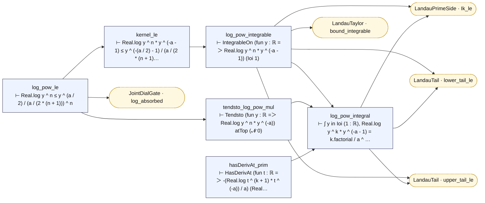

# `lean_stage3/Stage3/LandauKernel.lean`

**What it does** (its own header): LandauKernel — the kernel's integral: for `a > 0`, `∫₁^∞ (log y)^k · y^(−a−1) dy = k!/a^(k+1)`. Block 4a of `lean_stage3/design/landau.md`. 2026-11-22.

**Imports:** nothing in this tree.
**Imported by:** [`Stage3`](../lean_stage3/Stage3.md), [`JointDialGate`](../lean_stage3/JointDialGate.md), [`LandauTail`](../lean_stage3/LandauTail.md), [`LandauTaylor`](../lean_stage3/LandauTaylor.md).

Blue: theorem. Green: a theorem nothing else uses (an end). Dashed white: connects to nothing. Grey: definition. Red: contains `sorry`. Yellow: in another file. An arrow A → B reads "A is used by B".

## Every declaration

| declaration | proves (output) | needs (input) | why (its own docstring) | uses | used by |
|---|---|---|---|---|---|
| `LandauKernel.log_pow_le` theorem, line 33 | Real.log y ^ n ≤ y ^ (a / 2) / (a / (2 * (n + 1))) ^ n | ha : 0 &lt; a; n : ℕ; hy : 1 ≤ y | — | — | `JointDialGate.log_absorbed`, `LandauKernel.kernel_le`, `LandauKernel.tendsto_log_pow_mul` |
| `LandauKernel.kernel_le` theorem, line 56 | Real.log y ^ n * y ^ (-a - 1) ≤ y ^ (-(a / 2) - 1) / (a / (2 * (n + 1))) ^ n | ha : 0 &lt; a; n : ℕ; hy : 1 ≤ y | The kernel is at most a power of `y` with exponent below `−1`. | `LandauKernel.log_pow_le` | `LandauKernel.log_pow_integrable` |
| `LandauKernel.log_pow_integrable` theorem, line 66 | IntegrableOn (fun y : ℝ =&gt; Real.log y ^ n * y ^ (-a - 1)) (Ioi 1) | ha : 0 &lt; a; n : ℕ | — | `LandauKernel.kernel_le` | `LandauKernel.log_pow_integral`, `LandauPrimeSide.Ik_le`, `LandauTail.lower_tail_le`, `LandauTail.upper_tail_le`, `LandauTaylor.bound_integrable` |
| `LandauKernel.tendsto_log_pow_mul` theorem, line 84 | Tendsto (fun y : ℝ =&gt; Real.log y ^ n * y ^ (-a)) atTop (𝓝 0) | ha : 0 &lt; a; n : ℕ | — | `LandauKernel.log_pow_le` | `LandauKernel.log_pow_integral` |
| `LandauKernel.hasDerivAt_prim` theorem, line 102 | HasDerivAt (fun t : ℝ =&gt; -(Real.log t ^ (k + 1) * t ^ (-a)) / a) (Real.log y ^ (k + 1) * y ^ (-a - 1) - ((k : ℝ) + 1) / a * (Real.log y ^ k * y ^ (-a - 1))) y | ha : 0 &lt; a; k : ℕ; hy : 0 &lt; y | — | — | `LandauKernel.log_pow_integral` |
| `LandauKernel.log_pow_integral` theorem, line 118 | ∫ y in Ioi (1 : ℝ), Real.log y ^ k * y ^ (-a - 1) = k.factorial / a ^ (k + 1) | ha : 0 &lt; a; k : ℕ | — | `LandauKernel.hasDerivAt_prim`, `LandauKernel.log_pow_integrable`, `LandauKernel.tendsto_log_pow_mul` | `LandauPrimeSide.Ik_le`, `LandauTail.lower_tail_le`, `LandauTail.upper_tail_le` |
