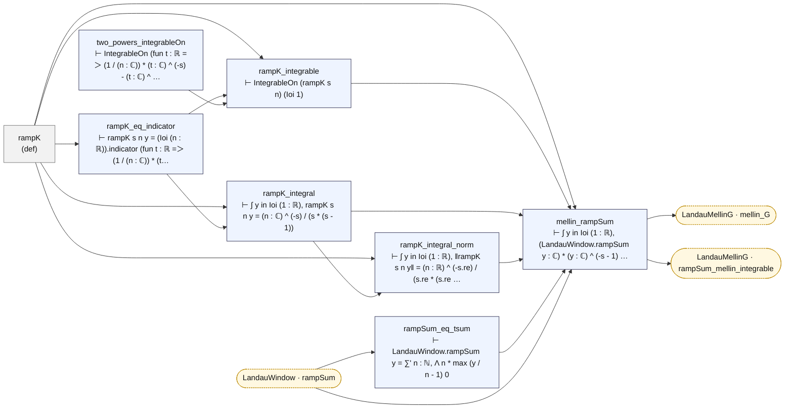

# `lean_stage3/Stage3/LandauMellin.lean`

**What it does** (its own header): LandauMellin — the Mellin transform of the ramp sum on `Re s > 1`. Block 2 of `lean_stage3/design/landau.md`. 2026-11-22.

**Imports:** [`LandauWindow`](../lean_stage3/LandauWindow.md).
**Imported by:** [`Stage3`](../lean_stage3/Stage3.md), [`LandauMellinG`](../lean_stage3/LandauMellinG.md).

Blue: theorem. Green: a theorem nothing else uses (an end). Dashed white: connects to nothing. Grey: definition. Red: contains `sorry`. Yellow: in another file. An arrow A → B reads "A is used by B".

## Every declaration

| declaration | proves (output) | needs (input) | why (its own docstring) | uses | used by |
|---|---|---|---|---|---|
| `LandauMellin.rampK` def, line 43 | ℂ | s : ℂ; n : ℕ; y : ℝ | The ramp kernel of one `n`: `max(y/n − 1, 0)·y^(−s−1)`. | — | `LandauMellin.mellin_rampSum`, `LandauMellin.rampK_eq_indicator`, `LandauMellin.rampK_integrable`, `LandauMellin.rampK_integral`, `LandauMellin.rampK_integral_norm` |
| `LandauMellin.rampK_eq_indicator` theorem, line 47 | rampK s n y = (Ioi (n : ℝ)).indicator (fun t : ℝ =&gt; (1 / (n : ℂ)) * (t : ℂ) ^ (-s) - (t : ℂ) ^ (-s - 1)) y | s : ℂ; hn : 1 ≤ n; hy : 1 &lt; y | On `(1, ∞)` the kernel is the indicator of `(n, ∞)` times two powers. | `LandauMellin.rampK` | `LandauMellin.rampK_integrable`, `LandauMellin.rampK_integral` |
| `LandauMellin.two_powers_integrableOn` theorem, line 68 | IntegrableOn (fun t : ℝ =&gt; (1 / (n : ℂ)) * (t : ℂ) ^ (-s) - (t : ℂ) ^ (-s - 1)) (Ioi (n : ℝ)) | hs : 1 &lt; s.re; hn : 1 ≤ n | — | — | `LandauMellin.rampK_integrable` |
| `LandauMellin.rampK_integrable` theorem, line 78 | IntegrableOn (rampK s n) (Ioi 1) | hs : 1 &lt; s.re; hn : 1 ≤ n | — | `LandauMellin.rampK`, `LandauMellin.rampK_eq_indicator`, `LandauMellin.two_powers_integrableOn` | `LandauMellin.mellin_rampSum` |
| `LandauMellin.rampK_integral` theorem, line 85 | ∫ y in Ioi (1 : ℝ), rampK s n y = (n : ℂ) ^ (-s) / (s * (s - 1)) | hs : 1 &lt; s.re; hn : 1 ≤ n | — | `LandauMellin.rampK`, `LandauMellin.rampK_eq_indicator` | `LandauMellin.mellin_rampSum`, `LandauMellin.rampK_integral_norm` |
| `LandauMellin.rampK_integral_norm` theorem, line 122 | ∫ y in Ioi (1 : ℝ), ‖rampK s n y‖ = (n : ℝ) ^ (-s.re) / (s.re * (s.re - 1)) | hs : 1 &lt; s.re; hn : 1 ≤ n | — | `LandauMellin.rampK`, `LandauMellin.rampK_integral` | `LandauMellin.mellin_rampSum` |
| `LandauMellin.rampSum_eq_tsum` theorem, line 148 | LandauWindow.rampSum y = ∑' n : ℕ, Λ n * max (y / n - 1) 0 | y : ℝ | — | `LandauWindow.rampSum` | `LandauMellin.mellin_rampSum` |
| `LandauMellin.mellin_rampSum` theorem, line 164 | ∫ y in Ioi (1 : ℝ), (LandauWindow.rampSum y : ℂ) * (y : ℂ) ^ (-s - 1) = -deriv riemannZeta s / riemannZeta s / (s * (s - 1)) | hs : 1 &lt; s.re | — | `LandauMellin.rampK`, `LandauMellin.rampK_integrable`, `LandauMellin.rampK_integral`, `LandauMellin.rampK_integral_norm`, `LandauMellin.rampSum_eq_tsum`, `LandauWindow.rampSum` | `LandauMellinG.mellin_G`, `LandauMellinG.rampSum_mellin_integrable` |
