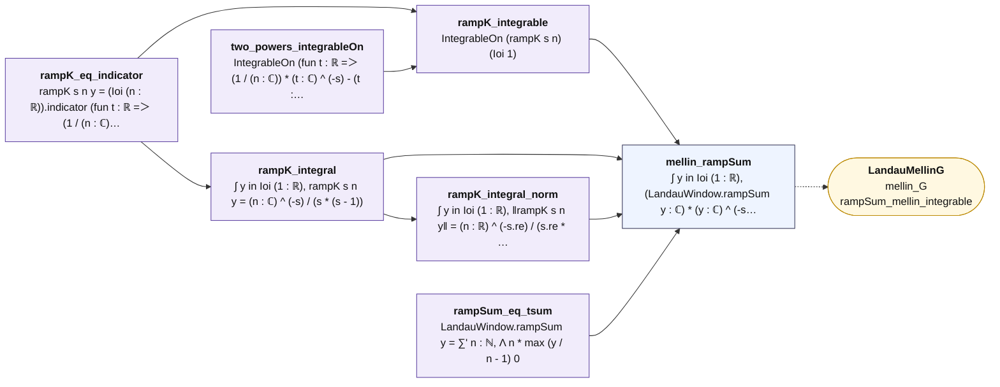

# `lean_stage3/Stage3/LandauMellin.lean`

LandauMellin — the Mellin transform of the ramp sum on `Re s > 1`. Block 2 of `lean_stage3/design/landau.md`. 2026-11-22.

7 theorems, 1 definition, 223 lines. Arrows are Lean's own record of what each proof uses.

**Imports:** [`LandauWindow`](../lean_stage3/LandauWindow.md)  
**Imported by:** [`Stage3`](../lean_stage3/Stage3.md), [`LandauMellinG`](../lean_stage3/LandauMellinG.md)

## The picture



An arrow A → B reads "A is used in the proof of B". Green: counting, integers only. Violet: shape, analysis with no ζ. Blue: reads ζ. A name ending in ■ is an end: nothing else uses it. Red: contains `sorry`. Yellow: theorems in another file, counted; a dotted arrow crosses files. Definitions are not drawn; they are listed below the diagram.

## Definitions

<a name="LandauMellin-rampK"></a>
### `LandauMellin.rampK`

def · line 43

The ramp kernel of one `n`: `max(y/n − 1, 0)·y^(−s−1)`.

- **Is:** `` rampK (s : ℂ) (n : ℕ) (y : ℝ) : ℂ := ((max (y / n - 1) 0 : ℝ) : ℂ) * (y : ℂ) ^ (-s - 1) ``
- **Used by 5:** [`LandauMellin.mellin_rampSum`](#LandauMellin-mellin_rampSum), [`LandauMellin.rampK_eq_indicator`](#LandauMellin-rampK_eq_indicator), [`LandauMellin.rampK_integrable`](#LandauMellin-rampK_integrable), [`LandauMellin.rampK_integral`](#LandauMellin-rampK_integral), [`LandauMellin.rampK_integral_norm`](#LandauMellin-rampK_integral_norm)

## Theorems

<a name="LandauMellin-rampK_eq_indicator"></a>
### `LandauMellin.rampK_eq_indicator`

line 47

**Shape.** Uses real or complex analysis; nothing in it or beneath it reads ζ.

**Why.** On `(1, ∞)` the kernel is the indicator of `(n, ∞)` times two powers.

**Proves**

```lean
rampK s n y = (Ioi (n : ℝ)).indicator (fun t : ℝ => (1 / (n : ℂ)) * (t : ℂ) ^ (-s) - (t : ℂ) ^ (-s - 1)) y
```

**Needs** (its hypotheses)

  - `` s : ℂ ``
  - `` hn : 1 ≤ n ``
  - `` hy : 1 < y ``

**Stated with:** [`LandauMellin.rampK`](#LandauMellin-rampK)

**Fed by:** no theorem of this repo; it stands on Mathlib and the definitions below.

**Feeds** (2 that use it)

  - [`LandauMellin.rampK_integrable`](#LandauMellin-rampK_integrable) — `` IntegrableOn (rampK s n) (Ioi 1) ``
  - [`LandauMellin.rampK_integral`](#LandauMellin-rampK_integral) — `` ∫ y in Ioi (1 : ℝ), rampK s n y = (n : ℂ) ^ (-s) / (s * (s - 1)) ``

<a name="LandauMellin-two_powers_integrableOn"></a>
### `LandauMellin.two_powers_integrableOn`

line 68

**Shape.** Uses real or complex analysis; nothing in it or beneath it reads ζ.

**Proves**

```lean
IntegrableOn (fun t : ℝ => (1 / (n : ℂ)) * (t : ℂ) ^ (-s) - (t : ℂ) ^ (-s - 1)) (Ioi (n : ℝ))
```

**Needs** (its hypotheses)

  - `` hs : 1 < s.re ``
  - `` hn : 1 ≤ n ``

**Fed by:** no theorem of this repo; it stands on Mathlib.

**Feeds** (1 that use it)

  - [`LandauMellin.rampK_integrable`](#LandauMellin-rampK_integrable) — `` IntegrableOn (rampK s n) (Ioi 1) ``

<a name="LandauMellin-rampK_integrable"></a>
### `LandauMellin.rampK_integrable`

line 78

**Shape.** Uses real or complex analysis; nothing in it or beneath it reads ζ.

**Proves**

```lean
IntegrableOn (rampK s n) (Ioi 1)
```

**Needs** (its hypotheses)

  - `` hs : 1 < s.re ``
  - `` hn : 1 ≤ n ``

**Stated with:** [`LandauMellin.rampK`](#LandauMellin-rampK)

**Fed by** (2 theorems its proof uses)

  - [`LandauMellin.rampK_eq_indicator`](#LandauMellin-rampK_eq_indicator) — `` rampK s n y = (Ioi (n : ℝ)).indicator (fun t : ℝ => (1 / (n : ℂ)) * (t : ℂ) ^ (-s) - (t : ℂ) ^ (-s - 1)) y ``
  - [`LandauMellin.two_powers_integrableOn`](#LandauMellin-two_powers_integrableOn) — `` IntegrableOn (fun t : ℝ => (1 / (n : ℂ)) * (t : ℂ) ^ (-s) - (t : ℂ) ^ (-s - 1)) (Ioi (n : ℝ)) ``

**Feeds** (1 that use it)

  - [`LandauMellin.mellin_rampSum`](#LandauMellin-mellin_rampSum) — `` ∫ y in Ioi (1 : ℝ), (LandauWindow.rampSum y : ℂ) * (y : ℂ) ^ (-s - 1) = -deriv riemannZeta s / riemannZeta s / (s * (s - 1)) ``

<a name="LandauMellin-rampK_integral"></a>
### `LandauMellin.rampK_integral`

line 85

**Shape.** Uses real or complex analysis; nothing in it or beneath it reads ζ.

**Proves**

```lean
∫ y in Ioi (1 : ℝ), rampK s n y = (n : ℂ) ^ (-s) / (s * (s - 1))
```

**Needs** (its hypotheses)

  - `` hs : 1 < s.re ``
  - `` hn : 1 ≤ n ``

**Stated with:** [`LandauMellin.rampK`](#LandauMellin-rampK)

**Fed by** (1 theorem its proof uses)

  - [`LandauMellin.rampK_eq_indicator`](#LandauMellin-rampK_eq_indicator) — `` rampK s n y = (Ioi (n : ℝ)).indicator (fun t : ℝ => (1 / (n : ℂ)) * (t : ℂ) ^ (-s) - (t : ℂ) ^ (-s - 1)) y ``

**Feeds** (2 that use it)

  - [`LandauMellin.mellin_rampSum`](#LandauMellin-mellin_rampSum) — `` ∫ y in Ioi (1 : ℝ), (LandauWindow.rampSum y : ℂ) * (y : ℂ) ^ (-s - 1) = -deriv riemannZeta s / riemannZeta s / (s * (s - 1)) ``
  - [`LandauMellin.rampK_integral_norm`](#LandauMellin-rampK_integral_norm) — `` ∫ y in Ioi (1 : ℝ), ‖rampK s n y‖ = (n : ℝ) ^ (-s.re) / (s.re * (s.re - 1)) ``

<a name="LandauMellin-rampK_integral_norm"></a>
### `LandauMellin.rampK_integral_norm`

line 122

**Shape.** Uses real or complex analysis; nothing in it or beneath it reads ζ.

**Proves**

```lean
∫ y in Ioi (1 : ℝ), ‖rampK s n y‖ = (n : ℝ) ^ (-s.re) / (s.re * (s.re - 1))
```

**Needs** (its hypotheses)

  - `` hs : 1 < s.re ``
  - `` hn : 1 ≤ n ``

**Stated with:** [`LandauMellin.rampK`](#LandauMellin-rampK)

**Fed by** (1 theorem its proof uses)

  - [`LandauMellin.rampK_integral`](#LandauMellin-rampK_integral) — `` ∫ y in Ioi (1 : ℝ), rampK s n y = (n : ℂ) ^ (-s) / (s * (s - 1)) ``

**Feeds** (1 that use it)

  - [`LandauMellin.mellin_rampSum`](#LandauMellin-mellin_rampSum) — `` ∫ y in Ioi (1 : ℝ), (LandauWindow.rampSum y : ℂ) * (y : ℂ) ^ (-s - 1) = -deriv riemannZeta s / riemannZeta s / (s * (s - 1)) ``

<a name="LandauMellin-rampSum_eq_tsum"></a>
### `LandauMellin.rampSum_eq_tsum`

line 148

**Shape.** Uses real or complex analysis; nothing in it or beneath it reads ζ.

**Proves**

```lean
LandauWindow.rampSum y = ∑' n : ℕ, Λ n * max (y / n - 1) 0
```

**Needs** (its hypotheses)

  - `` y : ℝ ``

**Stated with:** [`LandauWindow.rampSum`](../lean_stage3/LandauWindow.md#LandauWindow-rampSum)

**Fed by:** no theorem of this repo; it stands on Mathlib and the definitions below.

**Feeds** (1 that use it)

  - [`LandauMellin.mellin_rampSum`](#LandauMellin-mellin_rampSum) — `` ∫ y in Ioi (1 : ℝ), (LandauWindow.rampSum y : ℂ) * (y : ℂ) ^ (-s - 1) = -deriv riemannZeta s / riemannZeta s / (s * (s - 1)) ``

<a name="LandauMellin-mellin_rampSum"></a>
### `LandauMellin.mellin_rampSum`

line 164

**Reads ζ.** It, or something it rests on, uses the zeta function, its zeros or the Riemann hypothesis.

**Proves**

```lean
∫ y in Ioi (1 : ℝ), (LandauWindow.rampSum y : ℂ) * (y : ℂ) ^ (-s - 1) = -deriv riemannZeta s / riemannZeta s / (s * (s - 1))
```

**Needs** (its hypotheses)

  - `` hs : 1 < s.re ``

**Stated with:** [`LandauWindow.rampSum`](../lean_stage3/LandauWindow.md#LandauWindow-rampSum)

**Fed by** (4 theorems its proof uses)

  - [`LandauMellin.rampK_integrable`](#LandauMellin-rampK_integrable) — `` IntegrableOn (rampK s n) (Ioi 1) ``
  - [`LandauMellin.rampK_integral`](#LandauMellin-rampK_integral) — `` ∫ y in Ioi (1 : ℝ), rampK s n y = (n : ℂ) ^ (-s) / (s * (s - 1)) ``
  - [`LandauMellin.rampK_integral_norm`](#LandauMellin-rampK_integral_norm) — `` ∫ y in Ioi (1 : ℝ), ‖rampK s n y‖ = (n : ℝ) ^ (-s.re) / (s.re * (s.re - 1)) ``
  - [`LandauMellin.rampSum_eq_tsum`](#LandauMellin-rampSum_eq_tsum) — `` LandauWindow.rampSum y = ∑' n : ℕ, Λ n * max (y / n - 1) 0 ``

**Definitions its proof touches:** [`LandauMellin.rampK`](#LandauMellin-rampK)

**Feeds** (2 that use it)

  - [`LandauMellinG.mellin_G`](../lean_stage3/LandauMellinG.md#LandauMellinG-mellin_G) (LandauMellinG) — `` ∫ y in Ioi (1 : ℝ), (LandauWindow.G y : ℂ) * (y : ℂ) ^ (-s - 1) = Phi s ``
  - [`LandauMellinG.rampSum_mellin_integrable`](../lean_stage3/LandauMellinG.md#LandauMellinG-rampSum_mellin_integrable) (LandauMellinG) — `` IntegrableOn (fun y : ℝ => (LandauWindow.rampSum y : ℂ) * (y : ℂ) ^ (-s - 1)) (Ioi 1) ``

