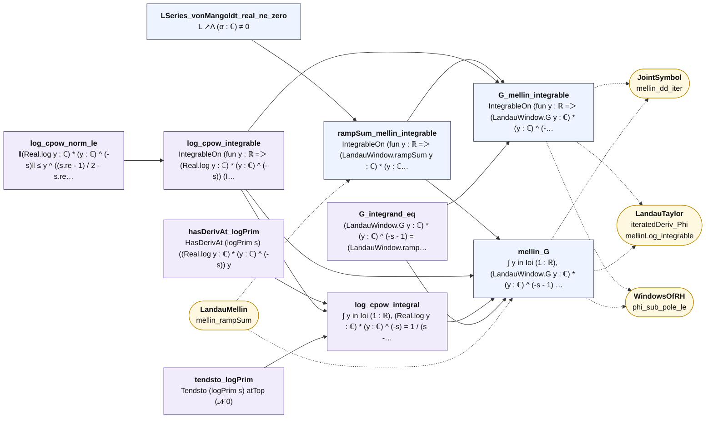

# `lean_stage3/Stage3/LandauMellinG.lean`

LandauMellinG — the Mellin transform of `G` on `Re s > 1`. Block 2b of `lean_stage3/design/landau.md`. 2026-11-22.

10 theorems, 2 definitions, 280 lines. Arrows are Lean's own record of what each proof uses.

**Imports:** [`LandauMellin`](../lean_stage3/LandauMellin.md)  
**Imported by:** [`Stage3`](../lean_stage3/Stage3.md), [`LandauPoleLocal`](../lean_stage3/LandauPoleLocal.md), [`LandauTaylor`](../lean_stage3/LandauTaylor.md), [`WindowsOfRH`](../lean_stage3/WindowsOfRH.md)

## The picture



An arrow A → B reads "A is used in the proof of B". Green: counting, integers only. Violet: shape, analysis with no ζ. Blue: reads ζ. A name ending in ■ is an end: nothing else uses it. Red: contains `sorry`. Yellow: theorems in another file, counted; a dotted arrow crosses files. Definitions are not drawn; they are listed below the diagram.

## Definitions

<a name="LandauMellinG-Phi"></a>
### `LandauMellinG.Phi`

def · line 43

The Mellin transform of `G`: the `Φ` of the worksheet.

- **Is:** `` Phi (s : ℂ) : ℂ := -deriv riemannZeta s / riemannZeta s / (s * (s - 1)) - 1 / (s - 1) ^ 2 + (1 + (Real.eulerMascheroniConstant : ℂ)) / (s - 1) ``
- **Used by 12:** [`JointSymbol.mellin_dd_iter`](../lean_stage3/JointSymbol.md#JointSymbol-mellin_dd_iter), [`JointSymbol.symPhi_principal_part`](../lean_stage3/JointSymbol.md#JointSymbol-symPhi_principal_part), [`LandauMellinG.mellin_G`](#LandauMellinG-mellin_G), [`LandauPoleDisc.Phi_taylor_on_disc`](../lean_stage3/LandauPoleDisc.md#LandauPoleDisc-Phi_taylor_on_disc), [`LandauPoleLocal.Phi_principal_part`](../lean_stage3/LandauPoleLocal.md#LandauPoleLocal-Phi_principal_part), [`LandauPoleLocal.Phi_regular_at_one`](../lean_stage3/LandauPoleLocal.md#LandauPoleLocal-Phi_regular_at_one), [`LandauPoleLocal.differentiableAt_Phi`](../lean_stage3/LandauPoleLocal.md#LandauPoleLocal-differentiableAt_Phi), [`LandauPrimeSide.iteratedDeriv_Phi_eq_Ik`](../lean_stage3/LandauPrimeSide.md#LandauPrimeSide-iteratedDeriv_Phi_eq_Ik), [`LandauTaylor.iteratedDeriv_Phi`](../lean_stage3/LandauTaylor.md#LandauTaylor-iteratedDeriv_Phi), [`LandauZeroSide.zero_side`](../lean_stage3/LandauZeroSide.md#LandauZeroSide-zero_side), [`WindowsOfRH.const_eq_zero`](../lean_stage3/WindowsOfRH.md#WindowsOfRH-const_eq_zero), [`WindowsOfRH.phi_sub_pole_le`](../lean_stage3/WindowsOfRH.md#WindowsOfRH-phi_sub_pole_le)

<a name="LandauMellinG-logPrim"></a>
### `LandauMellinG.logPrim`

def · line 118

The primitive of `log y · y^(−s)`.

- **Is:** `` logPrim (s : ℂ) (t : ℝ) : ℂ := (t : ℂ) ^ (-s + 1) / (-s + 1) * (Real.log t : ℂ) - (t : ℂ) ^ (-s + 1) / (-s + 1) / (-s + 1) ``
- **Used by 3:** [`LandauMellinG.hasDerivAt_logPrim`](#LandauMellinG-hasDerivAt_logPrim), [`LandauMellinG.log_cpow_integral`](#LandauMellinG-log_cpow_integral), [`LandauMellinG.tendsto_logPrim`](#LandauMellinG-tendsto_logPrim)

## Theorems

<a name="LandauMellinG-LSeries_vonMangoldt_real_ne_zero"></a>
### `LandauMellinG.LSeries_vonMangoldt_real_ne_zero`

line 48

**Reads ζ.** It, or something it rests on, uses the zeta function, its zeros or the Riemann hypothesis.

**Why.** For real `σ > 1`, the L-series of the von Mangoldt function is nonzero at `σ`.

**Proves**

```lean
L ↗Λ (σ : ℂ) ≠ 0
```

**Needs** (its hypotheses)

  - `` hσ : 1 < σ ``

**Fed by:** no theorem of this repo; it stands on Mathlib.

**Feeds** (1 that use it)

  - [`LandauMellinG.rampSum_mellin_integrable`](#LandauMellinG-rampSum_mellin_integrable) — `` IntegrableOn (fun y : ℝ => (LandauWindow.rampSum y : ℂ) * (y : ℂ) ^ (-s - 1)) (Ioi 1) ``

<a name="LandauMellinG-rampSum_mellin_integrable"></a>
### `LandauMellinG.rampSum_mellin_integrable`

line 80

**Reads ζ.** It, or something it rests on, uses the zeta function, its zeros or the Riemann hypothesis.

**Why.** For `Re s > 1`, the Mellin integrand of the ramp sum, `rampSum y · y^(−s−1)`, is integrable on `(1, ∞)`.

**Proves**

```lean
IntegrableOn (fun y : ℝ => (LandauWindow.rampSum y : ℂ) * (y : ℂ) ^ (-s - 1)) (Ioi 1)
```

**Needs** (its hypotheses)

  - `` hs : 1 < s.re ``

**Stated with:** [`LandauWindow.rampSum`](../lean_stage3/LandauWindow.md#LandauWindow-rampSum)

**Fed by** (2 theorems its proof uses)

  - [`LandauMellin.mellin_rampSum`](../lean_stage3/LandauMellin.md#LandauMellin-mellin_rampSum) (LandauMellin) — `` ∫ y in Ioi (1 : ℝ), (LandauWindow.rampSum y : ℂ) * (y : ℂ) ^ (-s - 1) = -deriv riemannZeta s / riemannZeta s / (s * (s - 1)) ``
  - [`LandauMellinG.LSeries_vonMangoldt_real_ne_zero`](#LandauMellinG-LSeries_vonMangoldt_real_ne_zero) — `` L ↗Λ (σ : ℂ) ≠ 0 ``

**Feeds** (2 that use it)

  - [`LandauMellinG.G_mellin_integrable`](#LandauMellinG-G_mellin_integrable) — `` IntegrableOn (fun y : ℝ => (LandauWindow.G y : ℂ) * (y : ℂ) ^ (-s - 1)) (Ioi 1) ``
  - [`LandauMellinG.mellin_G`](#LandauMellinG-mellin_G) — `` ∫ y in Ioi (1 : ℝ), (LandauWindow.G y : ℂ) * (y : ℂ) ^ (-s - 1) = Phi s ``

<a name="LandauMellinG-hasDerivAt_logPrim"></a>
### `LandauMellinG.hasDerivAt_logPrim`

line 123

**Shape.** Uses real or complex analysis; nothing in it or beneath it reads ζ.

**Why.** Helper: for `s ≠ 1` and `y > 0`, the primitive `logPrim s` has derivative `log y · y^(−s)` at `y`.

**Proves**

```lean
HasDerivAt (logPrim s) ((Real.log y : ℂ) * (y : ℂ) ^ (-s)) y
```

**Needs** (its hypotheses)

  - `` hs1 : -s + 1 ≠ 0 ``
  - `` hy : 0 < y ``

**Stated with:** [`LandauMellinG.logPrim`](#LandauMellinG-logPrim)

**Fed by:** no theorem of this repo; it stands on Mathlib and the definitions below.

**Feeds** (1 that use it)

  - [`LandauMellinG.log_cpow_integral`](#LandauMellinG-log_cpow_integral) — `` ∫ y in Ioi (1 : ℝ), (Real.log y : ℂ) * (y : ℂ) ^ (-s) = 1 / (s - 1) ^ 2 ``

<a name="LandauMellinG-log_cpow_norm_le"></a>
### `LandauMellinG.log_cpow_norm_le`

line 144

**Shape.** Uses real or complex analysis; nothing in it or beneath it reads ζ.

**Why.** Helper: for `Re s > 1` and `y > 1`, with `ε = (Re s − 1)/2`, the norm of `log y · y^(−s)` is at most `y^(ε − Re s) / ε`.

**Proves**

```lean
‖(Real.log y : ℂ) * (y : ℂ) ^ (-s)‖ ≤ y ^ ((s.re - 1) / 2 - s.re) / ((s.re - 1) / 2)
```

**Needs** (its hypotheses)

  - `` hs : 1 < s.re ``
  - `` hy : 1 < y ``

**Fed by:** no theorem of this repo; it stands on Mathlib.

**Feeds** (1 that use it)

  - [`LandauMellinG.log_cpow_integrable`](#LandauMellinG-log_cpow_integrable) — `` IntegrableOn (fun y : ℝ => (Real.log y : ℂ) * (y : ℂ) ^ (-s)) (Ioi 1) ``

<a name="LandauMellinG-log_cpow_integrable"></a>
### `LandauMellinG.log_cpow_integrable`

line 159

**Shape.** Uses real or complex analysis; nothing in it or beneath it reads ζ.

**Why.** For `Re s > 1`, the function `log y · y^(−s)` is integrable on `(1, ∞)`.

**Proves**

```lean
IntegrableOn (fun y : ℝ => (Real.log y : ℂ) * (y : ℂ) ^ (-s)) (Ioi 1)
```

**Needs** (its hypotheses)

  - `` hs : 1 < s.re ``

**Fed by** (1 theorem its proof uses)

  - [`LandauMellinG.log_cpow_norm_le`](#LandauMellinG-log_cpow_norm_le) — `` ‖(Real.log y : ℂ) * (y : ℂ) ^ (-s)‖ ≤ y ^ ((s.re - 1) / 2 - s.re) / ((s.re - 1) / 2) ``

**Feeds** (3 that use it)

  - [`LandauMellinG.G_mellin_integrable`](#LandauMellinG-G_mellin_integrable) — `` IntegrableOn (fun y : ℝ => (LandauWindow.G y : ℂ) * (y : ℂ) ^ (-s - 1)) (Ioi 1) ``
  - [`LandauMellinG.log_cpow_integral`](#LandauMellinG-log_cpow_integral) — `` ∫ y in Ioi (1 : ℝ), (Real.log y : ℂ) * (y : ℂ) ^ (-s) = 1 / (s - 1) ^ 2 ``
  - [`LandauMellinG.mellin_G`](#LandauMellinG-mellin_G) — `` ∫ y in Ioi (1 : ℝ), (LandauWindow.G y : ℂ) * (y : ℂ) ^ (-s - 1) = Phi s ``

<a name="LandauMellinG-tendsto_logPrim"></a>
### `LandauMellinG.tendsto_logPrim`

line 175

**Shape.** Uses real or complex analysis; nothing in it or beneath it reads ζ.

**Why.** Helper: for `Re s > 1`, the primitive `logPrim s` tends to `0` at `+∞`.

**Proves**

```lean
Tendsto (logPrim s) atTop (𝓝 0)
```

**Needs** (its hypotheses)

  - `` hs : 1 < s.re ``

**Stated with:** [`LandauMellinG.logPrim`](#LandauMellinG-logPrim)

**Fed by:** no theorem of this repo; it stands on Mathlib and the definitions below.

**Feeds** (1 that use it)

  - [`LandauMellinG.log_cpow_integral`](#LandauMellinG-log_cpow_integral) — `` ∫ y in Ioi (1 : ℝ), (Real.log y : ℂ) * (y : ℂ) ^ (-s) = 1 / (s - 1) ^ 2 ``

<a name="LandauMellinG-log_cpow_integral"></a>
### `LandauMellinG.log_cpow_integral`

line 201

**Shape.** Uses real or complex analysis; nothing in it or beneath it reads ζ.

**Why.** For `Re s > 1`, the integral of `log y · y^(−s)` over `(1, ∞)` equals `1/(s−1)²`.

**Proves**

```lean
∫ y in Ioi (1 : ℝ), (Real.log y : ℂ) * (y : ℂ) ^ (-s) = 1 / (s - 1) ^ 2
```

**Needs** (its hypotheses)

  - `` hs : 1 < s.re ``

**Fed by** (3 theorems its proof uses)

  - [`LandauMellinG.hasDerivAt_logPrim`](#LandauMellinG-hasDerivAt_logPrim) — `` HasDerivAt (logPrim s) ((Real.log y : ℂ) * (y : ℂ) ^ (-s)) y ``
  - [`LandauMellinG.log_cpow_integrable`](#LandauMellinG-log_cpow_integrable) — `` IntegrableOn (fun y : ℝ => (Real.log y : ℂ) * (y : ℂ) ^ (-s)) (Ioi 1) ``
  - [`LandauMellinG.tendsto_logPrim`](#LandauMellinG-tendsto_logPrim) — `` Tendsto (logPrim s) atTop (𝓝 0) ``

**Definitions its proof touches:** [`LandauMellinG.logPrim`](#LandauMellinG-logPrim)

**Feeds** (1 that use it)

  - [`LandauMellinG.mellin_G`](#LandauMellinG-mellin_G) — `` ∫ y in Ioi (1 : ℝ), (LandauWindow.G y : ℂ) * (y : ℂ) ^ (-s - 1) = Phi s ``

<a name="LandauMellinG-G_integrand_eq"></a>
### `LandauMellinG.G_integrand_eq`

line 219

**Shape.** Uses real or complex analysis; nothing in it or beneath it reads ζ.

**Why.** Helper: for `y > 1`, the Mellin integrand `G y · y^(−s−1)` splits as `rampSum y · y^(−s−1) − log y · y^(−s) + (1+γ) · y^(−s)`.

**Proves**

```lean
(LandauWindow.G y : ℂ) * (y : ℂ) ^ (-s - 1) = (LandauWindow.rampSum y : ℂ) * (y : ℂ) ^ (-s - 1) - (Real.log y : ℂ) * (y : ℂ) ^ (-s) + (1 + (Real.eulerMascheroniConstant : ℂ)) * (y : ℂ) ^ (-s)
```

**Needs** (its hypotheses)

  - `` s : ℂ ``
  - `` hy : 1 < y ``

**Stated with:** [`LandauWindow.G`](../lean_stage3/LandauWindow.md#LandauWindow-G), [`LandauWindow.rampSum`](../lean_stage3/LandauWindow.md#LandauWindow-rampSum)

**Fed by:** no theorem of this repo; it stands on Mathlib and the definitions below.

**Feeds** (2 that use it)

  - [`LandauMellinG.G_mellin_integrable`](#LandauMellinG-G_mellin_integrable) — `` IntegrableOn (fun y : ℝ => (LandauWindow.G y : ℂ) * (y : ℂ) ^ (-s - 1)) (Ioi 1) ``
  - [`LandauMellinG.mellin_G`](#LandauMellinG-mellin_G) — `` ∫ y in Ioi (1 : ℝ), (LandauWindow.G y : ℂ) * (y : ℂ) ^ (-s - 1) = Phi s ``

<a name="LandauMellinG-G_mellin_integrable"></a>
### `LandauMellinG.G_mellin_integrable`

line 233

**Reads ζ.** It, or something it rests on, uses the zeta function, its zeros or the Riemann hypothesis.

**Why.** For `Re s > 1`, the Mellin integrand `G y · y^(−s−1)` is integrable on `(1, ∞)`.

**Proves**

```lean
IntegrableOn (fun y : ℝ => (LandauWindow.G y : ℂ) * (y : ℂ) ^ (-s - 1)) (Ioi 1)
```

**Needs** (its hypotheses)

  - `` hs : 1 < s.re ``

**Stated with:** [`LandauWindow.G`](../lean_stage3/LandauWindow.md#LandauWindow-G)

**Fed by** (3 theorems its proof uses)

  - [`LandauMellinG.G_integrand_eq`](#LandauMellinG-G_integrand_eq) — `` (LandauWindow.G y : ℂ) * (y : ℂ) ^ (-s - 1) = (LandauWindow.rampSum y : ℂ) * (y : ℂ) ^ (-s - 1) - (Real.log y : ℂ) * (y : ℂ) ^ (-s) + (1 + (Real.euler… ``
  - [`LandauMellinG.log_cpow_integrable`](#LandauMellinG-log_cpow_integrable) — `` IntegrableOn (fun y : ℝ => (Real.log y : ℂ) * (y : ℂ) ^ (-s)) (Ioi 1) ``
  - [`LandauMellinG.rampSum_mellin_integrable`](#LandauMellinG-rampSum_mellin_integrable) — `` IntegrableOn (fun y : ℝ => (LandauWindow.rampSum y : ℂ) * (y : ℂ) ^ (-s - 1)) (Ioi 1) ``

**Definitions its proof touches:** [`LandauWindow.rampSum`](../lean_stage3/LandauWindow.md#LandauWindow-rampSum)

**Feeds** (3 that use it)

  - [`JointSymbol.mellin_dd_iter`](../lean_stage3/JointSymbol.md#JointSymbol-mellin_dd_iter) (JointSymbol) — `` ∫ y in Ioi (1 : ℝ), (dd^[d] cutG) y * (y : ℂ) ^ (-s - 1) = (1 - (2 : ℂ) ^ (-s)) ^ d * LandauMellinG.Phi s ``
  - [`LandauTaylor.mellinLog_integrable`](../lean_stage3/LandauTaylor.md#LandauTaylor-mellinLog_integrable) (LandauTaylor) — `` IntegrableOn (fun y : ℝ => (LandauWindow.G y : ℂ) * (-(Real.log y : ℂ)) ^ k * (y : ℂ) ^ (-s - 1)) (Ioi 1) ``
  - [`WindowsOfRH.phi_sub_pole_le`](../lean_stage3/WindowsOfRH.md#WindowsOfRH-phi_sub_pole_le) (WindowsOfRH) — `` ‖LandauMellinG.Phi σ - c / ((σ : ℂ) - 1)‖ ≤ K / (σ - α) ``

<a name="LandauMellinG-mellin_G"></a>
### `LandauMellinG.mellin_G`

line 244

**Reads ζ.** It, or something it rests on, uses the zeta function, its zeros or the Riemann hypothesis.

**Why.** For `Re s > 1`, the Mellin transform of `G` over `(1, ∞)`, `∫ G y · y^(−s−1) dy`, equals `Phi s`.

**Proves**

```lean
∫ y in Ioi (1 : ℝ), (LandauWindow.G y : ℂ) * (y : ℂ) ^ (-s - 1) = Phi s
```

**Needs** (its hypotheses)

  - `` hs : 1 < s.re ``

**Stated with:** [`LandauMellinG.Phi`](#LandauMellinG-Phi), [`LandauWindow.G`](../lean_stage3/LandauWindow.md#LandauWindow-G)

**Fed by** (5 theorems its proof uses)

  - [`LandauMellin.mellin_rampSum`](../lean_stage3/LandauMellin.md#LandauMellin-mellin_rampSum) (LandauMellin) — `` ∫ y in Ioi (1 : ℝ), (LandauWindow.rampSum y : ℂ) * (y : ℂ) ^ (-s - 1) = -deriv riemannZeta s / riemannZeta s / (s * (s - 1)) ``
  - [`LandauMellinG.G_integrand_eq`](#LandauMellinG-G_integrand_eq) — `` (LandauWindow.G y : ℂ) * (y : ℂ) ^ (-s - 1) = (LandauWindow.rampSum y : ℂ) * (y : ℂ) ^ (-s - 1) - (Real.log y : ℂ) * (y : ℂ) ^ (-s) + (1 + (Real.euler… ``
  - [`LandauMellinG.log_cpow_integrable`](#LandauMellinG-log_cpow_integrable) — `` IntegrableOn (fun y : ℝ => (Real.log y : ℂ) * (y : ℂ) ^ (-s)) (Ioi 1) ``
  - [`LandauMellinG.log_cpow_integral`](#LandauMellinG-log_cpow_integral) — `` ∫ y in Ioi (1 : ℝ), (Real.log y : ℂ) * (y : ℂ) ^ (-s) = 1 / (s - 1) ^ 2 ``
  - [`LandauMellinG.rampSum_mellin_integrable`](#LandauMellinG-rampSum_mellin_integrable) — `` IntegrableOn (fun y : ℝ => (LandauWindow.rampSum y : ℂ) * (y : ℂ) ^ (-s - 1)) (Ioi 1) ``

**Definitions its proof touches:** [`LandauWindow.rampSum`](../lean_stage3/LandauWindow.md#LandauWindow-rampSum)

**Feeds** (3 that use it)

  - [`JointSymbol.mellin_dd_iter`](../lean_stage3/JointSymbol.md#JointSymbol-mellin_dd_iter) (JointSymbol) — `` ∫ y in Ioi (1 : ℝ), (dd^[d] cutG) y * (y : ℂ) ^ (-s - 1) = (1 - (2 : ℂ) ^ (-s)) ^ d * LandauMellinG.Phi s ``
  - [`LandauTaylor.iteratedDeriv_Phi`](../lean_stage3/LandauTaylor.md#LandauTaylor-iteratedDeriv_Phi) (LandauTaylor) — `` iteratedDeriv k LandauMellinG.Phi s = mellinLog k s ``
  - [`WindowsOfRH.phi_sub_pole_le`](../lean_stage3/WindowsOfRH.md#WindowsOfRH-phi_sub_pole_le) (WindowsOfRH) — `` ‖LandauMellinG.Phi σ - c / ((σ : ℂ) - 1)‖ ≤ K / (σ - α) ``

