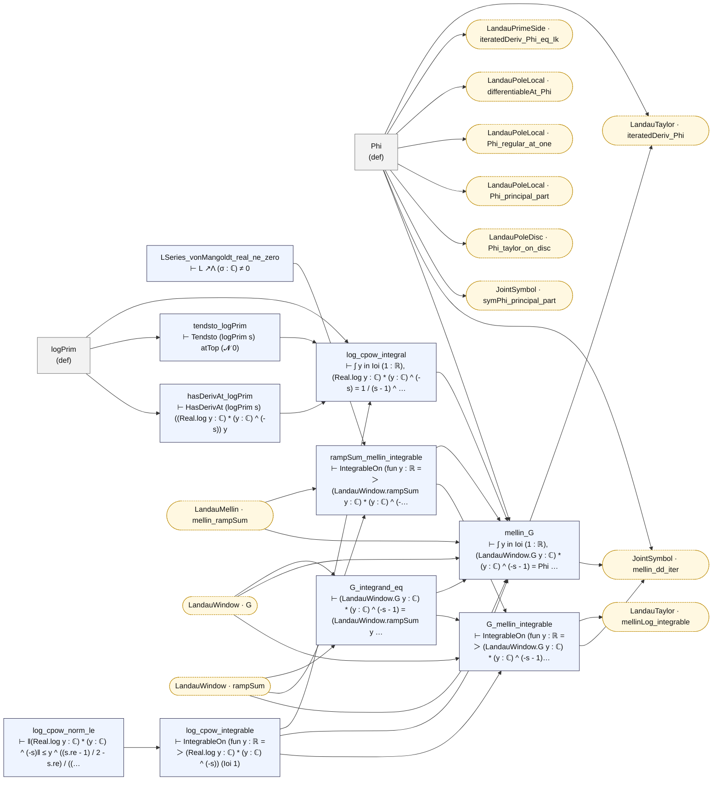

# `lean_stage3/Stage3/LandauMellinG.lean`

**What it does** (its own header): LandauMellinG — the Mellin transform of `G` on `Re s > 1`. Block 2b of `lean_stage3/design/landau.md`. 2026-11-22.

**Imports:** [`LandauMellin`](../lean_stage3/LandauMellin.md).
**Imported by:** [`Stage3`](../lean_stage3/Stage3.md), [`LandauPoleLocal`](../lean_stage3/LandauPoleLocal.md), [`LandauTaylor`](../lean_stage3/LandauTaylor.md).

Blue: theorem. Green: a theorem nothing else uses (an end). Dashed white: connects to nothing. Grey: definition. Red: contains `sorry`. Yellow: in another file. An arrow A → B reads "A is used by B".

## Every declaration

| declaration | proves (output) | needs (input) | why (its own docstring) | uses | used by |
|---|---|---|---|---|---|
| `LandauMellinG.Phi` def, line 43 | ℂ | s : ℂ | The Mellin transform of `G`: the `Φ` of the worksheet. | — | `JointSymbol.mellin_dd_iter`, `JointSymbol.symPhi_principal_part`, `LandauMellinG.mellin_G`, `LandauPoleDisc.Phi_taylor_on_disc`, `LandauPoleLocal.Phi_principal_part`, `LandauPoleLocal.Phi_regular_at_one`, `LandauPoleLocal.differentiableAt_Phi`, `LandauPrimeSide.iteratedDeriv_Phi_eq_Ik`, `LandauTaylor.iteratedDeriv_Phi` |
| `LandauMellinG.LSeries_vonMangoldt_real_ne_zero` theorem, line 47 | L ↗Λ (σ : ℂ) ≠ 0 | hσ : 1 &lt; σ | — | — | `LandauMellinG.rampSum_mellin_integrable` |
| `LandauMellinG.rampSum_mellin_integrable` theorem, line 77 | IntegrableOn (fun y : ℝ =&gt; (LandauWindow.rampSum y : ℂ) * (y : ℂ) ^ (-s - 1)) (Ioi 1) | hs : 1 &lt; s.re | — | `LandauMellin.mellin_rampSum`, `LandauMellinG.LSeries_vonMangoldt_real_ne_zero`, `LandauWindow.rampSum` | `LandauMellinG.G_mellin_integrable`, `LandauMellinG.mellin_G` |
| `LandauMellinG.logPrim` def, line 115 | ℂ | s : ℂ; t : ℝ | The primitive of `log y · y^(−s)`. | — | `LandauMellinG.hasDerivAt_logPrim`, `LandauMellinG.log_cpow_integral`, `LandauMellinG.tendsto_logPrim` |
| `LandauMellinG.hasDerivAt_logPrim` theorem, line 118 | HasDerivAt (logPrim s) ((Real.log y : ℂ) * (y : ℂ) ^ (-s)) y | hs1 : -s + 1 ≠ 0; hy : 0 &lt; y | — | `LandauMellinG.logPrim` | `LandauMellinG.log_cpow_integral` |
| `LandauMellinG.log_cpow_norm_le` theorem, line 137 | ‖(Real.log y : ℂ) * (y : ℂ) ^ (-s)‖ ≤ y ^ ((s.re - 1) / 2 - s.re) / ((s.re - 1) / 2) | hs : 1 &lt; s.re; hy : 1 &lt; y | — | — | `LandauMellinG.log_cpow_integrable` |
| `LandauMellinG.log_cpow_integrable` theorem, line 151 | IntegrableOn (fun y : ℝ =&gt; (Real.log y : ℂ) * (y : ℂ) ^ (-s)) (Ioi 1) | hs : 1 &lt; s.re | — | `LandauMellinG.log_cpow_norm_le` | `LandauMellinG.G_mellin_integrable`, `LandauMellinG.log_cpow_integral`, `LandauMellinG.mellin_G` |
| `LandauMellinG.tendsto_logPrim` theorem, line 166 | Tendsto (logPrim s) atTop (𝓝 0) | hs : 1 &lt; s.re | — | `LandauMellinG.logPrim` | `LandauMellinG.log_cpow_integral` |
| `LandauMellinG.log_cpow_integral` theorem, line 191 | ∫ y in Ioi (1 : ℝ), (Real.log y : ℂ) * (y : ℂ) ^ (-s) = 1 / (s - 1) ^ 2 | hs : 1 &lt; s.re | — | `LandauMellinG.hasDerivAt_logPrim`, `LandauMellinG.logPrim`, `LandauMellinG.log_cpow_integrable`, `LandauMellinG.tendsto_logPrim` | `LandauMellinG.mellin_G` |
| `LandauMellinG.G_integrand_eq` theorem, line 207 | (LandauWindow.G y : ℂ) * (y : ℂ) ^ (-s - 1) = (LandauWindow.rampSum y : ℂ) * (y : ℂ) ^ (-s - 1) - (Real.log y : ℂ) * (y : ℂ) ^ (-s) + (1 + (Real.eulerMascheroniConstant : ℂ)) * (y : ℂ) ^ (-s) | s : ℂ; hy : 1 &lt; y | — | `LandauWindow.G`, `LandauWindow.rampSum` | `LandauMellinG.G_mellin_integrable`, `LandauMellinG.mellin_G` |
| `LandauMellinG.G_mellin_integrable` theorem, line 220 | IntegrableOn (fun y : ℝ =&gt; (LandauWindow.G y : ℂ) * (y : ℂ) ^ (-s - 1)) (Ioi 1) | hs : 1 &lt; s.re | — | `LandauMellinG.G_integrand_eq`, `LandauMellinG.log_cpow_integrable`, `LandauMellinG.rampSum_mellin_integrable`, `LandauWindow.G` | `JointSymbol.mellin_dd_iter`, `LandauTaylor.mellinLog_integrable` |
| `LandauMellinG.mellin_G` theorem, line 229 | ∫ y in Ioi (1 : ℝ), (LandauWindow.G y : ℂ) * (y : ℂ) ^ (-s - 1) = Phi s | hs : 1 &lt; s.re | — | `LandauMellin.mellin_rampSum`, `LandauMellinG.G_integrand_eq`, `LandauMellinG.Phi`, `LandauMellinG.log_cpow_integrable`, `LandauMellinG.log_cpow_integral`, `LandauMellinG.rampSum_mellin_integrable`, `LandauWindow.G`, `LandauWindow.rampSum` | `JointSymbol.mellin_dd_iter`, `LandauTaylor.iteratedDeriv_Phi` |
