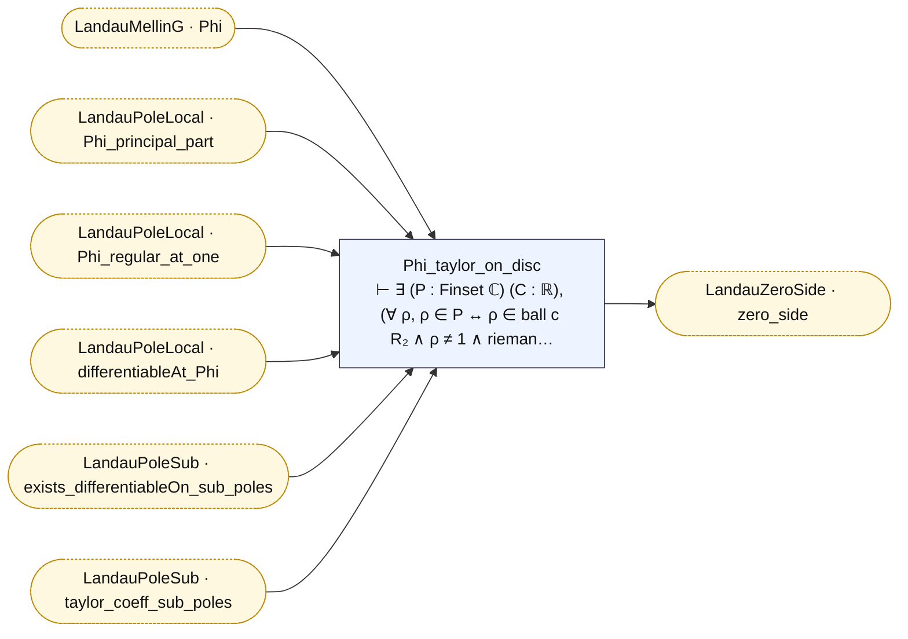

# `lean_stage3/Stage3/LandauPoleDisc.lean`

**What it does** (its own header): LandauPoleDisc — the derivatives of `Phi` at a regular point, from the zeros of `ζ` in a disc around it. Block 3b2 of `lean_stage3/design/landau.md`. 2026-11-22.

**Imports:** [`LandauPoleLocal`](../lean_stage3/LandauPoleLocal.md), [`LandauPoleSub`](../lean_stage3/LandauPoleSub.md).
**Imported by:** [`Stage3`](../lean_stage3/Stage3.md), [`LandauZeroSide`](../lean_stage3/LandauZeroSide.md).

Blue: theorem. Green: a theorem nothing else uses (an end). Dashed white: connects to nothing. Grey: definition. Red: contains `sorry`. Yellow: in another file. An arrow A → B reads "A is used by B".

## Every declaration

| declaration | proves (output) | needs (input) | why (its own docstring) | uses | used by |
|---|---|---|---|---|---|
| `LandauPoleDisc.Phi_taylor_on_disc` theorem, line 36 | ∃ (P : Finset ℂ) (C : ℝ), (∀ ρ, ρ ∈ P ↔ ρ ∈ ball c R₂ ∧ ρ ≠ 1 ∧ riemannZeta ρ = 0) ∧ ∀ k : ℕ, ‖iteratedDeriv k LandauMellinG.Phi c - ∑ ρ ∈ P, (analyticOrderNatAt riemannZeta ρ : ℂ) / (ρ * (1 - ρ)) * ((-1) ^ k * (k.factorial : ℂ) * (c - ρ) ^ (-1 - (k : ℤ)))‖ ≤ k.factorial * C / R ^ k | hR : 0 &lt; R; hRR : R &lt; R₂; hpos : closedBall c R₂ ⊆ {s : ℂ \| 0 &lt; s.re}; hc1 : c ≠ 1; hcz : riemannZeta c ≠ 0 | — | `LandauMellinG.Phi`, `LandauPoleLocal.Phi_principal_part`, `LandauPoleLocal.Phi_regular_at_one`, `LandauPoleLocal.differentiableAt_Phi`, `LandauPoleSub.exists_differentiableOn_sub_poles`, `LandauPoleSub.taylor_coeff_sub_poles` | `LandauZeroSide.zero_side` |
