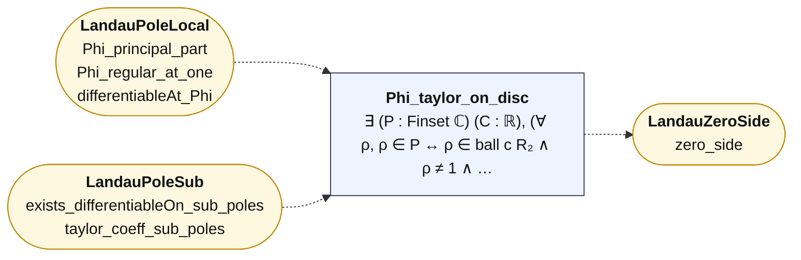

# `lean_stage3/Stage3/LandauPoleDisc.lean`

LandauPoleDisc — the derivatives of `Phi` at a regular point, from the zeros of `ζ` in a disc around it. Block 3b2 of `lean_stage3/design/landau.md`. 2026-11-22.

1 theorem, 0 definitions, 118 lines. Arrows are Lean's own record of what each proof uses.

**Imports:** [`LandauPoleLocal`](../lean_stage3/LandauPoleLocal.md), [`LandauPoleSub`](../lean_stage3/LandauPoleSub.md)  
**Imported by:** [`Stage3`](../lean_stage3/Stage3.md), [`LandauZeroSide`](../lean_stage3/LandauZeroSide.md)

## The picture



An arrow A → B reads "A is used in the proof of B". Green: counting, integers only. Violet: shape, analysis with no ζ. Blue: reads ζ. A name ending in ■ is an end: nothing else uses it. Red: contains `sorry`. Yellow: theorems in another file, counted; a dotted arrow crosses files. Definitions are not drawn; they are listed below the diagram.

## Theorems

<a name="LandauPoleDisc-Phi_taylor_on_disc"></a>
### `LandauPoleDisc.Phi_taylor_on_disc`

line 40

**Reads ζ.** It, or something it rests on, uses the zeta function, its zeros or the Riemann hypothesis.

**Why.** For `0 < R < R₂`, a closed disc of radius `R₂` about `c` inside `Re s > 0`, `c ≠ 1` and `ζ c ≠ 0`: there are a finite set `P`, exactly the zeros `ρ ≠ 1` of ζ in the open disc, and a `C` such that for every `k` the `k`-th derivative of `Phi` at `c` is within `k!·C/R^k` of `Σ_{ρ ∈ P} m_ρ/(ρ(1−ρ))·(−1)^k·k!·(c − ρ)^(−1−k)`, with `m_ρ` the order of the zero.

**Proves**

```lean
∃ (P : Finset ℂ) (C : ℝ), (∀ ρ, ρ ∈ P ↔ ρ ∈ ball c R₂ ∧ ρ ≠ 1 ∧ riemannZeta ρ = 0) ∧ ∀ k : ℕ, ‖iteratedDeriv k LandauMellinG.Phi c - ∑ ρ ∈ P, (analyticOrderNatAt riemannZeta ρ : ℂ) / (ρ * (1 - ρ)) * ((-1) ^ k * (k.factorial : ℂ) * (c - ρ) ^ (-1 - (k : ℤ)))‖ ≤ k.factorial * C / R ^ k
```

**Needs** (its hypotheses)

  - `` hR : 0 < R ``
  - `` hRR : R < R₂ ``
  - `` hpos : closedBall c R₂ ⊆ {s : ℂ | 0 < s.re} ``
  - `` hc1 : c ≠ 1 ``
  - `` hcz : riemannZeta c ≠ 0 ``

**Stated with:** [`LandauMellinG.Phi`](../lean_stage3/LandauMellinG.md#LandauMellinG-Phi)

**Fed by** (5 theorems its proof uses)

  - [`LandauPoleLocal.Phi_principal_part`](../lean_stage3/LandauPoleLocal.md#LandauPoleLocal-Phi_principal_part) (LandauPoleLocal) — `` ∃ h : ℂ → ℂ, AnalyticAt ℂ h ρ ∧ ∀ᶠ s in 𝓝[≠] ρ, LandauMellinG.Phi s = h s + (analyticOrderNatAt riemannZeta ρ : ℂ) / (ρ * (1 - ρ)) / (s - ρ) ``
  - [`LandauPoleLocal.Phi_regular_at_one`](../lean_stage3/LandauPoleLocal.md#LandauPoleLocal-Phi_regular_at_one) (LandauPoleLocal) — `` ∃ h : ℂ → ℂ, AnalyticAt ℂ h 1 ∧ ∀ᶠ s in 𝓝[≠] 1, LandauMellinG.Phi s = h s ``
  - [`LandauPoleLocal.differentiableAt_Phi`](../lean_stage3/LandauPoleLocal.md#LandauPoleLocal-differentiableAt_Phi) (LandauPoleLocal) — `` DifferentiableAt ℂ LandauMellinG.Phi s ``
  - [`LandauPoleSub.exists_differentiableOn_sub_poles`](../lean_stage3/LandauPoleSub.md#LandauPoleSub-exists_differentiableOn_sub_poles) (LandauPoleSub) — `` ∃ g : ℂ → ℂ, DifferentiableOn ℂ g U ∧ ∀ s, s ∉ P → g s = f s - ∑ q ∈ P, A q / (s - q) ``
  - [`LandauPoleSub.taylor_coeff_sub_poles`](../lean_stage3/LandauPoleSub.md#LandauPoleSub-taylor_coeff_sub_poles) (LandauPoleSub) — `` ∃ C : ℝ, ∀ k : ℕ, ‖iteratedDeriv k f c - ∑ q ∈ P, A q * ((-1) ^ k * (k.factorial : ℂ) * (c - q) ^ (-1 - (k : ℤ)))‖ ≤ k.factorial * C / R ^ k ``

**Feeds** (1 that use it)

  - [`LandauZeroSide.zero_side`](../lean_stage3/LandauZeroSide.md#LandauZeroSide-zero_side) (LandauZeroSide) — `` ∃ r R τ C₁ : ℝ, ∃ N₀ : ℕ, σ₀ - 1 < r ∧ r ≤ ‖(σ₀ : ℂ) - ρ₀‖ ∧ r < R ∧ 0 < τ ∧ 0 ≤ C₁ ∧ ∀ a N : ℕ, N₀ ≤ N → ∃ k ∈ Finset.Ico a (a + N), τ / r ^ (k + 1) … ``

