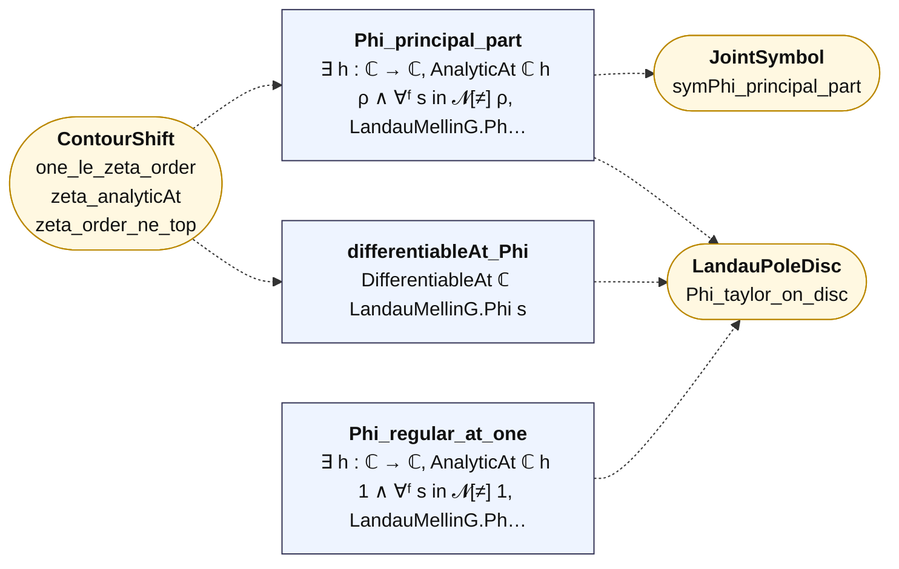

# `lean_stage3/Stage3/LandauPoleLocal.lean`

LandauPoleLocal — `Phi` near a zero of `ζ` and near `1`. Block 3a of `lean_stage3/design/landau.md`. 2026-11-22.

3 theorems, 0 definitions, 171 lines. Arrows are Lean's own record of what each proof uses.

**Imports:** [`ContourShift`](../lean_stage3/ContourShift.md), [`LandauMellinG`](../lean_stage3/LandauMellinG.md)  
**Imported by:** [`Stage3`](../lean_stage3/Stage3.md), [`JointSymbol`](../lean_stage3/JointSymbol.md), [`LandauPoleDisc`](../lean_stage3/LandauPoleDisc.md)

## The picture



An arrow A → B reads "A is used in the proof of B". Green: counting, integers only. Violet: shape, analysis with no ζ. Blue: reads ζ. A name ending in ■ is an end: nothing else uses it. Red: contains `sorry`. Yellow: theorems in another file, counted; a dotted arrow crosses files. Definitions are not drawn; they are listed below the diagram.

## Theorems

<a name="LandauPoleLocal-differentiableAt_Phi"></a>
### `LandauPoleLocal.differentiableAt_Phi`

line 37

**Reads ζ.** It, or something it rests on, uses the zeta function, its zeros or the Riemann hypothesis.

**Why.** If `s ≠ 0`, `s ≠ 1` and `ζ s ≠ 0`, then `Phi` is complex differentiable at `s`.

**Proves**

```lean
DifferentiableAt ℂ LandauMellinG.Phi s
```

**Needs** (its hypotheses)

  - `` h0 : s ≠ 0 ``
  - `` h1 : s ≠ 1 ``
  - `` hz : riemannZeta s ≠ 0 ``

**Stated with:** [`LandauMellinG.Phi`](../lean_stage3/LandauMellinG.md#LandauMellinG-Phi)

**Fed by** (1 theorem its proof uses)

  - [`ContourShift.zeta_analyticAt`](../lean_stage3/ContourShift.md#ContourShift-zeta_analyticAt) (ContourShift) — `` AnalyticAt ℂ riemannZeta ρ ``

**Feeds** (1 that use it)

  - [`LandauPoleDisc.Phi_taylor_on_disc`](../lean_stage3/LandauPoleDisc.md#LandauPoleDisc-Phi_taylor_on_disc) (LandauPoleDisc) — `` ∃ (P : Finset ℂ) (C : ℝ), (∀ ρ, ρ ∈ P ↔ ρ ∈ ball c R₂ ∧ ρ ≠ 1 ∧ riemannZeta ρ = 0) ∧ ∀ k : ℕ, ‖iteratedDeriv k LandauMellinG.Phi c - ∑ ρ ∈ P, (analyti… ``

<a name="LandauPoleLocal-Phi_principal_part"></a>
### `LandauPoleLocal.Phi_principal_part`

line 57

**Reads ζ.** It, or something it rests on, uses the zeta function, its zeros or the Riemann hypothesis.

**Why.** At a zero `ρ` of `ζ` with `ρ ≠ 0` and `ρ ≠ 1`, of order `m`, there is a function `h` analytic at `ρ` such that `Phi s = h s + m/(ρ(1−ρ))/(s−ρ)` for `s` near `ρ`, `s ≠ ρ`.

**Proves**

```lean
∃ h : ℂ → ℂ, AnalyticAt ℂ h ρ ∧ ∀ᶠ s in 𝓝[≠] ρ, LandauMellinG.Phi s = h s + (analyticOrderNatAt riemannZeta ρ : ℂ) / (ρ * (1 - ρ)) / (s - ρ)
```

**Needs** (its hypotheses)

  - `` h0 : ρ ≠ 0 ``
  - `` h1 : ρ ≠ 1 ``
  - `` hz : riemannZeta ρ = 0 ``

**Stated with:** [`LandauMellinG.Phi`](../lean_stage3/LandauMellinG.md#LandauMellinG-Phi)

**Fed by** (3 theorems its proof uses)

  - [`ContourShift.one_le_zeta_order`](../lean_stage3/ContourShift.md#ContourShift-one_le_zeta_order) (ContourShift) — `` 1 ≤ analyticOrderNatAt riemannZeta ρ ``
  - [`ContourShift.zeta_analyticAt`](../lean_stage3/ContourShift.md#ContourShift-zeta_analyticAt) (ContourShift) — `` AnalyticAt ℂ riemannZeta ρ ``
  - [`ContourShift.zeta_order_ne_top`](../lean_stage3/ContourShift.md#ContourShift-zeta_order_ne_top) (ContourShift) — `` analyticOrderAt riemannZeta ρ ≠ ⊤ ``

**Feeds** (2 that use it)

  - [`JointSymbol.symPhi_principal_part`](../lean_stage3/JointSymbol.md#JointSymbol-symPhi_principal_part) (JointSymbol) — `` ∃ h : ℂ → ℂ, AnalyticAt ℂ h ρ ∧ ∀ᶠ s in 𝓝[≠] ρ, (1 - (2 : ℂ) ^ (-s)) ^ d * LandauMellinG.Phi s = h s + (1 - (2 : ℂ) ^ (-ρ)) ^ d * ((analyticOrderNatAt… ``
  - [`LandauPoleDisc.Phi_taylor_on_disc`](../lean_stage3/LandauPoleDisc.md#LandauPoleDisc-Phi_taylor_on_disc) (LandauPoleDisc) — `` ∃ (P : Finset ℂ) (C : ℝ), (∀ ρ, ρ ∈ P ↔ ρ ∈ ball c R₂ ∧ ρ ≠ 1 ∧ riemannZeta ρ = 0) ∧ ∀ k : ℕ, ‖iteratedDeriv k LandauMellinG.Phi c - ∑ ρ ∈ P, (analyti… ``

<a name="LandauPoleLocal-Phi_regular_at_one"></a>
### `LandauPoleLocal.Phi_regular_at_one`

line 125

**Reads ζ.** It, or something it rests on, uses the zeta function, its zeros or the Riemann hypothesis.

**Why.** There is a function `h` analytic at `1` with `Phi s = h s` for `s` near `1`, `s ≠ 1`.

**Proves**

```lean
∃ h : ℂ → ℂ, AnalyticAt ℂ h 1 ∧ ∀ᶠ s in 𝓝[≠] 1, LandauMellinG.Phi s = h s
```

**Stated with:** [`LandauMellinG.Phi`](../lean_stage3/LandauMellinG.md#LandauMellinG-Phi)

**Fed by:** no theorem of this repo; it stands on Mathlib and the definitions below.

**Feeds** (1 that use it)

  - [`LandauPoleDisc.Phi_taylor_on_disc`](../lean_stage3/LandauPoleDisc.md#LandauPoleDisc-Phi_taylor_on_disc) (LandauPoleDisc) — `` ∃ (P : Finset ℂ) (C : ℝ), (∀ ρ, ρ ∈ P ↔ ρ ∈ ball c R₂ ∧ ρ ≠ 1 ∧ riemannZeta ρ = 0) ∧ ∀ k : ℕ, ‖iteratedDeriv k LandauMellinG.Phi c - ∑ ρ ∈ P, (analyti… ``

