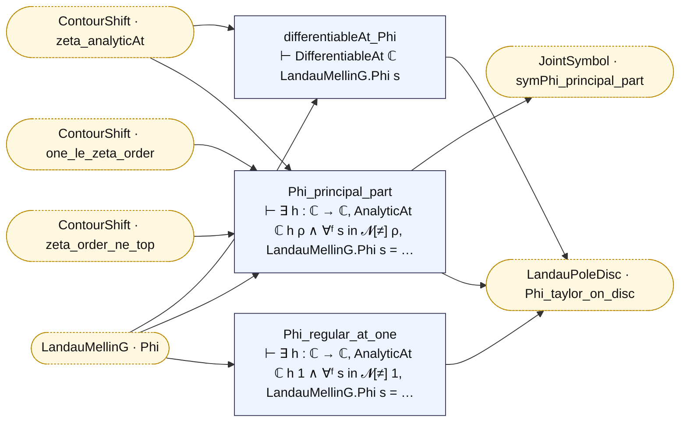

# `lean_stage3/Stage3/LandauPoleLocal.lean`

**What it does** (its own header): LandauPoleLocal — `Phi` near a zero of `ζ` and near `1`. Block 3a of `lean_stage3/design/landau.md`. 2026-11-22.

**Imports:** [`ContourShift`](../lean_stage3/ContourShift.md), [`LandauMellinG`](../lean_stage3/LandauMellinG.md).
**Imported by:** [`Stage3`](../lean_stage3/Stage3.md), [`JointSymbol`](../lean_stage3/JointSymbol.md), [`LandauPoleDisc`](../lean_stage3/LandauPoleDisc.md).

Blue: theorem. Green: a theorem nothing else uses (an end). Dashed white: connects to nothing. Grey: definition. Red: contains `sorry`. Yellow: in another file. An arrow A → B reads "A is used by B".

## Every declaration

| declaration | proves (output) | needs (input) | why (its own docstring) | uses | used by |
|---|---|---|---|---|---|
| `LandauPoleLocal.differentiableAt_Phi` theorem, line 36 | DifferentiableAt ℂ LandauMellinG.Phi s | h0 : s ≠ 0; h1 : s ≠ 1; hz : riemannZeta s ≠ 0 | — | `ContourShift.zeta_analyticAt`, `LandauMellinG.Phi` | `LandauPoleDisc.Phi_taylor_on_disc` |
| `LandauPoleLocal.Phi_principal_part` theorem, line 54 | ∃ h : ℂ → ℂ, AnalyticAt ℂ h ρ ∧ ∀ᶠ s in 𝓝[≠] ρ, LandauMellinG.Phi s = h s + (analyticOrderNatAt riemannZeta ρ : ℂ) / (ρ * (1 - ρ)) / (s - ρ) | h0 : ρ ≠ 0; h1 : ρ ≠ 1; hz : riemannZeta ρ = 0 | — | `ContourShift.one_le_zeta_order`, `ContourShift.zeta_analyticAt`, `ContourShift.zeta_order_ne_top`, `LandauMellinG.Phi` | `JointSymbol.symPhi_principal_part`, `LandauPoleDisc.Phi_taylor_on_disc` |
| `LandauPoleLocal.Phi_regular_at_one` theorem, line 121 | ∃ h : ℂ → ℂ, AnalyticAt ℂ h 1 ∧ ∀ᶠ s in 𝓝[≠] 1, LandauMellinG.Phi s = h s | — | — | `LandauMellinG.Phi` | `LandauPoleDisc.Phi_taylor_on_disc` |
