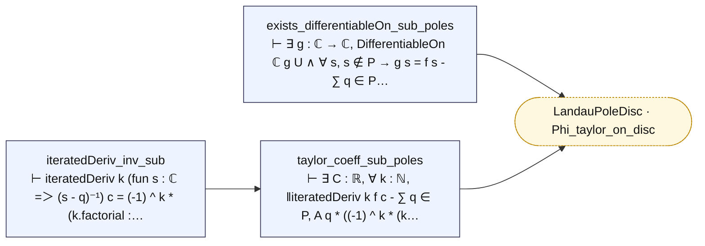

# `lean_stage3/Stage3/LandauPoleSub.lean`

**What it does** (its own header): LandauPoleSub — finitely many simple poles subtracted on an open set, and what that gives for the Taylor coefficients. Nothing here is about `ζ`. Block 3b1 of `lean_stage3/design/landau.md`. 2026-11-22.

**Imports:** nothing in this tree.
**Imported by:** [`Stage3`](../lean_stage3/Stage3.md), [`LandauPoleDisc`](../lean_stage3/LandauPoleDisc.md).

Blue: theorem. Green: a theorem nothing else uses (an end). Dashed white: connects to nothing. Grey: definition. Red: contains `sorry`. Yellow: in another file. An arrow A → B reads "A is used by B".

## Every declaration

| declaration | proves (output) | needs (input) | why (its own docstring) | uses | used by |
|---|---|---|---|---|---|
| `LandauPoleSub.iteratedDeriv_inv_sub` theorem, line 35 | iteratedDeriv k (fun s : ℂ =&gt; (s - q)⁻¹) c = (-1) ^ k * (k.factorial : ℂ) * (c - q) ^ (-1 - (k : ℤ)) | k : ℕ; q c : ℂ | — | — | `LandauPoleSub.taylor_coeff_sub_poles` |
| `LandauPoleSub.exists_differentiableOn_sub_poles` theorem, line 41 | ∃ g : ℂ → ℂ, DifferentiableOn ℂ g U ∧ ∀ s, s ∉ P → g s = f s - ∑ q ∈ P, A q / (s - q) | hf : ∀ s ∈ U, s ∉ P → DifferentiableAt ℂ f s; hloc : ∀ p ∈ P, ∃ h : ℂ → ℂ, AnalyticAt ℂ h p ∧ ∀ᶠ s in 𝓝[≠] p, f s = h s + A p / (s - p) | — | — | `LandauPoleDisc.Phi_taylor_on_disc` |
| `LandauPoleSub.taylor_coeff_sub_poles` theorem, line 104 | ∃ C : ℝ, ∀ k : ℕ, ‖iteratedDeriv k f c - ∑ q ∈ P, A q * ((-1) ^ k * (k.factorial : ℂ) * (c - q) ^ (-1 - (k : ℤ)))‖ ≤ k.factorial * C / R ^ k | hR : 0 &lt; R; hU : IsOpen U; hball : closedBall c R ⊆ U; hcP : c ∉ P; hg : DifferentiableOn ℂ g U; hgf : ∀ s, s ∉ P → g s = f s - ∑ q ∈ P, A q / (s - q) | — | `LandauPoleSub.iteratedDeriv_inv_sub` | `LandauPoleDisc.Phi_taylor_on_disc` |
