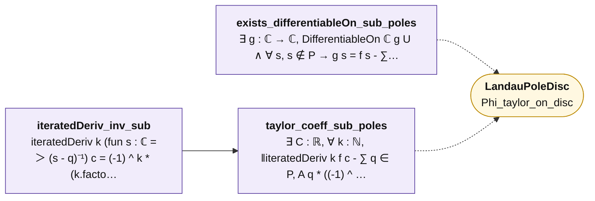

# `lean_stage3/Stage3/LandauPoleSub.lean`

LandauPoleSub — finitely many simple poles subtracted on an open set, and what that gives for the Taylor coefficients. Nothing here is about `ζ`. Block 3b1 of `lean_stage3/design/landau.md`. 2026-11-22.

3 theorems, 0 definitions, 166 lines. Arrows are Lean's own record of what each proof uses.

**Imports:** nothing in this tree  
**Imported by:** [`Stage3`](../lean_stage3/Stage3.md), [`LandauPoleDisc`](../lean_stage3/LandauPoleDisc.md)

## The picture



An arrow A → B reads "A is used in the proof of B". Green: counting, integers only. Violet: shape, analysis with no ζ. Blue: reads ζ. A name ending in ■ is an end: nothing else uses it. Red: contains `sorry`. Yellow: theorems in another file, counted; a dotted arrow crosses files. Definitions are not drawn; they are listed below the diagram.

## Theorems

<a name="LandauPoleSub-iteratedDeriv_inv_sub"></a>
### `LandauPoleSub.iteratedDeriv_inv_sub`

line 36

**Shape.** Uses real or complex analysis; nothing in it or beneath it reads ζ.

**Why.** The `k`-th derivative of `s ↦ (s − q)⁻¹` at `c` is `(−1)^k·k!·(c − q)^(−1−k)`.

**Proves**

```lean
iteratedDeriv k (fun s : ℂ => (s - q)⁻¹) c = (-1) ^ k * (k.factorial : ℂ) * (c - q) ^ (-1 - (k : ℤ))
```

**Needs** (its hypotheses)

  - `` k : ℕ ``
  - `` q c : ℂ ``

**Fed by:** no theorem of this repo; it stands on Mathlib.

**Feeds** (1 that use it)

  - [`LandauPoleSub.taylor_coeff_sub_poles`](#LandauPoleSub-taylor_coeff_sub_poles) — `` ∃ C : ℝ, ∀ k : ℕ, ‖iteratedDeriv k f c - ∑ q ∈ P, A q * ((-1) ^ k * (k.factorial : ℂ) * (c - q) ^ (-1 - (k : ℤ)))‖ ≤ k.factorial * C / R ^ k ``

<a name="LandauPoleSub-exists_differentiableOn_sub_poles"></a>
### `LandauPoleSub.exists_differentiableOn_sub_poles`

line 45

**Shape.** Uses real or complex analysis; nothing in it or beneath it reads ζ.

**Why.** If `f` is differentiable at every point of `U` off the finite set `P`, and near each `p ∈ P` has the local form `f = h + A p/(s − p)` with `h` analytic at `p`, then there is a `g` differentiable on `U` with `g = f − Σ_{q ∈ P} A q/(s − q)` off `P`.

**Proves**

```lean
∃ g : ℂ → ℂ, DifferentiableOn ℂ g U ∧ ∀ s, s ∉ P → g s = f s - ∑ q ∈ P, A q / (s - q)
```

**Needs** (its hypotheses)

  - `` hf : ∀ s ∈ U, s ∉ P → DifferentiableAt ℂ f s ``
  - `` hloc : ∀ p ∈ P, ∃ h : ℂ → ℂ, AnalyticAt ℂ h p ∧ ∀ᶠ s in 𝓝[≠] p, f s = h s + A p / (s - p) ``

**Fed by:** no theorem of this repo; it stands on Mathlib.

**Feeds** (1 that use it)

  - [`LandauPoleDisc.Phi_taylor_on_disc`](../lean_stage3/LandauPoleDisc.md#LandauPoleDisc-Phi_taylor_on_disc) (LandauPoleDisc) — `` ∃ (P : Finset ℂ) (C : ℝ), (∀ ρ, ρ ∈ P ↔ ρ ∈ ball c R₂ ∧ ρ ≠ 1 ∧ riemannZeta ρ = 0) ∧ ∀ k : ℕ, ‖iteratedDeriv k LandauMellinG.Phi c - ∑ ρ ∈ P, (analyti… ``

<a name="LandauPoleSub-taylor_coeff_sub_poles"></a>
### `LandauPoleSub.taylor_coeff_sub_poles`

line 112

**Shape.** Uses real or complex analysis; nothing in it or beneath it reads ζ.

**Why.** If the closed ball of radius `R > 0` about `c` lies in the open set `U`, `c ∉ P`, and `g` is differentiable on `U` with `g = f − Σ_{q ∈ P} A q/(s − q)` off `P`, then there is a `C` such that for every `k` the `k`-th derivative of `f` at `c` is within `k!·C/R^k` of `Σ_{q ∈ P} A q·(−1)^k·k!·(c − q)^(−1−k)`.

**Proves**

```lean
∃ C : ℝ, ∀ k : ℕ, ‖iteratedDeriv k f c - ∑ q ∈ P, A q * ((-1) ^ k * (k.factorial : ℂ) * (c - q) ^ (-1 - (k : ℤ)))‖ ≤ k.factorial * C / R ^ k
```

**Needs** (its hypotheses)

  - `` hR : 0 < R ``
  - `` hU : IsOpen U ``
  - `` hball : closedBall c R ⊆ U ``
  - `` hcP : c ∉ P ``
  - `` hg : DifferentiableOn ℂ g U ``
  - `` hgf : ∀ s, s ∉ P → g s = f s - ∑ q ∈ P, A q / (s - q) ``

**Fed by** (1 theorem its proof uses)

  - [`LandauPoleSub.iteratedDeriv_inv_sub`](#LandauPoleSub-iteratedDeriv_inv_sub) — `` iteratedDeriv k (fun s : ℂ => (s - q)⁻¹) c = (-1) ^ k * (k.factorial : ℂ) * (c - q) ^ (-1 - (k : ℤ)) ``

**Feeds** (1 that use it)

  - [`LandauPoleDisc.Phi_taylor_on_disc`](../lean_stage3/LandauPoleDisc.md#LandauPoleDisc-Phi_taylor_on_disc) (LandauPoleDisc) — `` ∃ (P : Finset ℂ) (C : ℝ), (∀ ρ, ρ ∈ P ↔ ρ ∈ ball c R₂ ∧ ρ ≠ 1 ∧ riemannZeta ρ = 0) ∧ ∀ k : ℕ, ‖iteratedDeriv k LandauMellinG.Phi c - ∑ ρ ∈ P, (analyti… ``

