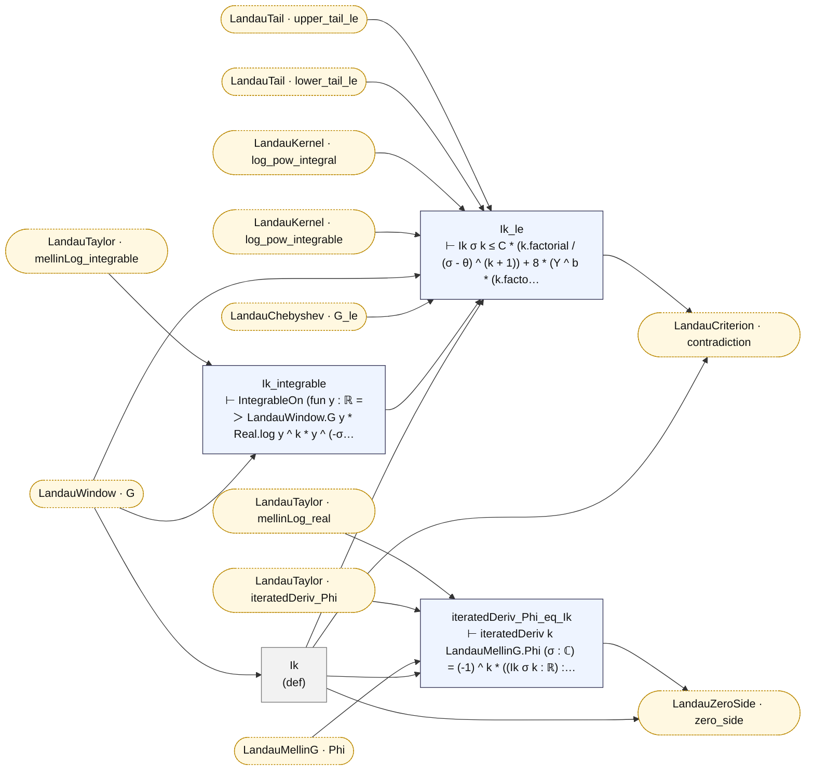

# `lean_stage3/Stage3/LandauPrimeSide.lean`

**What it does** (its own header): LandauPrimeSide — the primes' reading of the Taylor coefficients of `Phi`, bounded from above by a window bound on `G`. Block 7a of `lean_stage3/design/landau.md`. 2026-11-22.

**Imports:** [`LandauTail`](../lean_stage3/LandauTail.md), [`LandauTaylor`](../lean_stage3/LandauTaylor.md).
**Imported by:** [`Stage3`](../lean_stage3/Stage3.md), [`LandauZeroSide`](../lean_stage3/LandauZeroSide.md).

Blue: theorem. Green: a theorem nothing else uses (an end). Dashed white: connects to nothing. Grey: definition. Red: contains `sorry`. Yellow: in another file. An arrow A → B reads "A is used by B".

## Every declaration

| declaration | proves (output) | needs (input) | why (its own docstring) | uses | used by |
|---|---|---|---|---|---|
| `LandauPrimeSide.Ik` def, line 39 | ℝ | σ : ℝ; k : ℕ | `∫₁^∞ G(y)·(log y)^k·y^(−σ−1) dy`. | `LandauWindow.G` | `LandauCriterion.contradiction`, `LandauPrimeSide.Ik_le`, `LandauPrimeSide.iteratedDeriv_Phi_eq_Ik`, `LandauZeroSide.zero_side` |
| `LandauPrimeSide.Ik_integrable` theorem, line 42 | IntegrableOn (fun y : ℝ =&gt; LandauWindow.G y * Real.log y ^ k * y ^ (-σ - 1)) (Ioi 1) | hσ : 1 &lt; σ; k : ℕ | — | `LandauTaylor.mellinLog_integrable`, `LandauWindow.G` | `LandauPrimeSide.Ik_le` |
| `LandauPrimeSide.iteratedDeriv_Phi_eq_Ik` theorem, line 60 | iteratedDeriv k LandauMellinG.Phi (σ : ℂ) = (-1) ^ k * ((Ik σ k : ℝ) : ℂ) | hσ : 1 &lt; σ; k : ℕ | — | `LandauMellinG.Phi`, `LandauPrimeSide.Ik`, `LandauTaylor.iteratedDeriv_Phi`, `LandauTaylor.mellinLog_real` | `LandauZeroSide.zero_side` |
| `LandauPrimeSide.Ik_le` theorem, line 65 | Ik σ k ≤ C * (k.factorial / (σ - θ) ^ (k + 1)) + 8 * (Y ^ b * (k.factorial / (σ - 1 + b) ^ (k + 1))) + 8 * ((Y ^ (1 + δ)) ^ (-b') * (k.factorial / (σ - 1 - b') ^ (k + 1))) | hσ : 1 &lt; σ; hθ : θ &lt; σ; hC : 0 ≤ C; hY : 1 ≤ Y; hδ : 0 ≤ δ; hwin : ∀ y ∈ Icc Y (Y ^ (1 + δ)), LandauWindow.G y ≤ C * y ^ θ; hb : 0 &lt; b; hb' : 0 &lt; b'; hb'a : b' &lt; σ - 1; k : ℕ | — | `LandauChebyshev.G_le`, `LandauKernel.log_pow_integrable`, `LandauKernel.log_pow_integral`, `LandauPrimeSide.Ik`, `LandauPrimeSide.Ik_integrable`, `LandauTail.lower_tail_le`, `LandauTail.upper_tail_le`, `LandauWindow.G` | `LandauCriterion.contradiction` |
