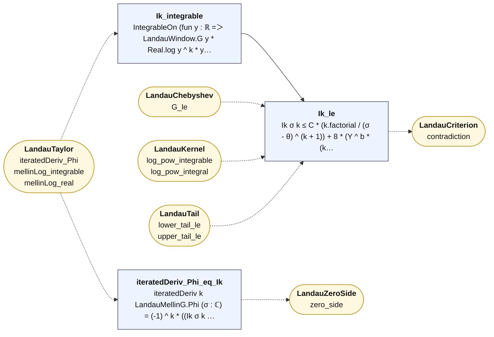

# `lean_stage3/Stage3/LandauPrimeSide.lean`

LandauPrimeSide — the primes' reading of the Taylor coefficients of `Phi`, bounded from above by a window bound on `G`. Block 7a of `lean_stage3/design/landau.md`. 2026-11-22.

3 theorems, 1 definition, 184 lines. Arrows are Lean's own record of what each proof uses.

**Imports:** [`LandauTail`](../lean_stage3/LandauTail.md), [`LandauTaylor`](../lean_stage3/LandauTaylor.md)  
**Imported by:** [`Stage3`](../lean_stage3/Stage3.md), [`LandauZeroSide`](../lean_stage3/LandauZeroSide.md)

## The picture



An arrow A → B reads "A is used in the proof of B". Green: counting, integers only. Violet: shape, analysis with no ζ. Blue: reads ζ. A name ending in ■ is an end: nothing else uses it. Red: contains `sorry`. Yellow: theorems in another file, counted; a dotted arrow crosses files. Definitions are not drawn; they are listed below the diagram.

## Definitions

<a name="LandauPrimeSide-Ik"></a>
### `LandauPrimeSide.Ik`

def · line 39

`∫₁^∞ G(y)·(log y)^k·y^(−σ−1) dy`.

- **Is:** `` Ik (σ : ℝ) (k : ℕ) : ℝ := ∫ y in Ioi (1 : ℝ), LandauWindow.G y * Real.log y ^ k * y ^ (-σ - 1) ``
- **Built from:** [`LandauWindow.G`](../lean_stage3/LandauWindow.md#LandauWindow-G)
- **Used by 5:** [`LandauCriterion.contradiction`](../lean_stage3/LandauCriterion.md#LandauCriterion-contradiction), [`LandauCriterion.stmtLandauWindow`](../lean_stage3/LandauCriterion.md#LandauCriterion-stmtLandauWindow), [`LandauPrimeSide.Ik_le`](#LandauPrimeSide-Ik_le), [`LandauPrimeSide.iteratedDeriv_Phi_eq_Ik`](#LandauPrimeSide-iteratedDeriv_Phi_eq_Ik), [`LandauZeroSide.zero_side`](../lean_stage3/LandauZeroSide.md#LandauZeroSide-zero_side)

## Theorems

<a name="LandauPrimeSide-Ik_integrable"></a>
### `LandauPrimeSide.Ik_integrable`

line 42

**Reads ζ.** It, or something it rests on, uses the zeta function, its zeros or the Riemann hypothesis.

**Proves**

```lean
IntegrableOn (fun y : ℝ => LandauWindow.G y * Real.log y ^ k * y ^ (-σ - 1)) (Ioi 1)
```

**Needs** (its hypotheses)

  - `` hσ : 1 < σ ``
  - `` k : ℕ ``

**Stated with:** [`LandauWindow.G`](../lean_stage3/LandauWindow.md#LandauWindow-G)

**Fed by** (1 theorem its proof uses)

  - [`LandauTaylor.mellinLog_integrable`](../lean_stage3/LandauTaylor.md#LandauTaylor-mellinLog_integrable) (LandauTaylor) — `` IntegrableOn (fun y : ℝ => (LandauWindow.G y : ℂ) * (-(Real.log y : ℂ)) ^ k * (y : ℂ) ^ (-s - 1)) (Ioi 1) ``

**Feeds** (1 that use it)

  - [`LandauPrimeSide.Ik_le`](#LandauPrimeSide-Ik_le) — `` Ik σ k ≤ C * (k.factorial / (σ - θ) ^ (k + 1)) + 8 * (Y ^ b * (k.factorial / (σ - 1 + b) ^ (k + 1))) + 8 * ((Y ^ (1 + δ)) ^ (-b') * (k.factorial / (σ … ``

<a name="LandauPrimeSide-iteratedDeriv_Phi_eq_Ik"></a>
### `LandauPrimeSide.iteratedDeriv_Phi_eq_Ik`

line 60

**Reads ζ.** It, or something it rests on, uses the zeta function, its zeros or the Riemann hypothesis.

**Proves**

```lean
iteratedDeriv k LandauMellinG.Phi (σ : ℂ) = (-1) ^ k * ((Ik σ k : ℝ) : ℂ)
```

**Needs** (its hypotheses)

  - `` hσ : 1 < σ ``
  - `` k : ℕ ``

**Stated with:** [`LandauMellinG.Phi`](../lean_stage3/LandauMellinG.md#LandauMellinG-Phi), [`LandauPrimeSide.Ik`](#LandauPrimeSide-Ik)

**Fed by** (2 theorems its proof uses)

  - [`LandauTaylor.iteratedDeriv_Phi`](../lean_stage3/LandauTaylor.md#LandauTaylor-iteratedDeriv_Phi) (LandauTaylor) — `` iteratedDeriv k LandauMellinG.Phi s = mellinLog k s ``
  - [`LandauTaylor.mellinLog_real`](../lean_stage3/LandauTaylor.md#LandauTaylor-mellinLog_real) (LandauTaylor) — `` mellinLog k (σ : ℂ) = (-1) ^ k * ((∫ y in Ioi (1 : ℝ), LandauWindow.G y * Real.log y ^ k * y ^ (-σ - 1) : ℝ) : ℂ) ``

**Definitions its proof touches:** [`LandauTaylor.mellinLog`](../lean_stage3/LandauTaylor.md#LandauTaylor-mellinLog), [`LandauWindow.G`](../lean_stage3/LandauWindow.md#LandauWindow-G)

**Feeds** (1 that use it)

  - [`LandauZeroSide.zero_side`](../lean_stage3/LandauZeroSide.md#LandauZeroSide-zero_side) (LandauZeroSide) — `` ∃ r R τ C₁ : ℝ, ∃ N₀ : ℕ, σ₀ - 1 < r ∧ r ≤ ‖(σ₀ : ℂ) - ρ₀‖ ∧ r < R ∧ 0 < τ ∧ 0 ≤ C₁ ∧ ∀ a N : ℕ, N₀ ≤ N → ∃ k ∈ Finset.Ico a (a + N), τ / r ^ (k + 1) … ``

<a name="LandauPrimeSide-Ik_le"></a>
### `LandauPrimeSide.Ik_le`

line 65

**Reads ζ.** It, or something it rests on, uses the zeta function, its zeros or the Riemann hypothesis.

**Proves**

```lean
Ik σ k ≤ C * (k.factorial / (σ - θ) ^ (k + 1)) + 8 * (Y ^ b * (k.factorial / (σ - 1 + b) ^ (k + 1))) + 8 * ((Y ^ (1 + δ)) ^ (-b') * (k.factorial / (σ - 1 - b') ^ (k + 1)))
```

**Needs** (its hypotheses)

  - `` hσ : 1 < σ ``
  - `` hθ : θ < σ ``
  - `` hC : 0 ≤ C ``
  - `` hY : 1 ≤ Y ``
  - `` hδ : 0 ≤ δ ``
  - `` hwin : ∀ y ∈ Icc Y (Y ^ (1 + δ)), LandauWindow.G y ≤ C * y ^ θ ``
  - `` hb : 0 < b ``
  - `` hb' : 0 < b' ``
  - `` hb'a : b' < σ - 1 ``
  - `` k : ℕ ``

**Stated with:** [`LandauPrimeSide.Ik`](#LandauPrimeSide-Ik), [`LandauWindow.G`](../lean_stage3/LandauWindow.md#LandauWindow-G)

**Fed by** (6 theorems its proof uses)

  - [`LandauChebyshev.G_le`](../lean_stage3/LandauChebyshev.md#LandauChebyshev-G_le) (LandauChebyshev) — `` LandauWindow.G y ≤ 8 * y ``
  - [`LandauKernel.log_pow_integrable`](../lean_stage3/LandauKernel.md#LandauKernel-log_pow_integrable) (LandauKernel) — `` IntegrableOn (fun y : ℝ => Real.log y ^ n * y ^ (-a - 1)) (Ioi 1) ``
  - [`LandauKernel.log_pow_integral`](../lean_stage3/LandauKernel.md#LandauKernel-log_pow_integral) (LandauKernel) — `` ∫ y in Ioi (1 : ℝ), Real.log y ^ k * y ^ (-a - 1) = k.factorial / a ^ (k + 1) ``
  - [`LandauPrimeSide.Ik_integrable`](#LandauPrimeSide-Ik_integrable) — `` IntegrableOn (fun y : ℝ => LandauWindow.G y * Real.log y ^ k * y ^ (-σ - 1)) (Ioi 1) ``
  - [`LandauTail.lower_tail_le`](../lean_stage3/LandauTail.md#LandauTail-lower_tail_le) (LandauTail) — `` ∫ y in Ioc (1 : ℝ) Y, Real.log y ^ k * y ^ (-a - 1) ≤ Y ^ b * (k.factorial / (a + b) ^ (k + 1)) ``
  - [`LandauTail.upper_tail_le`](../lean_stage3/LandauTail.md#LandauTail-upper_tail_le) (LandauTail) — `` ∫ y in Ioi Z, Real.log y ^ k * y ^ (-a - 1) ≤ Z ^ (-b) * (k.factorial / (a - b) ^ (k + 1)) ``

**Feeds** (1 that use it)

  - [`LandauCriterion.contradiction`](../lean_stage3/LandauCriterion.md#LandauCriterion-contradiction) (LandauCriterion) — `` False ``

