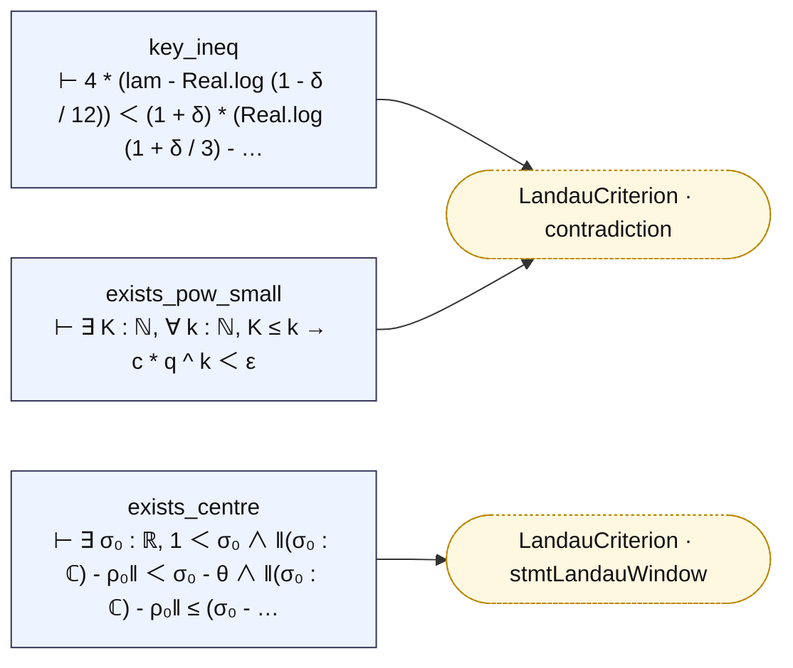

# `lean_stage3/Stage3/LandauRates.lean`

**What it does** (its own header): LandauRates — the scalar inequalities of the assembly. Block 7c of `lean_stage3/design/landau.md`. 2026-11-22.

**Imports:** nothing in this tree.
**Imported by:** [`Stage3`](../lean_stage3/Stage3.md), [`LandauCriterion`](../lean_stage3/LandauCriterion.md).

Blue: theorem. Green: a theorem nothing else uses (an end). Dashed white: connects to nothing. Grey: definition. Red: contains `sorry`. Yellow: in another file. An arrow A → B reads "A is used by B".

## Every declaration

| declaration | proves (output) | needs (input) | why (its own docstring) | uses | used by |
|---|---|---|---|---|---|
| `LandauRates.key_ineq` theorem, line 30 | 4 * (lam - Real.log (1 - δ / 12)) &lt; (1 + δ) * (Real.log (1 + δ / 3) - lam) ∧ 0 &lt; Real.log (1 + δ / 3) - lam ∧ 0 &lt; lam - Real.log (1 - δ / 12) | hδ0 : 0 &lt; δ; hδ1 : δ ≤ 1; hl0 : 0 ≤ lam; hl : lam ≤ δ ^ 2 / 240 | — | — | `LandauCriterion.contradiction` |
| `LandauRates.exists_centre` theorem, line 64 | ∃ σ₀ : ℝ, 1 &lt; σ₀ ∧ ‖(σ₀ : ℂ) - ρ₀‖ &lt; σ₀ - θ ∧ ‖(σ₀ : ℂ) - ρ₀‖ ≤ (σ₀ - 1) * (1 + δ ^ 2 / 240) | hθ0 : 0 ≤ θ; hθ : θ &lt; ρ₀.re; h1 : ρ₀.re &lt; 1; hδ : 0 &lt; δ | — | — | `LandauCriterion.stmtLandauWindow` |
| `LandauRates.exists_pow_small` theorem, line 93 | ∃ K : ℕ, ∀ k : ℕ, K ≤ k → c * q ^ k &lt; ε | hq0 : 0 ≤ q; hq1 : q &lt; 1; hε : 0 &lt; ε | — | — | `LandauCriterion.contradiction` |
