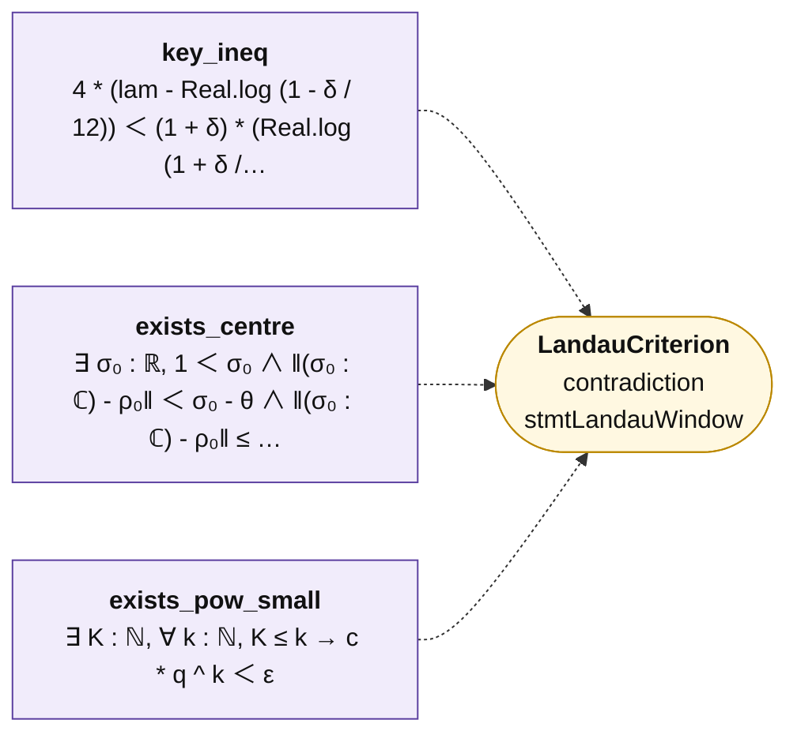

# `lean_stage3/Stage3/LandauRates.lean`

LandauRates — the scalar inequalities of the assembly. Block 7c of `lean_stage3/design/landau.md`. 2026-11-22.

3 theorems, 0 definitions, 120 lines. Arrows are Lean's own record of what each proof uses.

**Imports:** nothing in this tree  
**Imported by:** [`Stage3`](../lean_stage3/Stage3.md), [`LandauCriterion`](../lean_stage3/LandauCriterion.md)

## The picture



An arrow A → B reads "A is used in the proof of B". Green: counting, integers only. Violet: shape, analysis with no ζ. Blue: reads ζ. A name ending in ■ is an end: nothing else uses it. Red: contains `sorry`. Yellow: theorems in another file, counted; a dotted arrow crosses files. Definitions are not drawn; they are listed below the diagram.

## Theorems

<a name="LandauRates-key_ineq"></a>
### `LandauRates.key_ineq`

line 33

**Shape.** Uses real or complex analysis; nothing in it or beneath it reads ζ.

**Why.** The inequality between the rates of the two tails. If `0 < δ ≤ 1` and `0 ≤ λ ≤ δ²/240`, then `4(λ − log(1−δ/12)) < (1+δ)(log(1+δ/3) − λ)`, and both `log(1+δ/3) − λ` and `λ − log(1−δ/12)` are positive.

**Proves**

```lean
4 * (lam - Real.log (1 - δ / 12)) < (1 + δ) * (Real.log (1 + δ / 3) - lam) ∧ 0 < Real.log (1 + δ / 3) - lam ∧ 0 < lam - Real.log (1 - δ / 12)
```

**Needs** (its hypotheses)

  - `` hδ0 : 0 < δ ``
  - `` hδ1 : δ ≤ 1 ``
  - `` hl0 : 0 ≤ lam ``
  - `` hl : lam ≤ δ ^ 2 / 240 ``

**Fed by:** no theorem of this repo; it stands on Mathlib.

**Feeds** (1 that use it)

  - [`LandauCriterion.contradiction`](../lean_stage3/LandauCriterion.md#LandauCriterion-contradiction) (LandauCriterion) — `` False ``

<a name="LandauRates-exists_centre"></a>
### `LandauRates.exists_centre`

line 69

**Shape.** Uses real or complex analysis; nothing in it or beneath it reads ζ.

**Why.** The choice of the real centre. If `0 ≤ θ < Re ρ₀ < 1` and `0 < δ`, there is a real `σ₀ > 1` with `‖σ₀ − ρ₀‖ < σ₀ − θ` and `‖σ₀ − ρ₀‖ ≤ (σ₀ − 1)(1 + δ²/240)`.

**Proves**

```lean
∃ σ₀ : ℝ, 1 < σ₀ ∧ ‖(σ₀ : ℂ) - ρ₀‖ < σ₀ - θ ∧ ‖(σ₀ : ℂ) - ρ₀‖ ≤ (σ₀ - 1) * (1 + δ ^ 2 / 240)
```

**Needs** (its hypotheses)

  - `` hθ0 : 0 ≤ θ ``
  - `` hθ : θ < ρ₀.re ``
  - `` h1 : ρ₀.re < 1 ``
  - `` hδ : 0 < δ ``

**Fed by:** no theorem of this repo; it stands on Mathlib.

**Feeds** (1 that use it)

  - [`LandauCriterion.stmtLandauWindow`](../lean_stage3/LandauCriterion.md#LandauCriterion-stmtLandauWindow) (LandauCriterion) — `` LandauWindow.StmtLandauWindow ``

<a name="LandauRates-exists_pow_small"></a>
### `LandauRates.exists_pow_small`

line 99

**Shape.** Uses real or complex analysis; nothing in it or beneath it reads ζ.

**Why.** If `0 ≤ q < 1` and `0 < ε`, there is a `K` such that `c·q^k < ε` for every `k ≥ K`.

**Proves**

```lean
∃ K : ℕ, ∀ k : ℕ, K ≤ k → c * q ^ k < ε
```

**Needs** (its hypotheses)

  - `` hq0 : 0 ≤ q ``
  - `` hq1 : q < 1 ``
  - `` hε : 0 < ε ``

**Fed by:** no theorem of this repo; it stands on Mathlib.

**Feeds** (1 that use it)

  - [`LandauCriterion.contradiction`](../lean_stage3/LandauCriterion.md#LandauCriterion-contradiction) (LandauCriterion) — `` False ``

