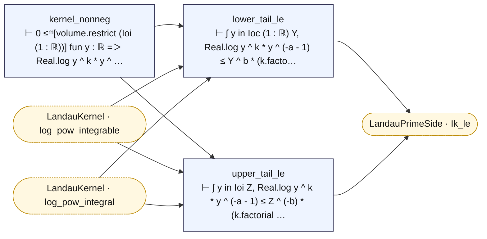

# `lean_stage3/Stage3/LandauTail.lean`

**What it does** (its own header): LandauTail — the kernel off the window: the integral of `(log y)^k·y^(−a−1)` over `(1, Y]` and over `(Z, ∞)`, each bounded by a shift of the exponent. Block 4b of `lean_stage3/design/landau.md`. 2026-11-22.

**Imports:** [`LandauKernel`](../lean_stage3/LandauKernel.md).
**Imported by:** [`Stage3`](../lean_stage3/Stage3.md), [`LandauPrimeSide`](../lean_stage3/LandauPrimeSide.md).

Blue: theorem. Green: a theorem nothing else uses (an end). Dashed white: connects to nothing. Grey: definition. Red: contains `sorry`. Yellow: in another file. An arrow A → B reads "A is used by B".

## Every declaration

| declaration | proves (output) | needs (input) | why (its own docstring) | uses | used by |
|---|---|---|---|---|---|
| `LandauTail.kernel_nonneg` theorem, line 30 | 0 ≤ᵐ[volume.restrict (Ioi (1 : ℝ))] fun y : ℝ =&gt; Real.log y ^ k * y ^ (-a - 1) | a : ℝ; k : ℕ | — | — | `LandauTail.lower_tail_le`, `LandauTail.upper_tail_le` |
| `LandauTail.lower_tail_le` theorem, line 36 | ∫ y in Ioc (1 : ℝ) Y, Real.log y ^ k * y ^ (-a - 1) ≤ Y ^ b * (k.factorial / (a + b) ^ (k + 1)) | ha : 0 &lt; a; hb : 0 &lt; b; k : ℕ; hY : 1 ≤ Y | — | `LandauKernel.log_pow_integrable`, `LandauKernel.log_pow_integral`, `LandauTail.kernel_nonneg` | `LandauPrimeSide.Ik_le` |
| `LandauTail.upper_tail_le` theorem, line 71 | ∫ y in Ioi Z, Real.log y ^ k * y ^ (-a - 1) ≤ Z ^ (-b) * (k.factorial / (a - b) ^ (k + 1)) | hb : 0 &lt; b; hba : b &lt; a; k : ℕ; hZ : 1 ≤ Z | — | `LandauKernel.log_pow_integrable`, `LandauKernel.log_pow_integral`, `LandauTail.kernel_nonneg` | `LandauPrimeSide.Ik_le` |
