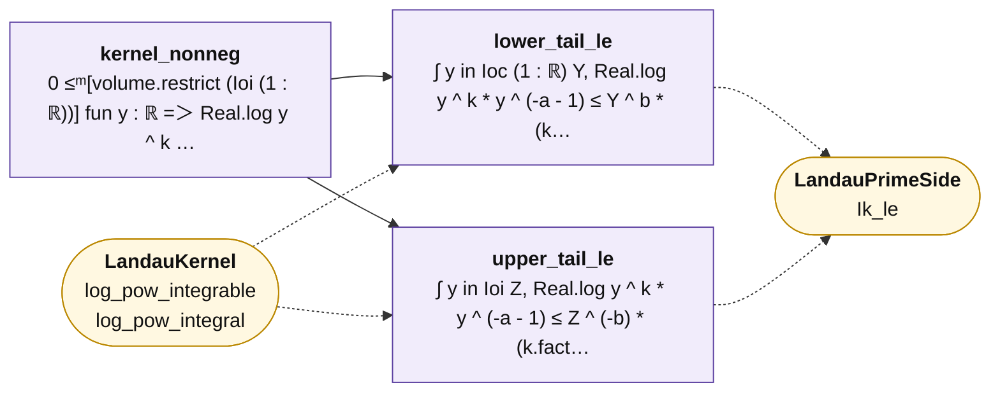

# `lean_stage3/Stage3/LandauTail.lean`

LandauTail — the kernel off the window: the integral of `(log y)^k·y^(−a−1)` over `(1, Y]` and over `(Z, ∞)`, each bounded by a shift of the exponent. Block 4b of `lean_stage3/design/landau.md`. 2026-11-22.

3 theorems, 0 definitions, 126 lines. Arrows are Lean's own record of what each proof uses.

**Imports:** [`LandauKernel`](../lean_stage3/LandauKernel.md)  
**Imported by:** [`Stage3`](../lean_stage3/Stage3.md), [`LandauPrimeSide`](../lean_stage3/LandauPrimeSide.md)

## The picture



An arrow A → B reads "A is used in the proof of B". Green: counting, integers only. Violet: shape, analysis with no ζ. Blue: reads ζ. A name ending in ■ is an end: nothing else uses it. Red: contains `sorry`. Yellow: theorems in another file, counted; a dotted arrow crosses files. Definitions are not drawn; they are listed below the diagram.

## Theorems

<a name="LandauTail-kernel_nonneg"></a>
### `LandauTail.kernel_nonneg`

line 30

**Shape.** Uses real or complex analysis; nothing in it or beneath it reads ζ.

**Proves**

```lean
0 ≤ᵐ[volume.restrict (Ioi (1 : ℝ))] fun y : ℝ => Real.log y ^ k * y ^ (-a - 1)
```

**Needs** (its hypotheses)

  - `` a : ℝ ``
  - `` k : ℕ ``

**Fed by:** no theorem of this repo; it stands on Mathlib.

**Feeds** (2 that use it)

  - [`LandauTail.lower_tail_le`](#LandauTail-lower_tail_le) — `` ∫ y in Ioc (1 : ℝ) Y, Real.log y ^ k * y ^ (-a - 1) ≤ Y ^ b * (k.factorial / (a + b) ^ (k + 1)) ``
  - [`LandauTail.upper_tail_le`](#LandauTail-upper_tail_le) — `` ∫ y in Ioi Z, Real.log y ^ k * y ^ (-a - 1) ≤ Z ^ (-b) * (k.factorial / (a - b) ^ (k + 1)) ``

<a name="LandauTail-lower_tail_le"></a>
### `LandauTail.lower_tail_le`

line 36

**Shape.** Uses real or complex analysis; nothing in it or beneath it reads ζ.

**Proves**

```lean
∫ y in Ioc (1 : ℝ) Y, Real.log y ^ k * y ^ (-a - 1) ≤ Y ^ b * (k.factorial / (a + b) ^ (k + 1))
```

**Needs** (its hypotheses)

  - `` ha : 0 < a ``
  - `` hb : 0 < b ``
  - `` k : ℕ ``
  - `` hY : 1 ≤ Y ``

**Fed by** (3 theorems its proof uses)

  - [`LandauKernel.log_pow_integrable`](../lean_stage3/LandauKernel.md#LandauKernel-log_pow_integrable) (LandauKernel) — `` IntegrableOn (fun y : ℝ => Real.log y ^ n * y ^ (-a - 1)) (Ioi 1) ``
  - [`LandauKernel.log_pow_integral`](../lean_stage3/LandauKernel.md#LandauKernel-log_pow_integral) (LandauKernel) — `` ∫ y in Ioi (1 : ℝ), Real.log y ^ k * y ^ (-a - 1) = k.factorial / a ^ (k + 1) ``
  - [`LandauTail.kernel_nonneg`](#LandauTail-kernel_nonneg) — `` 0 ≤ᵐ[volume.restrict (Ioi (1 : ℝ))] fun y : ℝ => Real.log y ^ k * y ^ (-a - 1) ``

**Feeds** (1 that use it)

  - [`LandauPrimeSide.Ik_le`](../lean_stage3/LandauPrimeSide.md#LandauPrimeSide-Ik_le) (LandauPrimeSide) — `` Ik σ k ≤ C * (k.factorial / (σ - θ) ^ (k + 1)) + 8 * (Y ^ b * (k.factorial / (σ - 1 + b) ^ (k + 1))) + 8 * ((Y ^ (1 + δ)) ^ (-b') * (k.factorial / (σ … ``

<a name="LandauTail-upper_tail_le"></a>
### `LandauTail.upper_tail_le`

line 71

**Shape.** Uses real or complex analysis; nothing in it or beneath it reads ζ.

**Proves**

```lean
∫ y in Ioi Z, Real.log y ^ k * y ^ (-a - 1) ≤ Z ^ (-b) * (k.factorial / (a - b) ^ (k + 1))
```

**Needs** (its hypotheses)

  - `` hb : 0 < b ``
  - `` hba : b < a ``
  - `` k : ℕ ``
  - `` hZ : 1 ≤ Z ``

**Fed by** (3 theorems its proof uses)

  - [`LandauKernel.log_pow_integrable`](../lean_stage3/LandauKernel.md#LandauKernel-log_pow_integrable) (LandauKernel) — `` IntegrableOn (fun y : ℝ => Real.log y ^ n * y ^ (-a - 1)) (Ioi 1) ``
  - [`LandauKernel.log_pow_integral`](../lean_stage3/LandauKernel.md#LandauKernel-log_pow_integral) (LandauKernel) — `` ∫ y in Ioi (1 : ℝ), Real.log y ^ k * y ^ (-a - 1) = k.factorial / a ^ (k + 1) ``
  - [`LandauTail.kernel_nonneg`](#LandauTail-kernel_nonneg) — `` 0 ≤ᵐ[volume.restrict (Ioi (1 : ℝ))] fun y : ℝ => Real.log y ^ k * y ^ (-a - 1) ``

**Feeds** (1 that use it)

  - [`LandauPrimeSide.Ik_le`](../lean_stage3/LandauPrimeSide.md#LandauPrimeSide-Ik_le) (LandauPrimeSide) — `` Ik σ k ≤ C * (k.factorial / (σ - θ) ^ (k + 1)) + 8 * (Y ^ b * (k.factorial / (σ - 1 + b) ^ (k + 1))) + 8 * ((Y ^ (1 + δ)) ^ (-b') * (k.factorial / (σ … ``

