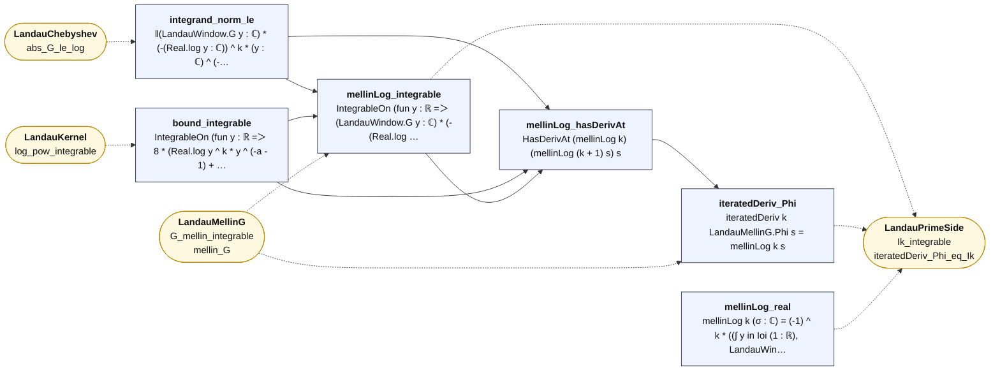

# `lean_stage3/Stage3/LandauTaylor.lean`

LandauTaylor — the derivatives of `Phi` on `Re s > 1`, from the primes: iteratedDeriv k Phi s = ∫₁^∞ G(y)·(−log y)^k·y^(−s−1) dy.

6 theorems, 1 definition, 182 lines. Arrows are Lean's own record of what each proof uses.

**Imports:** [`LandauChebyshev`](../lean_stage3/LandauChebyshev.md), [`LandauKernel`](../lean_stage3/LandauKernel.md), [`LandauMellinG`](../lean_stage3/LandauMellinG.md)  
**Imported by:** [`Stage3`](../lean_stage3/Stage3.md), [`LandauPrimeSide`](../lean_stage3/LandauPrimeSide.md)

## The picture



An arrow A → B reads "A is used in the proof of B". Blue: theorem. Green: a theorem nothing else uses (an end). Dashed: connects to nothing. Red: contains `sorry`. Yellow: theorems in another file, counted; a dotted arrow crosses files. Definitions are not drawn; they are listed below the diagram.

## Definitions

<a name="LandauTaylor-mellinLog"></a>
### `LandauTaylor.mellinLog`

def · line 40

`∫₁^∞ G(y)·(−log y)^k·y^(−s−1) dy`.

- **Is:** `` mellinLog (k : ℕ) (s : ℂ) : ℂ := ∫ y in Ioi (1 : ℝ), (LandauWindow.G y : ℂ) * (-(Real.log y : ℂ)) ^ k * (y : ℂ) ^ (-s - 1) ``
- **Built from:** [`LandauWindow.G`](../lean_stage3/LandauWindow.md#LandauWindow-G)
- **Used by 4:** [`LandauPrimeSide.iteratedDeriv_Phi_eq_Ik`](../lean_stage3/LandauPrimeSide.md#LandauPrimeSide-iteratedDeriv_Phi_eq_Ik), [`LandauTaylor.iteratedDeriv_Phi`](#LandauTaylor-iteratedDeriv_Phi), [`LandauTaylor.mellinLog_hasDerivAt`](#LandauTaylor-mellinLog_hasDerivAt), [`LandauTaylor.mellinLog_real`](#LandauTaylor-mellinLog_real)

## Theorems

<a name="LandauTaylor-integrand_norm_le"></a>
### `LandauTaylor.integrand_norm_le`

line 45

**Why.** The domination: for `Re s ≥ 1 + a` the integrand is at most this.

**Proves**

```lean
‖(LandauWindow.G y : ℂ) * (-(Real.log y : ℂ)) ^ k * (y : ℂ) ^ (-s - 1)‖ ≤ 8 * (Real.log y ^ k * y ^ (-a - 1) + Real.log y ^ (k + 1) * y ^ (-a - 1))
```

**Needs** (its hypotheses)

  - `` has : 1 + a ≤ s.re ``
  - `` k : ℕ ``
  - `` hy : 1 < y ``

**Stated with:** [`LandauWindow.G`](../lean_stage3/LandauWindow.md#LandauWindow-G)

**Fed by** (1 theorem its proof uses)

  - [`LandauChebyshev.abs_G_le_log`](../lean_stage3/LandauChebyshev.md#LandauChebyshev-abs_G_le_log) (LandauChebyshev) — `` |LandauWindow.G y| ≤ 8 * y * (1 + Real.log y) ``

**Feeds** (2 that use it)

  - [`LandauTaylor.mellinLog_hasDerivAt`](#LandauTaylor-mellinLog_hasDerivAt) — `` HasDerivAt (mellinLog k) (mellinLog (k + 1) s) s ``
  - [`LandauTaylor.mellinLog_integrable`](#LandauTaylor-mellinLog_integrable) — `` IntegrableOn (fun y : ℝ => (LandauWindow.G y : ℂ) * (-(Real.log y : ℂ)) ^ k * (y : ℂ) ^ (-s - 1)) (Ioi 1) ``

<a name="LandauTaylor-bound_integrable"></a>
### `LandauTaylor.bound_integrable`

line 70

**Proves**

```lean
IntegrableOn (fun y : ℝ => 8 * (Real.log y ^ k * y ^ (-a - 1) + Real.log y ^ (k + 1) * y ^ (-a - 1))) (Ioi 1)
```

**Needs** (its hypotheses)

  - `` ha : 0 < a ``
  - `` k : ℕ ``

**Fed by** (1 theorem its proof uses)

  - [`LandauKernel.log_pow_integrable`](../lean_stage3/LandauKernel.md#LandauKernel-log_pow_integrable) (LandauKernel) — `` IntegrableOn (fun y : ℝ => Real.log y ^ n * y ^ (-a - 1)) (Ioi 1) ``

**Feeds** (2 that use it)

  - [`LandauTaylor.mellinLog_hasDerivAt`](#LandauTaylor-mellinLog_hasDerivAt) — `` HasDerivAt (mellinLog k) (mellinLog (k + 1) s) s ``
  - [`LandauTaylor.mellinLog_integrable`](#LandauTaylor-mellinLog_integrable) — `` IntegrableOn (fun y : ℝ => (LandauWindow.G y : ℂ) * (-(Real.log y : ℂ)) ^ k * (y : ℂ) ^ (-s - 1)) (Ioi 1) ``

<a name="LandauTaylor-mellinLog_integrable"></a>
### `LandauTaylor.mellinLog_integrable`

line 76

**Proves**

```lean
IntegrableOn (fun y : ℝ => (LandauWindow.G y : ℂ) * (-(Real.log y : ℂ)) ^ k * (y : ℂ) ^ (-s - 1)) (Ioi 1)
```

**Needs** (its hypotheses)

  - `` hs : 1 < s.re ``
  - `` k : ℕ ``

**Stated with:** [`LandauWindow.G`](../lean_stage3/LandauWindow.md#LandauWindow-G)

**Fed by** (3 theorems its proof uses)

  - [`LandauMellinG.G_mellin_integrable`](../lean_stage3/LandauMellinG.md#LandauMellinG-G_mellin_integrable) (LandauMellinG) — `` IntegrableOn (fun y : ℝ => (LandauWindow.G y : ℂ) * (y : ℂ) ^ (-s - 1)) (Ioi 1) ``
  - [`LandauTaylor.bound_integrable`](#LandauTaylor-bound_integrable) — `` IntegrableOn (fun y : ℝ => 8 * (Real.log y ^ k * y ^ (-a - 1) + Real.log y ^ (k + 1) * y ^ (-a - 1))) (Ioi 1) ``
  - [`LandauTaylor.integrand_norm_le`](#LandauTaylor-integrand_norm_le) — `` ‖(LandauWindow.G y : ℂ) * (-(Real.log y : ℂ)) ^ k * (y : ℂ) ^ (-s - 1)‖ ≤ 8 * (Real.log y ^ k * y ^ (-a - 1) + Real.log y ^ (k + 1) * y ^ (-a - 1)) ``

**Feeds** (2 that use it)

  - [`LandauPrimeSide.Ik_integrable`](../lean_stage3/LandauPrimeSide.md#LandauPrimeSide-Ik_integrable) (LandauPrimeSide) — `` IntegrableOn (fun y : ℝ => LandauWindow.G y * Real.log y ^ k * y ^ (-σ - 1)) (Ioi 1) ``
  - [`LandauTaylor.mellinLog_hasDerivAt`](#LandauTaylor-mellinLog_hasDerivAt) — `` HasDerivAt (mellinLog k) (mellinLog (k + 1) s) s ``

<a name="LandauTaylor-mellinLog_hasDerivAt"></a>
### `LandauTaylor.mellinLog_hasDerivAt`

line 98

**Proves**

```lean
HasDerivAt (mellinLog k) (mellinLog (k + 1) s) s
```

**Needs** (its hypotheses)

  - `` hs : 1 < s.re ``
  - `` k : ℕ ``

**Stated with:** [`LandauTaylor.mellinLog`](#LandauTaylor-mellinLog)

**Fed by** (3 theorems its proof uses)

  - [`LandauTaylor.bound_integrable`](#LandauTaylor-bound_integrable) — `` IntegrableOn (fun y : ℝ => 8 * (Real.log y ^ k * y ^ (-a - 1) + Real.log y ^ (k + 1) * y ^ (-a - 1))) (Ioi 1) ``
  - [`LandauTaylor.integrand_norm_le`](#LandauTaylor-integrand_norm_le) — `` ‖(LandauWindow.G y : ℂ) * (-(Real.log y : ℂ)) ^ k * (y : ℂ) ^ (-s - 1)‖ ≤ 8 * (Real.log y ^ k * y ^ (-a - 1) + Real.log y ^ (k + 1) * y ^ (-a - 1)) ``
  - [`LandauTaylor.mellinLog_integrable`](#LandauTaylor-mellinLog_integrable) — `` IntegrableOn (fun y : ℝ => (LandauWindow.G y : ℂ) * (-(Real.log y : ℂ)) ^ k * (y : ℂ) ^ (-s - 1)) (Ioi 1) ``

**Definitions its proof touches:** [`LandauWindow.G`](../lean_stage3/LandauWindow.md#LandauWindow-G)

**Feeds** (1 that use it)

  - [`LandauTaylor.iteratedDeriv_Phi`](#LandauTaylor-iteratedDeriv_Phi) — `` iteratedDeriv k LandauMellinG.Phi s = mellinLog k s ``

<a name="LandauTaylor-iteratedDeriv_Phi"></a>
### `LandauTaylor.iteratedDeriv_Phi`

line 140

**Proves**

```lean
iteratedDeriv k LandauMellinG.Phi s = mellinLog k s
```

**Needs** (its hypotheses)

  - `` k : ℕ ``
  - `` hs : 1 < s.re ``

**Stated with:** [`LandauMellinG.Phi`](../lean_stage3/LandauMellinG.md#LandauMellinG-Phi), [`LandauTaylor.mellinLog`](#LandauTaylor-mellinLog)

**Fed by** (2 theorems its proof uses)

  - [`LandauMellinG.mellin_G`](../lean_stage3/LandauMellinG.md#LandauMellinG-mellin_G) (LandauMellinG) — `` ∫ y in Ioi (1 : ℝ), (LandauWindow.G y : ℂ) * (y : ℂ) ^ (-s - 1) = Phi s ``
  - [`LandauTaylor.mellinLog_hasDerivAt`](#LandauTaylor-mellinLog_hasDerivAt) — `` HasDerivAt (mellinLog k) (mellinLog (k + 1) s) s ``

**Definitions its proof touches:** [`LandauWindow.G`](../lean_stage3/LandauWindow.md#LandauWindow-G)

**Feeds** (1 that use it)

  - [`LandauPrimeSide.iteratedDeriv_Phi_eq_Ik`](../lean_stage3/LandauPrimeSide.md#LandauPrimeSide-iteratedDeriv_Phi_eq_Ik) (LandauPrimeSide) — `` iteratedDeriv k LandauMellinG.Phi (σ : ℂ) = (-1) ^ k * ((Ik σ k : ℝ) : ℂ) ``

<a name="LandauTaylor-mellinLog_real"></a>
### `LandauTaylor.mellinLog_real`

line 155

**Proves**

```lean
mellinLog k (σ : ℂ) = (-1) ^ k * ((∫ y in Ioi (1 : ℝ), LandauWindow.G y * Real.log y ^ k * y ^ (-σ - 1) : ℝ) : ℂ)
```

**Needs** (its hypotheses)

  - `` σ : ℝ ``
  - `` k : ℕ ``

**Stated with:** [`LandauTaylor.mellinLog`](#LandauTaylor-mellinLog), [`LandauWindow.G`](../lean_stage3/LandauWindow.md#LandauWindow-G)

**Fed by:** no theorem of this repo; it stands on Mathlib and the definitions below.

**Feeds** (1 that use it)

  - [`LandauPrimeSide.iteratedDeriv_Phi_eq_Ik`](../lean_stage3/LandauPrimeSide.md#LandauPrimeSide-iteratedDeriv_Phi_eq_Ik) (LandauPrimeSide) — `` iteratedDeriv k LandauMellinG.Phi (σ : ℂ) = (-1) ^ k * ((Ik σ k : ℝ) : ℂ) ``

