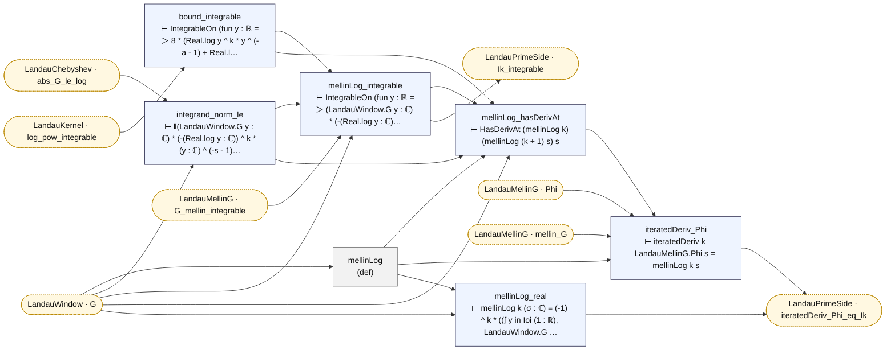

# `lean_stage3/Stage3/LandauTaylor.lean`

**What it does** (its own header): LandauTaylor — the derivatives of `Phi` on `Re s > 1`, from the primes: iteratedDeriv k Phi s = ∫₁^∞ G(y)·(−log y)^k·y^(−s−1) dy.

**Imports:** [`LandauChebyshev`](../lean_stage3/LandauChebyshev.md), [`LandauKernel`](../lean_stage3/LandauKernel.md), [`LandauMellinG`](../lean_stage3/LandauMellinG.md).
**Imported by:** [`Stage3`](../lean_stage3/Stage3.md), [`LandauPrimeSide`](../lean_stage3/LandauPrimeSide.md).

Blue: theorem. Green: a theorem nothing else uses (an end). Dashed white: connects to nothing. Grey: definition. Red: contains `sorry`. Yellow: in another file. An arrow A → B reads "A is used by B".

## Every declaration

| declaration | proves (output) | needs (input) | why (its own docstring) | uses | used by |
|---|---|---|---|---|---|
| `LandauTaylor.mellinLog` def, line 40 | ℂ | k : ℕ; s : ℂ | `∫₁^∞ G(y)·(−log y)^k·y^(−s−1) dy`. | `LandauWindow.G` | `LandauTaylor.iteratedDeriv_Phi`, `LandauTaylor.mellinLog_hasDerivAt`, `LandauTaylor.mellinLog_real` |
| `LandauTaylor.integrand_norm_le` theorem, line 45 | ‖(LandauWindow.G y : ℂ) * (-(Real.log y : ℂ)) ^ k * (y : ℂ) ^ (-s - 1)‖ ≤ 8 * (Real.log y ^ k * y ^ (-a - 1) + Real.log y ^ (k + 1) * y ^ (-a - 1)) | has : 1 + a ≤ s.re; k : ℕ; hy : 1 &lt; y | The domination: for `Re s ≥ 1 + a` the integrand is at most this. | `LandauChebyshev.abs_G_le_log`, `LandauWindow.G` | `LandauTaylor.mellinLog_hasDerivAt`, `LandauTaylor.mellinLog_integrable` |
| `LandauTaylor.bound_integrable` theorem, line 70 | IntegrableOn (fun y : ℝ =&gt; 8 * (Real.log y ^ k * y ^ (-a - 1) + Real.log y ^ (k + 1) * y ^ (-a - 1))) (Ioi 1) | ha : 0 &lt; a; k : ℕ | — | `LandauKernel.log_pow_integrable` | `LandauTaylor.mellinLog_hasDerivAt`, `LandauTaylor.mellinLog_integrable` |
| `LandauTaylor.mellinLog_integrable` theorem, line 76 | IntegrableOn (fun y : ℝ =&gt; (LandauWindow.G y : ℂ) * (-(Real.log y : ℂ)) ^ k * (y : ℂ) ^ (-s - 1)) (Ioi 1) | hs : 1 &lt; s.re; k : ℕ | — | `LandauMellinG.G_mellin_integrable`, `LandauTaylor.bound_integrable`, `LandauTaylor.integrand_norm_le`, `LandauWindow.G` | `LandauPrimeSide.Ik_integrable`, `LandauTaylor.mellinLog_hasDerivAt` |
| `LandauTaylor.mellinLog_hasDerivAt` theorem, line 98 | HasDerivAt (mellinLog k) (mellinLog (k + 1) s) s | hs : 1 &lt; s.re; k : ℕ | — | `LandauTaylor.bound_integrable`, `LandauTaylor.integrand_norm_le`, `LandauTaylor.mellinLog`, `LandauTaylor.mellinLog_integrable`, `LandauWindow.G` | `LandauTaylor.iteratedDeriv_Phi` |
| `LandauTaylor.iteratedDeriv_Phi` theorem, line 140 | iteratedDeriv k LandauMellinG.Phi s = mellinLog k s | k : ℕ; hs : 1 &lt; s.re | — | `LandauMellinG.Phi`, `LandauMellinG.mellin_G`, `LandauTaylor.mellinLog`, `LandauTaylor.mellinLog_hasDerivAt` | `LandauPrimeSide.iteratedDeriv_Phi_eq_Ik` |
| `LandauTaylor.mellinLog_real` theorem, line 155 | mellinLog k (σ : ℂ) = (-1) ^ k * ((∫ y in Ioi (1 : ℝ), LandauWindow.G y * Real.log y ^ k * y ^ (-σ - 1) : ℝ) : ℂ) | σ : ℝ; k : ℕ | — | `LandauTaylor.mellinLog`, `LandauWindow.G` | `LandauPrimeSide.iteratedDeriv_Phi_eq_Ik` |
