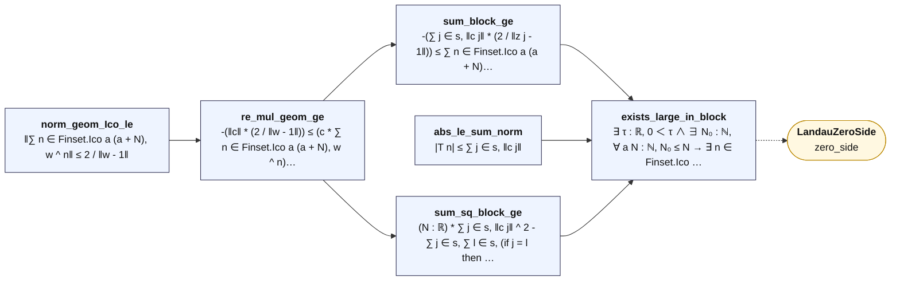

# `lean_stage3/Stage3/LandauTrig.lean`

LandauTrig — a real exponential sum is large somewhere in every long block. Block 6 of `lean_stage3/design/landau.md`. 2026-11-22.

6 theorems, 0 definitions, 229 lines. Arrows are Lean's own record of what each proof uses.

**Imports:** nothing in this tree  
**Imported by:** [`Stage3`](../lean_stage3/Stage3.md), [`LandauZeroSide`](../lean_stage3/LandauZeroSide.md)

## The picture



An arrow A → B reads "A is used in the proof of B". Blue: theorem. Green: a theorem nothing else uses (an end). Dashed: connects to nothing. Red: contains `sorry`. Yellow: theorems in another file, counted; a dotted arrow crosses files. Definitions are not drawn; they are listed below the diagram.

## Theorems

<a name="LandauTrig-norm_geom_Ico_le"></a>
### `LandauTrig.norm_geom_Ico_le`

line 42

**Proves**

```lean
‖∑ n ∈ Finset.Ico a (a + N), w ^ n‖ ≤ 2 / ‖w - 1‖
```

**Needs** (its hypotheses)

  - `` hw : ‖w‖ = 1 ``
  - `` hw1 : w ≠ 1 ``
  - `` a N : ℕ ``

**Fed by:** no theorem of this repo; it stands on Mathlib.

**Feeds** (1 that use it)

  - [`LandauTrig.re_mul_geom_ge`](#LandauTrig-re_mul_geom_ge) — `` -(‖c‖ * (2 / ‖w - 1‖)) ≤ (c * ∑ n ∈ Finset.Ico a (a + N), w ^ n).re ``

<a name="LandauTrig-re_mul_geom_ge"></a>
### `LandauTrig.re_mul_geom_ge`

line 51

**Why.** The real part of `c·Σ w^n` over a block, from below, when `w ≠ 1`.

**Proves**

```lean
-(‖c‖ * (2 / ‖w - 1‖)) ≤ (c * ∑ n ∈ Finset.Ico a (a + N), w ^ n).re
```

**Needs** (its hypotheses)

  - `` c : ℂ ``
  - `` hw : ‖w‖ = 1 ``
  - `` hw1 : w ≠ 1 ``
  - `` a N : ℕ ``

**Fed by** (1 theorem its proof uses)

  - [`LandauTrig.norm_geom_Ico_le`](#LandauTrig-norm_geom_Ico_le) — `` ‖∑ n ∈ Finset.Ico a (a + N), w ^ n‖ ≤ 2 / ‖w - 1‖ ``

**Feeds** (2 that use it)

  - [`LandauTrig.sum_block_ge`](#LandauTrig-sum_block_ge) — `` -(∑ j ∈ s, ‖c j‖ * (2 / ‖z j - 1‖)) ≤ ∑ n ∈ Finset.Ico a (a + N), T n ``
  - [`LandauTrig.sum_sq_block_ge`](#LandauTrig-sum_sq_block_ge) — `` (N : ℝ) * ∑ j ∈ s, ‖c j‖ ^ 2 - ∑ j ∈ s, ∑ l ∈ s, (if j = l then 0 else ‖c j‖ * ‖c l‖ * (2 / ‖z j * conj (z l) - 1‖)) ≤ ∑ n ∈ Finset.Ico a (a + N), T n… ``

<a name="LandauTrig-sum_block_ge"></a>
### `LandauTrig.sum_block_ge`

line 60

**Proves**

```lean
-(∑ j ∈ s, ‖c j‖ * (2 / ‖z j - 1‖)) ≤ ∑ n ∈ Finset.Ico a (a + N), T n
```

**Needs** (its hypotheses)

  - `` s : Finset ι ``
  - `` c z : ι → ℂ ``
  - `` hz : ∀ j ∈ s, ‖z j‖ = 1 ``
  - `` hconst : ∀ j ∈ s, z j = 1 → 0 ≤ (c j).re ``
  - `` T : ℕ → ℝ ``
  - `` hT : ∀ n, (T n : ℂ) = ∑ j ∈ s, c j * z j ^ n ``
  - `` a N : ℕ ``

**Fed by** (1 theorem its proof uses)

  - [`LandauTrig.re_mul_geom_ge`](#LandauTrig-re_mul_geom_ge) — `` -(‖c‖ * (2 / ‖w - 1‖)) ≤ (c * ∑ n ∈ Finset.Ico a (a + N), w ^ n).re ``

**Feeds** (1 that use it)

  - [`LandauTrig.exists_large_in_block`](#LandauTrig-exists_large_in_block) — `` ∃ τ : ℝ, 0 < τ ∧ ∃ N₀ : ℕ, ∀ a N : ℕ, N₀ ≤ N → ∃ n ∈ Finset.Ico a (a + N), τ ≤ T n ``

<a name="LandauTrig-abs_le_sum_norm"></a>
### `LandauTrig.abs_le_sum_norm`

line 83

**Proves**

```lean
|T n| ≤ ∑ j ∈ s, ‖c j‖
```

**Needs** (its hypotheses)

  - `` s : Finset ι ``
  - `` c z : ι → ℂ ``
  - `` hz : ∀ j ∈ s, ‖z j‖ = 1 ``
  - `` T : ℕ → ℝ ``
  - `` hT : ∀ n, (T n : ℂ) = ∑ j ∈ s, c j * z j ^ n ``
  - `` n : ℕ ``

**Fed by:** no theorem of this repo; it stands on Mathlib.

**Feeds** (1 that use it)

  - [`LandauTrig.exists_large_in_block`](#LandauTrig-exists_large_in_block) — `` ∃ τ : ℝ, 0 < τ ∧ ∃ N₀ : ℕ, ∀ a N : ℕ, N₀ ≤ N → ∃ n ∈ Finset.Ico a (a + N), τ ≤ T n ``

<a name="LandauTrig-sum_sq_block_ge"></a>
### `LandauTrig.sum_sq_block_ge`

line 91

**Proves**

```lean
(N : ℝ) * ∑ j ∈ s, ‖c j‖ ^ 2 - ∑ j ∈ s, ∑ l ∈ s, (if j = l then 0 else ‖c j‖ * ‖c l‖ * (2 / ‖z j * conj (z l) - 1‖)) ≤ ∑ n ∈ Finset.Ico a (a + N), T n ^ 2
```

**Needs** (its hypotheses)

  - `` s : Finset ι ``
  - `` c z : ι → ℂ ``
  - `` hz : ∀ j ∈ s, ‖z j‖ = 1 ``
  - `` hinj : Set.InjOn z s ``
  - `` T : ℕ → ℝ ``
  - `` hT : ∀ n, (T n : ℂ) = ∑ j ∈ s, c j * z j ^ n ``
  - `` a N : ℕ ``

**Fed by** (1 theorem its proof uses)

  - [`LandauTrig.re_mul_geom_ge`](#LandauTrig-re_mul_geom_ge) — `` -(‖c‖ * (2 / ‖w - 1‖)) ≤ (c * ∑ n ∈ Finset.Ico a (a + N), w ^ n).re ``

**Feeds** (1 that use it)

  - [`LandauTrig.exists_large_in_block`](#LandauTrig-exists_large_in_block) — `` ∃ τ : ℝ, 0 < τ ∧ ∃ N₀ : ℕ, ∀ a N : ℕ, N₀ ≤ N → ∃ n ∈ Finset.Ico a (a + N), τ ≤ T n ``

<a name="LandauTrig-exists_large_in_block"></a>
### `LandauTrig.exists_large_in_block`

line 158

**Proves**

```lean
∃ τ : ℝ, 0 < τ ∧ ∃ N₀ : ℕ, ∀ a N : ℕ, N₀ ≤ N → ∃ n ∈ Finset.Ico a (a + N), τ ≤ T n
```

**Needs** (its hypotheses)

  - `` s : Finset ι ``
  - `` c z : ι → ℂ ``
  - `` hz : ∀ j ∈ s, ‖z j‖ = 1 ``
  - `` hinj : Set.InjOn z s ``
  - `` hconst : ∀ j ∈ s, z j = 1 → 0 ≤ (c j).re ``
  - `` hne : ∃ j ∈ s, c j ≠ 0 ``
  - `` T : ℕ → ℝ ``
  - `` hT : ∀ n, (T n : ℂ) = ∑ j ∈ s, c j * z j ^ n ``

**Fed by** (3 theorems its proof uses)

  - [`LandauTrig.abs_le_sum_norm`](#LandauTrig-abs_le_sum_norm) — `` |T n| ≤ ∑ j ∈ s, ‖c j‖ ``
  - [`LandauTrig.sum_block_ge`](#LandauTrig-sum_block_ge) — `` -(∑ j ∈ s, ‖c j‖ * (2 / ‖z j - 1‖)) ≤ ∑ n ∈ Finset.Ico a (a + N), T n ``
  - [`LandauTrig.sum_sq_block_ge`](#LandauTrig-sum_sq_block_ge) — `` (N : ℝ) * ∑ j ∈ s, ‖c j‖ ^ 2 - ∑ j ∈ s, ∑ l ∈ s, (if j = l then 0 else ‖c j‖ * ‖c l‖ * (2 / ‖z j * conj (z l) - 1‖)) ≤ ∑ n ∈ Finset.Ico a (a + N), T n… ``

**Feeds** (1 that use it)

  - [`LandauZeroSide.zero_side`](../lean_stage3/LandauZeroSide.md#LandauZeroSide-zero_side) (LandauZeroSide) — `` ∃ r R τ C₁ : ℝ, ∃ N₀ : ℕ, σ₀ - 1 < r ∧ r ≤ ‖(σ₀ : ℂ) - ρ₀‖ ∧ r < R ∧ 0 < τ ∧ 0 ≤ C₁ ∧ ∀ a N : ℕ, N₀ ≤ N → ∃ k ∈ Finset.Ico a (a + N), τ / r ^ (k + 1) … ``

