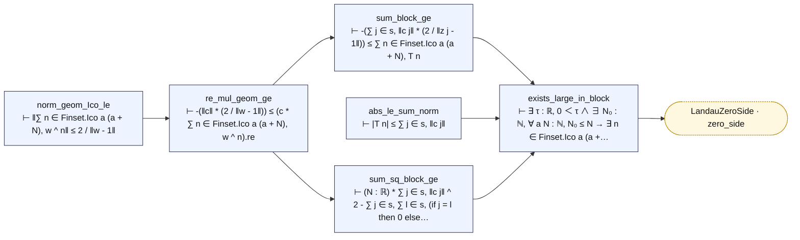

# `lean_stage3/Stage3/LandauTrig.lean`

**What it does** (its own header): LandauTrig — a real exponential sum is large somewhere in every long block. Block 6 of `lean_stage3/design/landau.md`. 2026-11-22.

**Imports:** nothing in this tree.
**Imported by:** [`Stage3`](../lean_stage3/Stage3.md), [`LandauZeroSide`](../lean_stage3/LandauZeroSide.md).

Blue: theorem. Green: a theorem nothing else uses (an end). Dashed white: connects to nothing. Grey: definition. Red: contains `sorry`. Yellow: in another file. An arrow A → B reads "A is used by B".

## Every declaration

| declaration | proves (output) | needs (input) | why (its own docstring) | uses | used by |
|---|---|---|---|---|---|
| `LandauTrig.norm_geom_Ico_le` theorem, line 42 | ‖∑ n ∈ Finset.Ico a (a + N), w ^ n‖ ≤ 2 / ‖w - 1‖ | hw : ‖w‖ = 1; hw1 : w ≠ 1; a N : ℕ | — | — | `LandauTrig.re_mul_geom_ge` |
| `LandauTrig.re_mul_geom_ge` theorem, line 51 | -(‖c‖ * (2 / ‖w - 1‖)) ≤ (c * ∑ n ∈ Finset.Ico a (a + N), w ^ n).re | c : ℂ; hw : ‖w‖ = 1; hw1 : w ≠ 1; a N : ℕ | The real part of `c·Σ w^n` over a block, from below, when `w ≠ 1`. | `LandauTrig.norm_geom_Ico_le` | `LandauTrig.sum_block_ge`, `LandauTrig.sum_sq_block_ge` |
| `LandauTrig.sum_block_ge` theorem, line 60 | -(∑ j ∈ s, ‖c j‖ * (2 / ‖z j - 1‖)) ≤ ∑ n ∈ Finset.Ico a (a + N), T n | s : Finset ι; c z : ι → ℂ; hz : ∀ j ∈ s, ‖z j‖ = 1; hconst : ∀ j ∈ s, z j = 1 → 0 ≤ (c j).re; T : ℕ → ℝ; hT : ∀ n, (T n : ℂ) = ∑ j ∈ s, c j * z j ^ n; a N : ℕ | — | `LandauTrig.re_mul_geom_ge` | `LandauTrig.exists_large_in_block` |
| `LandauTrig.abs_le_sum_norm` theorem, line 83 | \|T n\| ≤ ∑ j ∈ s, ‖c j‖ | s : Finset ι; c z : ι → ℂ; hz : ∀ j ∈ s, ‖z j‖ = 1; T : ℕ → ℝ; hT : ∀ n, (T n : ℂ) = ∑ j ∈ s, c j * z j ^ n; n : ℕ | — | — | `LandauTrig.exists_large_in_block` |
| `LandauTrig.sum_sq_block_ge` theorem, line 91 | (N : ℝ) * ∑ j ∈ s, ‖c j‖ ^ 2 - ∑ j ∈ s, ∑ l ∈ s, (if j = l then 0 else ‖c j‖ * ‖c l‖ * (2 / ‖z j * conj (z l) - 1‖)) ≤ ∑ n ∈ Finset.Ico a (a + N), T n ^ 2 | s : Finset ι; c z : ι → ℂ; hz : ∀ j ∈ s, ‖z j‖ = 1; hinj : Set.InjOn z s; T : ℕ → ℝ; hT : ∀ n, (T n : ℂ) = ∑ j ∈ s, c j * z j ^ n; a N : ℕ | — | `LandauTrig.re_mul_geom_ge` | `LandauTrig.exists_large_in_block` |
| `LandauTrig.exists_large_in_block` theorem, line 158 | ∃ τ : ℝ, 0 &lt; τ ∧ ∃ N₀ : ℕ, ∀ a N : ℕ, N₀ ≤ N → ∃ n ∈ Finset.Ico a (a + N), τ ≤ T n | s : Finset ι; c z : ι → ℂ; hz : ∀ j ∈ s, ‖z j‖ = 1; hinj : Set.InjOn z s; hconst : ∀ j ∈ s, z j = 1 → 0 ≤ (c j).re; hne : ∃ j ∈ s, c j ≠ 0; T : ℕ → ℝ; hT : ∀ n, (T n : ℂ) = ∑ j ∈ s, c j * z j ^ n | — | `LandauTrig.abs_le_sum_norm`, `LandauTrig.sum_block_ge`, `LandauTrig.sum_sq_block_ge` | `LandauZeroSide.zero_side` |
