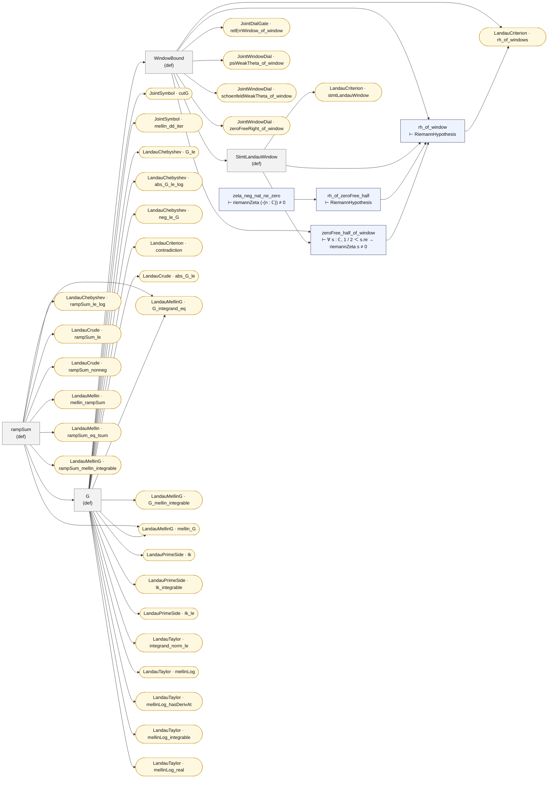

# `lean_stage3/Stage3/LandauWindow.lean`

**What it does** (its own header): LandauWindow — the Landau window criterion as a statement, and what it gives: a one-sided bound on one function of the primes, on long windows, implies Mathlib's `RiemannHypothesis`. Block 1 of `lean_stage3/design/landau.md`. 2026-11-22.

**Imports:** nothing in this tree.
**Imported by:** [`Stage3`](../lean_stage3/Stage3.md), [`LandauCrude`](../lean_stage3/LandauCrude.md), [`LandauMellin`](../lean_stage3/LandauMellin.md).

Blue: theorem. Green: a theorem nothing else uses (an end). Dashed white: connects to nothing. Grey: definition. Red: contains `sorry`. Yellow: in another file. An arrow A → B reads "A is used by B".

## Every declaration

| declaration | proves (output) | needs (input) | why (its own docstring) | uses | used by |
|---|---|---|---|---|---|
| `LandauWindow.rampSum` def, line 49 | ℝ | y : ℝ | `Σ_{n ≤ y} Λ(n)·(y/n − 1)`, the von Mangoldt sum against the ramp. | — | `LandauChebyshev.rampSum_le_log`, `LandauCrude.rampSum_le`, `LandauCrude.rampSum_nonneg`, `LandauMellin.mellin_rampSum`, `LandauMellin.rampSum_eq_tsum`, `LandauMellinG.G_integrand_eq`, `LandauMellinG.mellin_G`, `LandauMellinG.rampSum_mellin_integrable`, `LandauWindow.G` |
| `LandauWindow.G` def, line 53 | ℝ | y : ℝ | The ramp sum with its main terms removed. | `LandauWindow.rampSum` | `JointSymbol.cutG`, `JointSymbol.mellin_dd_iter`, `LandauChebyshev.G_le`, `LandauChebyshev.abs_G_le_log`, `LandauChebyshev.neg_le_G`, `LandauCriterion.contradiction`, `LandauCrude.abs_G_le`, `LandauMellinG.G_integrand_eq`, `LandauMellinG.G_mellin_integrable`, `LandauMellinG.mellin_G`, `LandauPrimeSide.Ik`, `LandauPrimeSide.Ik_integrable`, `LandauPrimeSide.Ik_le`, `LandauTaylor.integrand_norm_le`, `LandauTaylor.mellinLog`, `LandauTaylor.mellinLog_hasDerivAt`, `LandauTaylor.mellinLog_integrable`, `LandauTaylor.mellinLog_real`, `LandauWindow.WindowBound` |
| `LandauWindow.WindowBound` def, line 57 | Prop | θ δ C : ℝ | The hypothesis: `G(y) ≤ C·y^θ` on a window `[Y, Y^(1+δ)]`, for arbitrarily large `Y`. | `LandauWindow.G` | `JointDialGate.relErrWindow_of_window`, `JointWindowDial.psiWeakTheta_of_window`, `JointWindowDial.schoenfeldWeakTheta_of_window`, `JointWindowDial.zeroFreeRight_of_window`, `LandauCriterion.rh_of_windows`, `LandauWindow.StmtLandauWindow`, `LandauWindow.rh_of_window`, `LandauWindow.zeroFree_half_of_window` |
| `LandauWindow.StmtLandauWindow` def, line 61 | Prop | — | The Landau window criterion, as a statement. | `LandauWindow.WindowBound` | `LandauCriterion.stmtLandauWindow`, `LandauWindow.rh_of_window`, `LandauWindow.zeroFree_half_of_window` |
| `LandauWindow.zeta_neg_nat_ne_zero` theorem, line 66 | riemannZeta (-(n : ℂ)) ≠ 0 | n : ℕ; hn : ¬∃ k : ℕ, n = 2 * (k + 1) | `ζ` does not vanish at a nonpositive integer other than a trivial zero. | — | `LandauWindow.rh_of_zeroFree_half` |
| `LandauWindow.rh_of_zeroFree_half` theorem, line 114 | RiemannHypothesis | h : ∀ s : ℂ, 1 / 2 &lt; s.re → riemannZeta s ≠ 0 | From a zero-free half-plane to the Riemann hypothesis. | `LandauWindow.zeta_neg_nat_ne_zero` | `LandauWindow.rh_of_window` |
| `LandauWindow.zeroFree_half_of_window` theorem, line 137 | ∀ s : ℂ, 1 / 2 &lt; s.re → riemannZeta s ≠ 0 | hL : StmtLandauWindow; hW : ∀ θ : ℝ, 1 / 2 &lt; θ → θ &lt; 1 → ∃ δ C : ℝ, 0 &lt; δ ∧ WindowBound θ δ C | The criterion and a window bound at every `θ` above `1/2` give a zero-free half-plane. | `LandauWindow.StmtLandauWindow`, `LandauWindow.WindowBound` | `LandauWindow.rh_of_window` |
| `LandauWindow.rh_of_window` theorem, line 152 | RiemannHypothesis | hL : StmtLandauWindow; hW : ∀ θ : ℝ, 1 / 2 &lt; θ → θ &lt; 1 → ∃ δ C : ℝ, 0 &lt; δ ∧ WindowBound θ δ C | The window bound gives the Riemann hypothesis, given the criterion. | `LandauWindow.StmtLandauWindow`, `LandauWindow.WindowBound`, `LandauWindow.rh_of_zeroFree_half`, `LandauWindow.zeroFree_half_of_window` | `LandauCriterion.rh_of_windows` |
