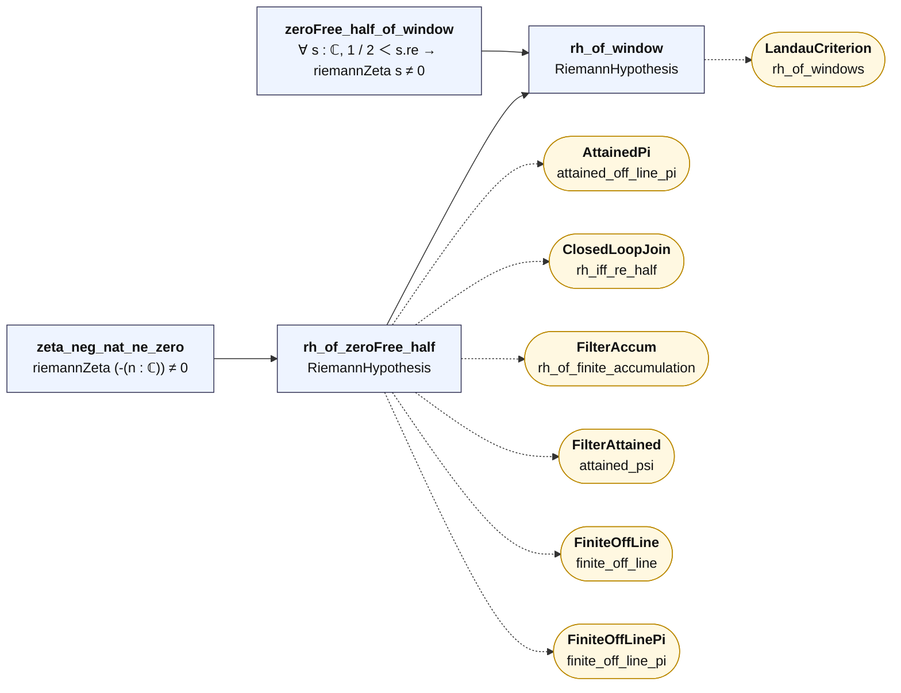

# `lean_stage3/Stage3/LandauWindow.lean`

LandauWindow — the Landau window criterion as a statement, and what it gives: a one-sided bound on one function of the primes, on long windows, implies Mathlib's `RiemannHypothesis`. Block 1 of `lean_stage3/design/landau.md`. 2026-11-22.

4 theorems, 4 definitions, 176 lines. Arrows are Lean's own record of what each proof uses.

**Imports:** nothing in this tree  
**Imported by:** [`Stage3`](../lean_stage3/Stage3.md), [`ClosedLoopJoin`](../lean_stage3/ClosedLoopJoin.md), [`FiniteOffLine`](../lean_stage3/FiniteOffLine.md), [`FiniteOffLinePi`](../lean_stage3/FiniteOffLinePi.md), [`LandauCrude`](../lean_stage3/LandauCrude.md), [`LandauMellin`](../lean_stage3/LandauMellin.md)

## The picture



An arrow A → B reads "A is used in the proof of B". Green: counting, integers only. Violet: shape, analysis with no ζ. Blue: reads ζ. A name ending in ■ is an end: nothing else uses it. Red: contains `sorry`. Yellow: theorems in another file, counted; a dotted arrow crosses files. Definitions are not drawn; they are listed below the diagram.

## Definitions

<a name="LandauWindow-rampSum"></a>
### `LandauWindow.rampSum`

def · line 49

`Σ_{n ≤ y} Λ(n)·(y/n − 1)`, the von Mangoldt sum against the ramp.

- **Is:** `` rampSum (y : ℝ) : ℝ := ∑ n ∈ Finset.range (⌊y⌋₊ + 1), ArithmeticFunction.vonMangoldt n * max (y / n - 1) 0 ``
- **Used by 15:** [`LandauChebyshev.G_le`](../lean_stage3/LandauChebyshev.md#LandauChebyshev-G_le), [`LandauChebyshev.neg_le_G`](../lean_stage3/LandauChebyshev.md#LandauChebyshev-neg_le_G), [`LandauChebyshev.rampSum_le_log`](../lean_stage3/LandauChebyshev.md#LandauChebyshev-rampSum_le_log), [`LandauCrude.abs_G_le`](../lean_stage3/LandauCrude.md#LandauCrude-abs_G_le), [`LandauCrude.rampSum_le`](../lean_stage3/LandauCrude.md#LandauCrude-rampSum_le), [`LandauCrude.rampSum_nonneg`](../lean_stage3/LandauCrude.md#LandauCrude-rampSum_nonneg), [`LandauMellin.mellin_rampSum`](../lean_stage3/LandauMellin.md#LandauMellin-mellin_rampSum), [`LandauMellin.rampSum_eq_tsum`](../lean_stage3/LandauMellin.md#LandauMellin-rampSum_eq_tsum), [`LandauMellinG.G_integrand_eq`](../lean_stage3/LandauMellinG.md#LandauMellinG-G_integrand_eq), [`LandauMellinG.G_mellin_integrable`](../lean_stage3/LandauMellinG.md#LandauMellinG-G_mellin_integrable), [`LandauMellinG.mellin_G`](../lean_stage3/LandauMellinG.md#LandauMellinG-mellin_G), [`LandauMellinG.rampSum_mellin_integrable`](../lean_stage3/LandauMellinG.md#LandauMellinG-rampSum_mellin_integrable), [`LandauWindow.G`](#LandauWindow-G), [`WindowsOfRH.rampSum_eq_integral`](../lean_stage3/WindowsOfRH.md#WindowsOfRH-rampSum_eq_integral), [`WindowsOfRH.rampSum_eq_mertens`](../lean_stage3/WindowsOfRH.md#WindowsOfRH-rampSum_eq_mertens)

<a name="LandauWindow-G"></a>
### `LandauWindow.G`

def · line 53

The ramp sum with its main terms removed.

- **Is:** `` G (y : ℝ) : ℝ := rampSum y - y * Real.log y + (1 + Real.eulerMascheroniConstant) * y ``
- **Built from:** [`LandauWindow.rampSum`](#LandauWindow-rampSum)
- **Used by 25:** [`JointSymbol.cutG`](../lean_stage3/JointSymbol.md#JointSymbol-cutG), [`JointSymbol.mellin_dd_iter`](../lean_stage3/JointSymbol.md#JointSymbol-mellin_dd_iter), [`LandauChebyshev.G_le`](../lean_stage3/LandauChebyshev.md#LandauChebyshev-G_le), [`LandauChebyshev.abs_G_le_log`](../lean_stage3/LandauChebyshev.md#LandauChebyshev-abs_G_le_log), [`LandauChebyshev.neg_le_G`](../lean_stage3/LandauChebyshev.md#LandauChebyshev-neg_le_G), [`LandauCriterion.contradiction`](../lean_stage3/LandauCriterion.md#LandauCriterion-contradiction), [`LandauCriterion.stmtLandauWindow`](../lean_stage3/LandauCriterion.md#LandauCriterion-stmtLandauWindow), [`LandauCrude.abs_G_le`](../lean_stage3/LandauCrude.md#LandauCrude-abs_G_le), [`LandauMellinG.G_integrand_eq`](../lean_stage3/LandauMellinG.md#LandauMellinG-G_integrand_eq), [`LandauMellinG.G_mellin_integrable`](../lean_stage3/LandauMellinG.md#LandauMellinG-G_mellin_integrable), [`LandauMellinG.mellin_G`](../lean_stage3/LandauMellinG.md#LandauMellinG-mellin_G), [`LandauPrimeSide.Ik`](../lean_stage3/LandauPrimeSide.md#LandauPrimeSide-Ik), [`LandauPrimeSide.Ik_integrable`](../lean_stage3/LandauPrimeSide.md#LandauPrimeSide-Ik_integrable), [`LandauPrimeSide.Ik_le`](../lean_stage3/LandauPrimeSide.md#LandauPrimeSide-Ik_le), [`LandauPrimeSide.iteratedDeriv_Phi_eq_Ik`](../lean_stage3/LandauPrimeSide.md#LandauPrimeSide-iteratedDeriv_Phi_eq_Ik), [`LandauTaylor.integrand_norm_le`](../lean_stage3/LandauTaylor.md#LandauTaylor-integrand_norm_le), [`LandauTaylor.iteratedDeriv_Phi`](../lean_stage3/LandauTaylor.md#LandauTaylor-iteratedDeriv_Phi), [`LandauTaylor.mellinLog`](../lean_stage3/LandauTaylor.md#LandauTaylor-mellinLog), [`LandauTaylor.mellinLog_hasDerivAt`](../lean_stage3/LandauTaylor.md#LandauTaylor-mellinLog_hasDerivAt), [`LandauTaylor.mellinLog_integrable`](../lean_stage3/LandauTaylor.md#LandauTaylor-mellinLog_integrable), [`LandauTaylor.mellinLog_real`](../lean_stage3/LandauTaylor.md#LandauTaylor-mellinLog_real), [`LandauWindow.WindowBound`](#LandauWindow-WindowBound), [`WindowsOfRH.G_eq`](../lean_stage3/WindowsOfRH.md#WindowsOfRH-G_eq), [`WindowsOfRH.const_eq_zero`](../lean_stage3/WindowsOfRH.md#WindowsOfRH-const_eq_zero), [`WindowsOfRH.phi_sub_pole_le`](../lean_stage3/WindowsOfRH.md#WindowsOfRH-phi_sub_pole_le)

<a name="LandauWindow-WindowBound"></a>
### `LandauWindow.WindowBound`

def · line 57

The hypothesis: `G(y) ≤ C·y^θ` on a window `[Y, Y^(1+δ)]`, for arbitrarily large `Y`.

- **Is:** `` WindowBound (θ δ C : ℝ) : Prop := ∀ Y₀ : ℝ, ∃ Y : ℝ, Y₀ ≤ Y ∧ ∀ y ∈ Set.Icc Y (Y ^ (1 + δ)), G y ≤ C * y ^ θ ``
- **Built from:** [`LandauWindow.G`](#LandauWindow-G)
- **Used by 12:** [`JointDialGate.relErrWindow_of_window`](../lean_stage3/JointDialGate.md#JointDialGate-relErrWindow_of_window), [`JointWindowDial.psiWeakTheta_of_window`](../lean_stage3/JointWindowDial.md#JointWindowDial-psiWeakTheta_of_window), [`JointWindowDial.schoenfeldWeakTheta_of_window`](../lean_stage3/JointWindowDial.md#JointWindowDial-schoenfeldWeakTheta_of_window), [`JointWindowDial.zeroFreeRight_of_window`](../lean_stage3/JointWindowDial.md#JointWindowDial-zeroFreeRight_of_window), [`LandauCriterion.rh_of_windows`](../lean_stage3/LandauCriterion.md#LandauCriterion-rh_of_windows), [`LandauCriterion.stmtLandauWindow`](../lean_stage3/LandauCriterion.md#LandauCriterion-stmtLandauWindow), [`LandauWindow.StmtLandauWindow`](#LandauWindow-StmtLandauWindow), [`LandauWindow.rh_of_window`](#LandauWindow-rh_of_window), [`LandauWindow.zeroFree_half_of_window`](#LandauWindow-zeroFree_half_of_window), [`Stage3.Target`](../lean_stage3/Target.md#Stage3-Target), [`WindowsOfRH.spiralLink_iff_windows`](../lean_stage3/WindowsOfRH.md#WindowsOfRH-spiralLink_iff_windows), [`WindowsOfRH.windows_of_rh`](../lean_stage3/WindowsOfRH.md#WindowsOfRH-windows_of_rh)

<a name="LandauWindow-StmtLandauWindow"></a>
### `LandauWindow.StmtLandauWindow`

def · line 61

The Landau window criterion, as a statement.

- **Is:** `` StmtLandauWindow : Prop := ∀ θ δ C : ℝ, 0 < θ → θ < 1 → 0 < δ → WindowBound θ δ C → ∀ s : ℂ, θ < s.re → riemannZeta s ≠ 0 ``
- **Built from:** [`LandauWindow.WindowBound`](#LandauWindow-WindowBound)
- **Used by 3:** [`LandauCriterion.stmtLandauWindow`](../lean_stage3/LandauCriterion.md#LandauCriterion-stmtLandauWindow), [`LandauWindow.rh_of_window`](#LandauWindow-rh_of_window), [`LandauWindow.zeroFree_half_of_window`](#LandauWindow-zeroFree_half_of_window)

## Theorems

<a name="LandauWindow-zeta_neg_nat_ne_zero"></a>
### `LandauWindow.zeta_neg_nat_ne_zero`

line 66

**Reads ζ.** It, or something it rests on, uses the zeta function, its zeros or the Riemann hypothesis.

**Why.** `ζ` does not vanish at a nonpositive integer other than a trivial zero.

**Proves**

```lean
riemannZeta (-(n : ℂ)) ≠ 0
```

**Needs** (its hypotheses)

  - `` n : ℕ ``
  - `` hn : ¬∃ k : ℕ, n = 2 * (k + 1) ``

**Fed by:** no theorem of this repo; it stands on Mathlib.

**Feeds** (1 that use it)

  - [`LandauWindow.rh_of_zeroFree_half`](#LandauWindow-rh_of_zeroFree_half) — `` RiemannHypothesis ``

<a name="LandauWindow-rh_of_zeroFree_half"></a>
### `LandauWindow.rh_of_zeroFree_half`

line 114

**Reads ζ.** It, or something it rests on, uses the zeta function, its zeros or the Riemann hypothesis.

**Why.** From a zero-free half-plane to the Riemann hypothesis.

**Proves**

```lean
RiemannHypothesis
```

**Needs** (its hypotheses)

  - `` h : ∀ s : ℂ, 1 / 2 < s.re → riemannZeta s ≠ 0 ``

**Fed by** (1 theorem its proof uses)

  - [`LandauWindow.zeta_neg_nat_ne_zero`](#LandauWindow-zeta_neg_nat_ne_zero) — `` riemannZeta (-(n : ℂ)) ≠ 0 ``

**Feeds** (7 that use it)

  - [`AttainedPi.attained_off_line_pi`](../lean_stage3/AttainedPi.md#AttainedPi-attained_off_line_pi) (AttainedPi) — `` RiemannHypothesis ``
  - [`ClosedLoopJoin.rh_iff_re_half`](../lean_stage3/ClosedLoopJoin.md#ClosedLoopJoin-rh_iff_re_half) (ClosedLoopJoin) — `` RiemannHypothesis ↔ ∀ ρ : NontrivialZeros, (ρ : ℂ).re = 1 / 2 ``
  - [`FilterAccum.rh_of_finite_accumulation`](../lean_stage3/FilterAccum.md#FilterAccum-rh_of_finite_accumulation) (FilterAccum) — `` RiemannHypothesis ``
  - [`FilterAttained.attained_psi`](../lean_stage3/FilterAttained.md#FilterAttained-attained_psi) (FilterAttained) — `` RiemannHypothesis ``
  - [`FiniteOffLine.finite_off_line`](../lean_stage3/FiniteOffLine.md#FiniteOffLine-finite_off_line) (FiniteOffLine) — `` RiemannHypothesis ``
  - [`FiniteOffLinePi.finite_off_line_pi`](../lean_stage3/FiniteOffLinePi.md#FiniteOffLinePi-finite_off_line_pi) (FiniteOffLinePi) — `` RiemannHypothesis ``
  - [`LandauWindow.rh_of_window`](#LandauWindow-rh_of_window) — `` RiemannHypothesis ``

<a name="LandauWindow-zeroFree_half_of_window"></a>
### `LandauWindow.zeroFree_half_of_window`

line 137

**Reads ζ.** It, or something it rests on, uses the zeta function, its zeros or the Riemann hypothesis.

**Why.** The criterion and a window bound at every `θ` above `1/2` give a zero-free half-plane.

**Proves**

```lean
∀ s : ℂ, 1 / 2 < s.re → riemannZeta s ≠ 0
```

**Needs** (its hypotheses)

  - `` hL : StmtLandauWindow ``
  - `` hW : ∀ θ : ℝ, 1 / 2 < θ → θ < 1 → ∃ δ C : ℝ, 0 < δ ∧ WindowBound θ δ C ``

**Stated with:** [`LandauWindow.StmtLandauWindow`](#LandauWindow-StmtLandauWindow), [`LandauWindow.WindowBound`](#LandauWindow-WindowBound)

**Fed by:** no theorem of this repo; it stands on Mathlib and the definitions below.

**Feeds** (1 that use it)

  - [`LandauWindow.rh_of_window`](#LandauWindow-rh_of_window) — `` RiemannHypothesis ``

<a name="LandauWindow-rh_of_window"></a>
### `LandauWindow.rh_of_window`

line 152

**Reads ζ.** It, or something it rests on, uses the zeta function, its zeros or the Riemann hypothesis.

**Why.** The window bound gives the Riemann hypothesis, given the criterion.

**Proves**

```lean
RiemannHypothesis
```

**Needs** (its hypotheses)

  - `` hL : StmtLandauWindow ``
  - `` hW : ∀ θ : ℝ, 1 / 2 < θ → θ < 1 → ∃ δ C : ℝ, 0 < δ ∧ WindowBound θ δ C ``

**Stated with:** [`LandauWindow.StmtLandauWindow`](#LandauWindow-StmtLandauWindow), [`LandauWindow.WindowBound`](#LandauWindow-WindowBound)

**Fed by** (2 theorems its proof uses)

  - [`LandauWindow.rh_of_zeroFree_half`](#LandauWindow-rh_of_zeroFree_half) — `` RiemannHypothesis ``
  - [`LandauWindow.zeroFree_half_of_window`](#LandauWindow-zeroFree_half_of_window) — `` ∀ s : ℂ, 1 / 2 < s.re → riemannZeta s ≠ 0 ``

**Feeds** (1 that use it)

  - [`LandauCriterion.rh_of_windows`](../lean_stage3/LandauCriterion.md#LandauCriterion-rh_of_windows) (LandauCriterion) — `` RiemannHypothesis ``

