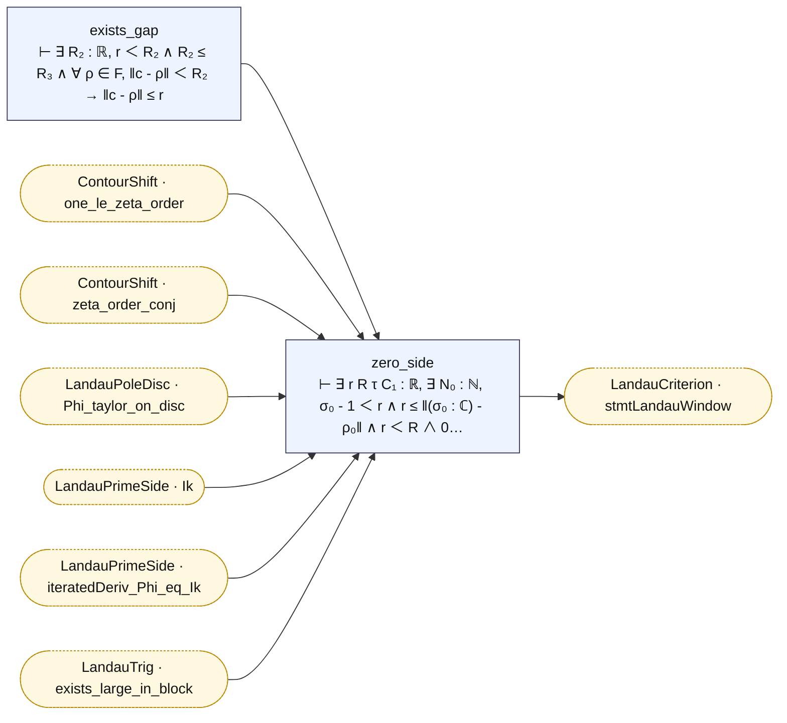

# `lean_stage3/Stage3/LandauZeroSide.lean`

**What it does** (its own header): LandauZeroSide — the zeros' reading of the Taylor coefficients of `Phi`, from below. Block 7b of `lean_stage3/design/landau.md`. 2026-11-22.

**Imports:** [`LandauPoleDisc`](../lean_stage3/LandauPoleDisc.md), [`LandauPrimeSide`](../lean_stage3/LandauPrimeSide.md), [`LandauTrig`](../lean_stage3/LandauTrig.md).
**Imported by:** [`Stage3`](../lean_stage3/Stage3.md), [`LandauCriterion`](../lean_stage3/LandauCriterion.md).

Blue: theorem. Green: a theorem nothing else uses (an end). Dashed white: connects to nothing. Grey: definition. Red: contains `sorry`. Yellow: in another file. An arrow A → B reads "A is used by B".

## Every declaration

| declaration | proves (output) | needs (input) | why (its own docstring) | uses | used by |
|---|---|---|---|---|---|
| `LandauZeroSide.exists_gap` theorem, line 38 | ∃ R₂ : ℝ, r &lt; R₂ ∧ R₂ ≤ R₃ ∧ ∀ ρ ∈ F, ‖c - ρ‖ &lt; R₂ → ‖c - ρ‖ ≤ r | F : Finset ℂ; c : ℂ; r R₃ : ℝ; hr : r &lt; R₃ | Past the nearest points of a finite set there is a gap. | — | `LandauZeroSide.zero_side` |
| `LandauZeroSide.zero_side` theorem, line 54 | ∃ r R τ C₁ : ℝ, ∃ N₀ : ℕ, σ₀ - 1 &lt; r ∧ r ≤ ‖(σ₀ : ℂ) - ρ₀‖ ∧ r &lt; R ∧ 0 &lt; τ ∧ 0 ≤ C₁ ∧ ∀ a N : ℕ, N₀ ≤ N → ∃ k ∈ Finset.Ico a (a + N), τ / r ^ (k + 1) - C₁ / R ^ k ≤ LandauPrimeSide.Ik σ₀ k / k.factorial | hz : riemannZeta ρ₀ = 0; hσ : 1 &lt; σ₀; hS2 : ‖(σ₀ : ℂ) - ρ₀‖ &lt; σ₀ | — | `ContourShift.one_le_zeta_order`, `ContourShift.zeta_order_conj`, `LandauPoleDisc.Phi_taylor_on_disc`, `LandauPrimeSide.Ik`, `LandauPrimeSide.iteratedDeriv_Phi_eq_Ik`, `LandauTrig.exists_large_in_block`, `LandauZeroSide.exists_gap` | `LandauCriterion.stmtLandauWindow` |
