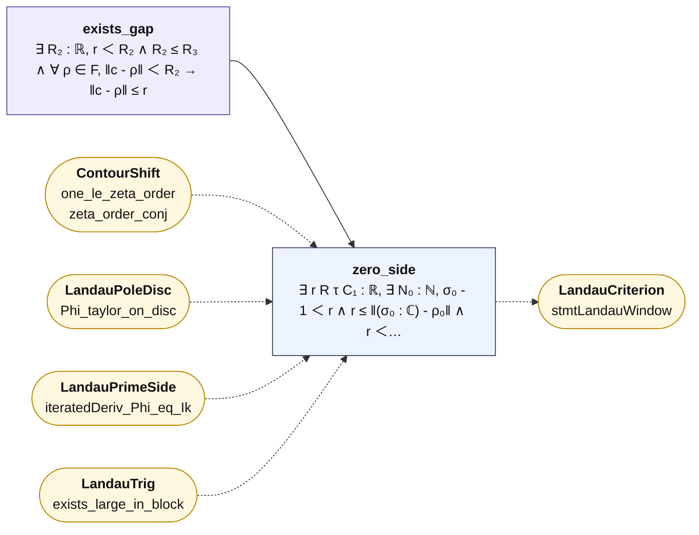

# `lean_stage3/Stage3/LandauZeroSide.lean`

LandauZeroSide — the zeros' reading of the Taylor coefficients of `Phi`, from below. Block 7b of `lean_stage3/design/landau.md`. 2026-11-22.

2 theorems, 0 definitions, 301 lines. Arrows are Lean's own record of what each proof uses.

**Imports:** [`LandauPoleDisc`](../lean_stage3/LandauPoleDisc.md), [`LandauPrimeSide`](../lean_stage3/LandauPrimeSide.md), [`LandauTrig`](../lean_stage3/LandauTrig.md)  
**Imported by:** [`Stage3`](../lean_stage3/Stage3.md), [`LandauCriterion`](../lean_stage3/LandauCriterion.md)

## The picture



An arrow A → B reads "A is used in the proof of B". Green: counting, integers only. Violet: shape, analysis with no ζ. Blue: reads ζ. A name ending in ■ is an end: nothing else uses it. Red: contains `sorry`. Yellow: theorems in another file, counted; a dotted arrow crosses files. Definitions are not drawn; they are listed below the diagram.

## Theorems

<a name="LandauZeroSide-exists_gap"></a>
### `LandauZeroSide.exists_gap`

line 38

**Shape.** Uses real or complex analysis; nothing in it or beneath it reads ζ.

**Why.** Past the nearest points of a finite set there is a gap.

**Proves**

```lean
∃ R₂ : ℝ, r < R₂ ∧ R₂ ≤ R₃ ∧ ∀ ρ ∈ F, ‖c - ρ‖ < R₂ → ‖c - ρ‖ ≤ r
```

**Needs** (its hypotheses)

  - `` F : Finset ℂ ``
  - `` c : ℂ ``
  - `` r R₃ : ℝ ``
  - `` hr : r < R₃ ``

**Fed by:** no theorem of this repo; it stands on Mathlib.

**Feeds** (1 that use it)

  - [`LandauZeroSide.zero_side`](#LandauZeroSide-zero_side) — `` ∃ r R τ C₁ : ℝ, ∃ N₀ : ℕ, σ₀ - 1 < r ∧ r ≤ ‖(σ₀ : ℂ) - ρ₀‖ ∧ r < R ∧ 0 < τ ∧ 0 ≤ C₁ ∧ ∀ a N : ℕ, N₀ ≤ N → ∃ k ∈ Finset.Ico a (a + N), τ / r ^ (k + 1) … ``

<a name="LandauZeroSide-zero_side"></a>
### `LandauZeroSide.zero_side`

line 54

**Reads ζ.** It, or something it rests on, uses the zeta function, its zeros or the Riemann hypothesis.

**Proves**

```lean
∃ r R τ C₁ : ℝ, ∃ N₀ : ℕ, σ₀ - 1 < r ∧ r ≤ ‖(σ₀ : ℂ) - ρ₀‖ ∧ r < R ∧ 0 < τ ∧ 0 ≤ C₁ ∧ ∀ a N : ℕ, N₀ ≤ N → ∃ k ∈ Finset.Ico a (a + N), τ / r ^ (k + 1) - C₁ / R ^ k ≤ LandauPrimeSide.Ik σ₀ k / k.factorial
```

**Needs** (its hypotheses)

  - `` hz : riemannZeta ρ₀ = 0 ``
  - `` hσ : 1 < σ₀ ``
  - `` hS2 : ‖(σ₀ : ℂ) - ρ₀‖ < σ₀ ``

**Stated with:** [`LandauPrimeSide.Ik`](../lean_stage3/LandauPrimeSide.md#LandauPrimeSide-Ik)

**Fed by** (6 theorems its proof uses)

  - [`ContourShift.one_le_zeta_order`](../lean_stage3/ContourShift.md#ContourShift-one_le_zeta_order) (ContourShift) — `` 1 ≤ analyticOrderNatAt riemannZeta ρ ``
  - [`ContourShift.zeta_order_conj`](../lean_stage3/ContourShift.md#ContourShift-zeta_order_conj) (ContourShift) — `` analyticOrderNatAt riemannZeta ((starRingEnd ℂ) ρ) = analyticOrderNatAt riemannZeta ρ ``
  - [`LandauPoleDisc.Phi_taylor_on_disc`](../lean_stage3/LandauPoleDisc.md#LandauPoleDisc-Phi_taylor_on_disc) (LandauPoleDisc) — `` ∃ (P : Finset ℂ) (C : ℝ), (∀ ρ, ρ ∈ P ↔ ρ ∈ ball c R₂ ∧ ρ ≠ 1 ∧ riemannZeta ρ = 0) ∧ ∀ k : ℕ, ‖iteratedDeriv k LandauMellinG.Phi c - ∑ ρ ∈ P, (analyti… ``
  - [`LandauPrimeSide.iteratedDeriv_Phi_eq_Ik`](../lean_stage3/LandauPrimeSide.md#LandauPrimeSide-iteratedDeriv_Phi_eq_Ik) (LandauPrimeSide) — `` iteratedDeriv k LandauMellinG.Phi (σ : ℂ) = (-1) ^ k * ((Ik σ k : ℝ) : ℂ) ``
  - [`LandauTrig.exists_large_in_block`](../lean_stage3/LandauTrig.md#LandauTrig-exists_large_in_block) (LandauTrig) — `` ∃ τ : ℝ, 0 < τ ∧ ∃ N₀ : ℕ, ∀ a N : ℕ, N₀ ≤ N → ∃ n ∈ Finset.Ico a (a + N), τ ≤ T n ``
  - [`LandauZeroSide.exists_gap`](#LandauZeroSide-exists_gap) — `` ∃ R₂ : ℝ, r < R₂ ∧ R₂ ≤ R₃ ∧ ∀ ρ ∈ F, ‖c - ρ‖ < R₂ → ‖c - ρ‖ ≤ r ``

**Definitions its proof touches:** [`LandauMellinG.Phi`](../lean_stage3/LandauMellinG.md#LandauMellinG-Phi)

**Feeds** (1 that use it)

  - [`LandauCriterion.stmtLandauWindow`](../lean_stage3/LandauCriterion.md#LandauCriterion-stmtLandauWindow) (LandauCriterion) — `` LandauWindow.StmtLandauWindow ``

