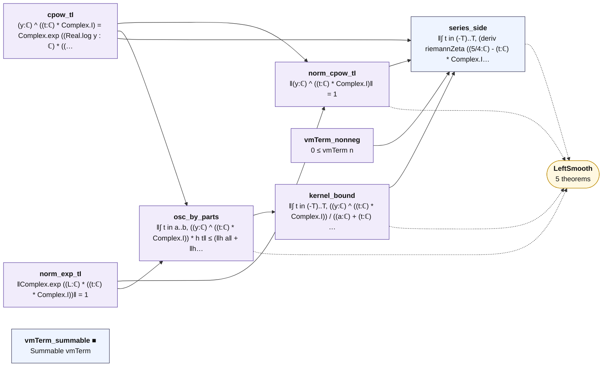

# `lean_stage3/Stage3/LeftKernel.lean`

> **Read from the source text.** This file changed after the last `python3 utilities/lean_map.py --dump`, so the arrows on this page are names occurring in each proof and have not been confirmed by Lean.

LeftKernel — blocks F2a and F2b of `lean_stage3/design/leftedge.md`. 2026-11-23.

8 theorems, 2 definitions, 366 lines. 

**Imports:** [`ExplicitLeft`](../lean_stage3/ExplicitLeft.md)  
**Imported by:** [`Stage3`](../lean_stage3/Stage3.md), [`LeftSmooth`](../lean_stage3/LeftSmooth.md)

## The picture



An arrow A → B reads "A is used in the proof of B". Green: counting, integers only. Violet: shape, analysis with no ζ. Blue: reads ζ. A name ending in ■ is an end: nothing else uses it. Red: contains `sorry`. Yellow: theorems in another file, counted; a dotted arrow crosses files. Definitions are not drawn; they are listed below the diagram.

## Definitions

<a name="LeftKernel-vmTerm"></a>
### `LeftKernel.vmTerm`

def · line 177

The `n`-th term of the von Mangoldt series at `5/4`: `Λ(n)·n^(−5/4)`.

- **Is:** `` vmTerm (n : ℕ) : ℝ := ArithmeticFunction.vonMangoldt n * (n:ℝ) ^ (-(5:ℝ)/4) ``
- **Used by 4:** [`LeftKernel.Bser`](#LeftKernel-Bser), [`LeftKernel.series_side`](#LeftKernel-series_side), [`LeftKernel.vmTerm_nonneg`](#LeftKernel-vmTerm_nonneg), [`LeftKernel.vmTerm_summable`](#LeftKernel-vmTerm_summable)

<a name="LeftKernel-Bser"></a>
### `LeftKernel.Bser`

def · line 198

The series-side constant: `((1 + 4π)/log 16)·Σ' n, Λ(n)·n^(−5/4)`.

- **Is:** `` Bser : ℝ := ((1 + 4 * Real.pi) / Real.log 16) * ∑' n : ℕ, vmTerm n ``
- **Built from:** [`LeftKernel.vmTerm`](#LeftKernel-vmTerm)
- **Used by 3:** [`LeftKernel.series_side`](#LeftKernel-series_side), [`LeftSmooth.Bleft`](../lean_stage3/LeftSmooth.md#LeftSmooth-Bleft), [`LeftSmooth.left_edge_bound`](../lean_stage3/LeftSmooth.md#LeftSmooth-left_edge_bound)

## Theorems

<a name="LeftKernel-cpow_tI"></a>
### `LeftKernel.cpow_tI`

line 28 · arrows read from text

**Shape.** Uses real or complex analysis; nothing in it or beneath it reads ζ.

**Why.** For `y > 0`, the turning factor `y^(it)` is the exponential `exp(log y · it)`.

**Proves**

```lean
(y:ℂ) ^ ((t:ℂ) * Complex.I) = Complex.exp ((Real.log y : ℂ) * ((t:ℂ) * Complex.I))
```

**Needs** (its hypotheses)

  - `` hy : 0 < y ``
  - `` t : ℝ ``

**Fed by:** no theorem of this repo; it stands on Mathlib.

**Feeds** (3 that use it)

  - [`LeftKernel.norm_cpow_tI`](#LeftKernel-norm_cpow_tI) — `` ‖(y:ℂ) ^ ((t:ℂ) * Complex.I)‖ = 1 ``
  - [`LeftKernel.osc_by_parts`](#LeftKernel-osc_by_parts) — `` ‖∫ t in a..b, ((y:ℂ) ^ ((t:ℂ) * Complex.I)) * h t‖ ≤ (‖h a‖ + ‖h b‖ + ∫ t in a..b, ‖h' t‖) / Real.log y ``
  - [`LeftKernel.series_side`](#LeftKernel-series_side) — `` ‖∫ t in (-T)..T, (deriv riemannZeta ((5/4:ℂ) - (t:ℂ) * Complex.I) / riemannZeta ((5/4:ℂ) - (t:ℂ) * Complex.I)) * ((x:ℂ) ^ (((-1/4 : ℝ):ℂ) + (t:ℂ) * Co… ``

<a name="LeftKernel-norm_exp_tI"></a>
### `LeftKernel.norm_exp_tI`

line 33 · arrows read from text

**Shape.** Uses real or complex analysis; nothing in it or beneath it reads ζ.

**Why.** The exponential `exp(L · it)` of a purely imaginary number has norm one.

**Proves**

```lean
‖Complex.exp ((L:ℂ) * ((t:ℂ) * Complex.I))‖ = 1
```

**Needs** (its hypotheses)

  - `` L t : ℝ ``

**Fed by:** no theorem of this repo; it stands on Mathlib.

**Feeds** (2 that use it)

  - [`LeftKernel.norm_cpow_tI`](#LeftKernel-norm_cpow_tI) — `` ‖(y:ℂ) ^ ((t:ℂ) * Complex.I)‖ = 1 ``
  - [`LeftKernel.osc_by_parts`](#LeftKernel-osc_by_parts) — `` ‖∫ t in a..b, ((y:ℂ) ^ ((t:ℂ) * Complex.I)) * h t‖ ≤ (‖h a‖ + ‖h b‖ + ∫ t in a..b, ‖h' t‖) / Real.log y ``

<a name="LeftKernel-norm_cpow_tI"></a>
### `LeftKernel.norm_cpow_tI`

line 38 · arrows read from text

**Shape.** Uses real or complex analysis; nothing in it or beneath it reads ζ.

**Why.** For `y > 0`, the turning factor `y^(it)` has norm one.

**Proves**

```lean
‖(y:ℂ) ^ ((t:ℂ) * Complex.I)‖ = 1
```

**Needs** (its hypotheses)

  - `` hy : 0 < y ``
  - `` t : ℝ ``

**Fed by** (2 theorems its proof uses)

  - [`LeftKernel.cpow_tI`](#LeftKernel-cpow_tI) — `` (y:ℂ) ^ ((t:ℂ) * Complex.I) = Complex.exp ((Real.log y : ℂ) * ((t:ℂ) * Complex.I)) ``
  - [`LeftKernel.norm_exp_tI`](#LeftKernel-norm_exp_tI) — `` ‖Complex.exp ((L:ℂ) * ((t:ℂ) * Complex.I))‖ = 1 ``

**Feeds** (2 that use it)

  - [`LeftKernel.series_side`](#LeftKernel-series_side) — `` ‖∫ t in (-T)..T, (deriv riemannZeta ((5/4:ℂ) - (t:ℂ) * Complex.I) / riemannZeta ((5/4:ℂ) - (t:ℂ) * Complex.I)) * ((x:ℂ) ^ (((-1/4 : ℝ):ℂ) + (t:ℂ) * Co… ``
  - [`LeftSmooth.digamma_piece`](../lean_stage3/LeftSmooth.md#LeftSmooth-digamma_piece) (LeftSmooth) — `` ‖∫ t in (-T)..T, ((y:ℂ) ^ ((t:ℂ) * Complex.I)) * ((-Complex.digamma (wL t) - (Real.eulerMascheroniConstant:ℂ)) * (sL t)⁻¹)‖ ≤ (∑' n : ℕ, dgTerm n) * (… ``

<a name="LeftKernel-osc_by_parts"></a>
### `LeftKernel.osc_by_parts`

line 45 · arrows read from text

**Shape.** Uses real or complex analysis; nothing in it or beneath it reads ζ.

**Why.** Integration by parts against the turning factor. For `y > 1`, `a ≤ b`, and `h` with derivative `h′` on `[a,b]`, `h′` integrable: `‖∫_a^b y^(it)·h(t) dt‖ ≤ (‖h a‖ + ‖h b‖ + ∫_a^b ‖h′‖)/log y`.

**Proves**

```lean
‖∫ t in a..b, ((y:ℂ) ^ ((t:ℂ) * Complex.I)) * h t‖ ≤ (‖h a‖ + ‖h b‖ + ∫ t in a..b, ‖h' t‖) / Real.log y
```

**Needs** (its hypotheses)

  - `` hy : 1 < y ``
  - `` hab : a ≤ b ``
  - `` hd : ∀ t ∈ Set.uIcc a b, HasDerivAt h (h' t) t ``
  - `` hi : IntervalIntegrable h' volume a b ``

**Fed by** (2 theorems its proof uses)

  - [`LeftKernel.cpow_tI`](#LeftKernel-cpow_tI) — `` (y:ℂ) ^ ((t:ℂ) * Complex.I) = Complex.exp ((Real.log y : ℂ) * ((t:ℂ) * Complex.I)) ``
  - [`LeftKernel.norm_exp_tI`](#LeftKernel-norm_exp_tI) — `` ‖Complex.exp ((L:ℂ) * ((t:ℂ) * Complex.I))‖ = 1 ``

**Feeds** (3 that use it)

  - [`LeftKernel.kernel_bound`](#LeftKernel-kernel_bound) — `` ‖∫ t in (-T)..T, ((y:ℂ) ^ ((t:ℂ) * Complex.I)) / ((a:ℂ) + (t:ℂ) * Complex.I)‖ ≤ (2 / T + Real.pi / |a|) / Real.log y ``
  - [`LeftSmooth.kernel_conj`](../lean_stage3/LeftSmooth.md#LeftSmooth-kernel_conj) (LeftSmooth) — `` ‖∫ t in (-T)..T, ((y:ℂ) ^ ((t:ℂ) * Complex.I)) * ((c:ℂ) - (t:ℂ) * Complex.I)⁻¹‖ ≤ (2 + Real.pi) / (c * Real.log y) ``
  - [`LeftSmooth.tan_piece`](../lean_stage3/LeftSmooth.md#LeftSmooth-tan_piece) (LeftSmooth) — `` ‖∫ t in (-T)..T, ((y:ℂ) ^ ((t:ℂ) * Complex.I)) * tanPiece t‖ ≤ (8 + 2 * Real.pi ^ 2 + 4 * Real.pi) / (kc * Real.log y) ``

<a name="LeftKernel-kernel_bound"></a>
### `LeftKernel.kernel_bound`

line 101 · arrows read from text

**Shape.** Uses real or complex analysis; nothing in it or beneath it reads ζ.

**Why.** F2a, the kernel. For `y > 1`, `T > 0` and real `a ≠ 0`: `‖∫_{−T}^{T} y^(it)/(a+it) dt‖ ≤ (2/T + π/|a|)/log y`.

**Proves**

```lean
‖∫ t in (-T)..T, ((y:ℂ) ^ ((t:ℂ) * Complex.I)) / ((a:ℂ) + (t:ℂ) * Complex.I)‖ ≤ (2 / T + Real.pi / |a|) / Real.log y
```

**Needs** (its hypotheses)

  - `` hy : 1 < y ``
  - `` hT : 0 < T ``
  - `` ha : a ≠ 0 ``

**Fed by** (1 theorem its proof uses)

  - [`LeftKernel.osc_by_parts`](#LeftKernel-osc_by_parts) — `` ‖∫ t in a..b, ((y:ℂ) ^ ((t:ℂ) * Complex.I)) * h t‖ ≤ (‖h a‖ + ‖h b‖ + ∫ t in a..b, ‖h' t‖) / Real.log y ``

**Feeds** (2 that use it)

  - [`LeftKernel.series_side`](#LeftKernel-series_side) — `` ‖∫ t in (-T)..T, (deriv riemannZeta ((5/4:ℂ) - (t:ℂ) * Complex.I) / riemannZeta ((5/4:ℂ) - (t:ℂ) * Complex.I)) * ((x:ℂ) ^ (((-1/4 : ℝ):ℂ) + (t:ℂ) * Co… ``
  - [`LeftSmooth.smooth_side`](../lean_stage3/LeftSmooth.md#LeftSmooth-smooth_side) (LeftSmooth) — `` ‖∫ t in (-T)..T, (deriv riemannZeta (((-1/4 : ℝ):ℂ) + (t:ℂ) * Complex.I) / riemannZeta (((-1/4 : ℝ):ℂ) + (t:ℂ) * Complex.I) + deriv riemannZeta ((5/4:… ``

<a name="LeftKernel-vmTerm_nonneg"></a>
### `LeftKernel.vmTerm_nonneg`

line 181 · arrows read from text

**Shape.** Uses real or complex analysis; nothing in it or beneath it reads ζ.

**Why.** Each term `Λ(n)·n^(−5/4)` is nonnegative.

**Proves**

```lean
0 ≤ vmTerm n
```

**Needs** (its hypotheses)

  - `` n : ℕ ``

**Fed by:** no theorem of this repo; it stands on Mathlib and the definitions below.

**Definitions its proof touches:** [`LeftKernel.vmTerm`](#LeftKernel-vmTerm)

**Feeds** (1 that use it)

  - [`LeftKernel.series_side`](#LeftKernel-series_side) — `` ‖∫ t in (-T)..T, (deriv riemannZeta ((5/4:ℂ) - (t:ℂ) * Complex.I) / riemannZeta ((5/4:ℂ) - (t:ℂ) * Complex.I)) * ((x:ℂ) ^ (((-1/4 : ℝ):ℂ) + (t:ℂ) * Co… ``

<a name="LeftKernel-vmTerm_summable"></a>
### `LeftKernel.vmTerm_summable`

line 185 · arrows read from text

**Reads ζ.** It, or something it rests on, uses the zeta function, its zeros or the Riemann hypothesis.

**Why.** The series `Σ Λ(n)·n^(−5/4)` converges.

**Proves**

```lean
Summable vmTerm
```

**Fed by:** no theorem of this repo; it stands on Mathlib and the definitions below.

**Definitions its proof touches:** [`LeftKernel.vmTerm`](#LeftKernel-vmTerm)

**Feeds:** nothing. It is an end.

<a name="LeftKernel-series_side"></a>
### `LeftKernel.series_side`

line 205 · arrows read from text

**Reads ζ.** It, or something it rests on, uses the zeta function, its zeros or the Riemann hypothesis.

**Why.** F2b, the series side. For `16 ≤ x` and `2 ≤ T`, the Dirichlet-series half of the left edge, `∫_{−T}^{T} ζ'/ζ(5/4 − it)·x^(−1/4+it)/(−1/4+it) dt`, has norm at most `Bser·x^(−1/4)`, with `Bser` free of `x` and `T`.

**Proves**

```lean
‖∫ t in (-T)..T, (deriv riemannZeta ((5/4:ℂ) - (t:ℂ) * Complex.I) / riemannZeta ((5/4:ℂ) - (t:ℂ) * Complex.I)) * ((x:ℂ) ^ (((-1/4 : ℝ):ℂ) + (t:ℂ) * Complex.I)) / (((-1/4 : ℝ):ℂ) + (t:ℂ) * Complex.I)‖ ≤ Bser * x ^ (-(1:ℝ)/4)
```

**Needs** (its hypotheses)

  - `` hx : 16 ≤ x ``
  - `` hT : 2 ≤ T ``

**Fed by** (4 theorems its proof uses)

  - [`LeftKernel.cpow_tI`](#LeftKernel-cpow_tI) — `` (y:ℂ) ^ ((t:ℂ) * Complex.I) = Complex.exp ((Real.log y : ℂ) * ((t:ℂ) * Complex.I)) ``
  - [`LeftKernel.kernel_bound`](#LeftKernel-kernel_bound) — `` ‖∫ t in (-T)..T, ((y:ℂ) ^ ((t:ℂ) * Complex.I)) / ((a:ℂ) + (t:ℂ) * Complex.I)‖ ≤ (2 / T + Real.pi / |a|) / Real.log y ``
  - [`LeftKernel.norm_cpow_tI`](#LeftKernel-norm_cpow_tI) — `` ‖(y:ℂ) ^ ((t:ℂ) * Complex.I)‖ = 1 ``
  - [`LeftKernel.vmTerm_nonneg`](#LeftKernel-vmTerm_nonneg) — `` 0 ≤ vmTerm n ``

**Definitions its proof touches:** [`LeftKernel.Bser`](#LeftKernel-Bser), [`LeftKernel.vmTerm`](#LeftKernel-vmTerm)

**Feeds** (1 that use it)

  - [`LeftSmooth.left_edge_bound`](../lean_stage3/LeftSmooth.md#LeftSmooth-left_edge_bound) (LeftSmooth) — `` ‖VIntegral (Glue.Gf x) (-1/4) (-T) T‖ ≤ Bleft * x ^ (-(1:ℝ)/4) ``

