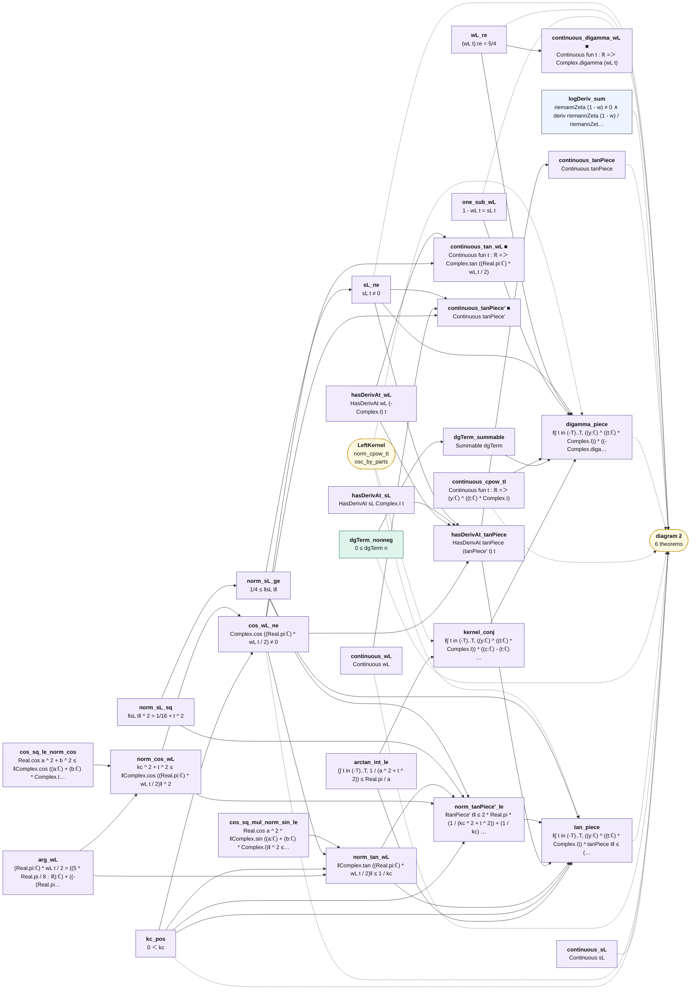
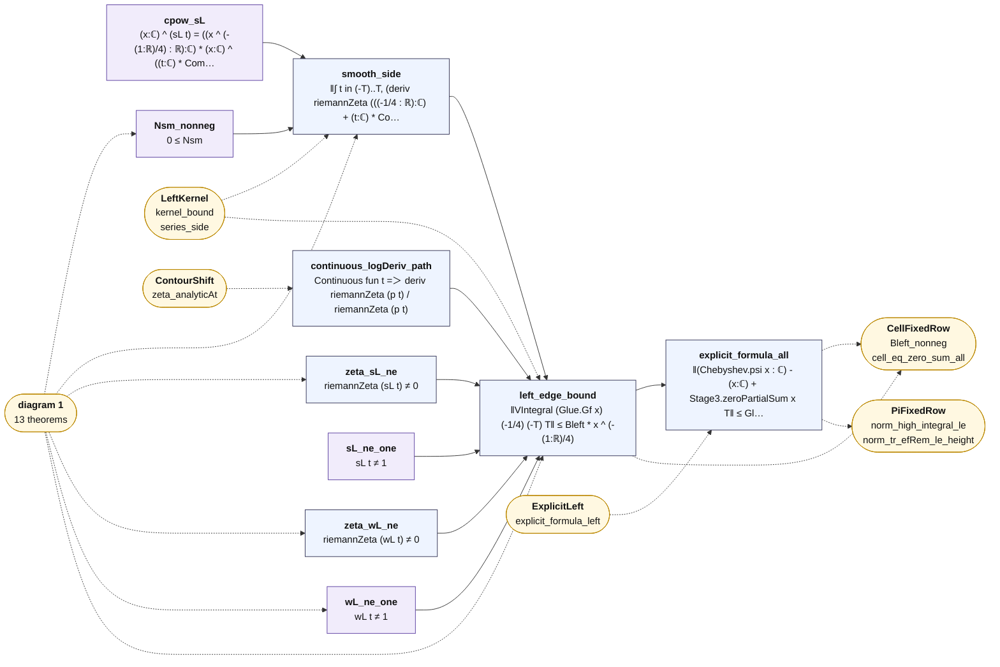

# `lean_stage3/Stage3/LeftSmooth.lean`

> **Read from the source text.** This file changed after the last `python3 utilities/lean_map.py --dump`, so the arrows on this page are names occurring in each proof and have not been confirmed by Lean.

LeftSmooth — blocks F2c, F2 and F3 of `lean_stage3/design/leftedge.md`. 2026-11-23.

40 theorems, 11 definitions, 913 lines. 

**Imports:** [`LeftKernel`](../lean_stage3/LeftKernel.md)  
**Imported by:** [`Stage3`](../lean_stage3/Stage3.md), [`CellFixedRow`](../lean_stage3/CellFixedRow.md)

## The picture

### Diagram 1 of 2: `arctan_int_le` to `continuous_tanPiece`



### Diagram 2 of 2: `cpow_sL` to `explicit_formula_all`



An arrow A → B reads "A is used in the proof of B". Green: counting, integers only. Violet: shape, analysis with no ζ. Blue: reads ζ. A name ending in ■ is an end: nothing else uses it. Red: contains `sorry`. Yellow: theorems in another file, counted; a dotted arrow crosses files. Definitions are not drawn; they are listed below the diagram.

## Definitions

<a name="LeftSmooth-Gs"></a>
### `LeftSmooth.Gs`

def · line 173

The smooth factor of the functional equation, as a function of `w = 1 − s`: `G(w) = log 2π − ψ(w) + (π/2)·tan(πw/2)`, with `ψ` the digamma function.

- **Is:** `` Gs (w : ℂ) : ℂ := Complex.log (2 * (Real.pi:ℂ)) - Complex.digamma w + ((Real.pi:ℂ) / 2) * Complex.tan ((Real.pi:ℂ) * w / 2) ``
- **Used by 2:** [`LeftSmooth.logDeriv_sum`](#LeftSmooth-logDeriv_sum), [`LeftSmooth.smooth_side`](#LeftSmooth-smooth_side)

<a name="LeftSmooth-sL"></a>
### `LeftSmooth.sL`

def · line 260

The point `s = −1/4 + it` of the left line.

- **Is:** `` sL (t : ℝ) : ℂ := ((-1/4 : ℝ):ℂ) + (t:ℂ) * Complex.I ``
- **Used by 16:** [`LeftSmooth.continuous_sL`](#LeftSmooth-continuous_sL), [`LeftSmooth.cpow_sL`](#LeftSmooth-cpow_sL), [`LeftSmooth.digamma_piece`](#LeftSmooth-digamma_piece), [`LeftSmooth.hasDerivAt_sL`](#LeftSmooth-hasDerivAt_sL), [`LeftSmooth.left_edge_bound`](#LeftSmooth-left_edge_bound), [`LeftSmooth.norm_sL_ge`](#LeftSmooth-norm_sL_ge), [`LeftSmooth.norm_sL_sq`](#LeftSmooth-norm_sL_sq), [`LeftSmooth.norm_tanPiece'_le`](#LeftSmooth-norm_tanPiece-_le), [`LeftSmooth.one_sub_wL`](#LeftSmooth-one_sub_wL), [`LeftSmooth.sL_ne`](#LeftSmooth-sL_ne), [`LeftSmooth.sL_ne_one`](#LeftSmooth-sL_ne_one), [`LeftSmooth.smooth_side`](#LeftSmooth-smooth_side), [`LeftSmooth.tanPiece`](#LeftSmooth-tanPiece), [`LeftSmooth.tanPiece'`](#LeftSmooth-tanPiece-), [`LeftSmooth.tan_piece`](#LeftSmooth-tan_piece), [`LeftSmooth.zeta_sL_ne`](#LeftSmooth-zeta_sL_ne)

<a name="LeftSmooth-wL"></a>
### `LeftSmooth.wL`

def · line 263

The reflected point `w = 5/4 − it = 1 − s`.

- **Is:** `` wL (t : ℝ) : ℂ := (5/4 : ℂ) - (t:ℂ) * Complex.I ``
- **Used by 22:** [`LeftSmooth.arg_wL`](#LeftSmooth-arg_wL), [`LeftSmooth.continuous_digamma_wL`](#LeftSmooth-continuous_digamma_wL), [`LeftSmooth.continuous_tanPiece'`](#LeftSmooth-continuous_tanPiece-), [`LeftSmooth.continuous_tan_wL`](#LeftSmooth-continuous_tan_wL), [`LeftSmooth.continuous_wL`](#LeftSmooth-continuous_wL), [`LeftSmooth.cos_wL_ne`](#LeftSmooth-cos_wL_ne), [`LeftSmooth.digamma_piece`](#LeftSmooth-digamma_piece), [`LeftSmooth.hasDerivAt_tanPiece`](#LeftSmooth-hasDerivAt_tanPiece), [`LeftSmooth.hasDerivAt_wL`](#LeftSmooth-hasDerivAt_wL), [`LeftSmooth.left_edge_bound`](#LeftSmooth-left_edge_bound), [`LeftSmooth.norm_cos_wL`](#LeftSmooth-norm_cos_wL), [`LeftSmooth.norm_tanPiece'_le`](#LeftSmooth-norm_tanPiece-_le), [`LeftSmooth.norm_tan_wL`](#LeftSmooth-norm_tan_wL), [`LeftSmooth.one_sub_wL`](#LeftSmooth-one_sub_wL), [`LeftSmooth.smooth_side`](#LeftSmooth-smooth_side), [`LeftSmooth.tanPiece`](#LeftSmooth-tanPiece), [`LeftSmooth.tanPiece'`](#LeftSmooth-tanPiece-), [`LeftSmooth.tan_piece`](#LeftSmooth-tan_piece), [`LeftSmooth.wL_ne_one`](#LeftSmooth-wL_ne_one), [`LeftSmooth.wL_re`](#LeftSmooth-wL_re), [`LeftSmooth.zeta_sL_ne`](#LeftSmooth-zeta_sL_ne), [`LeftSmooth.zeta_wL_ne`](#LeftSmooth-zeta_wL_ne)

<a name="LeftSmooth-kc"></a>
### `LeftSmooth.kc`

def · line 303

The cosine constant `κ = |cos(5π/8)|`.

- **Is:** `` kc : ℝ := |Real.cos (5 * Real.pi / 8)| ``
- **Used by 7:** [`LeftSmooth.Nsm`](#LeftSmooth-Nsm), [`LeftSmooth.kc_pos`](#LeftSmooth-kc_pos), [`LeftSmooth.norm_cos_wL`](#LeftSmooth-norm_cos_wL), [`LeftSmooth.norm_tanPiece'_le`](#LeftSmooth-norm_tanPiece-_le), [`LeftSmooth.norm_tan_wL`](#LeftSmooth-norm_tan_wL), [`LeftSmooth.smooth_side`](#LeftSmooth-smooth_side), [`LeftSmooth.tan_piece`](#LeftSmooth-tan_piece)

<a name="LeftSmooth-tanPiece"></a>
### `LeftSmooth.tanPiece`

def · line 372

The tangent piece `tan(πw/2)/s` along the line.

- **Is:** `` tanPiece (t : ℝ) : ℂ := Complex.tan ((Real.pi:ℂ) * wL t / 2) * (sL t)⁻¹ ``
- **Built from:** [`LeftSmooth.sL`](#LeftSmooth-sL), [`LeftSmooth.wL`](#LeftSmooth-wL)
- **Used by 4:** [`LeftSmooth.continuous_tanPiece`](#LeftSmooth-continuous_tanPiece), [`LeftSmooth.hasDerivAt_tanPiece`](#LeftSmooth-hasDerivAt_tanPiece), [`LeftSmooth.smooth_side`](#LeftSmooth-smooth_side), [`LeftSmooth.tan_piece`](#LeftSmooth-tan_piece)

<a name="LeftSmooth-tanPiece-"></a>
### `LeftSmooth.tanPiece'`

def · line 376

The derivative of the tangent piece.

- **Is:** `` tanPiece' (t : ℝ) : ℂ := (1 / Complex.cos ((Real.pi:ℂ) * wL t / 2) ^ 2 * ((Real.pi:ℂ) * (-Complex.I) / 2)) * (sL t)⁻¹ + Complex.tan ((Real.pi:ℂ) * wL t / 2) * (-Complex.I / (sL t) ^ 2) ``
- **Built from:** [`LeftSmooth.sL`](#LeftSmooth-sL), [`LeftSmooth.wL`](#LeftSmooth-wL)
- **Used by 4:** [`LeftSmooth.continuous_tanPiece'`](#LeftSmooth-continuous_tanPiece-), [`LeftSmooth.hasDerivAt_tanPiece`](#LeftSmooth-hasDerivAt_tanPiece), [`LeftSmooth.norm_tanPiece'_le`](#LeftSmooth-norm_tanPiece-_le), [`LeftSmooth.tan_piece`](#LeftSmooth-tan_piece)

<a name="LeftSmooth-dgTerm"></a>
### `LeftSmooth.dgTerm`

def · line 519

The digamma-series weight `1/((n+1)(n+5/4))`.

- **Is:** `` dgTerm (n : ℕ) : ℝ := 1 / (((n:ℝ) + 1) * ((n:ℝ) + 5/4)) ``
- **Used by 6:** [`LeftSmooth.Nsm`](#LeftSmooth-Nsm), [`LeftSmooth.Nsm_nonneg`](#LeftSmooth-Nsm_nonneg), [`LeftSmooth.dgTerm_nonneg`](#LeftSmooth-dgTerm_nonneg), [`LeftSmooth.dgTerm_summable`](#LeftSmooth-dgTerm_summable), [`LeftSmooth.digamma_piece`](#LeftSmooth-digamma_piece), [`LeftSmooth.smooth_side`](#LeftSmooth-smooth_side)

<a name="LeftSmooth-c0"></a>
### `LeftSmooth.c0`

def · line 672

The constant of the smooth factor's flat part: `log 2π + γ`.

- **Is:** `` c0 : ℂ := Complex.log (2 * (Real.pi:ℂ)) + (Real.eulerMascheroniConstant:ℂ) ``
- **Used by 2:** [`LeftSmooth.Nsm`](#LeftSmooth-Nsm), [`LeftSmooth.smooth_side`](#LeftSmooth-smooth_side)

<a name="LeftSmooth-Nsm"></a>
### `LeftSmooth.Nsm`

def · line 676

The numerator of the smooth-side constant: `‖log 2π + γ‖·(1+4π) + (Σ' 1/((n+1)(n+5/4)))·(2+π) + (π/2)·(8+2π²+4π)/κ`.

- **Is:** `` Nsm : ℝ := ‖c0‖ * (1 + 4 * Real.pi) + (∑' n : ℕ, dgTerm n) * (2 + Real.pi) + Real.pi / 2 * ((8 + 2 * Real.pi ^ 2 + 4 * Real.pi) / kc) ``
- **Built from:** [`LeftSmooth.c0`](#LeftSmooth-c0), [`LeftSmooth.dgTerm`](#LeftSmooth-dgTerm), [`LeftSmooth.kc`](#LeftSmooth-kc)
- **Used by 3:** [`LeftSmooth.Bsm`](#LeftSmooth-Bsm), [`LeftSmooth.Nsm_nonneg`](#LeftSmooth-Nsm_nonneg), [`LeftSmooth.smooth_side`](#LeftSmooth-smooth_side)

<a name="LeftSmooth-Bsm"></a>
### `LeftSmooth.Bsm`

def · line 689

The smooth-side constant `Bsm = Nsm / log 16`, free of `x` and `T`.

- **Is:** `` Bsm : ℝ := Nsm / Real.log 16 ``
- **Built from:** [`LeftSmooth.Nsm`](#LeftSmooth-Nsm)
- **Used by 3:** [`LeftSmooth.Bleft`](#LeftSmooth-Bleft), [`LeftSmooth.left_edge_bound`](#LeftSmooth-left_edge_bound), [`LeftSmooth.smooth_side`](#LeftSmooth-smooth_side)

<a name="LeftSmooth-Bleft"></a>
### `LeftSmooth.Bleft`

def · line 849

The left-edge constant `Bleft = Bsm + Bser`.

- **Is:** `` Bleft : ℝ := Bsm + LeftKernel.Bser ``
- **Built from:** [`LeftKernel.Bser`](../lean_stage3/LeftKernel.md#LeftKernel-Bser), [`LeftSmooth.Bsm`](#LeftSmooth-Bsm)
- **Used by 9:** [`CellFixedRow.Bleft_nonneg`](../lean_stage3/CellFixedRow.md#CellFixedRow-Bleft_nonneg), [`CellFixedRow.cell_eq_zero_sum_all`](../lean_stage3/CellFixedRow.md#CellFixedRow-cell_eq_zero_sum_all), [`CellFixedRow.cell_fixed_row`](../lean_stage3/CellFixedRow.md#CellFixedRow-cell_fixed_row), [`CellFixedRow.cell_zero_sum_finset_all`](../lean_stage3/CellFixedRow.md#CellFixedRow-cell_zero_sum_finset_all), [`LeftSmooth.explicit_formula_all`](#LeftSmooth-explicit_formula_all), [`LeftSmooth.left_edge_bound`](#LeftSmooth-left_edge_bound), [`PiFixedRow.Api`](../lean_stage3/PiFixedRow.md#PiFixedRow-Api), [`PiFixedRow.norm_high_integral_le`](../lean_stage3/PiFixedRow.md#PiFixedRow-norm_high_integral_le), [`PiFixedRow.norm_tr_efRem_le_height`](../lean_stage3/PiFixedRow.md#PiFixedRow-norm_tr_efRem_le_height)

## Theorems

<a name="LeftSmooth-arctan_int_le"></a>
### `LeftSmooth.arctan_int_le`

line 35 · arrows read from text

**Shape.** Uses real or complex analysis; nothing in it or beneath it reads ζ.

**Why.** The arctan integral: for `a > 0`, `∫_{−T}^{T} dt/(a²+t²) ≤ π/a`.

**Proves**

```lean
(∫ t in (-T)..T, 1 / (a ^ 2 + t ^ 2)) ≤ Real.pi / a
```

**Needs** (its hypotheses)

  - `` ha : 0 < a ``

**Fed by:** no theorem of this repo; it stands on Mathlib.

**Feeds** (2 that use it)

  - [`LeftSmooth.kernel_conj`](#LeftSmooth-kernel_conj) — `` ‖∫ t in (-T)..T, ((y:ℂ) ^ ((t:ℂ) * Complex.I)) * ((c:ℂ) - (t:ℂ) * Complex.I)⁻¹‖ ≤ (2 + Real.pi) / (c * Real.log y) ``
  - [`LeftSmooth.tan_piece`](#LeftSmooth-tan_piece) — `` ‖∫ t in (-T)..T, ((y:ℂ) ^ ((t:ℂ) * Complex.I)) * tanPiece t‖ ≤ (8 + 2 * Real.pi ^ 2 + 4 * Real.pi) / (kc * Real.log y) ``

<a name="LeftSmooth-kernel_conj"></a>
### `LeftSmooth.kernel_conj`

line 62 · arrows read from text

**Shape.** Uses real or complex analysis; nothing in it or beneath it reads ζ.

**Why.** The conjugate kernel. For `y > 1`, `T ≥ 0`, `c > 0`: `‖∫_{−T}^{T} y^(it)/(c − it) dt‖ ≤ (2 + π)/(c·log y)`; the endpoint terms are bounded by `1/c`, so the bound does not see `T`.

**Proves**

```lean
‖∫ t in (-T)..T, ((y:ℂ) ^ ((t:ℂ) * Complex.I)) * ((c:ℂ) - (t:ℂ) * Complex.I)⁻¹‖ ≤ (2 + Real.pi) / (c * Real.log y)
```

**Needs** (its hypotheses)

  - `` hy : 1 < y ``
  - `` hT : 0 ≤ T ``
  - `` hc : 0 < c ``

**Fed by** (2 theorems its proof uses)

  - [`LeftKernel.osc_by_parts`](../lean_stage3/LeftKernel.md#LeftKernel-osc_by_parts) (LeftKernel) — `` ‖∫ t in a..b, ((y:ℂ) ^ ((t:ℂ) * Complex.I)) * h t‖ ≤ (‖h a‖ + ‖h b‖ + ∫ t in a..b, ‖h' t‖) / Real.log y ``
  - [`LeftSmooth.arctan_int_le`](#LeftSmooth-arctan_int_le) — `` (∫ t in (-T)..T, 1 / (a ^ 2 + t ^ 2)) ≤ Real.pi / a ``

**Feeds** (1 that use it)

  - [`LeftSmooth.digamma_piece`](#LeftSmooth-digamma_piece) — `` ‖∫ t in (-T)..T, ((y:ℂ) ^ ((t:ℂ) * Complex.I)) * ((-Complex.digamma (wL t) - (Real.eulerMascheroniConstant:ℂ)) * (sL t)⁻¹)‖ ≤ (∑' n : ℕ, dgTerm n) * (… ``

<a name="LeftSmooth-cos_sq_le_norm_cos"></a>
### `LeftSmooth.cos_sq_le_norm_cos`

line 116 · arrows read from text

**Shape.** Uses real or complex analysis; nothing in it or beneath it reads ζ.

**Why.** The squared norm of `cos(a + ib)` is at least `cos²a + b²` (it equals `cos²a + sinh²b`).

**Proves**

```lean
Real.cos a ^ 2 + b ^ 2 ≤ ‖Complex.cos ((a:ℂ) + (b:ℂ) * Complex.I)‖ ^ 2
```

**Needs** (its hypotheses)

  - `` a b : ℝ ``

**Fed by:** no theorem of this repo; it stands on Mathlib.

**Feeds** (1 that use it)

  - [`LeftSmooth.norm_cos_wL`](#LeftSmooth-norm_cos_wL) — `` kc ^ 2 + t ^ 2 ≤ ‖Complex.cos ((Real.pi:ℂ) * wL t / 2)‖ ^ 2 ``

<a name="LeftSmooth-cos_sq_mul_norm_sin_le"></a>
### `LeftSmooth.cos_sq_mul_norm_sin_le`

line 137 · arrows read from text

**Shape.** Uses real or complex analysis; nothing in it or beneath it reads ζ.

**Why.** `cos²a·‖sin(a + ib)‖² ≤ ‖cos(a + ib)‖²`; so `‖tan(a+ib)‖ ≤ 1/|cos a|`.

**Proves**

```lean
Real.cos a ^ 2 * ‖Complex.sin ((a:ℂ) + (b:ℂ) * Complex.I)‖ ^ 2 ≤ ‖Complex.cos ((a:ℂ) + (b:ℂ) * Complex.I)‖ ^ 2
```

**Needs** (its hypotheses)

  - `` a b : ℝ ``

**Fed by:** no theorem of this repo; it stands on Mathlib.

**Feeds** (1 that use it)

  - [`LeftSmooth.norm_tan_wL`](#LeftSmooth-norm_tan_wL) — `` ‖Complex.tan ((Real.pi:ℂ) * wL t / 2)‖ ≤ 1 / kc ``

<a name="LeftSmooth-logDeriv_sum"></a>
### `LeftSmooth.logDeriv_sum`

line 179 · arrows read from text

**Reads ζ.** It, or something it rests on, uses the zeta function, its zeros or the Riemann hypothesis.

**Why.** The logarithmic derivative of the functional equation. For `Re w > 1` with `cos(πw/2) ≠ 0`: `ζ(1−w) ≠ 0` and `ζ′/ζ(1−w) + ζ′/ζ(w) = G(w)`.

**Proves**

```lean
riemannZeta (1 - w) ≠ 0 ∧ deriv riemannZeta (1 - w) / riemannZeta (1 - w) + deriv riemannZeta w / riemannZeta w = Gs w
```

**Needs** (its hypotheses)

  - `` hw : 1 < w.re ``
  - `` hcos : Complex.cos ((Real.pi:ℂ) * w / 2) ≠ 0 ``

**Fed by:** no theorem of this repo; it stands on Mathlib and the definitions below.

**Definitions its proof touches:** [`LeftSmooth.Gs`](#LeftSmooth-Gs)

**Feeds** (2 that use it)

  - [`LeftSmooth.smooth_side`](#LeftSmooth-smooth_side) — `` ‖∫ t in (-T)..T, (deriv riemannZeta (((-1/4 : ℝ):ℂ) + (t:ℂ) * Complex.I) / riemannZeta (((-1/4 : ℝ):ℂ) + (t:ℂ) * Complex.I) + deriv riemannZeta ((5/4:… ``
  - [`LeftSmooth.zeta_sL_ne`](#LeftSmooth-zeta_sL_ne) — `` riemannZeta (sL t) ≠ 0 ``

<a name="LeftSmooth-one_sub_wL"></a>
### `LeftSmooth.one_sub_wL`

line 266 · arrows read from text

**Shape.** Uses real or complex analysis; nothing in it or beneath it reads ζ.

**Why.** `1 − w = s` on the line.

**Proves**

```lean
1 - wL t = sL t
```

**Needs** (its hypotheses)

  - `` t : ℝ ``

**Fed by:** no theorem of this repo; it stands on Mathlib and the definitions below.

**Definitions its proof touches:** [`LeftSmooth.sL`](#LeftSmooth-sL), [`LeftSmooth.wL`](#LeftSmooth-wL)

**Feeds** (3 that use it)

  - [`LeftSmooth.digamma_piece`](#LeftSmooth-digamma_piece) — `` ‖∫ t in (-T)..T, ((y:ℂ) ^ ((t:ℂ) * Complex.I)) * ((-Complex.digamma (wL t) - (Real.eulerMascheroniConstant:ℂ)) * (sL t)⁻¹)‖ ≤ (∑' n : ℕ, dgTerm n) * (… ``
  - [`LeftSmooth.smooth_side`](#LeftSmooth-smooth_side) — `` ‖∫ t in (-T)..T, (deriv riemannZeta (((-1/4 : ℝ):ℂ) + (t:ℂ) * Complex.I) / riemannZeta (((-1/4 : ℝ):ℂ) + (t:ℂ) * Complex.I) + deriv riemannZeta ((5/4:… ``
  - [`LeftSmooth.zeta_sL_ne`](#LeftSmooth-zeta_sL_ne) — `` riemannZeta (sL t) ≠ 0 ``

<a name="LeftSmooth-wL_re"></a>
### `LeftSmooth.wL_re`

line 272 · arrows read from text

**Shape.** Uses real or complex analysis; nothing in it or beneath it reads ζ.

**Why.** `Re w = 5/4`.

**Proves**

```lean
(wL t).re = 5/4
```

**Needs** (its hypotheses)

  - `` t : ℝ ``

**Fed by:** no theorem of this repo; it stands on Mathlib and the definitions below.

**Definitions its proof touches:** [`LeftSmooth.wL`](#LeftSmooth-wL)

**Feeds** (6 that use it)

  - [`LeftSmooth.continuous_digamma_wL`](#LeftSmooth-continuous_digamma_wL) — `` Continuous fun t : ℝ => Complex.digamma (wL t) ``
  - [`LeftSmooth.digamma_piece`](#LeftSmooth-digamma_piece) — `` ‖∫ t in (-T)..T, ((y:ℂ) ^ ((t:ℂ) * Complex.I)) * ((-Complex.digamma (wL t) - (Real.eulerMascheroniConstant:ℂ)) * (sL t)⁻¹)‖ ≤ (∑' n : ℕ, dgTerm n) * (… ``
  - [`LeftSmooth.smooth_side`](#LeftSmooth-smooth_side) — `` ‖∫ t in (-T)..T, (deriv riemannZeta (((-1/4 : ℝ):ℂ) + (t:ℂ) * Complex.I) / riemannZeta (((-1/4 : ℝ):ℂ) + (t:ℂ) * Complex.I) + deriv riemannZeta ((5/4:… ``
  - [`LeftSmooth.wL_ne_one`](#LeftSmooth-wL_ne_one) — `` wL t ≠ 1 ``
  - [`LeftSmooth.zeta_sL_ne`](#LeftSmooth-zeta_sL_ne) — `` riemannZeta (sL t) ≠ 0 ``
  - [`LeftSmooth.zeta_wL_ne`](#LeftSmooth-zeta_wL_ne) — `` riemannZeta (wL t) ≠ 0 ``

<a name="LeftSmooth-norm_sL_sq"></a>
### `LeftSmooth.norm_sL_sq`

line 277 · arrows read from text

**Shape.** Uses real or complex analysis; nothing in it or beneath it reads ζ.

**Why.** `‖s‖² = 1/16 + t²` on the line.

**Proves**

```lean
‖sL t‖ ^ 2 = 1/16 + t ^ 2
```

**Needs** (its hypotheses)

  - `` t : ℝ ``

**Fed by:** no theorem of this repo; it stands on Mathlib and the definitions below.

**Definitions its proof touches:** [`LeftSmooth.sL`](#LeftSmooth-sL)

**Feeds** (2 that use it)

  - [`LeftSmooth.norm_sL_ge`](#LeftSmooth-norm_sL_ge) — `` 1/4 ≤ ‖sL t‖ ``
  - [`LeftSmooth.norm_tanPiece'_le`](#LeftSmooth-norm_tanPiece-_le) — `` ‖tanPiece' t‖ ≤ 2 * Real.pi * (1 / (kc ^ 2 + t ^ 2)) + (1 / kc) * (1 / ((1/4:ℝ) ^ 2 + t ^ 2)) ``

<a name="LeftSmooth-norm_sL_ge"></a>
### `LeftSmooth.norm_sL_ge`

line 283 · arrows read from text

**Shape.** Uses real or complex analysis; nothing in it or beneath it reads ζ.

**Why.** `‖s‖ ≥ 1/4` on the line.

**Proves**

```lean
1/4 ≤ ‖sL t‖
```

**Needs** (its hypotheses)

  - `` t : ℝ ``

**Fed by** (1 theorem its proof uses)

  - [`LeftSmooth.norm_sL_sq`](#LeftSmooth-norm_sL_sq) — `` ‖sL t‖ ^ 2 = 1/16 + t ^ 2 ``

**Definitions its proof touches:** [`LeftSmooth.sL`](#LeftSmooth-sL)

**Feeds** (3 that use it)

  - [`LeftSmooth.norm_tanPiece'_le`](#LeftSmooth-norm_tanPiece-_le) — `` ‖tanPiece' t‖ ≤ 2 * Real.pi * (1 / (kc ^ 2 + t ^ 2)) + (1 / kc) * (1 / ((1/4:ℝ) ^ 2 + t ^ 2)) ``
  - [`LeftSmooth.sL_ne`](#LeftSmooth-sL_ne) — `` sL t ≠ 0 ``
  - [`LeftSmooth.tan_piece`](#LeftSmooth-tan_piece) — `` ‖∫ t in (-T)..T, ((y:ℂ) ^ ((t:ℂ) * Complex.I)) * tanPiece t‖ ≤ (8 + 2 * Real.pi ^ 2 + 4 * Real.pi) / (kc * Real.log y) ``

<a name="LeftSmooth-sL_ne"></a>
### `LeftSmooth.sL_ne`

line 289 · arrows read from text

**Shape.** Uses real or complex analysis; nothing in it or beneath it reads ζ.

**Why.** `s ≠ 0` on the line.

**Proves**

```lean
sL t ≠ 0
```

**Needs** (its hypotheses)

  - `` t : ℝ ``

**Fed by** (1 theorem its proof uses)

  - [`LeftSmooth.norm_sL_ge`](#LeftSmooth-norm_sL_ge) — `` 1/4 ≤ ‖sL t‖ ``

**Definitions its proof touches:** [`LeftSmooth.sL`](#LeftSmooth-sL)

**Feeds** (5 that use it)

  - [`LeftSmooth.continuous_tanPiece'`](#LeftSmooth-continuous_tanPiece-) — `` Continuous tanPiece' ``
  - [`LeftSmooth.digamma_piece`](#LeftSmooth-digamma_piece) — `` ‖∫ t in (-T)..T, ((y:ℂ) ^ ((t:ℂ) * Complex.I)) * ((-Complex.digamma (wL t) - (Real.eulerMascheroniConstant:ℂ)) * (sL t)⁻¹)‖ ≤ (∑' n : ℕ, dgTerm n) * (… ``
  - [`LeftSmooth.hasDerivAt_tanPiece`](#LeftSmooth-hasDerivAt_tanPiece) — `` HasDerivAt tanPiece (tanPiece' t) t ``
  - [`LeftSmooth.left_edge_bound`](#LeftSmooth-left_edge_bound) — `` ‖VIntegral (Glue.Gf x) (-1/4) (-T) T‖ ≤ Bleft * x ^ (-(1:ℝ)/4) ``
  - [`LeftSmooth.smooth_side`](#LeftSmooth-smooth_side) — `` ‖∫ t in (-T)..T, (deriv riemannZeta (((-1/4 : ℝ):ℂ) + (t:ℂ) * Complex.I) / riemannZeta (((-1/4 : ℝ):ℂ) + (t:ℂ) * Complex.I) + deriv riemannZeta ((5/4:… ``

<a name="LeftSmooth-arg_wL"></a>
### `LeftSmooth.arg_wL`

line 296 · arrows read from text

**Shape.** Uses real or complex analysis; nothing in it or beneath it reads ζ.

**Why.** The tangent's argument on the line: `πw/2 = 5π/8 − i·πt/2`.

**Proves**

```lean
(Real.pi:ℂ) * wL t / 2 = ((5 * Real.pi / 8 : ℝ):ℂ) + ((-(Real.pi * t / 2)) : ℝ) * Complex.I
```

**Needs** (its hypotheses)

  - `` t : ℝ ``

**Fed by:** no theorem of this repo; it stands on Mathlib and the definitions below.

**Definitions its proof touches:** [`LeftSmooth.wL`](#LeftSmooth-wL)

**Feeds** (2 that use it)

  - [`LeftSmooth.norm_cos_wL`](#LeftSmooth-norm_cos_wL) — `` kc ^ 2 + t ^ 2 ≤ ‖Complex.cos ((Real.pi:ℂ) * wL t / 2)‖ ^ 2 ``
  - [`LeftSmooth.norm_tan_wL`](#LeftSmooth-norm_tan_wL) — `` ‖Complex.tan ((Real.pi:ℂ) * wL t / 2)‖ ≤ 1 / kc ``

<a name="LeftSmooth-kc_pos"></a>
### `LeftSmooth.kc_pos`

line 306 · arrows read from text

**Shape.** Uses real or complex analysis; nothing in it or beneath it reads ζ.

**Why.** `κ > 0`: `cos(5π/8) < 0`.

**Proves**

```lean
0 < kc
```

**Fed by:** no theorem of this repo; it stands on Mathlib and the definitions below.

**Definitions its proof touches:** [`LeftSmooth.kc`](#LeftSmooth-kc)

**Feeds** (6 that use it)

  - [`LeftSmooth.Nsm_nonneg`](#LeftSmooth-Nsm_nonneg) — `` 0 ≤ Nsm ``
  - [`LeftSmooth.cos_wL_ne`](#LeftSmooth-cos_wL_ne) — `` Complex.cos ((Real.pi:ℂ) * wL t / 2) ≠ 0 ``
  - [`LeftSmooth.norm_tanPiece'_le`](#LeftSmooth-norm_tanPiece-_le) — `` ‖tanPiece' t‖ ≤ 2 * Real.pi * (1 / (kc ^ 2 + t ^ 2)) + (1 / kc) * (1 / ((1/4:ℝ) ^ 2 + t ^ 2)) ``
  - [`LeftSmooth.norm_tan_wL`](#LeftSmooth-norm_tan_wL) — `` ‖Complex.tan ((Real.pi:ℂ) * wL t / 2)‖ ≤ 1 / kc ``
  - [`LeftSmooth.smooth_side`](#LeftSmooth-smooth_side) — `` ‖∫ t in (-T)..T, (deriv riemannZeta (((-1/4 : ℝ):ℂ) + (t:ℂ) * Complex.I) / riemannZeta (((-1/4 : ℝ):ℂ) + (t:ℂ) * Complex.I) + deriv riemannZeta ((5/4:… ``
  - [`LeftSmooth.tan_piece`](#LeftSmooth-tan_piece) — `` ‖∫ t in (-T)..T, ((y:ℂ) ^ ((t:ℂ) * Complex.I)) * tanPiece t‖ ≤ (8 + 2 * Real.pi ^ 2 + 4 * Real.pi) / (kc * Real.log y) ``

<a name="LeftSmooth-norm_cos_wL"></a>
### `LeftSmooth.norm_cos_wL`

line 314 · arrows read from text

**Shape.** Uses real or complex analysis; nothing in it or beneath it reads ζ.

**Why.** `‖cos(πw/2)‖² ≥ κ² + t²` on the line.

**Proves**

```lean
kc ^ 2 + t ^ 2 ≤ ‖Complex.cos ((Real.pi:ℂ) * wL t / 2)‖ ^ 2
```

**Needs** (its hypotheses)

  - `` t : ℝ ``

**Fed by** (2 theorems its proof uses)

  - [`LeftSmooth.arg_wL`](#LeftSmooth-arg_wL) — `` (Real.pi:ℂ) * wL t / 2 = ((5 * Real.pi / 8 : ℝ):ℂ) + ((-(Real.pi * t / 2)) : ℝ) * Complex.I ``
  - [`LeftSmooth.cos_sq_le_norm_cos`](#LeftSmooth-cos_sq_le_norm_cos) — `` Real.cos a ^ 2 + b ^ 2 ≤ ‖Complex.cos ((a:ℂ) + (b:ℂ) * Complex.I)‖ ^ 2 ``

**Definitions its proof touches:** [`LeftSmooth.kc`](#LeftSmooth-kc), [`LeftSmooth.wL`](#LeftSmooth-wL)

**Feeds** (2 that use it)

  - [`LeftSmooth.cos_wL_ne`](#LeftSmooth-cos_wL_ne) — `` Complex.cos ((Real.pi:ℂ) * wL t / 2) ≠ 0 ``
  - [`LeftSmooth.norm_tanPiece'_le`](#LeftSmooth-norm_tanPiece-_le) — `` ‖tanPiece' t‖ ≤ 2 * Real.pi * (1 / (kc ^ 2 + t ^ 2)) + (1 / kc) * (1 / ((1/4:ℝ) ^ 2 + t ^ 2)) ``

<a name="LeftSmooth-cos_wL_ne"></a>
### `LeftSmooth.cos_wL_ne`

line 328 · arrows read from text

**Shape.** Uses real or complex analysis; nothing in it or beneath it reads ζ.

**Why.** `cos(πw/2) ≠ 0` on the line.

**Proves**

```lean
Complex.cos ((Real.pi:ℂ) * wL t / 2) ≠ 0
```

**Needs** (its hypotheses)

  - `` t : ℝ ``

**Fed by** (2 theorems its proof uses)

  - [`LeftSmooth.kc_pos`](#LeftSmooth-kc_pos) — `` 0 < kc ``
  - [`LeftSmooth.norm_cos_wL`](#LeftSmooth-norm_cos_wL) — `` kc ^ 2 + t ^ 2 ≤ ‖Complex.cos ((Real.pi:ℂ) * wL t / 2)‖ ^ 2 ``

**Definitions its proof touches:** [`LeftSmooth.wL`](#LeftSmooth-wL)

**Feeds** (6 that use it)

  - [`LeftSmooth.continuous_tanPiece'`](#LeftSmooth-continuous_tanPiece-) — `` Continuous tanPiece' ``
  - [`LeftSmooth.continuous_tan_wL`](#LeftSmooth-continuous_tan_wL) — `` Continuous fun t : ℝ => Complex.tan ((Real.pi:ℂ) * wL t / 2) ``
  - [`LeftSmooth.hasDerivAt_tanPiece`](#LeftSmooth-hasDerivAt_tanPiece) — `` HasDerivAt tanPiece (tanPiece' t) t ``
  - [`LeftSmooth.norm_tan_wL`](#LeftSmooth-norm_tan_wL) — `` ‖Complex.tan ((Real.pi:ℂ) * wL t / 2)‖ ≤ 1 / kc ``
  - [`LeftSmooth.smooth_side`](#LeftSmooth-smooth_side) — `` ‖∫ t in (-T)..T, (deriv riemannZeta (((-1/4 : ℝ):ℂ) + (t:ℂ) * Complex.I) / riemannZeta (((-1/4 : ℝ):ℂ) + (t:ℂ) * Complex.I) + deriv riemannZeta ((5/4:… ``
  - [`LeftSmooth.zeta_sL_ne`](#LeftSmooth-zeta_sL_ne) — `` riemannZeta (sL t) ≠ 0 ``

<a name="LeftSmooth-norm_tan_wL"></a>
### `LeftSmooth.norm_tan_wL`

line 336 · arrows read from text

**Shape.** Uses real or complex analysis; nothing in it or beneath it reads ζ.

**Why.** `‖tan(πw/2)‖ ≤ 1/κ` on the line.

**Proves**

```lean
‖Complex.tan ((Real.pi:ℂ) * wL t / 2)‖ ≤ 1 / kc
```

**Needs** (its hypotheses)

  - `` t : ℝ ``

**Fed by** (4 theorems its proof uses)

  - [`LeftSmooth.arg_wL`](#LeftSmooth-arg_wL) — `` (Real.pi:ℂ) * wL t / 2 = ((5 * Real.pi / 8 : ℝ):ℂ) + ((-(Real.pi * t / 2)) : ℝ) * Complex.I ``
  - [`LeftSmooth.cos_sq_mul_norm_sin_le`](#LeftSmooth-cos_sq_mul_norm_sin_le) — `` Real.cos a ^ 2 * ‖Complex.sin ((a:ℂ) + (b:ℂ) * Complex.I)‖ ^ 2 ≤ ‖Complex.cos ((a:ℂ) + (b:ℂ) * Complex.I)‖ ^ 2 ``
  - [`LeftSmooth.cos_wL_ne`](#LeftSmooth-cos_wL_ne) — `` Complex.cos ((Real.pi:ℂ) * wL t / 2) ≠ 0 ``
  - [`LeftSmooth.kc_pos`](#LeftSmooth-kc_pos) — `` 0 < kc ``

**Definitions its proof touches:** [`LeftSmooth.kc`](#LeftSmooth-kc), [`LeftSmooth.wL`](#LeftSmooth-wL)

**Feeds** (2 that use it)

  - [`LeftSmooth.norm_tanPiece'_le`](#LeftSmooth-norm_tanPiece-_le) — `` ‖tanPiece' t‖ ≤ 2 * Real.pi * (1 / (kc ^ 2 + t ^ 2)) + (1 / kc) * (1 / ((1/4:ℝ) ^ 2 + t ^ 2)) ``
  - [`LeftSmooth.tan_piece`](#LeftSmooth-tan_piece) — `` ‖∫ t in (-T)..T, ((y:ℂ) ^ ((t:ℂ) * Complex.I)) * tanPiece t‖ ≤ (8 + 2 * Real.pi ^ 2 + 4 * Real.pi) / (kc * Real.log y) ``

<a name="LeftSmooth-hasDerivAt_wL"></a>
### `LeftSmooth.hasDerivAt_wL`

line 350 · arrows read from text

**Shape.** Uses real or complex analysis; nothing in it or beneath it reads ζ.

**Why.** `t ↦ w(t)` has derivative `−i`.

**Proves**

```lean
HasDerivAt wL (-Complex.I) t
```

**Needs** (its hypotheses)

  - `` t : ℝ ``

**Fed by:** no theorem of this repo; it stands on Mathlib and the definitions below.

**Definitions its proof touches:** [`LeftSmooth.wL`](#LeftSmooth-wL)

**Feeds** (2 that use it)

  - [`LeftSmooth.continuous_tan_wL`](#LeftSmooth-continuous_tan_wL) — `` Continuous fun t : ℝ => Complex.tan ((Real.pi:ℂ) * wL t / 2) ``
  - [`LeftSmooth.hasDerivAt_tanPiece`](#LeftSmooth-hasDerivAt_tanPiece) — `` HasDerivAt tanPiece (tanPiece' t) t ``

<a name="LeftSmooth-hasDerivAt_sL"></a>
### `LeftSmooth.hasDerivAt_sL`

line 356 · arrows read from text

**Shape.** Uses real or complex analysis; nothing in it or beneath it reads ζ.

**Why.** `t ↦ s(t)` has derivative `i`.

**Proves**

```lean
HasDerivAt sL Complex.I t
```

**Needs** (its hypotheses)

  - `` t : ℝ ``

**Fed by:** no theorem of this repo; it stands on Mathlib and the definitions below.

**Definitions its proof touches:** [`LeftSmooth.sL`](#LeftSmooth-sL)

**Feeds** (1 that use it)

  - [`LeftSmooth.hasDerivAt_tanPiece`](#LeftSmooth-hasDerivAt_tanPiece) — `` HasDerivAt tanPiece (tanPiece' t) t ``

<a name="LeftSmooth-continuous_sL"></a>
### `LeftSmooth.continuous_sL`

line 362 · arrows read from text

**Shape.** Uses real or complex analysis; nothing in it or beneath it reads ζ.

**Why.** `t ↦ s(t)` is continuous.

**Proves**

```lean
Continuous sL
```

**Fed by:** no theorem of this repo; it stands on Mathlib and the definitions below.

**Definitions its proof touches:** [`LeftSmooth.sL`](#LeftSmooth-sL)

**Feeds** (1 that use it)

  - [`LeftSmooth.left_edge_bound`](#LeftSmooth-left_edge_bound) — `` ‖VIntegral (Glue.Gf x) (-1/4) (-T) T‖ ≤ Bleft * x ^ (-(1:ℝ)/4) ``

<a name="LeftSmooth-continuous_wL"></a>
### `LeftSmooth.continuous_wL`

line 367 · arrows read from text

**Shape.** Uses real or complex analysis; nothing in it or beneath it reads ζ.

**Why.** `t ↦ w(t)` is continuous.

**Proves**

```lean
Continuous wL
```

**Fed by:** no theorem of this repo; it stands on Mathlib and the definitions below.

**Definitions its proof touches:** [`LeftSmooth.wL`](#LeftSmooth-wL)

**Feeds** (2 that use it)

  - [`LeftSmooth.continuous_tanPiece'`](#LeftSmooth-continuous_tanPiece-) — `` Continuous tanPiece' ``
  - [`LeftSmooth.left_edge_bound`](#LeftSmooth-left_edge_bound) — `` ‖VIntegral (Glue.Gf x) (-1/4) (-T) T‖ ≤ Bleft * x ^ (-(1:ℝ)/4) ``

<a name="LeftSmooth-hasDerivAt_tanPiece"></a>
### `LeftSmooth.hasDerivAt_tanPiece`

line 381 · arrows read from text

**Shape.** Uses real or complex analysis; nothing in it or beneath it reads ζ.

**Why.** The tangent piece has derivative `tanPiece'`.

**Proves**

```lean
HasDerivAt tanPiece (tanPiece' t) t
```

**Needs** (its hypotheses)

  - `` t : ℝ ``

**Fed by** (4 theorems its proof uses)

  - [`LeftSmooth.cos_wL_ne`](#LeftSmooth-cos_wL_ne) — `` Complex.cos ((Real.pi:ℂ) * wL t / 2) ≠ 0 ``
  - [`LeftSmooth.hasDerivAt_sL`](#LeftSmooth-hasDerivAt_sL) — `` HasDerivAt sL Complex.I t ``
  - [`LeftSmooth.hasDerivAt_wL`](#LeftSmooth-hasDerivAt_wL) — `` HasDerivAt wL (-Complex.I) t ``
  - [`LeftSmooth.sL_ne`](#LeftSmooth-sL_ne) — `` sL t ≠ 0 ``

**Definitions its proof touches:** [`LeftSmooth.tanPiece`](#LeftSmooth-tanPiece), [`LeftSmooth.tanPiece'`](#LeftSmooth-tanPiece-), [`LeftSmooth.wL`](#LeftSmooth-wL)

**Feeds** (2 that use it)

  - [`LeftSmooth.continuous_tanPiece`](#LeftSmooth-continuous_tanPiece) — `` Continuous tanPiece ``
  - [`LeftSmooth.tan_piece`](#LeftSmooth-tan_piece) — `` ‖∫ t in (-T)..T, ((y:ℂ) ^ ((t:ℂ) * Complex.I)) * tanPiece t‖ ≤ (8 + 2 * Real.pi ^ 2 + 4 * Real.pi) / (kc * Real.log y) ``

<a name="LeftSmooth-continuous_tan_wL"></a>
### `LeftSmooth.continuous_tan_wL`

line 390 · arrows read from text

**Shape.** Uses real or complex analysis; nothing in it or beneath it reads ζ.

**Why.** The tangent along the line is continuous.

**Proves**

```lean
Continuous fun t : ℝ => Complex.tan ((Real.pi:ℂ) * wL t / 2)
```

**Fed by** (2 theorems its proof uses)

  - [`LeftSmooth.cos_wL_ne`](#LeftSmooth-cos_wL_ne) — `` Complex.cos ((Real.pi:ℂ) * wL t / 2) ≠ 0 ``
  - [`LeftSmooth.hasDerivAt_wL`](#LeftSmooth-hasDerivAt_wL) — `` HasDerivAt wL (-Complex.I) t ``

**Definitions its proof touches:** [`LeftSmooth.wL`](#LeftSmooth-wL)

**Feeds:** nothing. It is an end.

<a name="LeftSmooth-continuous_tanPiece-"></a>
### `LeftSmooth.continuous_tanPiece'`

line 399 · arrows read from text

**Shape.** Uses real or complex analysis; nothing in it or beneath it reads ζ.

**Why.** The derivative of the tangent piece is continuous.

**Proves**

```lean
Continuous tanPiece'
```

**Fed by** (3 theorems its proof uses)

  - [`LeftSmooth.continuous_wL`](#LeftSmooth-continuous_wL) — `` Continuous wL ``
  - [`LeftSmooth.cos_wL_ne`](#LeftSmooth-cos_wL_ne) — `` Complex.cos ((Real.pi:ℂ) * wL t / 2) ≠ 0 ``
  - [`LeftSmooth.sL_ne`](#LeftSmooth-sL_ne) — `` sL t ≠ 0 ``

**Definitions its proof touches:** [`LeftSmooth.tanPiece'`](#LeftSmooth-tanPiece-), [`LeftSmooth.wL`](#LeftSmooth-wL)

**Feeds:** nothing. It is an end.

<a name="LeftSmooth-norm_tanPiece-_le"></a>
### `LeftSmooth.norm_tanPiece'_le`

line 413 · arrows read from text

**Shape.** Uses real or complex analysis; nothing in it or beneath it reads ζ.

**Why.** The pointwise bound on the derivative of the tangent piece: `‖h′(t)‖ ≤ 2π/(κ²+t²) + (1/κ)/((1/4)²+t²)`.

**Proves**

```lean
‖tanPiece' t‖ ≤ 2 * Real.pi * (1 / (kc ^ 2 + t ^ 2)) + (1 / kc) * (1 / ((1/4:ℝ) ^ 2 + t ^ 2))
```

**Needs** (its hypotheses)

  - `` t : ℝ ``

**Fed by** (5 theorems its proof uses)

  - [`LeftSmooth.kc_pos`](#LeftSmooth-kc_pos) — `` 0 < kc ``
  - [`LeftSmooth.norm_cos_wL`](#LeftSmooth-norm_cos_wL) — `` kc ^ 2 + t ^ 2 ≤ ‖Complex.cos ((Real.pi:ℂ) * wL t / 2)‖ ^ 2 ``
  - [`LeftSmooth.norm_sL_ge`](#LeftSmooth-norm_sL_ge) — `` 1/4 ≤ ‖sL t‖ ``
  - [`LeftSmooth.norm_sL_sq`](#LeftSmooth-norm_sL_sq) — `` ‖sL t‖ ^ 2 = 1/16 + t ^ 2 ``
  - [`LeftSmooth.norm_tan_wL`](#LeftSmooth-norm_tan_wL) — `` ‖Complex.tan ((Real.pi:ℂ) * wL t / 2)‖ ≤ 1 / kc ``

**Definitions its proof touches:** [`LeftSmooth.kc`](#LeftSmooth-kc), [`LeftSmooth.sL`](#LeftSmooth-sL), [`LeftSmooth.tanPiece'`](#LeftSmooth-tanPiece-), [`LeftSmooth.wL`](#LeftSmooth-wL)

**Feeds** (1 that use it)

  - [`LeftSmooth.tan_piece`](#LeftSmooth-tan_piece) — `` ‖∫ t in (-T)..T, ((y:ℂ) ^ ((t:ℂ) * Complex.I)) * tanPiece t‖ ≤ (8 + 2 * Real.pi ^ 2 + 4 * Real.pi) / (kc * Real.log y) ``

<a name="LeftSmooth-tan_piece"></a>
### `LeftSmooth.tan_piece`

line 451 · arrows read from text

**Shape.** Uses real or complex analysis; nothing in it or beneath it reads ζ.

**Why.** The tangent piece by parts. For `y > 1` and `T ≥ 0`: `‖∫_{−T}^{T} y^(it)·tan(πw/2)/s dt‖ ≤ (8 + 2π² + 4π)/(κ·log y)`.

**Proves**

```lean
‖∫ t in (-T)..T, ((y:ℂ) ^ ((t:ℂ) * Complex.I)) * tanPiece t‖ ≤ (8 + 2 * Real.pi ^ 2 + 4 * Real.pi) / (kc * Real.log y)
```

**Needs** (its hypotheses)

  - `` hy : 1 < y ``
  - `` hT : 0 ≤ T ``

**Fed by** (7 theorems its proof uses)

  - [`LeftKernel.osc_by_parts`](../lean_stage3/LeftKernel.md#LeftKernel-osc_by_parts) (LeftKernel) — `` ‖∫ t in a..b, ((y:ℂ) ^ ((t:ℂ) * Complex.I)) * h t‖ ≤ (‖h a‖ + ‖h b‖ + ∫ t in a..b, ‖h' t‖) / Real.log y ``
  - [`LeftSmooth.arctan_int_le`](#LeftSmooth-arctan_int_le) — `` (∫ t in (-T)..T, 1 / (a ^ 2 + t ^ 2)) ≤ Real.pi / a ``
  - [`LeftSmooth.hasDerivAt_tanPiece`](#LeftSmooth-hasDerivAt_tanPiece) — `` HasDerivAt tanPiece (tanPiece' t) t ``
  - [`LeftSmooth.kc_pos`](#LeftSmooth-kc_pos) — `` 0 < kc ``
  - [`LeftSmooth.norm_sL_ge`](#LeftSmooth-norm_sL_ge) — `` 1/4 ≤ ‖sL t‖ ``
  - [`LeftSmooth.norm_tanPiece'_le`](#LeftSmooth-norm_tanPiece-_le) — `` ‖tanPiece' t‖ ≤ 2 * Real.pi * (1 / (kc ^ 2 + t ^ 2)) + (1 / kc) * (1 / ((1/4:ℝ) ^ 2 + t ^ 2)) ``
  - [`LeftSmooth.norm_tan_wL`](#LeftSmooth-norm_tan_wL) — `` ‖Complex.tan ((Real.pi:ℂ) * wL t / 2)‖ ≤ 1 / kc ``

**Definitions its proof touches:** [`LeftSmooth.kc`](#LeftSmooth-kc), [`LeftSmooth.sL`](#LeftSmooth-sL), [`LeftSmooth.tanPiece`](#LeftSmooth-tanPiece), [`LeftSmooth.tanPiece'`](#LeftSmooth-tanPiece-), [`LeftSmooth.wL`](#LeftSmooth-wL)

**Feeds** (1 that use it)

  - [`LeftSmooth.smooth_side`](#LeftSmooth-smooth_side) — `` ‖∫ t in (-T)..T, (deriv riemannZeta (((-1/4 : ℝ):ℂ) + (t:ℂ) * Complex.I) / riemannZeta (((-1/4 : ℝ):ℂ) + (t:ℂ) * Complex.I) + deriv riemannZeta ((5/4:… ``

<a name="LeftSmooth-dgTerm_nonneg"></a>
### `LeftSmooth.dgTerm_nonneg`

line 522 · arrows read from text

**Counting.** Integers only: nothing in its statement or proof, or in anything it rests on, uses analysis or ζ.

**Why.** Each weight `1/((n+1)(n+5/4))` is nonnegative.

**Proves**

```lean
0 ≤ dgTerm n
```

**Needs** (its hypotheses)

  - `` n : ℕ ``

**Fed by:** no theorem of this repo; it stands on Mathlib and the definitions below.

**Definitions its proof touches:** [`LeftSmooth.dgTerm`](#LeftSmooth-dgTerm)

**Feeds** (2 that use it)

  - [`LeftSmooth.Nsm_nonneg`](#LeftSmooth-Nsm_nonneg) — `` 0 ≤ Nsm ``
  - [`LeftSmooth.dgTerm_summable`](#LeftSmooth-dgTerm_summable) — `` Summable dgTerm ``

<a name="LeftSmooth-dgTerm_summable"></a>
### `LeftSmooth.dgTerm_summable`

line 527 · arrows read from text

**Shape.** Uses real or complex analysis; nothing in it or beneath it reads ζ.

**Why.** The weights `1/((n+1)(n+5/4))` are summable.

**Proves**

```lean
Summable dgTerm
```

**Fed by** (1 theorem its proof uses)

  - [`LeftSmooth.dgTerm_nonneg`](#LeftSmooth-dgTerm_nonneg) — `` 0 ≤ dgTerm n ``

**Definitions its proof touches:** [`LeftSmooth.dgTerm`](#LeftSmooth-dgTerm)

**Feeds** (1 that use it)

  - [`LeftSmooth.digamma_piece`](#LeftSmooth-digamma_piece) — `` ‖∫ t in (-T)..T, ((y:ℂ) ^ ((t:ℂ) * Complex.I)) * ((-Complex.digamma (wL t) - (Real.eulerMascheroniConstant:ℂ)) * (sL t)⁻¹)‖ ≤ (∑' n : ℕ, dgTerm n) * (… ``

<a name="LeftSmooth-continuous_digamma_wL"></a>
### `LeftSmooth.continuous_digamma_wL`

line 536 · arrows read from text

**Shape.** Uses real or complex analysis; nothing in it or beneath it reads ζ.

**Why.** The digamma function along `w = 5/4 − it` is continuous.

**Proves**

```lean
Continuous fun t : ℝ => Complex.digamma (wL t)
```

**Fed by** (1 theorem its proof uses)

  - [`LeftSmooth.wL_re`](#LeftSmooth-wL_re) — `` (wL t).re = 5/4 ``

**Definitions its proof touches:** [`LeftSmooth.wL`](#LeftSmooth-wL)

**Feeds:** nothing. It is an end.

<a name="LeftSmooth-continuous_cpow_tI"></a>
### `LeftSmooth.continuous_cpow_tI`

line 543 · arrows read from text

**Shape.** Uses real or complex analysis; nothing in it or beneath it reads ζ.

**Why.** `y^(it)` is continuous in `t` for `y > 0`.

**Proves**

```lean
Continuous fun t : ℝ => (y:ℂ) ^ ((t:ℂ) * Complex.I)
```

**Needs** (its hypotheses)

  - `` hy : 0 < y ``

**Fed by:** no theorem of this repo; it stands on Mathlib.

**Feeds** (2 that use it)

  - [`LeftSmooth.digamma_piece`](#LeftSmooth-digamma_piece) — `` ‖∫ t in (-T)..T, ((y:ℂ) ^ ((t:ℂ) * Complex.I)) * ((-Complex.digamma (wL t) - (Real.eulerMascheroniConstant:ℂ)) * (sL t)⁻¹)‖ ≤ (∑' n : ℕ, dgTerm n) * (… ``
  - [`LeftSmooth.smooth_side`](#LeftSmooth-smooth_side) — `` ‖∫ t in (-T)..T, (deriv riemannZeta (((-1/4 : ℝ):ℂ) + (t:ℂ) * Complex.I) / riemannZeta (((-1/4 : ℝ):ℂ) + (t:ℂ) * Complex.I) + deriv riemannZeta ((5/4:… ``

<a name="LeftSmooth-digamma_piece"></a>
### `LeftSmooth.digamma_piece`

line 553 · arrows read from text

**Shape.** Uses real or complex analysis; nothing in it or beneath it reads ζ.

**Why.** The digamma piece by the series. For `y > 1` and `T ≥ 0`: `‖∫_{−T}^{T} y^(it)·(−ψ(w) − γ)/s dt‖ ≤ (Σ' 1/((n+1)(n+5/4)))·(2+π)/log y`. Termwise, `(−ψ(w) − γ)/s = Σ 1/((n+1)(n+w))` since `w − 1 = −s`, and each term is the conjugate kernel.

**Proves**

```lean
‖∫ t in (-T)..T, ((y:ℂ) ^ ((t:ℂ) * Complex.I)) * ((-Complex.digamma (wL t) - (Real.eulerMascheroniConstant:ℂ)) * (sL t)⁻¹)‖ ≤ (∑' n : ℕ, dgTerm n) * ((2 + Real.pi) / Real.log y)
```

**Needs** (its hypotheses)

  - `` hy : 1 < y ``
  - `` hT : 0 ≤ T ``

**Fed by** (7 theorems its proof uses)

  - [`LeftKernel.norm_cpow_tI`](../lean_stage3/LeftKernel.md#LeftKernel-norm_cpow_tI) (LeftKernel) — `` ‖(y:ℂ) ^ ((t:ℂ) * Complex.I)‖ = 1 ``
  - [`LeftSmooth.continuous_cpow_tI`](#LeftSmooth-continuous_cpow_tI) — `` Continuous fun t : ℝ => (y:ℂ) ^ ((t:ℂ) * Complex.I) ``
  - [`LeftSmooth.dgTerm_summable`](#LeftSmooth-dgTerm_summable) — `` Summable dgTerm ``
  - [`LeftSmooth.kernel_conj`](#LeftSmooth-kernel_conj) — `` ‖∫ t in (-T)..T, ((y:ℂ) ^ ((t:ℂ) * Complex.I)) * ((c:ℂ) - (t:ℂ) * Complex.I)⁻¹‖ ≤ (2 + Real.pi) / (c * Real.log y) ``
  - [`LeftSmooth.one_sub_wL`](#LeftSmooth-one_sub_wL) — `` 1 - wL t = sL t ``
  - [`LeftSmooth.sL_ne`](#LeftSmooth-sL_ne) — `` sL t ≠ 0 ``
  - [`LeftSmooth.wL_re`](#LeftSmooth-wL_re) — `` (wL t).re = 5/4 ``

**Definitions its proof touches:** [`LeftSmooth.dgTerm`](#LeftSmooth-dgTerm), [`LeftSmooth.sL`](#LeftSmooth-sL), [`LeftSmooth.wL`](#LeftSmooth-wL)

**Feeds** (1 that use it)

  - [`LeftSmooth.smooth_side`](#LeftSmooth-smooth_side) — `` ‖∫ t in (-T)..T, (deriv riemannZeta (((-1/4 : ℝ):ℂ) + (t:ℂ) * Complex.I) / riemannZeta (((-1/4 : ℝ):ℂ) + (t:ℂ) * Complex.I) + deriv riemannZeta ((5/4:… ``

<a name="LeftSmooth-continuous_tanPiece"></a>
### `LeftSmooth.continuous_tanPiece`

line 660 · arrows read from text

**Shape.** Uses real or complex analysis; nothing in it or beneath it reads ζ.

**Why.** The tangent piece is continuous.

**Proves**

```lean
Continuous tanPiece
```

**Fed by** (1 theorem its proof uses)

  - [`LeftSmooth.hasDerivAt_tanPiece`](#LeftSmooth-hasDerivAt_tanPiece) — `` HasDerivAt tanPiece (tanPiece' t) t ``

**Definitions its proof touches:** [`LeftSmooth.tanPiece`](#LeftSmooth-tanPiece)

**Feeds** (1 that use it)

  - [`LeftSmooth.smooth_side`](#LeftSmooth-smooth_side) — `` ‖∫ t in (-T)..T, (deriv riemannZeta (((-1/4 : ℝ):ℂ) + (t:ℂ) * Complex.I) / riemannZeta (((-1/4 : ℝ):ℂ) + (t:ℂ) * Complex.I) + deriv riemannZeta ((5/4:… ``

<a name="LeftSmooth-cpow_sL"></a>
### `LeftSmooth.cpow_sL`

line 665 · arrows read from text

**Shape.** Uses real or complex analysis; nothing in it or beneath it reads ζ.

**Why.** On the line, `x^s = x^(−1/4)·x^(it)` for `x > 0`.

**Proves**

```lean
(x:ℂ) ^ (sL t) = ((x ^ (-(1:ℝ)/4) : ℝ):ℂ) * (x:ℂ) ^ ((t:ℂ) * Complex.I)
```

**Needs** (its hypotheses)

  - `` hx : 0 < x ``
  - `` t : ℝ ``

**Fed by:** no theorem of this repo; it stands on Mathlib and the definitions below.

**Definitions its proof touches:** [`LeftSmooth.sL`](#LeftSmooth-sL)

**Feeds** (1 that use it)

  - [`LeftSmooth.smooth_side`](#LeftSmooth-smooth_side) — `` ‖∫ t in (-T)..T, (deriv riemannZeta (((-1/4 : ℝ):ℂ) + (t:ℂ) * Complex.I) / riemannZeta (((-1/4 : ℝ):ℂ) + (t:ℂ) * Complex.I) + deriv riemannZeta ((5/4:… ``

<a name="LeftSmooth-Nsm_nonneg"></a>
### `LeftSmooth.Nsm_nonneg`

line 681 · arrows read from text

**Shape.** Uses real or complex analysis; nothing in it or beneath it reads ζ.

**Why.** The numerator `Nsm` is nonnegative.

**Proves**

```lean
0 ≤ Nsm
```

**Fed by** (2 theorems its proof uses)

  - [`LeftSmooth.dgTerm_nonneg`](#LeftSmooth-dgTerm_nonneg) — `` 0 ≤ dgTerm n ``
  - [`LeftSmooth.kc_pos`](#LeftSmooth-kc_pos) — `` 0 < kc ``

**Definitions its proof touches:** [`LeftSmooth.Nsm`](#LeftSmooth-Nsm), [`LeftSmooth.dgTerm`](#LeftSmooth-dgTerm)

**Feeds** (1 that use it)

  - [`LeftSmooth.smooth_side`](#LeftSmooth-smooth_side) — `` ‖∫ t in (-T)..T, (deriv riemannZeta (((-1/4 : ℝ):ℂ) + (t:ℂ) * Complex.I) / riemannZeta (((-1/4 : ℝ):ℂ) + (t:ℂ) * Complex.I) + deriv riemannZeta ((5/4:… ``

<a name="LeftSmooth-smooth_side"></a>
### `LeftSmooth.smooth_side`

line 697 · arrows read from text

**Reads ζ.** It, or something it rests on, uses the zeta function, its zeros or the Riemann hypothesis.

**Why.** F2c, the smooth side. For `16 ≤ x` and `2 ≤ T`, with `s = −1/4 + it` and `w = 5/4 − it`, the integral of `(ζ′/ζ(s) + ζ′/ζ(w))·x^s/s` over `[−T, T]` has norm at most `Bsm·x^(−1/4)`. Inside, the sum of the two logarithmic derivatives is `log 2π − ψ(w) + (π/2)·tan(πw/2)`, and each of its three parts is integrated by parts against `x^(it)` (the digamma part termwise through its series).

**Proves**

```lean
‖∫ t in (-T)..T, (deriv riemannZeta (((-1/4 : ℝ):ℂ) + (t:ℂ) * Complex.I) / riemannZeta (((-1/4 : ℝ):ℂ) + (t:ℂ) * Complex.I) + deriv riemannZeta ((5/4:ℂ) - (t:ℂ) * Complex.I) / riemannZeta ((5/4:ℂ) - (t:ℂ) * Complex.I)) * ((x:ℂ) ^ (((-1/4 : ℝ):ℂ) + (t:ℂ) * Complex.I)) / (((-1/4 : ℝ):ℂ) + (t:ℂ) * Complex.I)‖ ≤ Bsm * x ^ (-(1:ℝ)/4)
```

**Needs** (its hypotheses)

  - `` hx : 16 ≤ x ``
  - `` hT : 2 ≤ T ``

**Fed by** (13 theorems its proof uses)

  - [`LeftKernel.kernel_bound`](../lean_stage3/LeftKernel.md#LeftKernel-kernel_bound) (LeftKernel) — `` ‖∫ t in (-T)..T, ((y:ℂ) ^ ((t:ℂ) * Complex.I)) / ((a:ℂ) + (t:ℂ) * Complex.I)‖ ≤ (2 / T + Real.pi / |a|) / Real.log y ``
  - [`LeftSmooth.Nsm_nonneg`](#LeftSmooth-Nsm_nonneg) — `` 0 ≤ Nsm ``
  - [`LeftSmooth.continuous_cpow_tI`](#LeftSmooth-continuous_cpow_tI) — `` Continuous fun t : ℝ => (y:ℂ) ^ ((t:ℂ) * Complex.I) ``
  - [`LeftSmooth.continuous_tanPiece`](#LeftSmooth-continuous_tanPiece) — `` Continuous tanPiece ``
  - [`LeftSmooth.cos_wL_ne`](#LeftSmooth-cos_wL_ne) — `` Complex.cos ((Real.pi:ℂ) * wL t / 2) ≠ 0 ``
  - [`LeftSmooth.cpow_sL`](#LeftSmooth-cpow_sL) — `` (x:ℂ) ^ (sL t) = ((x ^ (-(1:ℝ)/4) : ℝ):ℂ) * (x:ℂ) ^ ((t:ℂ) * Complex.I) ``
  - [`LeftSmooth.digamma_piece`](#LeftSmooth-digamma_piece) — `` ‖∫ t in (-T)..T, ((y:ℂ) ^ ((t:ℂ) * Complex.I)) * ((-Complex.digamma (wL t) - (Real.eulerMascheroniConstant:ℂ)) * (sL t)⁻¹)‖ ≤ (∑' n : ℕ, dgTerm n) * (… ``
  - [`LeftSmooth.kc_pos`](#LeftSmooth-kc_pos) — `` 0 < kc ``
  - [`LeftSmooth.logDeriv_sum`](#LeftSmooth-logDeriv_sum) — `` riemannZeta (1 - w) ≠ 0 ∧ deriv riemannZeta (1 - w) / riemannZeta (1 - w) + deriv riemannZeta w / riemannZeta w = Gs w ``
  - [`LeftSmooth.one_sub_wL`](#LeftSmooth-one_sub_wL) — `` 1 - wL t = sL t ``
  - [`LeftSmooth.sL_ne`](#LeftSmooth-sL_ne) — `` sL t ≠ 0 ``
  - [`LeftSmooth.tan_piece`](#LeftSmooth-tan_piece) — `` ‖∫ t in (-T)..T, ((y:ℂ) ^ ((t:ℂ) * Complex.I)) * tanPiece t‖ ≤ (8 + 2 * Real.pi ^ 2 + 4 * Real.pi) / (kc * Real.log y) ``
  - [`LeftSmooth.wL_re`](#LeftSmooth-wL_re) — `` (wL t).re = 5/4 ``

**Definitions its proof touches:** [`LeftSmooth.Bsm`](#LeftSmooth-Bsm), [`LeftSmooth.Gs`](#LeftSmooth-Gs), [`LeftSmooth.Nsm`](#LeftSmooth-Nsm), [`LeftSmooth.c0`](#LeftSmooth-c0), [`LeftSmooth.dgTerm`](#LeftSmooth-dgTerm), [`LeftSmooth.kc`](#LeftSmooth-kc), [`LeftSmooth.sL`](#LeftSmooth-sL), [`LeftSmooth.tanPiece`](#LeftSmooth-tanPiece), [`LeftSmooth.wL`](#LeftSmooth-wL)

**Feeds** (1 that use it)

  - [`LeftSmooth.left_edge_bound`](#LeftSmooth-left_edge_bound) — `` ‖VIntegral (Glue.Gf x) (-1/4) (-T) T‖ ≤ Bleft * x ^ (-(1:ℝ)/4) ``

<a name="LeftSmooth-continuous_logDeriv_path"></a>
### `LeftSmooth.continuous_logDeriv_path`

line 814 · arrows read from text

**Reads ζ.** It, or something it rests on, uses the zeta function, its zeros or the Riemann hypothesis.

**Why.** Along a continuous path that avoids `1` and the zeros of `ζ`, the logarithmic derivative `ζ′/ζ` is continuous.

**Proves**

```lean
Continuous fun t => deriv riemannZeta (p t) / riemannZeta (p t)
```

**Needs** (its hypotheses)

  - `` hp : Continuous p ``
  - `` h1 : ∀ t, p t ≠ 1 ``
  - `` h0 : ∀ t, riemannZeta (p t) ≠ 0 ``

**Fed by** (1 theorem its proof uses)

  - [`ContourShift.zeta_analyticAt`](../lean_stage3/ContourShift.md#ContourShift-zeta_analyticAt) (ContourShift) — `` AnalyticAt ℂ riemannZeta ρ ``

**Feeds** (1 that use it)

  - [`LeftSmooth.left_edge_bound`](#LeftSmooth-left_edge_bound) — `` ‖VIntegral (Glue.Gf x) (-1/4) (-T) T‖ ≤ Bleft * x ^ (-(1:ℝ)/4) ``

<a name="LeftSmooth-zeta_sL_ne"></a>
### `LeftSmooth.zeta_sL_ne`

line 824 · arrows read from text

**Reads ζ.** It, or something it rests on, uses the zeta function, its zeros or the Riemann hypothesis.

**Why.** `ζ(s) ≠ 0` on the line `Re s = −1/4`.

**Proves**

```lean
riemannZeta (sL t) ≠ 0
```

**Needs** (its hypotheses)

  - `` t : ℝ ``

**Fed by** (4 theorems its proof uses)

  - [`LeftSmooth.cos_wL_ne`](#LeftSmooth-cos_wL_ne) — `` Complex.cos ((Real.pi:ℂ) * wL t / 2) ≠ 0 ``
  - [`LeftSmooth.logDeriv_sum`](#LeftSmooth-logDeriv_sum) — `` riemannZeta (1 - w) ≠ 0 ∧ deriv riemannZeta (1 - w) / riemannZeta (1 - w) + deriv riemannZeta w / riemannZeta w = Gs w ``
  - [`LeftSmooth.one_sub_wL`](#LeftSmooth-one_sub_wL) — `` 1 - wL t = sL t ``
  - [`LeftSmooth.wL_re`](#LeftSmooth-wL_re) — `` (wL t).re = 5/4 ``

**Definitions its proof touches:** [`LeftSmooth.sL`](#LeftSmooth-sL), [`LeftSmooth.wL`](#LeftSmooth-wL)

**Feeds** (1 that use it)

  - [`LeftSmooth.left_edge_bound`](#LeftSmooth-left_edge_bound) — `` ‖VIntegral (Glue.Gf x) (-1/4) (-T) T‖ ≤ Bleft * x ^ (-(1:ℝ)/4) ``

<a name="LeftSmooth-zeta_wL_ne"></a>
### `LeftSmooth.zeta_wL_ne`

line 830 · arrows read from text

**Reads ζ.** It, or something it rests on, uses the zeta function, its zeros or the Riemann hypothesis.

**Why.** `ζ(w) ≠ 0` on the line `Re w = 5/4`.

**Proves**

```lean
riemannZeta (wL t) ≠ 0
```

**Needs** (its hypotheses)

  - `` t : ℝ ``

**Fed by** (1 theorem its proof uses)

  - [`LeftSmooth.wL_re`](#LeftSmooth-wL_re) — `` (wL t).re = 5/4 ``

**Definitions its proof touches:** [`LeftSmooth.wL`](#LeftSmooth-wL)

**Feeds** (1 that use it)

  - [`LeftSmooth.left_edge_bound`](#LeftSmooth-left_edge_bound) — `` ‖VIntegral (Glue.Gf x) (-1/4) (-T) T‖ ≤ Bleft * x ^ (-(1:ℝ)/4) ``

<a name="LeftSmooth-sL_ne_one"></a>
### `LeftSmooth.sL_ne_one`

line 834 · arrows read from text

**Shape.** Uses real or complex analysis; nothing in it or beneath it reads ζ.

**Why.** `s ≠ 1` on the line.

**Proves**

```lean
sL t ≠ 1
```

**Needs** (its hypotheses)

  - `` t : ℝ ``

**Fed by:** no theorem of this repo; it stands on Mathlib and the definitions below.

**Definitions its proof touches:** [`LeftSmooth.sL`](#LeftSmooth-sL)

**Feeds** (1 that use it)

  - [`LeftSmooth.left_edge_bound`](#LeftSmooth-left_edge_bound) — `` ‖VIntegral (Glue.Gf x) (-1/4) (-T) T‖ ≤ Bleft * x ^ (-(1:ℝ)/4) ``

<a name="LeftSmooth-wL_ne_one"></a>
### `LeftSmooth.wL_ne_one`

line 841 · arrows read from text

**Shape.** Uses real or complex analysis; nothing in it or beneath it reads ζ.

**Why.** `w ≠ 1` on the line.

**Proves**

```lean
wL t ≠ 1
```

**Needs** (its hypotheses)

  - `` t : ℝ ``

**Fed by** (1 theorem its proof uses)

  - [`LeftSmooth.wL_re`](#LeftSmooth-wL_re) — `` (wL t).re = 5/4 ``

**Definitions its proof touches:** [`LeftSmooth.wL`](#LeftSmooth-wL)

**Feeds** (1 that use it)

  - [`LeftSmooth.left_edge_bound`](#LeftSmooth-left_edge_bound) — `` ‖VIntegral (Glue.Gf x) (-1/4) (-T) T‖ ≤ Bleft * x ^ (-(1:ℝ)/4) ``

<a name="LeftSmooth-left_edge_bound"></a>
### `LeftSmooth.left_edge_bound`

line 855 · arrows read from text

**Reads ζ.** It, or something it rests on, uses the zeta function, its zeros or the Riemann hypothesis.

**Why.** F2, the left edge at every height. For `16 ≤ x` and `2 ≤ T`, the integral of `−ζ′/ζ(s)·x^s/s` up `Re s = −1/4` from `−T` to `T` has norm at most `Bleft·x^(−1/4)`, with `Bleft` free of `x` and `T`: the smooth side plus the series side.

**Proves**

```lean
‖VIntegral (Glue.Gf x) (-1/4) (-T) T‖ ≤ Bleft * x ^ (-(1:ℝ)/4)
```

**Needs** (its hypotheses)

  - `` hx : 16 ≤ x ``
  - `` hT : 2 ≤ T ``

**Fed by** (10 theorems its proof uses)

  - [`LeftKernel.series_side`](../lean_stage3/LeftKernel.md#LeftKernel-series_side) (LeftKernel) — `` ‖∫ t in (-T)..T, (deriv riemannZeta ((5/4:ℂ) - (t:ℂ) * Complex.I) / riemannZeta ((5/4:ℂ) - (t:ℂ) * Complex.I)) * ((x:ℂ) ^ (((-1/4 : ℝ):ℂ) + (t:ℂ) * Co… ``
  - [`LeftSmooth.continuous_logDeriv_path`](#LeftSmooth-continuous_logDeriv_path) — `` Continuous fun t => deriv riemannZeta (p t) / riemannZeta (p t) ``
  - [`LeftSmooth.continuous_sL`](#LeftSmooth-continuous_sL) — `` Continuous sL ``
  - [`LeftSmooth.continuous_wL`](#LeftSmooth-continuous_wL) — `` Continuous wL ``
  - [`LeftSmooth.sL_ne`](#LeftSmooth-sL_ne) — `` sL t ≠ 0 ``
  - [`LeftSmooth.sL_ne_one`](#LeftSmooth-sL_ne_one) — `` sL t ≠ 1 ``
  - [`LeftSmooth.smooth_side`](#LeftSmooth-smooth_side) — `` ‖∫ t in (-T)..T, (deriv riemannZeta (((-1/4 : ℝ):ℂ) + (t:ℂ) * Complex.I) / riemannZeta (((-1/4 : ℝ):ℂ) + (t:ℂ) * Complex.I) + deriv riemannZeta ((5/4:… ``
  - [`LeftSmooth.wL_ne_one`](#LeftSmooth-wL_ne_one) — `` wL t ≠ 1 ``
  - [`LeftSmooth.zeta_sL_ne`](#LeftSmooth-zeta_sL_ne) — `` riemannZeta (sL t) ≠ 0 ``
  - [`LeftSmooth.zeta_wL_ne`](#LeftSmooth-zeta_wL_ne) — `` riemannZeta (wL t) ≠ 0 ``

**Definitions its proof touches:** [`Glue.Gf`](../lean_stage3/Glue.md#Glue-Gf), [`LeftKernel.Bser`](../lean_stage3/LeftKernel.md#LeftKernel-Bser), [`LeftSmooth.Bleft`](#LeftSmooth-Bleft), [`LeftSmooth.Bsm`](#LeftSmooth-Bsm), [`LeftSmooth.sL`](#LeftSmooth-sL), [`LeftSmooth.wL`](#LeftSmooth-wL)

**Feeds** (2 that use it)

  - [`CellFixedRow.Bleft_nonneg`](../lean_stage3/CellFixedRow.md#CellFixedRow-Bleft_nonneg) (CellFixedRow) — `` 0 ≤ LeftSmooth.Bleft ``
  - [`LeftSmooth.explicit_formula_all`](#LeftSmooth-explicit_formula_all) — `` ‖(Chebyshev.psi x : ℂ) - (x:ℂ) + Stage3.zeroPartialSum x T‖ ≤ Glue.c1n * x * Real.log (x*T)^2 / T + Glue.c3n * Real.log x + Bleft * x ^ (-(1:ℝ)/4) ``

<a name="LeftSmooth-explicit_formula_all"></a>
### `LeftSmooth.explicit_formula_all`

line 900 · arrows read from text

**Reads ζ.** It, or something it rests on, uses the zeta function, its zeros or the Riemann hypothesis.

**Why.** F3, the explicit formula at every height. For `16 ≤ x` and every `T ≥ 2`: `‖ψ(x) − x + Σ_{|γ|<T} m·x^ρ/ρ‖ ≤ c1n·x·log²(xT)/T + c3n·log x + Bleft·x^(−1/4)`, with no cap on `T` and the left edge bounded free of the height.

**Proves**

```lean
‖(Chebyshev.psi x : ℂ) - (x:ℂ) + Stage3.zeroPartialSum x T‖ ≤ Glue.c1n * x * Real.log (x*T)^2 / T + Glue.c3n * Real.log x + Bleft * x ^ (-(1:ℝ)/4)
```

**Needs** (its hypotheses)

  - `` hx : 16 ≤ x ``
  - `` hT : 2 ≤ T ``

**Fed by** (2 theorems its proof uses)

  - [`ExplicitLeft.explicit_formula_left`](../lean_stage3/ExplicitLeft.md#ExplicitLeft-explicit_formula_left) (ExplicitLeft) — `` ∃ T' : ℝ, T ≤ T' ∧ T' ≤ T + 1 ∧ ‖(Chebyshev.psi x : ℂ) - (x:ℂ) + Stage3.zeroPartialSum x T‖ ≤ Glue.c1n * x * Real.log (x*T)^2 / T + Glue.c3n * Real.lo… ``
  - [`LeftSmooth.left_edge_bound`](#LeftSmooth-left_edge_bound) — `` ‖VIntegral (Glue.Gf x) (-1/4) (-T) T‖ ≤ Bleft * x ^ (-(1:ℝ)/4) ``

**Definitions its proof touches:** [`Stage3.zeroPartialSum`](../lean_stage3/Assembly.md#Stage3-zeroPartialSum), [`Glue.c1n`](../lean_stage3/GlueNum.md#Glue-c1n), [`Glue.c3n`](../lean_stage3/GlueNum.md#Glue-c3n), [`LeftSmooth.Bleft`](#LeftSmooth-Bleft)

**Feeds** (3 that use it)

  - [`CellFixedRow.cell_eq_zero_sum_all`](../lean_stage3/CellFixedRow.md#CellFixedRow-cell_eq_zero_sum_all) (CellFixedRow) — `` ‖CellZeros.stencil d (fun n : ℤ => (Chebyshev.psi ((2:ℝ) ^ n) : ℂ)) r - (2:ℂ) ^ r * (1 - (2:ℂ)⁻¹) ^ d + ∑' ρ : {ρ : Kadiri.NontrivialZeros // |(ρ : ℂ)… ``
  - [`PiFixedRow.norm_high_integral_le`](../lean_stage3/PiFixedRow.md#PiFixedRow-norm_high_integral_le) (PiFixedRow) — `` ‖∫ t in (16:ℝ)..x, efRem T t * wt t‖ ≤ (x - 16) * (Glue.c1n * Real.log (x * T) ^ 2 / T) + (Glue.c3n + LeftSmooth.Bleft) * Real.log (x / 16) ``
  - [`PiFixedRow.norm_tr_efRem_le_height`](../lean_stage3/PiFixedRow.md#PiFixedRow-norm_tr_efRem_le_height) (PiFixedRow) — `` ‖tr (efRem T) x‖ ≤ Api * Real.log x + 2 * Glue.c1n * x * Real.log (x * T) ^ 2 / T ``

