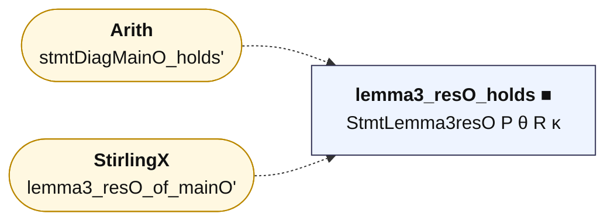

# `lean_stage3/Stage3/Lemma3.lean`

> **Read from the source text.** This file changed after the last `python3 utilities/lean_map.py --dump`, so the arrows on this page are names occurring in each proof and have not been confirmed by Lean.

# Lemma3 — block S12 of `lean_stage3/design/stencil.md`: Young's Lemma 3 with o(T) error, unconditional. 2026-11-25.

1 theorem, 0 definitions, 35 lines. 

**Imports:** [`Arith`](../lean_stage3/Arith.md), [`StirlingX`](../lean_stage3/StirlingX.md)  
**Imported by:** [`Stage3`](../lean_stage3/Stage3.md)

## The picture



An arrow A → B reads "A is used in the proof of B". Green: counting, integers only. Violet: shape, analysis with no ζ. Blue: reads ζ. A name ending in ■ is an end: nothing else uses it. Red: contains `sorry`. Yellow: theorems in another file, counted; a dotted arrow crosses files. Definitions are not drawn; they are listed below the diagram.

## Theorems

<a name="Lemma3-lemma3_resO_holds"></a>
### `Lemma3.lemma3_resO_holds`

line 26 · arrows read from text

**Reads ζ.** It, or something it rests on, uses the zeta function, its zeros or the Riemann hypothesis.

**Why.** Young's Lemma 3 at o(T), unconditional.

**Proves**

```lean
StmtLemma3resO P θ R κ
```

**Needs** (its hypotheses)

  - `` P : Polynomial ℝ ``
  - `` hP0 : P.eval 0 = 0 ``
  - `` hθ0 : 0 < θ ``
  - `` hθ : θ < 1 / 2 ``
  - `` R : ℝ ``
  - `` hκ : 0 < κ ``

**Fed by** (2 theorems its proof uses)

  - [`Arith.stmtDiagMainO_holds'`](../lean_stage3/Arith.md#Arith-stmtDiagMainO_holds-) (Arith) — `` StmtDiagMainO P θ R κ ``
  - [`Stirling.lemma3_resO_of_mainO'`](../lean_stage3/StirlingX.md#Stirling-lemma3_resO_of_mainO-) (StirlingX) — `` StmtLemma3resO P θ R κ ``

**Definitions its proof touches:** [`DiagonalO.StmtLemma3resO`](../lean_stage3/DiagonalO.md#DiagonalO-StmtLemma3resO)

**Feeds:** nothing. It is an end.

