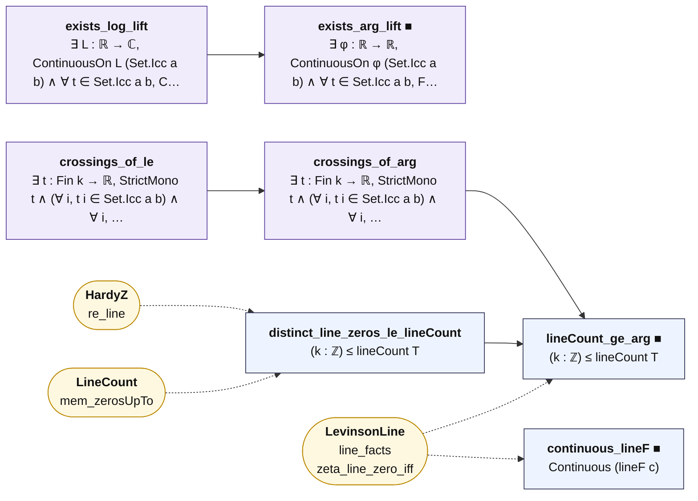

# `lean_stage3/Stage3/LevinsonArg.lean`

> **Read from the source text.** This file changed after the last `python3 utilities/lean_map.py --dump`, so the arrows on this page are names occurring in each proof and have not been confirmed by Lean.

LevinsonArg — block S11 of `lean_stage3/design/stencil.md`, step 1b. 2026-11-24.

7 theorems, 1 definition, 309 lines. 

**Imports:** [`LevinsonLine`](../lean_stage3/LevinsonLine.md), [`LineCount`](../lean_stage3/LineCount.md)  
**Imported by:** [`Stage3`](../lean_stage3/Stage3.md), [`LevinsonTurn`](../lean_stage3/LevinsonTurn.md)

## The picture



An arrow A → B reads "A is used in the proof of B". Green: counting, integers only. Violet: shape, analysis with no ζ. Blue: reads ζ. A name ending in ■ is an end: nothing else uses it. Red: contains `sorry`. Yellow: theorems in another file, counted; a dotted arrow crosses files. Definitions are not drawn; they are listed below the diagram.

## Definitions

<a name="LevinsonArg-lineF"></a>
### `LevinsonArg.lineF`

def · line 47

- **Is:** `` lineF (c : ℝ) (t : ℝ) : ℂ := Gammaℝ (1/2 + t * I) * (riemannZeta (1/2 + t * I) + c * deriv riemannZeta (1/2 + t * I)) ``
- **Used by 3:** [`LevinsonArg.continuous_lineF`](#LevinsonArg-continuous_lineF), [`LevinsonArg.lineCount_ge_arg`](#LevinsonArg-lineCount_ge_arg), [`LevinsonTurn.lineF_turn_eq`](../lean_stage3/LevinsonTurn.md#LevinsonTurn-lineF_turn_eq)

## Theorems

<a name="LevinsonArg-exists_log_lift"></a>
### `LevinsonArg.exists_log_lift`

line 53 · arrows read from text

**Shape.** Uses real or complex analysis; nothing in it or beneath it reads ζ.

**Why.** A continuous nonvanishing `F` on `[a, b]` has a continuous logarithm there.

**Proves**

```lean
∃ L : ℝ → ℂ, ContinuousOn L (Set.Icc a b) ∧ ∀ t ∈ Set.Icc a b, Complex.exp (L t) = F t
```

**Needs** (its hypotheses)

  - `` hab : a ≤ b ``
  - `` hc : ContinuousOn F (Set.Icc a b) ``
  - `` hne : ∀ t ∈ Set.Icc a b, F t ≠ 0 ``

**Fed by:** no theorem of this repo; it stands on Mathlib.

**Feeds** (1 that use it)

  - [`LevinsonArg.exists_arg_lift`](#LevinsonArg-exists_arg_lift) — `` ∃ φ : ℝ → ℝ, ContinuousOn φ (Set.Icc a b) ∧ ∀ t ∈ Set.Icc a b, F t = ‖F t‖ * Complex.exp (φ t * Complex.I) ``

<a name="LevinsonArg-exists_arg_lift"></a>
### `LevinsonArg.exists_arg_lift`

line 114 · arrows read from text

**Shape.** Uses real or complex analysis; nothing in it or beneath it reads ζ.

**Why.** Target 1. A continuous nonvanishing `F` on `[a, b]` has a continuous argument there: `F t = ‖F t‖ · exp(i φ t)`.

**Proves**

```lean
∃ φ : ℝ → ℝ, ContinuousOn φ (Set.Icc a b) ∧ ∀ t ∈ Set.Icc a b, F t = ‖F t‖ * Complex.exp (φ t * Complex.I)
```

**Needs** (its hypotheses)

  - `` hab : a ≤ b ``
  - `` hc : ContinuousOn F (Set.Icc a b) ``
  - `` hne : ∀ t ∈ Set.Icc a b, F t ≠ 0 ``

**Fed by** (1 theorem its proof uses)

  - [`LevinsonArg.exists_log_lift`](#LevinsonArg-exists_log_lift) — `` ∃ L : ℝ → ℂ, ContinuousOn L (Set.Icc a b) ∧ ∀ t ∈ Set.Icc a b, Complex.exp (L t) = F t ``

**Feeds:** nothing. It is an end.

<a name="LevinsonArg-crossings_of_le"></a>
### `LevinsonArg.crossings_of_le`

line 126 · arrows read from text

**Shape.** Uses real or complex analysis; nothing in it or beneath it reads ζ.

**Why.** The increasing case of `crossings_of_arg`.

**Proves**

```lean
∃ t : Fin k → ℝ, StrictMono t ∧ (∀ i, t i ∈ Set.Icc a b) ∧ ∀ i, Real.cos (φ (t i)) = 0
```

**Needs** (its hypotheses)

  - `` hab : a ≤ b ``
  - `` hc : ContinuousOn φ (Set.Icc a b) ``
  - `` k : ℕ ``
  - `` hk : (k : ℝ) * Real.pi ≤ φ b - φ a ``

**Fed by:** no theorem of this repo; it stands on Mathlib.

**Feeds** (1 that use it)

  - [`LevinsonArg.crossings_of_arg`](#LevinsonArg-crossings_of_arg) — `` ∃ t : Fin k → ℝ, StrictMono t ∧ (∀ i, t i ∈ Set.Icc a b) ∧ ∀ i, Real.cos (φ (t i)) = 0 ``

<a name="LevinsonArg-crossings_of_arg"></a>
### `LevinsonArg.crossings_of_arg`

line 193 · arrows read from text

**Shape.** Uses real or complex analysis; nothing in it or beneath it reads ζ.

**Why.** Target 2. If a continuous `φ` moves by at least `kπ` across `[a, b]`, then `cos φ` vanishes at `k` strictly increasing points of `[a, b]`.

**Proves**

```lean
∃ t : Fin k → ℝ, StrictMono t ∧ (∀ i, t i ∈ Set.Icc a b) ∧ ∀ i, Real.cos (φ (t i)) = 0
```

**Needs** (its hypotheses)

  - `` hab : a ≤ b ``
  - `` hc : ContinuousOn φ (Set.Icc a b) ``
  - `` k : ℕ ``
  - `` hk : (k : ℝ) * Real.pi ≤ |φ b - φ a| ``

**Fed by** (1 theorem its proof uses)

  - [`LevinsonArg.crossings_of_le`](#LevinsonArg-crossings_of_le) — `` ∃ t : Fin k → ℝ, StrictMono t ∧ (∀ i, t i ∈ Set.Icc a b) ∧ ∀ i, Real.cos (φ (t i)) = 0 ``

**Feeds** (1 that use it)

  - [`LevinsonArg.lineCount_ge_arg`](#LevinsonArg-lineCount_ge_arg) — `` (k : ℤ) ≤ lineCount T ``

<a name="LevinsonArg-continuous_lineF"></a>
### `LevinsonArg.continuous_lineF`

line 210 · arrows read from text

**Reads ζ.** It, or something it rests on, uses the zeta function, its zeros or the Riemann hypothesis.

**Why.** Levinson's function is continuous on the line.

**Proves**

```lean
Continuous (lineF c)
```

**Needs** (its hypotheses)

  - `` c : ℝ ``

**Fed by** (1 theorem its proof uses)

  - [`LevinsonLine.line_facts`](../lean_stage3/LevinsonLine.md#LevinsonLine-line_facts) (LevinsonLine) — `` ((1/2 : ℂ) + t * I) ≠ 0 ∧ ((1/2 : ℂ) + t * I) ≠ 1 ∧ 0 < ((1/2 : ℂ) + t * I).re ``

**Definitions its proof touches:** [`LevinsonArg.lineF`](#LevinsonArg-lineF)

**Feeds:** nothing. It is an end.

<a name="LevinsonArg-distinct_line_zeros_le_lineCount"></a>
### `LevinsonArg.distinct_line_zeros_le_lineCount`

line 234 · arrows read from text

**Reads ζ.** It, or something it rests on, uses the zeta function, its zeros or the Riemann hypothesis.

**Why.** `k` distinct heights in `(0, T]` carrying zeros of `ζ` on the line give at least `k` zeros on the line up to height `T`, with multiplicity (the counting step of `LineCount.signChanges_le_line_count`, re-proved for an injective family).

**Proves**

```lean
(k : ℤ) ≤ lineCount T
```

**Needs** (its hypotheses)

  - `` γ : Fin k → ℝ ``
  - `` hinj : Function.Injective γ ``
  - `` hpos : ∀ i, 0 < γ i ``
  - `` hT : ∀ i, γ i ≤ T ``
  - `` hζ : ∀ i, riemannZeta (1/2 + γ i * I) = 0 ``

**Fed by** (2 theorems its proof uses)

  - [`HardyZ.re_line`](../lean_stage3/HardyZ.md#HardyZ-re_line) (HardyZ) — `` ((1 / 2 : ℂ) + t * I).re = 1 / 2 ``
  - [`LineCount.mem_zerosUpTo`](../lean_stage3/LineCount.md#LineCount-mem_zerosUpTo) (LineCount) — `` ρ ∈ zerosUpTo T ↔ 0 < (ρ : ℂ).im ∧ (ρ : ℂ).im ≤ T ``

**Definitions its proof touches:** [`LineCount.lineCount`](../lean_stage3/LineCount.md#LineCount-lineCount), [`LineCount.zerosUpTo`](../lean_stage3/LineCount.md#LineCount-zerosUpTo)

**Feeds** (1 that use it)

  - [`LevinsonArg.lineCount_ge_arg`](#LevinsonArg-lineCount_ge_arg) — `` (k : ℤ) ≤ lineCount T ``

<a name="LevinsonArg-lineCount_ge_arg"></a>
### `LevinsonArg.lineCount_ge_arg`

line 274 · arrows read from text

**Reads ζ.** It, or something it rests on, uses the zeta function, its zeros or the Riemann hypothesis.

**Why.** Target 3. If a continuous argument `φ` of `Gammaℝ · (ζ + c ζ')` along `[1/2 + a i, 1/2 + b i]` moves by at least `kπ`, and the real factor `1 − c · Re(Gammaℝ'/Gammaℝ)` does not vanish there, then at least `k` zeros of `ζ` lie on the line up to height `T ≥ b`, with multiplicity.

**Proves**

```lean
(k : ℤ) ≤ lineCount T
```

**Needs** (its hypotheses)

  - `` ha : 0 < a ``
  - `` hab : a ≤ b ``
  - `` hbT : b ≤ T ``
  - `` hfac : ∀ t ∈ Set.Icc a b, 1 - c * (deriv Gammaℝ (1/2 + t * I) / Gammaℝ (1/2 + t * I)).re ≠ 0 ``
  - `` hφc : ContinuousOn φ (Set.Icc a b) ``
  - `` hφ : ∀ t ∈ Set.Icc a b, lineF c t = ‖lineF c t‖ * Complex.exp (φ t * Complex.I) ``
  - `` hk : (k : ℝ) * Real.pi ≤ |φ b - φ a| ``

**Fed by** (3 theorems its proof uses)

  - [`LevinsonArg.crossings_of_arg`](#LevinsonArg-crossings_of_arg) — `` ∃ t : Fin k → ℝ, StrictMono t ∧ (∀ i, t i ∈ Set.Icc a b) ∧ ∀ i, Real.cos (φ (t i)) = 0 ``
  - [`LevinsonArg.distinct_line_zeros_le_lineCount`](#LevinsonArg-distinct_line_zeros_le_lineCount) — `` (k : ℤ) ≤ lineCount T ``
  - [`LevinsonLine.zeta_line_zero_iff`](../lean_stage3/LevinsonLine.md#LevinsonLine-zeta_line_zero_iff) (LevinsonLine) — `` riemannZeta (1/2 + t * I) = 0 ↔ (Gammaℝ (1/2 + t * I) * (riemannZeta (1/2 + t * I) + c * deriv riemannZeta (1/2 + t * I))).re = 0 ``

**Definitions its proof touches:** [`LevinsonArg.lineF`](#LevinsonArg-lineF), [`LineCount.lineCount`](../lean_stage3/LineCount.md#LineCount-lineCount)

**Feeds:** nothing. It is an end.

