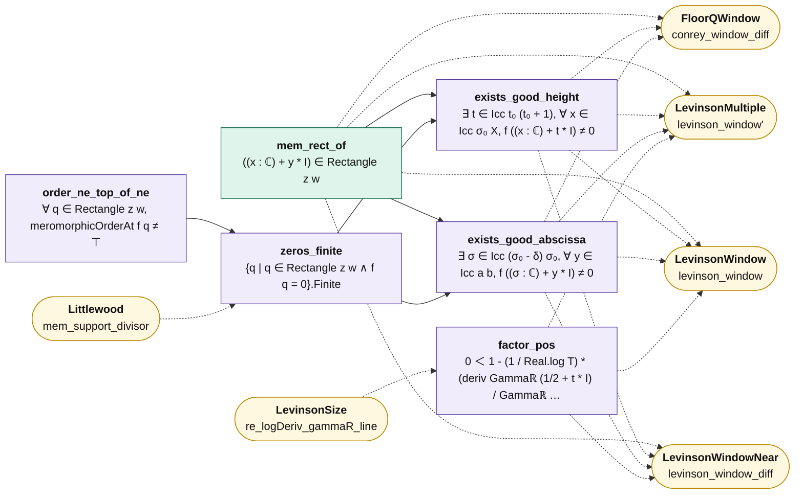

# `lean_stage3/Stage3/LevinsonAvoid.lean`

> **Read from the source text.** This file changed after the last `python3 utilities/lean_map.py --dump`, so the arrows on this page are names occurring in each proof and have not been confirmed by Lean.

LevinsonAvoid — block S11 of `lean_stage3/design/stencil.md`, avoidance. 2026-11-25.

6 theorems, 0 definitions, 155 lines. 

**Imports:** [`LevinsonSize`](../lean_stage3/LevinsonSize.md), [`Littlewood`](../lean_stage3/Littlewood.md)  
**Imported by:** [`Stage3`](../lean_stage3/Stage3.md), [`LevinsonWindow`](../lean_stage3/LevinsonWindow.md)

## The picture



An arrow A → B reads "A is used in the proof of B". Green: counting, integers only. Violet: shape, analysis with no ζ. Blue: reads ζ. A name ending in ■ is an end: nothing else uses it. Red: contains `sorry`. Yellow: theorems in another file, counted; a dotted arrow crosses files. Definitions are not drawn; they are listed below the diagram.

## Theorems

<a name="LevinsonAvoid-mem_rect_of"></a>
### `LevinsonAvoid.mem_rect_of`

line 38 · arrows read from text

**Counting.** Integers only: nothing in its statement or proof, or in anything it rests on, uses analysis or ζ.

**Why.** A point `x + y i` with `x`, `y` between the corners' parts lies in the rectangle.

**Proves**

```lean
((x : ℂ) + y * I) ∈ Rectangle z w
```

**Needs** (its hypotheses)

  - `` hx : x ∈ [[z.re, w.re]] ``
  - `` hy : y ∈ [[z.im, w.im]] ``

**Fed by:** no theorem of this repo; it stands on Mathlib.

**Feeds** (6 that use it)

  - [`FloorQ.conrey_window_diff`](../lean_stage3/FloorQWindow.md#FloorQ-conrey_window_diff) (FloorQWindow) — `` (riemannZeta.N b - riemannZeta.N a) - (1 / (Real.pi * (1 / 2 - σ₀))) * ((b - a) / 2 * Real.log K + windowEQ δR Mf X a b) - (Ec + 62 * Real.log T + 250… ``
  - [`LevinsonAvoid.exists_good_abscissa`](#LevinsonAvoid-exists_good_abscissa) — `` ∃ σ ∈ Icc (σ₀ - δ) σ₀, ∀ y ∈ Icc a b, f ((σ : ℂ) + y * I) ≠ 0 ``
  - [`LevinsonAvoid.exists_good_height`](#LevinsonAvoid-exists_good_height) — `` ∃ t ∈ Icc t₀ (t₀ + 1), ∀ x ∈ Icc σ₀ X, f ((x : ℂ) + t * I) ≠ 0 ``
  - [`LevinsonMultiple.levinson_window'`](../lean_stage3/LevinsonMultiple.md#LevinsonMultiple-levinson_window-) (LevinsonMultiple) — `` (riemannZeta.N b - riemannZeta.N a) - (1 / (Real.pi * (1 / 2 - σ₀))) * ((b - a) / 2 * Real.log K + windowE M B X T a b) - (134 * Real.log T + 2918) ≤ … ``
  - [`LevinsonWindow.levinson_window`](../lean_stage3/LevinsonWindow.md#LevinsonWindow-levinson_window) (LevinsonWindow) — `` (riemannZeta.N b - riemannZeta.N a) - (1 / (Real.pi * (1 / 2 - σ₀))) * ((b - a) / 2 * Real.log K + windowE M B X T a b) - (134 * Real.log T + 2918) ≤ … ``
  - [`LevinsonWindowNear.levinson_window_diff`](../lean_stage3/LevinsonWindowNear.md#LevinsonWindowNear-levinson_window_diff) (LevinsonWindowNear) — `` (riemannZeta.N b - riemannZeta.N a) - (1 / (Real.pi * (1 / 2 - σ₀))) * ((b - a) / 2 * Real.log K + windowE M B X T a b) - (134 * Real.log T + 2918) ≤ … ``

<a name="LevinsonAvoid-order_ne_top_of_ne"></a>
### `LevinsonAvoid.order_ne_top_of_ne`

line 47 · arrows read from text

**Shape.** Uses real or complex analysis; nothing in it or beneath it reads ζ.

**Why.** Isolated zeros: analytic near a rectangle and nonzero at one point of it, the order is finite at every point of it.

**Proves**

```lean
∀ q ∈ Rectangle z w, meromorphicOrderAt f q ≠ ⊤
```

**Needs** (its hypotheses)

  - `` hf : AnalyticOnNhd ℂ f (Rectangle z w) ``
  - `` hp : p ∈ Rectangle z w ``
  - `` hfp : f p ≠ 0 ``

**Fed by:** no theorem of this repo; it stands on Mathlib.

**Feeds** (1 that use it)

  - [`LevinsonAvoid.zeros_finite`](#LevinsonAvoid-zeros_finite) — `` {q | q ∈ Rectangle z w ∧ f q = 0}.Finite ``

<a name="LevinsonAvoid-zeros_finite"></a>
### `LevinsonAvoid.zeros_finite`

line 63 · arrows read from text

**Shape.** Uses real or complex analysis; nothing in it or beneath it reads ζ.

**Why.** The zeros in the rectangle are finitely many.

**Proves**

```lean
{q | q ∈ Rectangle z w ∧ f q = 0}.Finite
```

**Needs** (its hypotheses)

  - `` hf : AnalyticOnNhd ℂ f (Rectangle z w) ``
  - `` hp : p ∈ Rectangle z w ``
  - `` hfp : f p ≠ 0 ``

**Fed by** (2 theorems its proof uses)

  - [`LevinsonAvoid.order_ne_top_of_ne`](#LevinsonAvoid-order_ne_top_of_ne) — `` ∀ q ∈ Rectangle z w, meromorphicOrderAt f q ≠ ⊤ ``
  - [`Littlewood.mem_support_divisor`](../lean_stage3/Littlewood.md#Littlewood-mem_support_divisor) (Littlewood) — `` p ∈ (MeromorphicOn.divisor f U).support ↔ p ∈ U ∧ f p = 0 ``

**Feeds** (2 that use it)

  - [`LevinsonAvoid.exists_good_abscissa`](#LevinsonAvoid-exists_good_abscissa) — `` ∃ σ ∈ Icc (σ₀ - δ) σ₀, ∀ y ∈ Icc a b, f ((σ : ℂ) + y * I) ≠ 0 ``
  - [`LevinsonAvoid.exists_good_height`](#LevinsonAvoid-exists_good_height) — `` ∃ t ∈ Icc t₀ (t₀ + 1), ∀ x ∈ Icc σ₀ X, f ((x : ℂ) + t * I) ≠ 0 ``

<a name="LevinsonAvoid-exists_good_height"></a>
### `LevinsonAvoid.exists_good_height`

line 73 · arrows read from text

**Shape.** Uses real or complex analysis; nothing in it or beneath it reads ζ.

**Why.** A good height. Analytic near `[σ₀, X] × [t₀, t₀ + 1]` and not identically zero there, some height `t ∈ [t₀, t₀ + 1]` has no zero on the horizontal segment `[σ₀, X] + t i`.

**Proves**

```lean
∃ t ∈ Icc t₀ (t₀ + 1), ∀ x ∈ Icc σ₀ X, f ((x : ℂ) + t * I) ≠ 0
```

**Needs** (its hypotheses)

  - `` hf : AnalyticOnNhd ℂ f (Rectangle ((σ₀ : ℂ) + t₀ * I) ((X : ℂ) + (t₀ + 1 : ℝ) * I)) ``
  - `` hne : ∃ p ∈ Rectangle ((σ₀ : ℂ) + t₀ * I) ((X : ℂ) + (t₀ + 1 : ℝ) * I), f p ≠ 0 ``

**Fed by** (2 theorems its proof uses)

  - [`LevinsonAvoid.mem_rect_of`](#LevinsonAvoid-mem_rect_of) — `` ((x : ℂ) + y * I) ∈ Rectangle z w ``
  - [`LevinsonAvoid.zeros_finite`](#LevinsonAvoid-zeros_finite) — `` {q | q ∈ Rectangle z w ∧ f q = 0}.Finite ``

**Feeds** (4 that use it)

  - [`FloorQ.conrey_window_diff`](../lean_stage3/FloorQWindow.md#FloorQ-conrey_window_diff) (FloorQWindow) — `` (riemannZeta.N b - riemannZeta.N a) - (1 / (Real.pi * (1 / 2 - σ₀))) * ((b - a) / 2 * Real.log K + windowEQ δR Mf X a b) - (Ec + 62 * Real.log T + 250… ``
  - [`LevinsonMultiple.levinson_window'`](../lean_stage3/LevinsonMultiple.md#LevinsonMultiple-levinson_window-) (LevinsonMultiple) — `` (riemannZeta.N b - riemannZeta.N a) - (1 / (Real.pi * (1 / 2 - σ₀))) * ((b - a) / 2 * Real.log K + windowE M B X T a b) - (134 * Real.log T + 2918) ≤ … ``
  - [`LevinsonWindow.levinson_window`](../lean_stage3/LevinsonWindow.md#LevinsonWindow-levinson_window) (LevinsonWindow) — `` (riemannZeta.N b - riemannZeta.N a) - (1 / (Real.pi * (1 / 2 - σ₀))) * ((b - a) / 2 * Real.log K + windowE M B X T a b) - (134 * Real.log T + 2918) ≤ … ``
  - [`LevinsonWindowNear.levinson_window_diff`](../lean_stage3/LevinsonWindowNear.md#LevinsonWindowNear-levinson_window_diff) (LevinsonWindowNear) — `` (riemannZeta.N b - riemannZeta.N a) - (1 / (Real.pi * (1 / 2 - σ₀))) * ((b - a) / 2 * Real.log K + windowE M B X T a b) - (134 * Real.log T + 2918) ≤ … ``

<a name="LevinsonAvoid-exists_good_abscissa"></a>
### `LevinsonAvoid.exists_good_abscissa`

line 92 · arrows read from text

**Shape.** Uses real or complex analysis; nothing in it or beneath it reads ζ.

**Why.** A good abscissa. Analytic near `[σ₀ − δ, X] × [a, b]`, `δ > 0`, `σ₀ ≤ X`, and not identically zero there, some `σ ∈ [σ₀ − δ, σ₀]` has no zero on the vertical segment `σ + [a, b] i`.

**Proves**

```lean
∃ σ ∈ Icc (σ₀ - δ) σ₀, ∀ y ∈ Icc a b, f ((σ : ℂ) + y * I) ≠ 0
```

**Needs** (its hypotheses)

  - `` hδ : 0 < δ ``
  - `` hX : σ₀ ≤ X ``
  - `` hf : AnalyticOnNhd ℂ f (Rectangle (((σ₀ - δ : ℝ) : ℂ) + a * I) ((X : ℂ) + b * I)) ``
  - `` hne : ∃ p ∈ Rectangle (((σ₀ - δ : ℝ) : ℂ) + a * I) ((X : ℂ) + b * I), f p ≠ 0 ``

**Fed by** (2 theorems its proof uses)

  - [`LevinsonAvoid.mem_rect_of`](#LevinsonAvoid-mem_rect_of) — `` ((x : ℂ) + y * I) ∈ Rectangle z w ``
  - [`LevinsonAvoid.zeros_finite`](#LevinsonAvoid-zeros_finite) — `` {q | q ∈ Rectangle z w ∧ f q = 0}.Finite ``

**Feeds** (4 that use it)

  - [`FloorQ.conrey_window_diff`](../lean_stage3/FloorQWindow.md#FloorQ-conrey_window_diff) (FloorQWindow) — `` (riemannZeta.N b - riemannZeta.N a) - (1 / (Real.pi * (1 / 2 - σ₀))) * ((b - a) / 2 * Real.log K + windowEQ δR Mf X a b) - (Ec + 62 * Real.log T + 250… ``
  - [`LevinsonMultiple.levinson_window'`](../lean_stage3/LevinsonMultiple.md#LevinsonMultiple-levinson_window-) (LevinsonMultiple) — `` (riemannZeta.N b - riemannZeta.N a) - (1 / (Real.pi * (1 / 2 - σ₀))) * ((b - a) / 2 * Real.log K + windowE M B X T a b) - (134 * Real.log T + 2918) ≤ … ``
  - [`LevinsonWindow.levinson_window`](../lean_stage3/LevinsonWindow.md#LevinsonWindow-levinson_window) (LevinsonWindow) — `` (riemannZeta.N b - riemannZeta.N a) - (1 / (Real.pi * (1 / 2 - σ₀))) * ((b - a) / 2 * Real.log K + windowE M B X T a b) - (134 * Real.log T + 2918) ≤ … ``
  - [`LevinsonWindowNear.levinson_window_diff`](../lean_stage3/LevinsonWindowNear.md#LevinsonWindowNear-levinson_window_diff) (LevinsonWindowNear) — `` (riemannZeta.N b - riemannZeta.N a) - (1 / (Real.pi * (1 / 2 - σ₀))) * ((b - a) / 2 * Real.log K + windowE M B X T a b) - (134 * Real.log T + 2918) ≤ … ``

<a name="LevinsonAvoid-factor_pos"></a>
### `LevinsonAvoid.factor_pos`

line 111 · arrows read from text

**Shape.** Uses real or complex analysis; nothing in it or beneath it reads ζ.

**Why.** The real factor is positive. For `T ≥ e^26`, `c = 1/log T` and `4 ≤ t ≤ T`, `1 − c · Re(Gammaℝ'/Gammaℝ)(1/2 + t i) > 0`.

**Proves**

```lean
0 < 1 - (1 / Real.log T) * (deriv Gammaℝ (1/2 + t * I) / Gammaℝ (1/2 + t * I)).re
```

**Needs** (its hypotheses)

  - `` hT : Real.exp 26 ≤ T ``
  - `` ht : t ∈ Icc 4 T ``

**Fed by** (1 theorem its proof uses)

  - [`LevinsonSize.re_logDeriv_gammaR_line`](../lean_stage3/LevinsonSize.md#LevinsonSize-re_logDeriv_gammaR_line) (LevinsonSize) — `` (logDeriv Gammaℝ (1/2 + y * I)).re = -(Real.log Real.pi) / 2 + Stage3.phasePoint y / 2 ``

**Definitions its proof touches:** [`Stage3.phasePoint`](../lean_stage3/Stirling.md#Stage3-phasePoint)

**Feeds** (3 that use it)

  - [`LevinsonMultiple.levinson_window'`](../lean_stage3/LevinsonMultiple.md#LevinsonMultiple-levinson_window-) (LevinsonMultiple) — `` (riemannZeta.N b - riemannZeta.N a) - (1 / (Real.pi * (1 / 2 - σ₀))) * ((b - a) / 2 * Real.log K + windowE M B X T a b) - (134 * Real.log T + 2918) ≤ … ``
  - [`LevinsonWindow.levinson_window`](../lean_stage3/LevinsonWindow.md#LevinsonWindow-levinson_window) (LevinsonWindow) — `` (riemannZeta.N b - riemannZeta.N a) - (1 / (Real.pi * (1 / 2 - σ₀))) * ((b - a) / 2 * Real.log K + windowE M B X T a b) - (134 * Real.log T + 2918) ≤ … ``
  - [`LevinsonWindowNear.levinson_window_diff`](../lean_stage3/LevinsonWindowNear.md#LevinsonWindowNear-levinson_window_diff) (LevinsonWindowNear) — `` (riemannZeta.N b - riemannZeta.N a) - (1 / (Real.pi * (1 / 2 - σ₀))) * ((b - a) / 2 * Real.log K + windowE M B X T a b) - (134 * Real.log T + 2918) ≤ … ``

